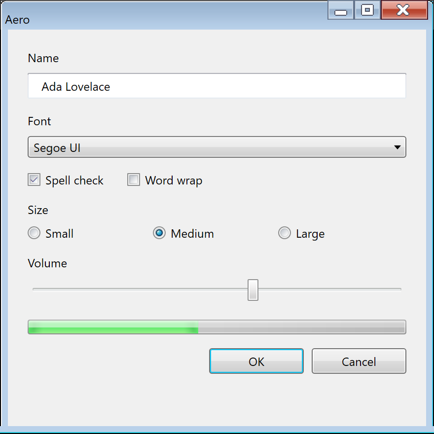

# Aero

Windows Vista and 7, 2006 to 2012; Win32, WPF and WinForms. The two releases share one look.
Where they differ, this page gives both values; everywhere else the value holds for both.

Aero is remembered for its glass window frames, but the part a control framework draws is much
quieter: glossy gray controls that only turn blue when you touch them, Segoe UI 9 pt, white
content over a light gray dialog face, and a blue main instruction. This page covers that part in
detail and explains why glass cannot be rebuilt in a client area today.

!!! note "Two Implementations, One Look"
    The era shipped its look twice. The Win32 look lives in `aero.msstyles`, a compiled bitmap
    archive whose authoring schema, `AeroStyle.xml`, ships in the Vista and Windows 7 SDKs. It
    states system colors, fonts, metrics, the text-style ramp and one-color *hints* per part,
    but no gradients. WPF's `PresentationFramework.Aero` is Microsoft's own vector re-creation of
    the same look, published as MIT source, and it is the only place the drawn gradients, radii
    and timings exist as numbers.[^wpf] Most tables below take colors and metrics from
    `AeroStyle.xml` and drawn surfaces from WPF, and say which is which.

## Principles

### The Name and the Two Principle Sets

Aero has one name and two sets of principles, one for each end of the era. The name is a
backronym, stated the same way in the Vista-era guideline pages and in the 2010 guide: *"Aero
stands for: authentic, energetic, reflective, and open."*[^uxguide] Neither document defines the
four words one by one.

Vista's guidelines framed the design as twelve **Top Rules**.[^msdn-vista] They are concrete and
prescriptive, and several of them become pixels directly:

| Rule | Heading | What it means on screen |
| --- | --- | --- |
| 1 | Use the Aero theme and system font (Segoe UI) | *"Don't use fixed values for fonts, sizes, or colors."* Everything comes from the theme. |
| 3 | Use the standard window frame, use glass judiciously | *"Glass is best used on small regions without text or interactive UI."* |
| 4 | Use icons consistent with the Windows Vista style | Up to 256 x 256 in Explorer, toolbar icons capped at 24 x 24 |
| 10 | Clean up the UI | *"Remove borders, separator lines, boxes, and other visual 'noise'"*; show detail on hover |
| 12 | Reserve time for "fit and finish" | Pixel-level alignment and spacing passes |

Windows 7's guide replaced the rules with eight **design principles**, headed by *"Reduce concepts
to increase confidence"* and *"Small things matter, good and bad"*. They are process questions
rather than visual rules, and they only exist in the printed guide (pages 4 and 5).[^uxguide]

### What Aero Is Not

The strongest rules in both sets are subtractive. They matter as much for a re-creation as the
positive ones, because each one is a thing a theme could easily get wrong.

| Aero is not | Evidence |
| --- | --- |
| Glass everywhere | *"Using glass in your application is not something everyone should do."* Glass is the frame plus small text-free regions touching it. |
| Custom-drawn chrome | *"Don't create your own nonstandard window frame by drawing in the non-client window region."* |
| Colorful text | *"Use blue text only for links and main instructions."* |
| Shadowed | Shadows only for *"your program's most significant content or objects being dragged"*, otherwise *"visual clutter"*. |
| Mandatory | Group Policy can force Windows Classic and switch off composition. Every Aero trait has to degrade. |
| A light/dark pair | `AeroStyle.xml` has one set of system colors. The only alternatives are the High Contrast schemes. |

### The Mechanical Design DNA

Put together, the rules reduce to a short list a renderer has to reproduce:

- Controls are **neutral gray at rest**. Blue means interaction: hover, press, the default button
  and selection. Nothing else is blue except links and the main instruction.
- Surfaces are **glossy**: a face gradient split hard at 50 %, a 1 px dark border and a 1 px white
  inner ring, with small 2 to 3 px corners.
- **Segoe UI 9 pt** with ClearType for every system font, including the caption.
- A **text-style ramp with color**: the 12 pt `#003399` main instruction is as recognizable as the
  glass.
- **No accent.** The user's glass color tinted the frame, taskbar and Start menu, never a
  control.

### The Tiers

The same `aero.msstyles` drove several rendering tiers, and the difference between them matters
for what a theme draws:

| Tier | Visual styles | Composition | What changes |
| --- | --- | --- | --- |
| Aero Glass | on | on | Translucent, blurred frame; live thumbnails, Flip3D |
| Windows 7 Basic (Vista's non-composited mode) | on | off | Opaque frame. Same `aero.msstyles` with `Composition=0` |
| Windows Classic | off | n/a | System colors only, the Windows 2000 look |
| High Contrast | off | n/a | Classic construction in the contrast scheme |

Glass and Basic differ **only in the frame**. Client-area controls look identical in both, which
is the single most useful fact for a control framework: an opaque page is what the era's own
client area drew.[^themefile]

## Foundations

### Color

The Aero system colors are one fixed light palette. Vista and 7 agree on every slot except one,
`GrayText`.[^aerostyle]

| Slot | `COLOR_*` | Value | Notes |
| --- | --- | --- | --- |
| `Window` | `COLOR_WINDOW` | `#FFFFFF` | Content areas, fields |
| `WindowText` | `COLOR_WINDOWTEXT` | `#000000` | |
| `Btnface` | `COLOR_BTNFACE` | `#F0F0F0` | Dialog face and command band; `Menu` and `MenuBar` alias it |
| `BtnHighlight` / `Light3d` | `COLOR_3DHIGHLIGHT` / `COLOR_3DLIGHT` | `#FFFFFF` / `#E3E3E3` | Classic-tier bevel only |
| `BtnShadow` / `DkShadow3d` | `COLOR_3DSHADOW` / `COLOR_3DDKSHADOW` | `#A0A0A0` / `#696969` | Classic-tier bevel only |
| `GrayText` | `COLOR_GRAYTEXT` | `#808080` (Vista), `#6D6D6D` (7) | The one system-color change between the two |
| `Highlight` | `COLOR_HIGHLIGHT` | `#3399FF` | Selection, with white `HighlightText` |
| `HotTracking` | `COLOR_HOTLIGHT` | `#0066CC` | Links |
| `InfoBk` / `InfoText` | `COLOR_INFOBK` / `COLOR_INFOTEXT` | `#FFFFE1` / `#000000` | The **Classic** tooltip only |
| `ActiveCaption` → `GradientActiveCaption` | | `#99B4D1` → `#B9D1EA` | Basic and Classic captions |
| `InactiveCaption` → `GradientInactiveCaption` | | `#BFCDDB` → `#D7E4F2` | |
| `WindowFrame` | `COLOR_WINDOWFRAME` | `#646464` | |
| `Scrollbar` | `COLOR_SCROLLBAR` | `#C8C8C8` | |

`GrayText` darkening from `#808080` to `#6D6D6D` raises disabled text on white from about 3.95:1
to 5.17:1 (derived with the WCAG formula; the era states no reason and no contrast ratio).

The text colors are real values in the `TEXTSTYLE` class, and they carry most of the era's
identity:

| Role | Color | Size |
| --- | --- | --- |
| Main instruction | `#003399` | Segoe UI 12 pt (16 px) |
| Instruction | `#003399` | 9 pt |
| Body title | `#000000` | 9 pt Bold |
| Body, secondary, label | `#000000` | 9 pt |
| Hyperlink | `#0066CC`; hot and pressed `#3399FF` underlined; disabled `#7E859C` | 9 pt |
| Control label (wizard and Control Panel buttons) | `#0066CC` | 9 pt |
| Tooltip and flyout body | `#575757` | 9 pt |
| Control Panel navigation link (Windows 7) | `#151C55`; hot `#074AE5` | 9 pt, Bold for the current page |

Two warnings about the per-part values. First, `AeroStyle.xml` gives most controls only as
`FillColorHint`/`BorderColorHint`/`AccentColorHint`: one color that summarizes a bitmap so a
custom control can blend in. The push button's hints are fill `#F4F4F4`, border `#8E8F8F` and
default accent `#04CCFF`, but the drawn button is a four-stop gradient. Second, the current
Windows 11 `Aero.msstyles` still returns 309 of 319 comparable `AeroStyle.xml` values while
drawing flat Windows 8 buttons. The hints were never updated when the bitmaps were redrawn, so a
button sampled from a current Windows install is never an Aero reference.

The drawn surfaces share a small set of color families, all from WPF:

| Family | Values | Used by |
| --- | --- | --- |
| Rest face | `#F3F3F3` `#EBEBEB` ‖ `#DDDDDD` `#CDCDCD` | Button, tab, drop-down list |
| Hover fill | `#EAF6FD` `#D9F0FC` ‖ `#BEE6FD` `#A7D9F5` | Button, tab |
| Hover border | `#3C7FB1` | Button, check box, radio, scroll thumb, slider thumb, tab |
| Pressed fill | `#C2E4F6` ‖ `#ABDAF3` `#90CBEB` | Button, check box and radio overlay |
| Pressed border | `#2C628B` | Button, check box, radio, slider |
| Disabled | fill `#F4F4F4`, border `#ADB2B5` | Every WPF chrome |
| Neutral borders | `#707070` button, `#8E8F8F` check box, `#ABADB3` field, `#828790` list, `#767676` tooltip, `#959595` menu and scroll thumb | |

`‖` marks a hard stop: two stops at the same offset.

**Aero has no accent.** `DwmGetColorizationColor` returns the glass color, and the DWM
documentation describes it as *"the color of the non-client region"*.[^colorization] No control
color in `AeroStyle.xml` or in the WPF theme references it, so `Highlight` stays `#3399FF`
whatever the glass color is. The only first-party colorization value is Windows 7's default,
`0x6B74B8FC` (`#74B8FC` at about 42 % alpha), from the `.theme` file format documentation. A theme
that feeds the live OS accent into Aero controls is drawing Windows 10, not Aero.

The UX Guide also assigns color meanings, which are the natural source for severity colors:

| Hue | Meaning | Where Windows uses it |
| --- | --- | --- |
| Blue | Start, commit, information | Default buttons, links, main instructions, Help icons |
| Green | Go, safe | Normal progress, search-result URLs |
| Yellow | Warning, caution | Paused progress, warning icon |
| Red | Error, stop | Stopped progress, error and close icons |
| Glass, black, gray, white | Neutral | Frames, taskbar, normal text |

### Typography

Every system font in `AeroStyle.xml` is `Segoe UI, 9, Quality:ClearType`: caption, small caption,
menu, message box and status. That is **12 px at 96 DPI**, and the caption is Regular, not Bold.
The only larger sizes are 12 pt (16 px) for main instructions, 11 pt for list-view group headers
and 10 pt for flyout headers. Bold is the only weight besides Regular; the era has no Light or
Semibold.[^aerostyle]

| Metric | Value |
| --- | --- |
| UI font | Segoe UI 9 pt = 12 px, ClearType |
| Line height at 9 pt | 15 px (measured) |
| Dialog base units | 7 x 15 px (average character width x height) |
| 1 horizontal DLU | 1.75 px |
| 1 vertical DLU | 1.875 px |
| Main instruction | 12 pt = 16 px, `#003399` |
| Text on glass | Caption font, black, with a white glow of about 12 px |

Sentence-style capitalization became the rule with Vista, for everything but titles. The UX Guide
disagrees with `AeroStyle.xml` in three places (it prints the instruction as black and disabled
text as `#323232`, a value no theme file contains); for Win32-drawn text `AeroStyle.xml` wins.

Glass text is the one place Aero drops ClearType: subpixel rendering has no meaning over a
translucent surface, so text on glass is grayscale-antialiased with a glow, drawn through
`DrawThemeTextEx` with `DTT_GLOWSIZE` into a 32-bit buffer. On an extended glass frame a black GDI
pixel is fully transparent, which is why plain black GDI text on glass came out as illegible gray.

### Metrics

The UX Guide prints every size in both dialog units and pixels. There is a trap in it: the pixel
column was converted with the **8 pt Tahoma** factors (1.50 and 1.625 px per DLU), not the 9 pt
Segoe UI factors (1.75 and 1.875) printed on the same page. Under the Segoe UI factors a 50 x 14
DLU button would be 88 x 26 px; the table says 75 x 23, which is what shipped dialogs measure. Draw
the printed pixel values and do not re-derive them.[^uxguide]

| Control | Size |
| --- | --- |
| Command button | 75 x 23 px (visible 73 x 21, since Win32 buttons carry a 1 px transparent border) |
| Text box, combo box | 23 px high; each extra text line adds 16 px |
| Check box and radio row | 17 px high, glyph 13 x 13 |
| Static text line | 13 px |
| Slider | 24 px |
| Progress bar | 160 or 355 x 15 px |
| Command link | 41 px (one line) or 58 px (two lines) |
| Scroll bar | 17 px |
| Caption bar | 19 px (Vista), 21 px (7); padded border 4 px |
| Minimum target | 16 x 16 px (mouse), 23 x 23 px (touch), 40 x 40 px for frequent touch targets |

| Spacing | Pixels | DLU |
| --- | --- | --- |
| Dialog margin, unrelated controls | 11 | 7 |
| Related controls, button to button | 7 | 4 |
| Label to control, minimum between interactive controls | 5 | 3 |
| Non-interactive element to anything | 3 | 2 |
| Dependent-control indent | 18 | 12 |

A Vista dialog is a white **content area** above a `#F0F0F0` **command area**, separated by a 1 px
`#DFDFDF` line. The band is 40 px tall for one row of buttons, which are right-aligned in the
order OK/[Do it]/Yes, [Don't do it]/No, Cancel, Apply, Help. This split is what makes a
screenshot read as 2009, and it is application layout rather than theme data.

### Elevation and Shadow

Aero has **no elevation system**: no levels, no z tokens and no per-control shadow. It has three
unrelated depth mechanisms, and a control framework owns exactly one of them.

| Mechanism | Owner | Numbers |
| --- | --- | --- |
| Window shadow | DWM | Not stated anywhere, for active or inactive windows |
| Popup shadow (`CS_DROPSHADOW`) | USER32 | WPF's `SystemDropShadowChrome` gives the only numeric spec |
| Inner highlight ring and pressed inner shadow | The control artwork | See the button below |

The popup shadow is the popup's own rectangle displaced **+5, +5** and filled `#71000000` (44 %
black). The whole shadow lives inside that displaced rectangle: a solid center wrapped in a 5 px
fall-off band whose alpha multiplier steps 1, 0.743, 0.381, 0.124, 0.027, 0 at half-pixel
steps, with radial corners at the popup radius plus 5. Because the displacement equals the band
width, the top and left bands land under the popup, and what a user sees is a 5 px shadow down
the right and along the bottom. The source says its fall-off is *"based on the Win32 dropshadow
fall off"*. It goes under menus, submenus, tooltips, combo drop-downs and toolbar overflows, and
only when the system drop-shadow setting is on.[^classstyles]

### Motion

No Vista or 7 source states a single control transition duration. The mechanism is era (Vista's
`uxtheme` reads per-part `TMT_TRANSITIONDURATIONS` and plays them through buffered animation), but
the values in a current `aero.msstyles` are Windows 11 data. What does exist:

| Value | Source |
| --- | --- |
| Hover in 300 ms, hover out 200 ms, press 100 ms | WPF Aero `ButtonChrome` |
| Check box and radio press and check 300 ms | WPF Aero `BulletChrome` |
| Default button pulse: 0 → 1 by 0.5 s, hold to 0.75 s, → 0 by 2.0 s, repeating at 10 fps | WPF Aero |
| Most animations 100 to 300 ms, *"preferably"* 167 or 250 ms, starting within 50 ms | UX Guide |
| Win32 marquee progress step every 30 ms | `PBM_SETMARQUEE` documentation |
| WPF progress glow sweeps at 200 px/s, then pauses 1 s | WPF Aero `ProgressBar` |
| Busy cursor 18 frames x 50 ms, a 900 ms cycle | Measured on Windows 11's `aero_busy.ani`; not verified against Vista's copy |
| Menu and drop-down effects: switches (`SPI_GETMENUANIMATION`, `SPI_GETMENUFADE`, `SPI_GETCOMBOBOXANIMATION`) | Durations not stated beyond `AnimateWindow`'s *"typically 200 milliseconds"* |
| Windows 11 `TRANSITIONDURATIONS`: push button hover 225 ms, press 150 ms | Out of era, never an Aero value |

WPF's chrome animates only when client-area animation is on, the machine is on AC power and the
render tier is above 0. Every WPF slider state change is instant.

### Materials: Glass

Glass is Aero's only material, and it belongs to the compositor. An application never paints the
blur, the tint or the reflection. It marks where glass should show, with
`DwmExtendFrameIntoClientArea` (margins) or `DwmEnableBlurBehindWindow` (a region), keeps those
pixels at alpha 0, and `dwm.exe` does the rest in the user's colorization color. The blur radius,
tint weights, reflection texture and default opacity were never published. Windows 7 stores its
colorization as registry values (`ColorizationColor`, `ColorizationAfterglow` and three balance
weights) that no Microsoft document describes. The blend they feed (tint times color balance,
plus desaturated blur times afterglow times afterglow balance, plus blur times blur balance) is
known only from community reverse engineering of the DWM shader bytecode,[^dwmblur] so it is
not presented here as an era fact.

## Controls

Each table gives the drawn values. Unless a row says otherwise, gradients are vertical, top to
bottom, and come from WPF Aero.

### Push Button

The push button is four layers, outside in, and every other control follows its grammar.

| Layer | Value |
| --- | --- |
| Face | `#F3F3F3`@0 → `#EBEBEB`@0.5 ‖ `#DDDDDD`@0.5 → `#CDCDCD`@1 |
| Border | 1 px, radius 2.75, `#707070` |
| Inner ring | 1 px, inset 1.5 px, radius 1.75, `#FAFFFFFF` → `#85FFFFFF` |
| Label | Segoe UI 9 pt, black, ClearType |

| State | Face | Border | Extra |
| --- | --- | --- | --- |
| Normal | gray, split at 50 % | `#707070` | White inner ring |
| Hover | `#EAF6FD` → `#D9F0FC` ‖ `#BEE6FD` → `#A7D9F5` | `#3C7FB1` | |
| Pressed | `#C2E4F6` ‖ `#ABDAF3` → `#90CBEB` | `#2C628B` | Ring removed; 2 px `#80333333` → clear inner shadows on the left and top; **the label does not move** |
| Disabled | flat `#F4F4F4` | `#ADB2B5` | Ring kept, text `#ADADAD` |
| Default | normal face | `#707070` | Inner ring solid cyan `#F900CCFF` (Win32 hint `#04CCFF`); the hover overlay pulses over it on a 2 s loop |

The hard 50 % split is the signature. Two gradients meeting at a coincident stop are what make the
surface read as glossy rather than shaded, and one smooth ramp over the full height loses it. The
UX Guide's own Win32 screenshots measure `#707070` and `#F2F2F2` → `#EDEDED` ‖ `#DDDDDD` →
`#CFCFCF`, within one to four levels of WPF. The border is the one visible disagreement: WPF and
those screenshots draw `#707070`, the Win32 hint says `#8E8F8F`, and which one a real Vista drew is
not settled.

Push buttons have six Win32 states (`PBS_NORMAL`, `_HOT`, `_PRESSED`, `_DISABLED`, `_DEFAULTED`,
`_DEFAULTED_ANIMATING`) and **no focused state**. Focus is a dotted rectangle drawn on top of
whichever state is current: in WPF a 1 px stroke with dash `1 2`, inset 2 px, in the control-text
color. Focus cues stay hidden until the user drives the UI with the keyboard (`UISF_HIDEFOCUS`).
In WPF, keyboard focus makes any button pulse like the default one, mirroring the Win32 rule that
a command button becomes the default when you tab to it.

**Command links** have no frame at rest: a 12 pt `#151C55` label and note next to a green arrow,
41 or 58 px tall, with a pale cyan 1 px frame only on the default link.

### Check Box and Radio Button

The check box stays **light when checked**. Aero has no filled toggle.

| Layer | Normal | Hover | Pressed | Disabled |
| --- | --- | --- | --- | --- |
| Border | `#8E8F8F` | `#3C7FB1` | `#2C628B` | `#ADB2B5` |
| Well | `#F4F4F4` | `#DEF9FA` | `#C2E4F6` | `#F4F4F4` |
| Inner rim (diagonal) | `#AEB3B9` `#C2C4C6` `#EAEBEB` | `#79C6F9` `#79C6F9` `#D2EDFD` | `#54A6D5` `#5EB5E4` `#C4E5F6` | `#E1E3E5` `#E8E9EA` `#F3F3F3` |
| Inner fill, 7 x 7 (diagonal) | `#CBCFD5` → `#F7F7F7` | `#B1DFFD` → `#E9F7FE` | `#7FBADC` → `#D6EDF9` | none |
| Check mark | `#31347C` | `#31347C` | `#31347C` | `#AEB7CF` |
| Mixed square | `#2FA8D5` → `#25598C` | `#33D7ED` → `#2094CE` | `#17447A` → `#218BC3` | `#C0E5F3` → `#BDCDDC` |

The glyph is 13 x 13 px, square, in five layers. The Win32 screenshot pixels match
`#8E8F8F`/`#F4F4F4`/`#AEB3B9`/`#CBCFD5` exactly, and equal `AeroStyle.xml`'s hints; no other part
of the set agrees this closely across sources. The **mixed** state is a filled blue square with a
dark inner border and a half-white highlight, which the UX Guide calls *"a solid blue"* box. It is
the one place the check box turns blue. Pressing an unchecked box previews the check at 70 %
opacity in WPF.

The radio button is the same well made round. The checked dot is a radial gradient lit from its
top-left quarter point, `#E5E5E5`@0.1 → `#5DCEDD`@0.35 → `#0B82C7`@1, inside a 1 px `#193B55`
ring. Hover brightens it to `#FFFFFF`/`#74FFFF`/`#0DA0F3`, press darkens it to
`#95D9FC`/`#3A84AA`/`#075483`.

The Win32 `BP_CHECKBOX` part has 20 states in both SDKs, including the implicit and excluded
states Vista added; no era source documents their look. **Aero has no toggle switch.**

### Text Box

| State | Border (top → sides → bottom) |
| --- | --- |
| Normal | `#ABADB3` → `#E2E3EA` → `#E3E9EF` |
| Hover | `#5794BF` → `#B7D5EA` → `#C7E2F1` |
| Focused | `#3D7BAD` → `#A4C9E3` → `#B7D9ED` |
| Disabled | `#ADB2B5`, fill `#F4F4F4` |

The border is a 1 px gradient over an absolute 20 px span, with stops at 1 and 1.4 px, so the top
edge is dark and the sides fade lighter: the field reads as sunk under a shadow at the top. The
corner radius is 1, not the button's 2.75. Focus turns the border blue and there is **no dotted
rectangle** inside a field; a theme that draws one is drawing Windows 95. The prompt is gray text
that disappears on focus (`#575757`), and the password mask is `●` (U+25CF). Win32 and WPF agree
on this control, and Windows 7 screenshots measure the same stops.

A spin box is a text box with an up-down control flush inside its right edge: two stacked halves,
each a small button face with a 7 x 4 triangle. No era source gives its width, so libwinui uses the
up-down control's default, `SM_CXVSCROLL`, the same 17 px as the scroll bar, for NumberBox's inline
spin buttons.

### Combo Box

Vista rebuilt the themed combo box into two looks. A **drop-down list** (`CBS_DROPDOWNLIST`) is
drawn as a push button, full width, and stays in the pressed look while its list is open. An
**editable combo** is a text box with a square drop button as wide as the 17 px scroll bar. The
arrow is a 7 x 4 px solid black triangle (`#AFAFAF` disabled). The list is white, square, framed
in `WindowFrame` `#646464`, highlighted in flat `#3399FF` with white text, and carries the popup
shadow.

### Slider

WPF's slider thumb is an 11 x 22 block (radius 1), or a 10 x 18 pointer when ticks sit on one
side, over a 4 px `#E7EAEA` groove whose border fades from `#AEB1AF` at the top to white.

| State | Thumb fill | Outline |
| --- | --- | --- |
| Rest | white → `#F0EFEF` → `#D6D5D5` | `#929292` |
| Hover (and keyboard focus) | white → `#B8E2F9` → `#B0DFF8` | `#3C7FB1` |
| Pressed | `#B8E4FA` → `#5EB4E3` → `#4C8BB4` | `#2C628B` |

A white 1 px inner ring sits inside the outline; ticks are `#C4C4C4`. There is no value fill:
a Win32 trackbar has no filled part. Every state change is instant. The Win32 hints (green accent
`#47C446`, border `#767676`) disagree with WPF and are hints only.

### Progress Bar

A progress bar's color is its state. `AeroStyle.xml` gives the `PP_FILL` hints: normal green
`#52D763`, error red `#E40021`, paused yellow `#DCD400`, and a partial teal `#0094AD` that no
public message can reach. `PBM_SETSTATE` (new in Vista) exposes the first three. The Win32 bar is
smooth; the chunked parts are marked deprecated. WPF's indicator is a glossy `#01D328` under a
green wash (about `#5BE969` effective) with a 100 px white glow sweeping across it; the WPF track
is `#BABABA` → `#C7C7C7` → `#BABABA`. Taskbar progress is Windows 7 only.

libwinui draws WPF's bar under Aero: 15 px tall in a `#B2B2B2` → `#8C8C8C` frame, the track's top
53.85 % glassy, the indicator with its dark 15 px ends, the warm light in its lower half and its
own gloss, and the glint crossing it at 200 px/s with a 1 s rest. Paused and error, which WPF has
no look for, swap the indicator to the Win32 yellow or red and drop the wash and the glint. An
indeterminate bar runs a 100 px band of the indicator's `#01D328` green over the gray track, fading
out at both ends, as WPF's does.

### Scroll Bar

17 px wide. The thumb uses the same split-gloss grammar as the button.

| State | Thumb (four stops) | Border |
| --- | --- | --- |
| Rest | `#F3F3F3` `#E8E8E9` ‖ `#D6D6D8` `#BCBDC0` | `#959595` |
| Hover | `#E3F4FC` `#D6EEFB` ‖ `#A9DBF6` `#A4D5EF` | `#3C7FB1` |
| Pressed | `#CAECF9` `#AFE1F7` ‖ `#6FCAF0` `#66BADD` | `#15598A` |

The track hint is `#F4F4F4`. Arrow buttons show no chrome until the pointer enters the bar. The
Win32 thumb hint is a lavender `#ABAFDA`, which matches neither WPF nor era screenshots.

libwinui draws this bar under Aero in place of the overlay one, after WPF's `ScrollChrome`: a
permanent 17 px gutter that `ui::Scroll` gives up while the bar shows (the content is measured
again in what is left), a `#E1E1E1` → `#EDEDED` → `#E3E3E3` track running across the bar
(`#F4F4F4` when there is nothing to scroll), arrow buttons as long as the bar is thick with a
7 × 4 `#707070` glyph that turns `#212121` and gains the thumb's chrome when the pointer enters the
bar, a thumb with three gripper lines once it is longer than 15 px, and a `#F0F0F0` corner cell
where two bars meet. It never narrows or fades. TableView gets the same pair: its rows give up the
right gutter and its columns the bottom one.

### Menus

Vista is the first Windows with themed menus. The system colors make `Menu` and `MenuBar` equal
to `Btnface` `#F0F0F0`, and `MenuHilight` equal to `Highlight`, which is the flat-menu color
rather than the themed one. The themed look exists as numbers only in WPF:

| Part | Value |
| --- | --- |
| Popup | `#F5F5F5`, 1 px `#959595` border (Win32 hint `#F4F4F4`) |
| Icon gutter | 28 px, `#F1F1F1`, closed by a `#E2E3E3` / white line pair |
| Hot item | `#34C5EBFF` → `#3481D8FF` fill inside a 1 px `#8071CBF1` border, radius 2 |

libwinui draws these menus under Aero. The popup is square, its rows padded 2,3,2,3 with a 24 px
icon column, a 37 px gap before the shortcut and a 17 px column for the 4 x 7 cascade arrow. A
checked item shows WPF's `#0C12A1` check in a 22 px `#E6EFF4` box in place of its icon. The
separator is a `#E0E0E0` and white line pair in a 12 px slot, starting at the gutter's edge. There
is no pressed look, and keyboard focus shows as the hot row. The menu bar sits on WPF's gray
gradient, a hovered item is only outlined in `#90717070`, and an open one is pressed in with a
`#28717070` → `#90717070` fill.

### Tooltip

The Aero tooltip is **not yellow**. Its body runs `#FFFFFF` → `#E4E5F0` inside a 1 px `#767676`
border, radius about 2, with `#575757` text and the 5 px popup shadow. WPF, `AeroStyle.xml`'s
text color and the UX Guide's screenshots agree exactly. `#FFFFE1` is the Classic tier's
`COLOR_INFOBK`, still what `GetSysColor` returns, and so a tooltip drawn from system colors comes
out in the wrong tier. Balloons use the same body with a rounder corner and a 12 pt `#003399`
title. Tooltip timings derive from the double-click time: 500 ms initial, 5 s auto-pop, 100 ms
reshow.

### Lists, Trees and Tabs

A stock comctl32 list or tree view selects with flat `Highlight` `#3399FF` and white text. The
rounded light-blue Explorer selection is opt-in (`SetWindowTheme(hwnd, L"Explorer")`), its
gradients live only in the bitmaps, and WPF gives them only to `GridView` rows (hot `#F1FBFF` →
`#D5F1FE`, selected `#D9F4FF` → `#9BDDFB`, radius 2, text color unchanged). `#828790` is the
list, tree and list-box border in three independent sources. Tree glyphs are 6 x 6 triangles:
hollow `#989898` collapsed, filled `#595959` expanded.

WPF tabs use the button face at rest and the hover blues on hover; the selected tab is flat
`#F9F9F9`, grown by 2 px to merge into a `#F9F9F9` page. The Win32 tab hint carries an orange
accent `#FFC83C` that no drawn source confirms. libwinui's `Tabs` takes the WPF look under Aero:
`#8C8E94` borders on three sides, the gray two-band face (`#F3F3F3` → `#EBEBEB`, `#DDDDDD` →
`#CDCDCD`), the blue one with a `#3C7FB1` border under the pointer, and the content 4 px inside
the framed page.

### Navigation Pane

The Control Panel's task pane is a surface of its own, and its links have their own colors.
`AeroStyle.xml` ties the two together in a comment: *"Caution disabled navigation link text color
must show over the NavigationPane Fill"*.

| | Vista | Windows 7 |
| --- | --- | --- |
| Link text | `#FFFFFF` | `#151C55` |
| Hot and pressed | `#D9F3F3` | `#074AE5` |
| Disabled | `#AABBB6` | `#808080` |
| Current page | white, Bold | `#151C55`, Bold |
| Pane fill | teal hint `#56938A` | pale blue gradient `#EDF2F9` → `#DEE8F6` → `#EDF5FF` (measured) |

The pane's `FillColorHint` stayed `#56938A` in the Windows 7 SDK, but navy text on dark teal
would be unreadable. The hint is stale, and the Windows 7 fill is measured from screenshots rather
than stated. Nothing in the era slides an accent bar beside the selected row: the current page is
navy Bold.

### Group Box and Dialogs

The group box border is `#D5DFE5`; the `AeroStyle.xml` hint, the WPF brush and a measured
screenshot agree to the digit. The task dialog is two-band: a white primary panel over the
`#F0F0F0` command band, a 32 px icon at (10, 10) on a 10 px grid, the main instruction in 12 pt
`#003399`. Aero never dims the desktop behind an ordinary modal dialog; the only first-party
dimming is UAC's secure desktop.

libwinui's `GroupBox` draws this frame under Aero: 1 px `#D5DFE5` with a 2 px corner step, the
black title 12 px in with a 2 px gap in the frame either side, the frame's top at the title's
middle, and the content 16 px down, 9 px in and 11 px above the bottom.

## Reproducing It Today

<figure markdown="span">
  { .era width="440" }
  <figcaption>libwinui's <code>Aero</code> theme, in a window opened with <code>Frame::Themed</code>.</figcaption>
</figure>

Aero is the lucky era for a re-creation. Its look was published twice, and one of the two
implementations, WPF's, states the drawn surfaces as numbers under a license that permits reuse.
Where WPF's values can be checked against pixels measured from the UX Guide's own Win32
screenshots, they agree to within one to four levels per channel. The bitmap artwork in
`aero.msstyles` is not needed for most of it, and it must not be redistributed anyway.

Two rules for using the sources. Transcribing values (gradient stops, radii, durations) is not the
same act as copying code: WPF's chrome classes are MIT, so a lifted render method carries the
license notice with it, while a transcribed number does not. And a current Windows install is not a
source: its `Aero.msstyles` still returns almost every `AeroStyle.xml` value while drawing flat
Windows 8 bitmaps (see [Color](#color)).

### Exact From the Data Above

| Area | What reproduces exactly |
| --- | --- |
| System and text colors | Every `AeroStyle.xml` value, including the `#003399` instruction ramp and `GrayText` per release |
| Push button, check box, radio, scroll thumb, slider, tooltip | WPF's gradients, radii, inner rings and per-state colors; antialiased vector geometry is what WPF drew too |
| Text box | The three-stop border gradient; Win32, WPF and screenshots agree |
| Type | Segoe UI still ships, ClearType maps onto DirectWrite's subpixel antialiasing, and the 9 pt = 12 px ramp is stated |
| Popup shadow | WPF's `SystemDropShadowChrome` geometry: `#71000000`, +5 / +5, the five-step fall-off |
| Timings | WPF's durations, labeled as WPF's rather than Win32's |
| Selection, links, dialog surfaces | Flat colors from the system palette |

### Approximated, and Why

| What | Why it cannot be exact |
| --- | --- |
| Push-button border | WPF and one set of era screenshots draw `#707070`, the Win32 hint says `#8E8F8F`. Which one a real Vista drew is not settled |
| Explorer-style list and tree selection | Its rounded light-blue gradients exist only as bitmaps; WPF's `GridView` row colors are the nearest numbers |
| Anything drawn per pixel in the Win32 art | Scroll arrows, tab corners and similar parts are bitmaps; geometry reproduces their shape and color, not their exact pixels |
| Win32 transition durations | The mechanism is era (`TMT_TRANSITIONDURATIONS`), but no Vista or 7 value survives; a current `Aero.msstyles` holds Windows 11 values |
| The Vista column | Vista and 7 differ in `GrayText`, the navigation-pane colors and the caption height; everything else is shared, so one set of values with those few exceptions covers both |
| Text on glass | `DrawThemeTextEx`'s glow still works, but the glass under it does not (below) |

### Cannot, on a Current Windows

- **Glass in the client area.** *"Beginning with Windows 8, calling this function doesn't result
  in the blur effect"*: `DwmEnableBlurBehindWindow` is inert.[^blur] The compositor's blur
  radius, tint weights, reflection texture and opacity were never published, so any glass today
  is a construction. Mica and Acrylic are not substitutes:
  they are saturated and noise-textured, a different material from a different decade.
- **The glass frame.** The non-client frame belongs to DWM, which draws the frame of the running
  OS. A libwinui window opened with `Frame::Themed` draws Aero's frame itself. While transparency
  effects are on, the host asks Windows to blur what is behind the window, through an undocumented
  `user32` call (`SetWindowCompositionAttribute`), and the frame paints glass over the blur:
  Windows 7's default "Sky" color `#74B8FC` at 42 %, three faint reflection streaks, the outline
  and highlight, and a white glow behind the title. DWM's own glass also mixed in an afterglow
  scaled by the backdrop's brightness, which a window cannot reach, so the tint is a close match
  rather than the same composite. The blur radius was never published. With transparency off,
  full screen, or on a Windows release where the call stops working, the frame is the opaque
  Windows 7 Basic frame, measured from the Basic art the style still carries. Vista's own Basic
  frame is not available, and the window shadow stays DWM's. The Basic frame's top corners are cut
  from the window with a region, from the caption art's 4-row mask, the way Windows 7 Basic shaped
  its windows, which costs the shadow. A region does not clip the blur, so on glass the frame
  leaves those pixels unpainted instead: they show the bare blur, and the shadow stays.
- **The artwork.** The era's `aero.msstyles` bitmaps are Microsoft's and cannot be shipped with
  another product.

The loss is smaller than it sounds. The era itself confined glass to *"small regions touching the
window frame without text"* and warned against using it where *"a plain window background would
be more attractive or easier to use"*.[^uxguide] Every era example, IE7's address band or Media
Player's control strip, is a frame extension holding chrome, never a page behind content. Since
client-area controls looked the same in the Glass and Basic tiers, an opaque page is what Aero
actually drew in the client area, not a low-fidelity stand-in for it.

### Not Theme Data

A theme alone does not make an application look like 2009. These belong to layout, content and
behavior:

- the white content area over the `#F0F0F0` command area, and the 40 px command band;
- the UX Guide's sizes and spacing (75 x 23 px buttons, 11 / 7 / 5 / 3 px spacing, the 18 px
  indent);
- button order (OK, Cancel, Apply, Help, right-aligned), sentence-style capitalization and the
  main-instruction text itself;
- command links, task dialogs and the Ribbon, which are controls in their own right;
- focus cues hidden until keyboard use (`UISF_HIDEFOCUS`) and tooltip delays derived from the
  double-click time, which are system behavior.

### High Contrast

On Vista and 7, High Contrast is not an Aero variant. Selecting a High Contrast theme turns visual
styles off, and the whole UI renders in the Classic model from system colors, with no glass, no
gradients and no DWM features: *"Users of high contrast themes must use the Windows classic
UI."*[^hc] Every themed part falls back to its classic construction, and owner-drawn controls were
expected to keep a second code path for it. The in-box schemes the UX Guide tests against are
High Contrast Black and High Contrast White. No era source states their default color values, so
a re-creation reads the contrast colors from the running system rather than embedding a table.

Related eras: [Luna](luna.md) came before, [Metro](mdl.md) replaced it with Windows 8 in 2012.

## Sources

This page ranks its evidence in tiers. First-party machine-readable sources come first (the SDK
`AeroStyle.xml` files and headers, and the WPF Aero theme source), then the written
specification (the UX Guide, the Vista UX Walkthrough and the Vista-era guideline pages), then
samples and reimplementations, then values measured from the UX Guide's own lossless
screenshots. Values read from a Windows 11 `Aero.msstyles` are out of era and count only where
they match an era source. Community reverse engineering ranks last; its one use here, the
Windows 7 colorization blend, is labeled where it appears.

[^aerostyle]: `AeroStyle.xml`, *"Windows Longhorn Aero Style Guide Definition"*, in the Windows
    SDK Update for Windows Vista (v6.0A, February 2007; file dated 2006-10-30), and *"Windows
    Vista Aero Style Guide Definition"*, in the Windows SDK for Windows 7 (v7.0, file dated
    2009-07-14; identical in the Windows SDK 7.1). With the same SDKs' `vsstyle.h`, `vssym32.h`,
    `Uxtheme.h` and `dwmapi.h`.
[^wpf]: WPF Aero theme, `PresentationFramework.Aero` in
    [dotnet/wpf](https://github.com/dotnet/wpf) (read at commit `e447f1dd`),
    `src/Microsoft.DotNet.Wpf/src/Themes/`: `Aero.NormalColor.xaml`, `ButtonChrome.cs`,
    `BulletChrome.cs`, `ListBoxChrome.cs`, `ScrollChrome.cs`, `DataGridHeaderBorder.cs` and the
    shared `SystemDropShadowChrome.cs`. MIT licensed; values are transcribed, not code.
[^uxguide]: Microsoft, *Windows User Experience Interaction Guidelines for Windows 7 and Windows
    Vista* (the UX Guide), last updated 29 September 2010, 882 pages; a copy is kept at the
    [Internet Archive](https://archive.org/details/windows_uxdocs), and the text lives on as
    [UX guidelines for Windows desktop apps](https://learn.microsoft.com/en-us/windows/win32/uxguide/guidelines)
    ([MicrosoftDocs/win32](https://github.com/MicrosoftDocs/win32), `desktop-src/uxguide/`).
    Also Microsoft, *Windows Vista User Experience Walkthrough Guide*, August 2006.
[^msdn-vista]: Microsoft, *Windows Vista User Experience Guidelines* on MSDN, last updated
    October 2007: "Top Rules for the Windows Vista User Experience" (`aa511327`), "Aero
    Aesthetics" (`aa511291`) and "System Font (Segoe UI)" (`aa511295`), read through
    [Wayback Machine](https://web.archive.org/web/20080513102937/http://msdn.microsoft.com/en-us/library/aa511327.aspx)
    captures from 2008.
[^themefile]: Microsoft Learn, [Theme file format](https://learn.microsoft.com/en-us/windows/win32/controls/themesfileformat-overview):
    the Windows 7 Basic theme is `Aero.msstyles` with `Composition=0`; the Windows 7 default
    `ColorizationColor=0x6B74B8FC`.
[^colorization]: Microsoft Learn, [DwmGetColorizationColor](https://learn.microsoft.com/en-us/windows/win32/api/dwmapi/nf-dwmapi-dwmgetcolorizationcolor)
    and the DWM composition overview.
[^dwmblur]: Community reverse engineering of the Windows 7 DWM shaders, confirmed in
    [Maplespe/DWMBlurGlass discussion #195](https://github.com/Maplespe/DWMBlurGlass/discussions/195)
    (November 2024). Not a Microsoft source.
[^classstyles]: Microsoft Learn, [Window class styles](https://learn.microsoft.com/en-us/windows/win32/winmsg/window-class-styles),
    `CS_DROPSHADOW`; the shadow geometry itself is WPF's `SystemDropShadowChrome.cs`.
[^blur]: Microsoft Learn, [DWM blur behind overview](https://learn.microsoft.com/en-us/windows/win32/dwm/blur-ovw).
[^hc]: Microsoft Learn, [Supporting high contrast themes](https://learn.microsoft.com/en-us/windows/win32/controls/supporting-high-contrast-themes).
