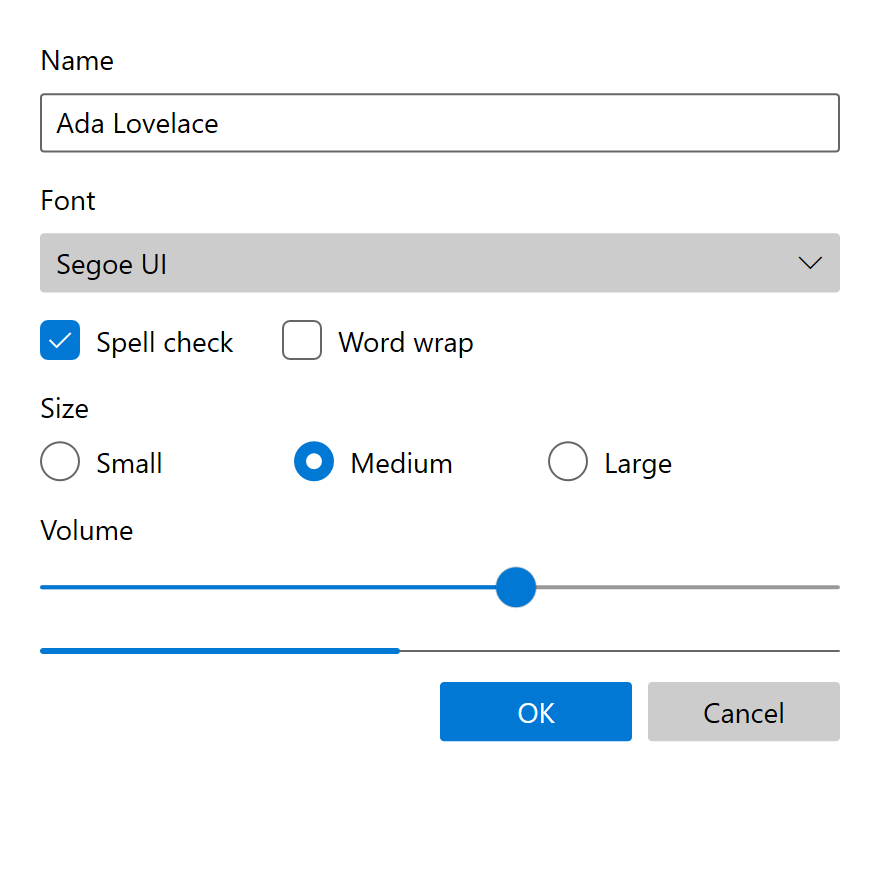

# Fluent

Windows 10, 2017 to 2021; UWP and WinUI 2 (the `_v1` style set).

This is the original Fluent Design System as it shipped on Windows 10: announced at Build in May
2017, shipped in the 1709 Fall Creators Update (17 October 2017), and frozen on 22 February 2021,
when WinUI 2 renamed its whole Windows 10 style set to `*_v1.xaml` to make room for Windows 11.
It is the Fluent of Reveal and Acrylic, `Segoe MDL2 Assets` and an opacity-derived color ramp.
Windows 11's refresh, later renamed Fluent 2, is a different design system and has
[its own page](fluent2.md).

!!! note "`_v1` Means Older"
    `Button_themeresources_v1.xaml` is Windows 10. `Button_themeresources.xaml`, without a suffix,
    is Windows 11. WinUI 2.6 kept the Windows 10 dictionaries under the new name instead of
    deleting them, and those 99 files are the main primary source for this page.

!!! note "Evidence Tiers"
    **Tier 1** is the shipped implementation: WinUI 2's XAML and C++, and the UAP
    `generic.xaml`/`themeresources.xaml` of the Windows 10 SDKs.

    **Tier 2** is the era's written guidance: the design docs, which Microsoft removed from its
    live site on 2021-04-23 and which survive only in the git history of
    [MicrosoftDocs/windows-dev-docs](https://github.com/MicrosoftDocs/windows-dev-docs).

    Where the two disagree, and in this era they often do, the shipped code wins and the page says
    so.

## Principles

### Two Framings, Dated

There was never one Fluent framing on Windows 10. There were two, and one commit swapped them.

| Period | Framing | Content |
| --- | --- | --- |
| 2017-10-09 to 2018-03-06 | Five building blocks | Light (Reveal), Depth (Acrylic, Parallax), Motion (connected animations), Material (Acrylic), Scale (no feature at all) |
| 2018-03-06 to 2021-06-24 | Three principles | Adaptive, Empathetic, Beautiful. The four surviving elements became sections of one article; Scale was deleted outright |

The five blocks that every retrospective quotes were Microsoft's public framing for just under five
months[^principles]. They are still the useful framing for a renderer, because each one maps onto a
shipped mechanism (`RevealBrush`, `AcrylicBrush`, `ParallaxView`, `ConnectedAnimation`, later
`ThemeShadow`). The three later principles are product philosophy and have no pixel consequences.

Two details are worth keeping. Acrylic was listed under both Depth and Material, so the five were
lenses rather than layers. And Scale ("from 0D to 3D") linked only to the input and device primers,
named no shipping feature, and is the one element with nothing behind it. There is nothing to
implement for it.

### What Fluent on Windows 10 Deliberately Is Not

Four absences, each a place where a modern reader silently imports a later era:

- **No semantic color tokens.** No `TextFillColor*`, `ControlFillColor*` or `SubtleFillColor*`.
  Color is a 24-entry ramp consumed through about 170 `SystemControl*` alias brushes, all defined
  by the OS.
- **No elevation border.** No `ControlElevationBorderBrush`, no gradient strokes. State is
  communicated by fill alone.
- **No rounded corners in the OS.** `ControlCornerRadius` and `OverlayCornerRadius` exist only in
  the WinUI 2 package, from WinUI 2.2 (2019-08-21). `grep -c ControlCornerRadius` over the SDK's
  own `generic.xaml` returns 0. A UWP app that did not merge WinUI 2's resources was square for
  the whole era.
- **No motion tokens.** No `Control*AnimationDuration`, no `*KeySpline` resource, zero hits across
  all 99 `_v1` files. Durations are inline literals on storyboards.

### The Substrate

Fluent sits on UWP's layout model, which is older than Fluent and which Fluent never changed:

- **Effective pixels.** Sizes are in epx, normalized for pixel density and viewing distance.
- **The 4-epx grid.** Sizes, margins and positions are multiples of 4, because 4 scales to a whole
  number at every scaling plateau (4 × 125 % = 5, 4 × 150 % = 6). Text is exempt, which is why the
  type ramp is irregular.
- **The 40-epx target.** *"All items on the screen align to a 40×40 effective pixels target."*
  Before 1809 it was **44 epx**, and the header-to-control margin shrank from 8 to 4 epx in the
  same release[^spacing]. Fluent on Windows 10 therefore has two sizing regimes, split at 1809.
- **Breakpoints.** Small ≤ 640 epx (phones and TVs), Medium 641 to 1007, Large ≥ 1008.

### Timeline

| Date | Event |
| --- | --- |
| 2017-05-11 | Fluent announced at Build 2017 ("Project Neon") |
| 2017-10-17 | Windows 10 1709: Reveal and Acrylic ship in the OS |
| 2018-03-06 | The five building blocks replaced by three principles; Scale deleted |
| 2018-10-02 | Windows 10 1809: 44 → 40 epx, Base and Body text 15 → 14 epx |
| 2019-05-21 | 19H1: `ThemeShadow` ships; Acrylic gains the luminosity recipe |
| 2019-08-21 | WinUI 2.2: `ControlCornerRadius` 2, `OverlayCornerRadius` 4 |
| 2020-12-02 | WinUI 2.5, the last pure Windows 10 release (tag `v2.5.0`) |
| 2021-01-07 | Radii jump to 4 / 8 on WinUI's main branch, the first Windows 11 value |
| 2021-02-22 | The `_v1` rename freezes Windows 10 Fluent as a named style set |
| 2021-04-23 | Reveal Highlight un-linked from the design docs; the docs leave the live site |
| 2021-06-23 | WinUI 2.6 ships the Windows 11 refresh |

## Foundations

### Color

#### Three Layers

Every color resolves through three hops, and every hop switches with the theme independently:

| Layer | What it is | Owner |
| --- | --- | --- |
| Ramp | 24 named `System*Color` values per theme (`SystemBaseHighColor`, `SystemChromeLowColor`, ...) | OS |
| Alias | About 170 `SystemControl*Brush` keys that pick a ramp entry per semantic role | OS |
| Control | Per-control keys (`ButtonBackground`, `CheckBoxForegroundChecked`, ...) | OS and WinUI 2 |

A control style never names a raw color. Plus two families that live in no file: the accent and
its six shades, and eight `SystemColor*Color` high-contrast values, both injected by the framework
at runtime. WinUI 2 itself contributes exactly three color resources for this era: two extra
accent rungs (0.75 and 0.9) and a compatibility copy of `SystemControlTransparentBrush`.

That makes Windows 10 Fluent's color system an *OS* system that WinUI 2 consumes. On Windows 11 it
is the other way around.

#### The Base Ramp

The `Alt` and `Base` families are black and white at six alphas and nothing else: `19` (10 %),
`33` (20 %), `66` (40 %), `99` (60 %), `CC` (80 %), `FF` (100 %). `Base` is black in Light and
white in Dark, `Alt` is its exact inverse. The whole ramp has been byte-identical in every Windows
10 SDK from 1507 to 2104[^sdk], so Fluent inherited it unchanged from MDL2.

| Key | Light | Dark |
| --- | --- | --- |
| `SystemBaseHighColor` | `#FF000000` | `#FFFFFFFF` |
| `SystemBaseMediumHighColor` | `#CC000000` | `#CCFFFFFF` |
| `SystemBaseMediumColor` | `#99000000` | `#99FFFFFF` |
| `SystemBaseMediumLowColor` | `#66000000` | `#66FFFFFF` |
| `SystemBaseLowColor` | `#33000000` | `#33FFFFFF` |
| `SystemAltHighColor` | `#FFFFFFFF` | `#FF000000` |
| `SystemAltMediumHighColor` | `#CCFFFFFF` | `#CC000000` |
| `SystemAltMediumColor` | `#99FFFFFF` | `#99000000` |
| `SystemAltMediumLowColor` | `#66FFFFFF` | `#66000000` |
| `SystemAltLowColor` | `#33FFFFFF` | `#33000000` |
| `SystemListMediumColor` | `#33000000` | `#33FFFFFF` |
| `SystemListLowColor` | `#19000000` | `#19FFFFFF` |

Only the `Chrome*` family carries real grays, and it is deliberately not a mirror image:

| Key | Light | Dark |
| --- | --- | --- |
| `SystemChromeLowColor` | `#FFF2F2F2` | `#FF171717` |
| `SystemChromeMediumLowColor` | `#FFF2F2F2` | `#FF2B2B2B` |
| `SystemChromeMediumColor` | `#FFE6E6E6` | `#FF1F1F1F` |
| `SystemChromeHighColor` | `#FFCCCCCC` | `#FF767676` |
| `SystemChromeAltLowColor` | `#FF171717` | `#FFF2F2F2` |
| `SystemChromeDisabledHighColor` | `#FFCCCCCC` | `#FF333333` |
| `SystemChromeDisabledLowColor` | `#FF7A7A7A` | `#FF858585` |
| `SystemChromeWhiteColor` | `#FFFFFFFF` | `#FFFFFFFF` |
| `SystemChromeBlackHighColor` | `#FF000000` | `#FF000000` |
| `SystemChromeAltHighColor` | `#FFFFFFFF` | see below |
| `SystemErrorTextColor` | `#C50500` | `#FFF000` |

`SystemErrorTextColor` is the one hue in the ramp, and the only key in the file written without an
alpha byte. `SystemChromeAltHighColor` is the acrylic tint, and its dark value is the one ramp value
that moved inside the era: `#1F1F1F` in 1709 and 1803, `#2D2D2D` in 1809, `#1C1C1C` from 1903 on.

**The page is pure white or pure black.** `ApplicationPageBackgroundThemeBrush` is `#FFFFFF` in
Light and `#000000` in Dark, not Windows 11's `#F3F3F3`/`#202020`. It is the loudest difference
between a Windows 10 screenshot and a Windows 11 one, and it costs nothing to get right.
`ApplicationForegroundThemeBrush` is `#DE000000` / `#DEFFFFFF`, an 87 % alpha inherited from
Windows 8.

`ThemeDictionaries` in the era's XAML use three keys, and **`Default` holds the dark theme**, not
the light one.

#### Accent

The OS generates the accent and six shades (`Light1` to `Light3`, `Dark1` to `Dark3`) with an
algorithm that has no era-correct public source. What is verifiable is how the era consumes them,
and it is much simpler than Windows 11:

| Consumer | Uses |
| --- | --- |
| Accent fill at rest | `SystemAccentColor`, unmodified |
| Accent fill on hover | `SystemAccentColorLight1` |
| Accent fill on press | `SystemAccentColorDark1` |
| Accent text (hyperlinks) | `SystemAccentColor`, unmodified |

Across the 99 `_v1` files `Light1` is used 23 times, `Dark1` 22 times and the other four shades
three times each. The accent story is base, `Light1`, `Dark1`, applied identically in both themes.
Windows 11 instead picks different rungs per theme so accent *text* stays legible; that selection
does not exist here, and the era's own acrylic guidance admits accent text on acrylic is likely to
fail contrast at 15 px.

Lists use accent at partial opacity, and dark theme runs 0.2 hotter at every step:

| Key | Light | Dark |
| --- | --- | --- |
| `SystemControlHighlightListAccentLowBrush` | 0.4 | 0.6 |
| `SystemControlHighlightListAccentMediumBrush` | 0.6 | 0.8 |
| `SystemControlHighlightListAccentHighBrush` | 0.7 | 0.9 |
| `SystemControlHighlightListAccentMediumLowBrush` (WinUI 2) | 0.75 | 0.75 |
| `SystemControlHighlightListAccentVeryHighBrush` (WinUI 2) | 0.9 | 0.9 |

#### Three Literal Colors

Almost nothing in the alias layer carries a hard-coded value. Three keys do:

| Key | Light | Dark | Role |
| --- | --- | --- | --- |
| `SystemControlTransientBorderBrush` | `#000000` at 0.14 | `#000000` at 0.36 | The hairline under every flyout, menu, drop-down and tooltip |
| `SystemControlTransparentBrush` | transparent | transparent | The same in all three themes |
| `SystemControlDisabledTransparentBrush` | transparent | transparent | Becomes `GrayText` in high contrast, so a disabled control grows a border there |

The transient border is **black in both themes**: a dark hairline under a dark flyout, never a
light one. That is the opposite of the Windows 11 convention and a quick way to date a screenshot.

#### High Contrast Is Derived, Not Authored

An alias key's name is `SystemControl[Role][Ramp]Brush`, and the role prefix alone decides its
high-contrast value[^xamlres]:

| Role prefix | High-contrast value |
| --- | --- |
| `Background` | `ButtonFace` |
| `Foreground` | `ButtonText` |
| `Disabled` | `GrayText` |
| `Highlight` | `Highlight` |
| `HighlightAlt` | `HighlightText` (longest prefix wins) |
| `PageBackground` | `Window` |
| `PageText` | `WindowText` |
| `Hyperlink` | `HotLight` |

Applied mechanically to the 99 plain alias brushes, 86 obey the rule, 6 break it and 7 have no role
prefix. In high contrast every acrylic and Reveal brush becomes a flat `SolidColorBrush`, at the
resource level, before any runtime policy runs.

`ColorPaletteResources` is the era's only theming API worth mentioning: overriding one ramp entry
in a scope cascades through the alias layer into every control and state in that scope. Windows 11
has no equivalent, because its semantic tokens are values rather than aliases.

### Typography

Static Segoe UI (not Segoe UI Variable), in five weights across one ramp. The shipped `FontFamily`
is the sentinel `XamlAutoFontFamily`, which resolves per language. The era docs scope Segoe UI to *"English,
European languages, Greek, Hebrew, Armenian, Georgian, and Arabic"*; other scripts get their own UI
face (Yu Gothic UI, Malgun Gothic, Nirmala UI and so on).

| Style | Size (≥ 1809) | Size (≤ 1803) | Weight | Trims side bearings |
| --- | --- | --- | --- | --- |
| `HeaderTextBlockStyle` | 46 | 46 | Light | yes |
| `SubheaderTextBlockStyle` | 34 | 34 | Light | yes |
| `TitleTextBlockStyle` | 24 | 24 | SemiLight | yes |
| `SubtitleTextBlockStyle` | 20 | 20 | Normal | yes |
| `BaseTextBlockStyle` | 14 | **15** | SemiBold | no |
| `BodyTextBlockStyle` | 14 | **15** | Normal | no |
| `CaptionTextBlockStyle` | 12 | 12 | Normal | no |

The 15 → 14 step happened at 1809, together with the 44 → 40 epx resize, and it also moved
`ControlContentThemeFontSize` (the default control text size) from 15 to 14. This was verified
against the UAP XAML of all ten Windows 10 SDKs[^sdk].

Details that matter more than they look:

- **Large styles get lighter as they grow.** Light at 46 and 34, SemiLight at 24, Normal at 20. The
  46 epx Light header is the era's most recognizable typographic gesture; Windows 11 drops both
  Light styles and keeps only Regular and SemiBold.
- **Clip, don't ellipsize.** `TextTrimming` is `None` by default, and the era's guidance says so
  outright. Windows 11 flips it to `CharacterEllipsis`.
- **No line-height token.** `TextLineBounds="Full"` with `LineStackingStrategy="MaxHeight"`, so
  line height comes from the font's own metrics.
- **WinUI 2.5 grafted three names on** (Dec 2020): `BodyStrong` 14, `TitleLarge` 40 and `Display`
  68, all SemiBold via `BaseTextBlockStyle`. On Windows 10, `BodyStrong` is exactly `Base`. They
  live in a `_v2.5` file, so a search for `_v1` misses them.
- The ramp is not geometric (12, 14, 20, 24, 34, 46) and should not be "fixed".

### Metrics

#### Corner Radius

| Date | `ControlCornerRadius` / `OverlayCornerRadius` |
| --- | --- |
| before 2019-08-21, and the OS throughout | square |
| 2019-08-21, WinUI 2.2 | **2 / 4** |
| 2021-01-07, Windows 11 | 4 / 8 |

4 / 8 is a Windows 11 value. A 2019-dated page of the era docs states 4 / 8 today only because a
2021 rewrite changed its text without touching its `ms.date`; before that it said 2 px / 4 px, in
agreement with the code[^corner].

Which controls round (WinUI 2.2 and later):

| Class | Radius | Members |
| --- | --- | --- |
| Rectangle controls | 2 | Button, ToggleButton, SplitButton, DropDownButton, CheckBox, ComboBox, TextBox, PasswordBox, RichEditBox, AutoSuggestBox, the pickers, FlipView |
| Overlays | 4 | ContentDialog, Flyout, MenuFlyout, CommandBarFlyout, ToolTip, TeachingTip, TabView tabs, the flyout part of every drop-down |
| Bars | 2 | NavigationView indicator, ProgressBar, Slider track, touch ScrollBar |

The era deliberately does not round adjacent parts inside one container (the two halves of a
SplitButton), a control housed in another (ScrollBar inside ScrollViewer), or the attached edge of a
flyout. The focus rectangle and shadows are never rounded either.

#### Borders and Padding

| Token | Value | Note |
| --- | --- | --- |
| `ButtonPadding` | `8,5,8,6` | One epx of optical correction top to bottom; Windows 11 widens it to `11,5,11,6` |
| `ButtonBorderThemeThickness` | 1 (WinUI 2), 2 (OS) | Present but transparent in every state |
| `CheckBoxBorderThemeThickness` | 2 | OS value, not overridden by WinUI 2 |
| `RadioButtonBorderThemeThickness` | 2 | OS value |
| `TextControlBorderThemeThickness` | 1 | |
| `TextControlBorderThemeThicknessFocused` | **2** on all four sides | Windows 11 changes this to `1,1,1,2`, one of the sharpest era markers |
| `TextControlThemePadding` | `10,6,6,5` | |

#### Focus Visual

A two-ring visual, always[^feedback]:

| Part | Width | Color | High contrast |
| --- | --- | --- | --- |
| Primary (outer) | 2 epx | `SystemBaseHighColor`: black in Light, white in Dark | `ButtonText` |
| Secondary (inner) | 1 epx | `SystemAltMediumColor`: 60 % white in Light, 60 % black in Dark | `ButtonFace` |

The two rings are opposite so the pair reads on any surface. They are square even around a
rounded control, and **never accent-colored**; only Reveal Focus (an Xbox opt-in) uses the accent.
Most chrome controls set `FocusVisualMargin="-3"`, which places the band from 3 epx outside the
bounds to flush against them. The renderer subtracts the margin, so a negative value pushes the
ring outward. Text controls are the exception: they show focus with the 2 epx border above.

#### Elevation and Shadow

Elevation is `Translation.Z` in epx, applied to popups, not a named token ladder[^depth]:

| Surface | Z |
| --- | --- |
| Dialog | 64 |
| Flyout, menu, CommandBar, NavigationView, ComboBox, pickers, TeachingTip | 32 |
| Each cascading menu level | +8 |
| ToolTip, TabView, NumberBox popup | 16 |

A Button sits at z = 0; there is no Card, Control or Layer rung. `ThemeShadow` needs 19H1, so
early-era surfaces have the ladder without a shadow. Outside a `Popup` a `ThemeShadow` casts on
nothing until receivers are named, and the scene is capped at five caster/receiver pairs.

### Interaction States

There are two fill ladders, and a control's alias names say which one it uses.

| State | Chrome ladder (Button) | List ladder (ListViewItem, menu items) | Text field |
| --- | --- | --- | --- |
| Rest | 20 % base | transparent | 40 % *alt* |
| Hover | **10 % base** | 10 % base | 60 % alt |
| Pressed | 40 % base | 20 % base | (focused) opaque alt |
| Disabled | 20 % base, gray text | | 20 % base |

**Hover is lighter than rest.** The chrome ladder goes down, then up. That is the era's signature
feel and the reverse of every later system, and the button's hover brush is the one literal in its
dictionary (`SystemBaseHighColor` at `Opacity="0.1"`), because the ramp has no 10 % base rung
outside the `List` family. A disabled button keeps its rest fill and only grays its label. Every
button border is transparent in every state, in both themes.

Text fields run the other way: they fill in as you engage with them, rest 40 % to hover 60 % to an
opaque focused field, over the *inverse* of the page color.

Selected list rows are accent at **0.75**, never a full accent. Hovering a selected row fades it
to 0.6 and pressing deepens it to 0.9. The 0.6 is reached through two different keys:
`ListViewItemBackgroundSelectedPointerOver` names `...ListAccentMediumBrush` in the Light
dictionary and `...ListAccentLowBrush` in the dark one, and because the accent ladder runs 0.2
hotter in Dark, both land on 0.6. It looks like an inconsistency in the file and is a deliberate
normalization.

A press is three things at once: the fill change, `PointerDownThemeAnimation` (a scale tilt, 148
uses across the `_v1` files, with OS-internal timings that were never published), and on commanding surfaces
the Reveal ripple. Only the first lives in a resource dictionary.

### Motion

The documented system[^motion]:

| Role | Duration | Curve | Intent |
| --- | --- | --- | --- |
| Exit | 150 ms | `0.7, 0, 1, 0.5` (Accelerate) | *"become powered and gain momentum until they reach escape velocity"* |
| Enter | 300 ms | `0.1, 0.9, 0.2, 1` (Decelerate) | *"met with extreme friction, which slows the object to rest"* |
| Move | ≤ 500 ms | `0.8, 0, 0.2, 1` (Standard) | *"the baseline easing for any animated parameter change"* |

Entering is twice as slow as exiting, on purpose, and Move is a ceiling that scales with distance,
not a value. The easing is aggressive by design; softening it is the usual way a reconstruction
stops looking like Windows 10.

What actually shipped is different:

- **The Standard curve never shipped.** `0.8,0,0.2,1` has zero hits in WinUI 2's XAML and in the
  SDK's `themeresources.xaml`.
- **Decelerate is the workhorse**: 120 of 216 `KeySpline` uses. Four undocumented splines carry
  the rest: `0.2,0 0,1` (CommandBar), `0.0,0.35 0.15,1.0` (the nav pane slide), `0.4,0,0.6,1`
  (ProgressBar) and `0.15,0.64,0.25,1` (CalendarView).
- **Durations are inline and mostly pre-Fluent**: 240, 167 and 467 ms are frame-count values from
  the Windows 8 animation library. Only CommandBarFlyout follows 150/300. SplitView opens in 200 ms
  and closes in 100 ms, the same 2:1 ratio at half the scale. The indeterminate ProgressBar loop
  is 3.917 s.
- **Control state changes snap.** Every color change in the `_v1` Button, CheckBox, RadioButton,
  ToggleSwitch and Slider templates is an `ObjectAnimationUsingKeyFrames` at `KeyTime="0"`.
  Windows 11's 83 ms brush transition does not exist here.

### Materials: Acrylic

Acrylic is the era's only material. There is no Mica (it ships in WinUI 2.7, 2021-09-14, after the
era closes) and no Smoke. The recipe, from `AcrylicBrush` in WinUI 2[^acrylic]:

| Constant | Value |
| --- | --- |
| Blur radius | 30 |
| Saturation | 1.25 (RS2 to RS5 recipe) |
| Exclusion color | `#1AFFFFFF` (RS2 to RS5 recipe) |
| Noise opacity | 0.02, over a 256 × 256 tile |
| Default tint | `#CCFFFFFF` |
| Tint transition | 500 ms |

From 19H1 a second recipe replaces the exclusion blend with a luminosity blend, so shadows stop
bleeding through, and compresses the tint opacity by luminosity: a user value of 100 % maps to 45 %
for pure white, 90 % for mid gray and 85 % for pure black, canceled out as saturation rises.

Two kinds, chosen by what the surface relates to:

| Kind | `BackgroundSource` | Samples | For |
| --- | --- | --- | --- |
| Background acrylic | `HostBackdrop` | the desktop | transient, light-dismiss UI |
| In-app acrylic | `Backdrop` | the app | supporting panes that content scrolls under |

The neutral brushes all tint with `SystemChromeAltHighColor` and differ only in opacity: 0.8 for
general use (and required behind secondary text below 18 px), 0.7 for top navigation and
commanding, 0.6 for the vertical navigation pane. **Every flyout, menu, drop-down, tooltip and
picker is background acrylic at 0.8 with the black transient hairline**, falling back to
`SystemChromeMediumLowColor`.

The fallback color is a designed state, not an error path. Acrylic goes solid under Battery Saver,
on hardware without fast effects, with transparency effects turned off in Settings, and (background
acrylic only) when the window deactivates or runs in tablet mode.

!!! warning "Read Transient Surfaces From WinUI 2.5"
    The `_v1` files have been maintained since the freeze, and 42 references across 15 of them now
    point transient surfaces at Windows 11 acrylic brushes, including switching MenuFlyout from
    desktop to in-app sampling. The era-correct values are in tag `v2.5.0`.

### Reveal

Reveal Highlight is the era's answer to "which of these is interactive": a pointer-tracked light
that exposes the hidden borders of dense commanding surfaces[^reveal]. It is the thing that
occupies the place Windows 11's elevation border takes.

Mechanically it is a lighting scene, not a brush effect: an ambient light and two border lights at
the app root, two hover lights per container, and two brushes (`RevealBorderBrush` for borders,
`RevealBackgroundBrush` for the backplate) rendered through `SceneLightingEffect`. The border light
is shared across siblings, which is why hovering one command-bar button lights its neighbors'
borders. No per-control effect can do that.

Every constant is `static constexpr` in WinUI 2's MIT C++:

| Part | Value |
| --- | --- |
| Hover light height | 256 epx above the surface |
| Hover cone size | element's larger side + 12, clamped to 16..512 epx |
| Hover fade | 166 ms (intensity; color flips in 1 ms) |
| Press | full white in 66 ms |
| Release ripple | cone scales 4.44× while fading over 266 ms, a footprint of about 420 epx |
| Border light | outer cone ~16.9°, at 128 epx (narrow) or 256 epx (wide) |
| Lighting | diffuse 0.2, specular 0, so purely matte |

The scoping rule follows from that geometry: use it on command bars, navigation menus and dense
groupings; not on a lone button, not on popups or flyouts, not on anything larger than 500 epx. A
separate `SystemReveal*` ramp of 22 colors sits beside the base ramp, and in high contrast every
entry collapses onto its plain counterpart.

Reveal Focus is a different feature: an off-by-default Xbox focus glow in the accent color. Reveal
Highlight was un-linked from Microsoft's design docs on 2021-04-23; Reveal Focus survived into
Windows 11.

### Iconography

`Segoe MDL2 Assets`, 1830 private-use glyphs. Windows 11's `Segoe Fluent Icons` keeps 1828 of the
same codepoints, redrawn. The trap is `SymbolThemeFontFamily`: every Windows 10 SDK sets it to
`Segoe MDL2 Assets`, but today's SDK resolves the same key to `Segoe Fluent Icons`. Name the font
explicitly or the Windows 11 glyphs appear.

### Accessibility

The era's contrast rule is 4.5:1 for all visible text, with **no large-text exemption**, so the
46 epx header is held to the same ratio as a caption. Text scaling (100 % to 225 %) is non-linear:
small sizes grow more than large ones, so the ramp compresses. The `_v1` files opt out of it 14
times, every one of them an icon glyph rather than prose.

## Controls

The tables below condense the per-control values. Sizes are in epx; "base" means
`SystemBase*` at the given alpha.

### Button

| | Button | AccentButton | HyperlinkButton |
| --- | --- | --- | --- |
| Owner | WinUI 2 | WinUI 2 | OS only |
| Padding | `8,5,8,6` | `8,5,8,6` | `0,6,0,7` |
| Border | 1, transparent | 1, transparent | 0 |
| Corner radius | 2 | 2 | not set |
| Rest fill | 20 % base | accent | transparent |
| Hover fill | **10 % base** | `Light1` | transparent |
| Pressed fill | 40 % base | `Dark1` | transparent |
| Rest text | base high | `#FFFFFF` in both themes | accent |
| Hover text | base high | `#FFFFFF` | 60 % base |
| Disabled fill | 20 % base | 20 % base (goes neutral) | |
| `FocusVisualMargin` | -3 | -3 | -3 |

A hyperlink grays out under the pointer rather than stepping along an accent ramp. A disabled
accent button loses the accent entirely.

### Toggle Controls

| | CheckBox | RadioButton | ToggleSwitch |
| --- | --- | --- | --- |
| Indicator | 20 × 20 box, 2 stroke | 20 ring, 2 stroke, 8 dot | 40 × 20 track, radius 10, 10 knob |
| Row height | 32 | 32 | 20 plus margins |
| `MinWidth` | 120 | 120 | 154 |
| Unchecked | stroke only, no fill | stroke only | stroke only |
| Unchecked stroke | 60 % → 80 % hover → 100 % pressed, 40 % disabled | same | same |
| Unchecked pressed fill | 40 % base | 40 % base | 40 % base |
| Checked fill | accent → `Light1` → `Dark1` | same | same |
| Mark | `ChromeWhite` in every state and theme | same | same |

Toggles do not fill in on hover: the *stroke* carries the state. The unchecked ToggleSwitch knob
is full-strength base high (a solid black or white dot), and no indicator grows or shrinks on hover
or press; those micro-interactions are Windows 11 additions. The indeterminate box repeats the
checked fill with glyph `E73C`.

### Text Input

| | TextBox, PasswordBox, RichEditBox, AutoSuggestBox, NumberBox |
| --- | --- |
| Min height / width | 32 / 64 |
| Padding | `10,6,6,5` |
| Border rest / focused | 1 / 2, uniform on all sides |
| Border color | 60 % base, 80 % on hover, accent when focused |
| Fill | 40 % alt, 60 % alt on hover, opaque alt when focused |
| Corner radius | 2 |
| Header margin | `0,0,0,4` |
| Clear button | glyph `E894`, 12 epx |

A focused Windows 10 field is ringed in accent on all four sides, not underlined, and unlike Windows
11 hovering really does recolor the outline.

### ComboBox and Pickers

| | ComboBox | DatePicker | TimePicker | CalendarView |
| --- | --- | --- | --- | --- |
| Min width | 64 | 296 | 242 | (content) |
| Min height | 32 | (content) | (content) | |
| Padding | `12,5,0,7` | `0,3,0,6` | `0,3,0,6` | |
| Row height | 32 | 40 | 40 | 40 × 40 day |
| Popup | max 504 tall, 15 items | | 398 tall | |

The closed ComboBox is accent-washed while open (`...ListAccentLow`, 0.4 Light / 0.6 Dark),
focused or not. Its item padding grows by 6 epx top and bottom in touch and gamepad input modes,
one of the era's `InputModeStates`. Reveal is the base CalendarView style.

### Lists

| | ListViewItem | GridViewItem | TreeViewItem |
| --- | --- | --- | --- |
| Min height | 40 | 44 | 32 |
| Min width | 88 | 44 | |
| Padding | `12,0,12,0` | margin `0,0,4,4` | 0 |
| Reveal by default | yes | yes | yes |
| Selected fill | accent at 0.75 | Reveal accent | accent `Dark3` |
| Disabled | opacity 0.55 | opacity 0.55 | brush swap |

### Navigation

| | NavigationView | CommandBar | Pivot | TabView |
| --- | --- | --- | --- | --- |
| Size | pane 320 open / 40 compact, items 40 | 24 / 40 / 56 | header 48 | (content) |
| Item text | 14 | label 12 | **24 SemiLight** | 12 |
| Selection | **2 × 24 accent bar**, inset 4 | | header color | tab chrome |
| Surface | in-app acrylic 0.8 (from RS2) | transparent | transparent | |
| Reveal | on | on | no | no |

The selected NavigationView item has no background of its own; only the bar marks it. Windows 11
uses a 3 × 16 bar flush with a filled pill. The 24 epx SemiLight Pivot header is one of the largest
gaps to Windows 11's TabView.

### Overlays

| | ContentDialog | Flyout | MenuFlyout | ToolTip | TeachingTip |
| --- | --- | --- | --- | --- | --- |
| Surface | opaque | acrylic 0.8 | acrylic 0.8 | acrylic 0.8 | acrylic 0.8 |
| Border | 1, 20 % base | 1, transient | 1, transient | 1, transient | 1 |
| Corner radius | 4 | 4 | 4 | 4 | 4 |
| Elevation | 64 | 32 | 32, +8 per level | 16 | 32 |
| Min / max width | 320 / 548 | 96 / 456 | | | 320 / 336 |
| Padding | `24,18,24,24` | `12,11,12,12` | item `11,9,11,10` | `8,5,8,7` | 12 |
| Font size | 14 | 14 | 14 | 12 | 14 |

The dialog scrim is 60 % of the *inverse* of the page (`SystemAltMediumColor`): `#99FFFFFF` in
Light, `#99000000` in Dark. Windows 10 washes a light page out behind a dialog instead of darkening
it. `ContentDialogDimmingThemeBrush`, which is `#99FFFFFF` in both themes, is a Windows 8.1 key the
era template never references.

### Slider, Progress and Scroll Bars

| | Slider | ProgressBar | ScrollBar |
| --- | --- | --- | --- |
| Size | 32 row, track 2, thumb 20 (radius 10) | 4 tall | 16 wide |
| Rest | track 40 % base, thumb accent | track 20 % base, fill accent | thumb `ChromeDisabledLow` (opaque), track `ChromeMedium` at 0.9 |
| Hover | track 60 %, thumb `Light1` | | expands in 100 ms |
| Pressed | thumb `Dark1` | | |
| Disabled | `ChromeDisabledHigh` | | |
| Timing | | 3.917 s indeterminate loop | in 400 + 100 ms, out 2000 + 100 ms |

The Slider thumb is a single 20 × 20 disc whose fill changes per state; there is no inner and
outer disc pair. A color picker's slider thumb uses a neutral gray ladder instead, so it is not
tinted by the color being chosen. The ScrollBar's arrow glyphs are full-strength base high.

## Reproducing It Today

<figure markdown="span">
  { .era width="440" }
  <figcaption>libwinui's <code>Fluent</code> theme.</figcaption>
</figure>

Nothing in this era is license-encumbered. The shipped XAML and C++ are MIT-licensed in
[microsoft/microsoft-ui-xaml](https://github.com/microsoft/microsoft-ui-xaml), and the OS half is
readable in the Windows 10 SDKs. Transcribing values is copying facts; copying code carries MIT's
notice obligation. Both halves are needed: WinUI 2's `_v1` files reference the `SystemControl*`
alias layer without defining it and never re-implement about half the control set, so a color
question answered from WinUI 2 alone is unanswered.

### Exact From the Data on This Page

| Area | Why it carries over unchanged |
| --- | --- |
| Color | The ramp, the alias roles, the control keys, the page colors and the three literals are plain ARGB values. Accent shades still come from the OS (`UISettings.GetColorValue` returns `AccentLight1` to `AccentDark3` on current Windows) |
| Geometry | Radii, padding, border thicknesses, indicator sizes and the two-ring focus visual are all rectangles and strokes |
| Type | Static Segoe UI still ships with Windows, and the ramp is sizes and weights |
| Icons | `Segoe MDL2 Assets` still ships and is still offered as a download; name it explicitly rather than through `SymbolThemeFontFamily` |
| State color | The chrome, list and text-field ladders, and snapping (not animating) between them |
| Motion values | The documented durations and curves, and the inline durations and splines of the templates |
| Acrylic constants | Blur, saturation, exclusion or luminosity blend, noise and tint map onto standard Direct2D effects |
| Reveal constants | Every light, cone and timing value is `static constexpr` in public C++ |

### Choices a Re-Creation Has to Make

The era moved inside itself, so any faithful re-creation pins a point and says which:

- **Sub-era.** Base and Body text are 15 epx before 1809 and 14 after, the touch target 44 or 40
  epx, and the dark acrylic tint `#1F1F1F`, `#2D2D2D` or `#1C1C1C`.
- **OS or WinUI 2.** A bare UWP app was square throughout; an app merging WinUI 2.2 or later got
  2 / 4. Both are era-correct.
- **OS dictionary or `_v1`.** Where the SDK's UAP `themeresources.xaml` and the `_v1` files
  disagree, they draw visibly different controls. A focused text field is `SystemChromeWhiteColor`
  with black text in both themes in the OS dictionary; `TextBox_themeresources_v1.xaml` re-points
  both at alt high and base high, so it is opaque white in Light and opaque black in Dark. The
  field border is also 40 % / 60 % in the OS dictionary and 60 % / 80 % in `_v1`.
- **`v2.5.0` for transient surfaces.** Values mined from the current `_v1` files for flyouts,
  menus, drop-downs and navigation panes pick up Windows 11 acrylic (see the warning under
  [Materials](#materials-acrylic)).

### Approximated, and Why

| Feature | What gets in the way |
| --- | --- |
| Background acrylic | It samples the desktop behind the window. No documented Win32 API does that with the Windows 10 recipe; the Windows 11 system backdrop is a different material. In-app acrylic, which samples the app's own content, is reproducible. The fallback color (`SystemChromeMediumLowColor`) is itself a designed era state, what Windows 10 showed with transparency effects off |
| `ThemeShadow` | The ladder (16 / 32 / 64, +8 per menu level) is exact, but the shadow's own rendering has no era-correct public source: the XAML core's C++ became public only in 2024. Pre-19H1 surfaces had no shadow at all |
| Accent shades | The OS algorithm that generates `Light1` to `Dark3` has no public source; reading them live from the OS is the only faithful route |
| Press tilt | `PointerDownThemeAnimation`'s timings are OS-internal |
| Navigation transitions | The OS-side page transition storyboards are in no public repository |
| Window corners | Windows 11's DWM rounds top-level windows. A Windows 10 window was square; `DWMWA_WINDOW_CORNER_PREFERENCE` with `DWMWCP_DONOTROUND` restores that |
| Mica | Not an approximation target: it did not exist until WinUI 2.7, after the era |

**Reveal** is the hard one. Every constant is public, but it is a lighting scene with per-pointer
state whose border light reaches neighboring controls, not a per-control brush. A re-creation
either builds that lighting model or draws the flat state fills and says so. What it should not do
is substitute Windows 11's elevation border: that is the single visual that most clearly dates a
surface to the wrong era.

### Not a Matter of Appearance

Some things that look like Windows 10 Fluent are layout, behavior or content, so a theme alone
cannot give them:

- the 4-epx grid, the 40-epx target and the breakpoints;
- input-mode states, such as the ComboBox item growing 6 epx top and bottom under touch;
- text scaling and its non-linear compression of the ramp;
- `ElementSoundPlayer`'s seven UI sounds;
- the NavigationView, CommandBar and Pivot patterns themselves, as opposed to their colors;
- writing style and the clip-not-ellipsize text behavior.

### High Contrast

The era says "high contrast", not "contrast theme"; the rename is a Windows 11 change. Four themes
ship by default, and every swatch in *Settings → Ease of access → High contrast* maps onto one of
eight `SystemColor*Color` resources (`Window`, `WindowText`, `ButtonFace`, `ButtonText`,
`Highlight`, `HighlightText`, `HotLight`, `GrayText`). The system dictionaries author only the
`HighContrast` key, and the alias layer derives its values from the role prefix (see
[High contrast is derived, not authored](#high-contrast-is-derived-not-authored)).

Four consequences:

- Every acrylic and Reveal brush becomes a flat solid color, at the resource level.
- `SystemControlDisabledTransparentBrush` becomes `GrayText`, so disabled controls grow a border.
- `GrayText` means *disabled*, not *secondary*. The era's guidance forbids it for hint or
  secondary text.
- The 99 `_v1` files use `HighContrastAdjustment="None"` only six times, each where the control
  already guarantees its own contrast.

The same eight system colors are still read live on current Windows, so the era's high-contrast
look is exactly reproducible; geometry (radii, padding, focus border, type ramp, icon font) stays
the era's own.

## Sources

Values come from the shipped implementation first (tier 1) and the era's written guidance second
(tier 2). The design docs are cited at
[MicrosoftDocs/windows-dev-docs](https://github.com/MicrosoftDocs/windows-dev-docs) commit
`eae67b971` (2021-04-23), the last revision before they were deleted from the live site, under
`windows-apps-src/design/`.

[^principles]: Microsoft, *Fluent Design System*,
    [MicrosoftDocs/windows-dev-docs](https://github.com/MicrosoftDocs/windows-dev-docs), commit
    `0a72b5ca7` (2017-10-09, the five building blocks), replaced by commit `eb515e432` (2018-03-06,
    *"Fluent messaging updates"*); final era text at commit `eae67b971` (2021-04-23),
    `hub/apps/fluent-design-system.md`. Tier 2.
[^spacing]: Microsoft, *Spacing* (`style/spacing.md`) and *Screen sizes and breakpoints*
    (`layout/screen-sizes-and-breakpoints-for-responsive-design.md`), windows-dev-docs
    `eae67b971`. Tier 2.
[^sdk]: Windows 10 SDK, versions 10.0.10240 to 10.0.20348, UAP `Generic/generic.xaml` and
    `themeresources.xaml`, compared per release. Tier 1.
[^xamlres]: Microsoft, *XAML theme resources* (`controls-and-patterns/xaml-theme-resources.md`) and
    *Color* (`style/color.md`), windows-dev-docs `eae67b971`; checked against the Windows 10 SDK's
    UAP `themeresources.xaml`. Tiers 1 and 2.
[^corner]: [microsoft/microsoft-ui-xaml](https://github.com/microsoft/microsoft-ui-xaml),
    `dev/CommonStyles/CornerRadius_themeresources.xaml`: created at `944c7d1c8` (2019-07-29,
    0 / 0), set to 2 / 4 at `893bb1c85` (2019-08-21), 4 / 8 at `c46407915` (2021-01-07).
    Microsoft, *Corner radius* (`style/rounded-corner.md`), windows-dev-docs, rewritten at
    `de2340be1` (2021-06-24). Tiers 1 and 2.
[^feedback]: Microsoft, *Guidelines for visual feedback* (`input/guidelines-for-visualfeedback.md`)
    and *Reveal Focus* (`style/reveal-focus.md`), windows-dev-docs `eae67b971`. Tier 2.
[^depth]: Microsoft, *Z-depth and shadow* (`layout/depth-shadow.md`), windows-dev-docs
    `eae67b971`; `ThemeShadow` API reference on Microsoft Learn. Tier 2.
[^motion]: Microsoft, *Timing and easing* (`motion/timing-and-easing.md`), windows-dev-docs
    `eae67b971`; `KeySpline` and `Duration` census over the 99 `_v1` dictionaries in
    microsoft-ui-xaml branch `release/2.8`. Tiers 1 and 2.
[^acrylic]: microsoft-ui-xaml, `dev/Materials/Acrylic/AcrylicBrush.{h,cpp}` and
    `AcrylicBrush_rs*_themeresources.xaml`, tag `v2.5.0` (2020-12-02); Microsoft, *Acrylic
    material* (`style/acrylic.md`), windows-dev-docs `eae67b971`. Tiers 1 and 2.
[^reveal]: microsoft-ui-xaml branch `release/2.8`, `dev/Lights/RevealHoverLight.cpp`,
    `RevealBorderLight.cpp`, `XamlAmbientLight.cpp` and `dev/Materials/Reveal/RevealBrush.cpp`;
    Microsoft, *Reveal highlight* (`style/reveal.md`), windows-dev-docs `eae67b971`. Tiers 1 and 2.

Control values throughout come from
[microsoft/microsoft-ui-xaml](https://github.com/microsoft/microsoft-ui-xaml) branch `release/2.8`
(the `_v1` dictionaries under `dev/CommonStyles/`) and tag `v2.5.0` for transient surfaces,
together with the Windows 10 SDKs' UAP XAML for every control WinUI 2 did not re-implement. The
WinUI 2 API reference on Microsoft Learn documents `XamlControlsResources.ControlsResourcesVersion`,
the switch that selects the `_v1` set. The era's controls can still be seen running in the UWP
`XamlControlsGallery` of [microsoft/WinUI-Gallery](https://github.com/microsoft/WinUI-Gallery) at
commit `e8d1cb253` (2021-04-16).
