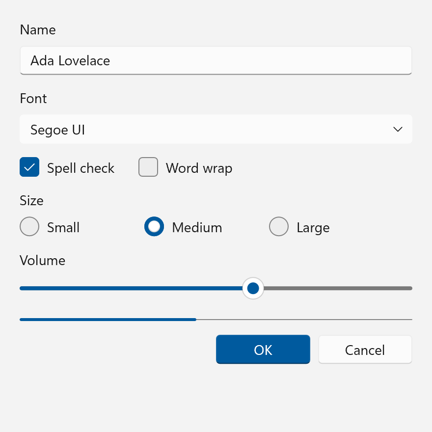

# Fluent 2

Windows 11, 2021 to present; WinUI 2.6 to 2.8 and WinUI 3. This is the current Windows design
language, and the reference point the older eras on these pages are compared against.

There was never a separate "Windows 11 Fluent" and "Fluent 2". Windows 11's design language
shipped in WinUI 2.6 (June 2021) and WinUI 3 1.0 under the plain name *Fluent*. *Fluent 2* is the
name Microsoft gave that same language, together with its web, iOS and Android siblings, in May
2023. It was a rebrand and a cross-platform unification. The shared color file carries 237 keys
across that seam with zero value drift, and the corner radii, elevation ladder, button padding and
motion tiers are identical. So this page treats 2021 to today as one era and calls out the few
places where the launch build differs. The genuinely different predecessor is Windows 10's
[Fluent](fluent.md).

!!! note "Evidence Tiers"
    **Tier 1** is the shipped implementation in the
    [microsoft/microsoft-ui-xaml](https://github.com/microsoft/microsoft-ui-xaml) repository: the
    `*_themeresources.xaml` dictionaries under `controls/dev/` and the C++ runtime under
    `dxaml/xcp/` (shadow recipe, theme resolution, accent sourcing, focus drawing).[^muxc]

    **Tier 2** is Microsoft's written guidance on Microsoft Learn, whose source is
    [MicrosoftDocs/windows-dev-docs](https://github.com/MicrosoftDocs/windows-dev-docs).

    **Tier 3** is the WinUI 3 Gallery, used only to confirm that a documented variant really
    ships.[^gallery]

    **Tier 4** is Microsoft's Fluent 2 *web* design kit, which describes a different platform and
    never supplies a value here.

    Where Tier 1 and Tier 2 disagree, the shipped XAML and C++ win, and the page says so.

## Principles

### The Five Windows Principles

Two principle sets exist. The four cross-platform Fluent 2 principles ("Natural on every
platform", "Built for focus", "One for all, all for one", "Unmistakably Microsoft") were added
above the Windows ones in 2023.[^f2web] The five Windows 11 principles from 2021 are the ones the
shipped values actually implement, so they are the ones to design against.[^principles]

| Principle | Microsoft's wording | What it turned into |
| --- | --- | --- |
| Effortless | "Faster and more intuitive" | Short, tiered motion: 83, 167 and 250 ms, and an entrance curve that covers most of its distance in the first third. |
| Calm | "Softer and decluttered; it fades into the background" | Rounded geometry (4 and 8 epx), translucent control fills, no shadow below `Translation.Z` 4, accent on one element per view. |
| Personal | "Adapts seamlessly to the way I use my device" | The accent is read live from the OS, light and dark are two full token sets, high contrast swaps in the user's own system colors. |
| Familiar | "Balances a new, refreshed look and feel with the familiarity of the Windows I already know" | Same control inventory and interaction model as before; only the surface treatment moved. |
| Complete + Coherent | "A visually seamless experience across platforms" | The same global ramps and two-light shadow model show up in the web implementation, with different plumbing. |

Calm is the one that matters most for a reimplementation. Most ways a copy of this look ends up
subtly wrong are ways of being louder than Fluent 2 intends: a shadow under a resting button, an
opaque fill where the system uses a 70 % alpha one, or accent color on more than one element.

Windows 11 also replaced Windows 10's pillars wholesale rather than relabeling them. The old
"Light, Depth, Motion, Material, Scale" became seven *signature experiences*: color, elevation
and layering, iconography, materials, shapes and geometry, typography, and motion. Color and
iconography are promotions: neither was a pillar in Windows 10. Reveal, which was the whole
"Light" pillar, is gone.

### Two Layers

Windows 11 apps are built from exactly two layers.[^layering] The **base layer** carries menus,
commands and navigation (`NavigationView`, `CommandBar`, `MenuBar`, `TabView`) and is what the
window's Mica shows through. The **content layer** holds the app's central experience, either as
one contiguous surface or as cards. Elevation values, which surfaces get acrylic and where a
shadow is allowed all follow from which layer a thing belongs to.

### Rounding

Three levels of rounding, chosen by what is being rounded and what it touches:[^geometry]

| Radius | Applies to |
| --- | --- |
| 8 epx | Top-level containers: windows, flyouts, dialogs |
| 4 epx | In-page elements: buttons, list backplates, text boxes, combo boxes |
| 4 epx | `ToolTip`, the documented exception to the overlay rule, because 8 would dominate it |
| 0 | Straight edges meeting other straight edges; window corners when snapped or maximized |

Where two elements touch, the touching edges are square: the two halves of a `SplitButton`, or the
side of a flyout attached to the control that opened it. WinUI does this with corner-radius
filter converters that zero one side of a single control radius, so an implementation needs "one
radius, per-corner derived", not four independent radius properties. The entire app-overridable
vocabulary is two resources, `ControlCornerRadius` (4) and `OverlayCornerRadius` (8).

The written "bars get 4 epx" rule is not what ships: `ProgressBarCornerRadius` is 1.5 and
`ProgressBarTrackCornerRadius` 0.5 in the Tier 1 dictionary.

### Spacing Between Things

Published composition gaps, for app authors rather than controls:[^contentbasics]

| Between | Gap |
| --- | --- |
| Two buttons; a button and its flyout; a control and its header | 8 epx |
| A control and its label; two content areas | 12 epx |
| A surface edge and the text inside it | 16 epx |

Page margins split into 56 epx for cohesive, media-rich layouts (Photos, Settings) and 12 epx for
utility and editing surfaces (Notepad, Terminal).

## Foundations

### Color

Every token follows `<Family><Purpose>Color<Variant>`. The family says the role, independent of
theme; the suffix (`Secondary`, `Tertiary`, `Quarternary` with WinUI's own spelling, `Quinary`,
`Senary`) is a fixed emphasis or state step inside that family. All values live in
`Common_themeresources_any.xaml`, whose three theme dictionaries are `Default`, `Light` and
`HighContrast`. **`Default` is the dark one.** That conflation is the single most common misreading
of these files.

| Family | Role |
| --- | --- |
| `TextFillColor*` | Text and icons on a neutral surface |
| `AccentTextFillColor*`, `TextOnAccentFillColor*` | Accent-colored text, and text drawn on an accent fill |
| `ControlFillColor*` | Standard control background, rest to disabled |
| `ControlStrongFillColor*`, `ControlSolidFillColor*` | High-emphasis chrome (slider track), fully opaque control fill (slider thumb, switch knob) |
| `SubtleFillColor*` | Transparent at rest, a faint wash on hover and press: list rows, nav items, command-bar buttons |
| `ControlAltFillColor*` | The **unchecked** CheckBox, RadioButton and ToggleSwitch indicator, despite the name |
| `AccentFillColor*` | Accent buttons, checked toggles, selection indicators |
| `ControlStrokeColor*`, `ControlStrongStrokeColor*` | Control borders, normal and high-emphasis |
| `CardStrokeColor*`, `CardBackgroundFillColor*` | Cards, `Expander`, `InfoBar` |
| `SurfaceStrokeColor*`, `DividerStrokeColor*`, `FocusStrokeColor*` | Popup borders, separators, the two focus rings |
| `SmokeFillColor*`, `LayerFillColor*`, `SolidBackgroundFillColor*` | Modal scrim, tints over Mica, the opaque page ramp |
| `SystemFillColor*` | Success, caution, critical, neutral and attention status colors |

The values that decide how a control looks, Light and Dark (alpha shown as a percentage):

| Token | Light | Dark |
| --- | --- | --- |
| `TextFillColorPrimary` | `#E4000000` (89 %) | `#FFFFFF` |
| `TextFillColorSecondary` | `#9E000000` (62 %) | `#C5FFFFFF` (77 %) |
| `TextFillColorTertiary` | `#72000000` (45 %) | `#87FFFFFF` (53 %) |
| `TextFillColorDisabled` | `#5C000000` (36 %) | `#5DFFFFFF` (36 %) |
| `TextOnAccentFillColorPrimary` | `#FFFFFF` | `#000000` |
| `TextOnAccentFillColorSecondary` | `#B3FFFFFF` (70 %) | `#80000000` (50 %) |
| `ControlFillColorDefault` | `#B3FFFFFF` (70 %) | `#0FFFFFFF` (6 %) |
| `ControlFillColorSecondary` (hover) | `#80F9F9F9` (50 %) | `#15FFFFFF` (8 %) |
| `ControlFillColorTertiary` (pressed) | `#4DF9F9F9` (30 %) | `#08FFFFFF` (3 %) |
| `ControlFillColorDisabled` | `#4DF9F9F9` (30 %) | `#0BFFFFFF` (4 %) |
| `ControlFillColorInputActive` (focused text field) | `#FFFFFF` | `#B31E1E1E` (70 %) |
| `ControlStrongFillColorDefault` | `#72000000` (45 %) | `#8BFFFFFF` (55 %) |
| `ControlSolidFillColorDefault` | `#FFFFFF` | `#454545` |
| `SubtleFillColorSecondary` (hover) | `#09000000` (4 %) | `#0FFFFFFF` (6 %) |
| `SubtleFillColorTertiary` (pressed) | `#06000000` (2 %) | `#0AFFFFFF` (4 %) |
| `ControlAltFillColorSecondary` (unchecked, rest) | `#06000000` (2 %) | `#19000000` (10 %) |
| `ControlAltFillColorTertiary` (unchecked, hover) | `#0F000000` (6 %) | `#0BFFFFFF` (4 %) |
| `ControlAltFillColorQuarternary` (unchecked, pressed) | `#18000000` (9 %) | `#12FFFFFF` (7 %) |
| `AccentFillColorDisabled` | `#37000000` (22 %) | `#28FFFFFF` (16 %) |
| `ControlStrokeColorDefault` | `#0F000000` (6 %) | `#12FFFFFF` (7 %) |
| `ControlStrokeColorSecondary` | `#29000000` (16 %) | `#18FFFFFF` (9 %) |
| `ControlStrokeColorOnAccentDefault` | `#14FFFFFF` (8 %) | `#14FFFFFF` (8 %) |
| `ControlStrokeColorOnAccentSecondary` | `#66000000` (40 %) | `#23000000` (14 %) |
| `ControlStrongStrokeColorDefault` | `#72000000` (45 %) | `#8BFFFFFF` (55 %) |
| `ControlStrongStrokeColorDisabled` | `#37000000` (22 %) | `#28FFFFFF` (16 %) |
| `CardStrokeColorDefault` | `#0F000000` (6 %) | `#19000000` (10 %) |
| `CardBackgroundFillColorDefault` | `#B3FFFFFF` (70 %) | `#0DFFFFFF` (5 %) |
| `SurfaceStrokeColorDefault` | `#66757575` | `#66757575` |
| `DividerStrokeColorDefault` | `#0F000000` (6 %) | `#15FFFFFF` (8 %) |
| `FocusStrokeColorOuter` | `#E4000000` (89 %) | `#FFFFFF` |
| `FocusStrokeColorInner` | `#B3FFFFFF` (70 %) | `#B3000000` (70 %) |
| `SmokeFillColorDefault` | `#4D000000` (30 %) | `#4D000000` (30 %) |
| `LayerFillColorDefault` | `#80FFFFFF` (50 %) | `#4C3A3A3A` (30 %) |
| `SolidBackgroundFillColorBase` (page) | `#F3F3F3` | `#202020` |
| `SolidBackgroundFillColorSecondary` | `#EEEEEE` | `#1C1C1C` |
| `SolidBackgroundFillColorTertiary` | `#F9F9F9` | `#282828` |
| `SystemFillColorSuccess` / `...Background` | `#0F7B0F` / `#DFF6DD` | `#6CCB5F` / `#393D1B` |
| `SystemFillColorCaution` / `...Background` | `#9D5D00` / `#FFF4CE` | `#FCE100` / `#433519` |
| `SystemFillColorCritical` / `...Background` | `#C42B1C` / `#FDE7E9` | `#FF99A4` / `#442726` |

Five traps hide in these numbers:

- **Fills are translucent.** A Light button at rest is 70 % white over whatever is behind it, which
  is what lets Mica tint it. Only `ControlFillColorInputActive` is opaque, which is why a focused
  text box visibly lifts off the page.
- **Dark's unchecked indicator is a recess.** Its rest rung is black-alpha and its hover and press
  rungs are white-alpha, so the box starts darker than the page and lifts out of it. Light is
  black-alpha throughout. Disabled is fully transparent in both.
- **`SurfaceStrokeColorDefault` and `SmokeFillColorDefault` are the same in both themes.** Almost
  nothing else is.
- **`CardStrokeColorDefault` is black-alpha in Dark** where the control stroke is white-alpha, so
  a card edge stays a dark line on a dark page.
- **`LayerOnMicaBaseAltFillColor*` is not the subtle ramp.** `TabView` uses it for its tab hover
  and press, and its pressed rung (`...Default`) is a lighter, mostly opaque layer: `#B3FFFFFF` in
  Light, `#733A3A3A` in Dark. So a tab brightens on press where a subtle-fill control darkens.

Four tokens (`CardBackgroundFillColorTertiary`, `ControlFillColorQuarternary`,
`SolidBackgroundFillColorQuinary`, `SolidBackgroundFillColorSenary`) arrived after 2021. Everything
else, including the whole `SystemFillColor*` family, is present in the launch build.

Measured over the base page, the text ramp encodes a rule: Primary and Secondary pass 4.5:1 in
both themes, Tertiary passes only in Dark (3.3:1 in Light), and Disabled fails by design in both
(2.5:1 Light, 3.3:1 Dark).[^text] So Tertiary is a placeholder token, never a body-text token, and
disabled state must never be the only signal that a control is unavailable.

#### Accent

The accent is seven OS-supplied colors, never computed. WinUI asks
`UISettings::GetColorValue` for `Accent` and the six variants `AccentLight1..3` and
`AccentDark1..3`, and uses what comes back verbatim.[^interop] The tint and shade algorithm lives
in closed shell code and has no published formula. When it cannot ask the OS, WinUI falls back to
seven constants, the Windows default blue:

| Rung | Color |
| --- | --- |
| Dark3 | `#002642` |
| Dark2 | `#004275` |
| Dark1 | `#005A9E` |
| Base (`SystemAccentColor`) | `#0078D4` |
| Light1 | `#429CE3` |
| Light2 | `#76B9ED` |
| Light3 | `#A6D8FF` |

**The polarity flips per theme.** Dark fills with the *Light* rungs, Light fills with the *Dark*
ones, so an accent surface always stands out from its page:

| Brush | Light | Dark |
| --- | --- | --- |
| `AccentFillColorDefault` | Dark1 | Light2 |
| `AccentFillColorSecondary` (hover) | Dark1 at 90 % | Light2 at 90 % |
| `AccentFillColorTertiary` (pressed) | Dark1 at 80 % | Light2 at 80 % |
| `AccentTextFillColorPrimary` / `Secondary` / `Tertiary` | Dark2 / Dark3 / Dark1 | Light3 / Light3 / Light2 |
| `SystemFillColorAttention` | base | Light2 |
| Selected-text background | base | base |

`GetSysColor(COLOR_HIGHLIGHT)` is not the accent: it returns a frozen Windows 10 `#0078D7`,
one digit away from the real default `#0078D4`, and it returns light values on a dark-mode machine.

An app that overrides `SystemAccentColor` in its resources shadows exactly that one key. The six
variants are fetched separately, so they keep the user's real OS ramp and the accent button stops
matching the overridden base. WinUI's own test hook says what its authors would reach for if they
wanted a derivation: alpha-blending the accent over white and black.

#### High Contrast

Under a contrast theme every semantic brush is rebound to one of the Win32 system colors, driven
by the user's own scheme. Fluent authors no colors for it at all.

| Token family | Resolves to |
| --- | --- |
| Text (`TextFillColor*`, `AccentTextFillColor*`, `TextOnAccentFillColor*`) | `WindowText`; disabled rungs `GrayText` |
| Fills (`ControlFillColor*`, `SubtleFillColor*`, `ControlAltFillColor*`, ...) | `ButtonFace` |
| Control strokes | `ButtonText`; disabled `GrayText` |
| Surface, card, divider strokes, outer focus ring | `WindowText` |
| Accent fills, card and layer fills, page ramp, inner focus ring | `Window` |

The elevation gradients collapse to a flat `WindowText` stroke, acrylic and Mica become solid
`Window`, and there are no shadows. In the `Default` and `Light` dictionaries the system-color
brushes are poisoned with magenta `#FF00FF`, and the `HighContrast` dictionary's raw `Color`
resources are pure red, so a style bound to the wrong layer shows up at once. Corner radii live
outside the theme dictionaries and stay 4 and 8. The OS calls these *contrast themes* (Aquatic,
Desert, Dusk, Night sky, and custom); WinUI branches only on "is one active".[^hc]

### Typography

One variable font, Segoe UI Variable, with a weight axis (100 to 700) and an automatic optical-size
axis whose Small, Text and Display cuts reshape the glyphs per size. Before Windows 11 the
resolved family was static Segoe UI, and that font swap is the real type change at the Windows 10
seam. The sizes moved far less.[^type]

| Style | Size (epx) | Weight | Line height (epx) |
| --- | --- | --- | --- |
| Caption | 12 | Regular | 16 |
| Body | 14 | Regular | 20 |
| BodyStrong | 14 | SemiBold | 20 |
| BodyLarge (after 2021) | 18 | Regular | 24 |
| BodyLargeStrong (after 2021) | 18 | SemiBold | 24 |
| Subtitle | 20 | SemiBold | 28 |
| Title | 28 | SemiBold | 36 |
| TitleLarge | 40 | SemiBold | 52 |
| Display | 68 | SemiBold | 92 |

- `BaseTextBlockStyle` is SemiBold, and only Caption, Body and BodyLarge override it back, so every
  style from Subtitle up is SemiBold by default.
- The line heights are Tier 2. The XAML sets no `LineHeight` at all and leaves it to the font's
  metrics with `LineStackingStrategy="MaxHeight"`.
- Bold and italic are not part of the ramp. Emphasis is SemiBold.
- The launch ramp is the other seven rows. `BodyLarge` was documented from day one and not
  implemented in WinUI 2.6 to 2.8 XAML, the era's clearest case of guidance and code disagreeing.
- Control text is `ControlContentThemeFontSize`, 14 epx.
- Icons come from **Segoe Fluent Icons**, which replaced Segoe MDL2 Assets. Every glyph is drawn as
  a 1 epx monoline, the codepoints mostly carry over, and the glyph sizes did not change across the
  seam.[^icons]

### Metrics

Everything is in effective pixels (epx). Element sizes, margins and positions sit on a **4 epx
grid**, because 4 is the smallest unit that stays a whole number of physical pixels at every
scale plateau (100, 125, 150, 175, 200, 225, 250, 300, 350 and 400 %).[^grid] Control padding
deliberately does not: vertical padding is often one pixel off the grid, tuned against the font's
baseline.

| Token | Value |
| --- | --- |
| `ControlCornerRadius` | 4 |
| `OverlayCornerRadius` | 8 |
| `ButtonPadding` | `11,5,11,6` |
| `ButtonBorderThemeThickness` | 1 |
| `TextControlThemePadding` | `10,5,6,6` |
| `TextControlThemeMinHeight` / `MinWidth` | 32 / 64 |
| `TextControlBorderThemeThicknessFocused` | `1,1,1,2` (HC: 2 uniform) |
| `CheckBoxSize`, `CheckBoxPadding` | 20, `8,5,0,0` |
| `ComboBoxPadding`, `ComboBoxMinHeight` | `12,5,0,7`, 32 |
| `FlyoutContentPadding` | `16,15,16,17` |
| `ToolTipBorderPadding` | `9,6,9,8` |
| `ContentDialogPadding` | 24 |

Note the bottom-heavy padding: `ButtonPadding` went from `8,5,8,6` and `TextControlThemePadding`
from `10,6,6,5` in Windows 10 to the values above. Two controls flipping the same way in the same
release reads as a deliberate "weight sits slightly low" rule.

#### Elevation and Shadow

Each surface class has an elevation value (`UIElement.Translation.Z`) and a 1 epx contour
stroke.[^layering] The stroke is the primary depth cue. Shadow is secondary and only switches on
higher up the ladder:

| Surface | Z | Shadow |
| --- | --- | --- |
| Window, Dialog | 128 | yes, the strongest |
| Flyout | 32 | yes |
| ToolTip | 16 | yes |
| Card | 8 | yes, subtle |
| Control (rest, hover) | 2 | **none** |
| Control (pressed) | 1 | **none** |
| Layer | 1 | **none** |

Pressing does not lift a control. It presses it *in*, and elevation drops from 2 to 1. Both are below
the shadow threshold, so the only visible change is the contour flattening.

The shadow is two superimposed pure-black drop shadows, an ambient (omnidirectional) and a
directional (offset down), from `DropShadowRecipe.h`, which states it was taken from the shell's
own implementation:[^shadow]

```
Elevation = min(64, Translation.Z / 2)

Elevation < 2        no shadow
2 <= E <= 16         ambient alpha 0
                     directional alpha  Light min(E/100 + 0.06, 0.14)   Dark 0.26
E > 16               ambient blur E/3, y-offset 2, alpha  Light 0.15   Dark 0.37
                     directional alpha                    Light 0.19   Dark 0.37

directional blur = E, directional y-offset = E / 2
```

| Surface | Directional blur / offset | Directional alpha (Light, Dark) | Ambient |
| --- | --- | --- | --- |
| Window, Dialog (128) | 64 / 32 | 0.19, 0.37 | blur 21.3, offset 2, alpha 0.15, 0.37 |
| Flyout (32) | 16 / 8 | 0.14, 0.26 | none |
| ToolTip (16) | 8 / 4 | 0.14, 0.26 | none |
| Card (8) | 4 / 2 | 0.10, 0.26 | none |

Light-theme alpha saturates at elevation 8, so a tooltip and a flyout differ only in blur and
offset. Dark shadows are much stronger at every elevation, so one theme's values ported to the
other look wrong. For windowed popups WinUI replaces the computed insets with hand-tuned ones that
bound the *visible* shadow: 4/1/4/8 for a tooltip, 10/2/10/18 for everything else. WinUI renders
the shadow into a nine-grid surface only to work around compositor clipping; a renderer drawing its
own shadows can apply the recipe directly.

#### The Contour Gradient

Below the shadow threshold, a control reads as raised through a **gradient border**:

| Brush | Mapping | Stops |
| --- | --- | --- |
| `ControlElevationBorderBrush` | Absolute, `(0,0)` to `(0,3)` | 0.33 `ControlStrokeColorSecondary`, 1.0 `ControlStrokeColorDefault` |
| `AccentControlElevationBorderBrush` | Absolute, `(0,0)` to `(0,3)` | 0.33 `ControlStrokeColorOnAccentSecondary`, 1.0 `ControlStrokeColorOnAccentDefault` |
| `CircleElevationBorderBrush` | Relative to bounding box | 0.50 `ControlStrokeColorDefault`, 0.70 `ControlStrokeColorSecondary` |
| `TextControlElevationBorderBrush` | Absolute, 2 epx, flipped | 0.5 `ControlStrongStrokeColorDefault`, 1.0 `ControlStrokeColorDefault` |

Three details decide whether a copy looks right:

- **The transition happens inside 3 epx, in absolute units**, so the stronger stop reads as a
  hairline along one horizontal edge at any control height. A bounding-box gradient gives a
  softer, visibly different control.
- **The direction flips per theme.** A `ScaleTransform ScaleY="-1"` sits on the neutral brush in
  the **Light** dictionary only, and on the accent brush in both. So a plain control's strong edge
  is its bottom in Dark and its top in Light, while an accent control's is always the bottom.
- **Pressed and disabled drop the gradient** for a flat `ControlStrokeColorDefault` (neutral) or a
  transparent border (accent).

This lift border is a Windows 11 launch signature. The brushes sit in a file both eras merge, but
no Windows 10 template ever binds them.

#### Focus

The focus visual is two nested strokes, drawn **outside** the control:[^focus]

| Ring | Width | Brush |
| --- | --- | --- |
| Outer | 2 epx | `FocusStrokeColorOuter` |
| Inner | 1 epx, inside the outer | `FocusStrokeColorInner` |

The default `FocusVisualMargin` is `-3`, so the pair floats 3 epx outside the bounds. The colors
invert between themes, and the contrast *between* the rings is what keeps focus visible on any
background; a single thick ring vanishes on a surface of similar luminance. The ring has no radius
of its own: each corner takes the target's `CornerRadius` adjusted by the average of the two edge
margins meeting there, which keeps it concentric. It is drawn only for keyboard or gamepad focus,
and only while the window is active. Focus is not a visual state: it composes on top of whatever
state the control is in.

Per-control margins deviate for geometry: `CheckBox`, `RadioButton` and `ToggleSwitch` use
`-7,-3,-7,-3` so the ring wraps glyph and label together, `Slider` uses `-7,0,-7,0`, list items
`0` or `1`, and `BreadcrumbBar` a positive `1` so neighboring crumbs' rings don't collide.

#### Interaction States

`Normal`, `PointerOver`, `Pressed` and `Disabled`, with `Selected` or `Checked` in a separate
group. Three token families supply the fills, and which one a control uses is the whole difference
between a standard, an accent and a subtle control:

| State | Standard | Accent | Subtle |
| --- | --- | --- | --- |
| Normal | `ControlFillColorDefault` | `AccentFillColorDefault` | transparent |
| PointerOver | `ControlFillColorSecondary` | `AccentFillColorSecondary` | `SubtleFillColorSecondary` |
| Pressed | `ControlFillColorTertiary` | `AccentFillColorTertiary` | `SubtleFillColorTertiary` |
| Disabled | `ControlFillColorDisabled` | `AccentFillColorDisabled` | transparent |

The foreground follows one step behind: primary text through hover, secondary text when pressed,
disabled text when disabled. Nothing moves, offsets or scales on press.

### Materials

**Mica** is an opaque material for the base layer of long-lived windows. It samples the desktop
wallpaper *once* and tints it with the theme, and it has a built-in inactive state. **Mica Alt**
is a stronger tint for tabbed title bars. Mica arrived in WinUI 2.7 (2021-09-14), three months
after the Windows 11 refresh itself, so a Mica claim dated to the launch build is wrong by a
quarter.[^mica]

The internal Mica controller behind WinUI 2's `BackdropMaterial` is open source and gives the
recipe: tint `#202020` at 0.8 in Dark and `#F3F3F3` at 0.5 in Light, luminosity opacity 1.0, over
the blurred wallpaper sample. Its fallback is the tint color itself, i.e. exactly
`SolidBackgroundFillColorBase`. Mica Alt falls back to `SolidBackgroundFillColorBaseAlt`
(`#DADADA` Light, `#0A0A0A` Dark). Everything above the material must be transparent for Mica to
show, and content layers tint it with `LayerFillColorDefault`.

**Acrylic** is a translucent brush: background sample, Gaussian blur, a luminosity blend, a color
tint, noise. *Background* acrylic samples the desktop behind the window (flyouts, context menus);
*in-app* acrylic samples only the app's own content (panes). Both share the same numbers:

| Brush | Theme | Tint | Tint opacity | Luminosity opacity | Fallback |
| --- | --- | --- | --- | --- | --- |
| `Acrylic...FillColorDefault` | Light | `#FCFCFC` | 0.0 | 0.85 | `#F9F9F9` |
| | Dark | `#2C2C2C` | 0.15 | 0.96 | `#2C2C2C` |
| `Acrylic...FillColorBase` | Light | `#F3F3F3` | 0.0 | 0.9 | `#EEEEEE` |
| | Dark | `#202020` | 0.5 | 0.96 | `#1C1C1C` |

Both materials fall back to their solid color under a contrast theme, with transparency effects
off, in battery saver, and on low-end hardware. Mica and background acrylic also fall back when the
window deactivates. For in-app acrylic the policy is open code: exactly energy saver, "effects not
fast" and transparency off, cross-faded over 167 ms. For Mica and background acrylic the policy
lives in the closed compositor.

`FlyoutPresenter`, `ToolTip`, `MenuFlyout` and the `ComboBox` popup all use in-app acrylic in
Windows 11 (Windows 10 used background acrylic for flyouts). `ContentDialog` and a pinned
`TeachingTip` are opaque. **Smoke**, the modal scrim, is `#4D000000` in both themes and needs no
material support. **Reveal** is not part of Fluent 2. Its retreat was gradual: it still ships in
WinUI 2.6 to 2.8 behind a type-presence guard, so a re-creation of the 2021 launch may include it
and one of today's system should not.

### Motion

Four principles govern motion: connected, consistent, responsive and resourceful. The shipped
dictionaries name exactly four durations and one curve:[^motion]

| Resource | Duration | Typical use |
| --- | --- | --- |
| `ControlFasterAnimationDuration` | 83 ms | Opacity-only fades, the switch knob's grow |
| `ControlFastAnimationDuration` | 167 ms | Most position and scale moves |
| `ControlFastAnimationAfterDuration` | 168 ms | A companion that sequences a keyframe right after the 167 ms one |
| `ControlNormalAnimationDuration` | 250 ms | Normal-weight state transitions |

Other durations are real but unnamed, each pinned by a shipped template or runtime constant:

| Duration | Where |
| --- | --- |
| 333 ms | `Expander` expand, `ListViewItem` entering multi-select, indeterminate `ProgressBar` resume |
| 200 ms | Direct connected animation, `Expander`'s collapse visibility flip |
| 300 ms / 150 ms | Implicit `ScalarTransition`/`Vector3Transition` / `BrushTransition` defaults |
| 500 ms | Indeterminate `ProgressBar` track sweep |

| Curve | Control points | Use |
| --- | --- | --- |
| Fast out, slow in (`ControlFastOutSlowInKeySpline`) | `0, 0, 0, 1` | Entrances; nearly every themed state move |
| Slow out, fast in | `1, 0, 1, 1` | Exits, always paired with a fade |
| Point to point | `0.55, 0.55, 0, 1` | Existing elements moving between positions |
| Implicit / connected default | `0.8, 0, 0.2, 1` | Implicit transitions and `ConnectedAnimationService` |
| Decelerate | `0.1, 0.9, 0.2, 1` | Direct connected animation, multi-select slide |
| Linear | | Color transitions (`BrushTransition`), bare-minimum fades |

**Entrances run about twice as long as the matching exit.** `Expander` opens in 333 ms on
`0,0,0,1` and closes in 167 ms on `1,1,0,1`; page transitions are 300 ms in, 150 ms out; implicit
geometry is 300 ms and color 150 ms. The "Standard" easing named in the guidance has no published
control points; `0.8, 0, 0.2, 1` is the only symmetric curve the runtime ships, so treating it as
Standard is an inference.

Page navigation uses four transitions. Page refresh (the `Frame` default) fades out in 150 ms, then
slides new content up about 150 px while fading in over 300 ms; drill scales in from the invoked
item; slide moves sibling pages sideways; suppress does nothing. Their storyboards are OS-side, so
these numbers are Tier 2. Connected animation is fully Tier 1: the gravity configuration dips the
element 80 epx down and 32 epx forward and scales it to 1.1 at 66 % of the move. The shipped code
contradicts the docs twice here, and the code wins: the direct configuration runs 200 ms (docs:
150), and an unstarted animation is dropped after 2 s (docs: 3).

## Controls

Values are epx at 100 % scale. Colors are token names; resolve them with the tables above.

### Button

| Property | Value |
| --- | --- |
| Padding | `11,5,11,6`; no min width or height, sizes from padding and content |
| Border | 1 epx; corner radius `ControlCornerRadius` (4) |
| `BackgroundSizing` | `InnerBorderEdge` (default style); `OuterBorderEdge` (accent) |
| Font | 14, Regular |
| Focus margin | -3 |

| State | Background | Foreground | Border |
| --- | --- | --- | --- |
| Normal | `ControlFillColorDefault` | `TextFillColorPrimary` | `ControlElevationBorderBrush` |
| PointerOver | `ControlFillColorSecondary` | `TextFillColorPrimary` | `ControlElevationBorderBrush` |
| Pressed | `ControlFillColorTertiary` | `TextFillColorSecondary` | `ControlStrokeColorDefault` |
| Disabled | `ControlFillColorDisabled` | `TextFillColorDisabled` | `ControlStrokeColorDefault` |

**Accent button** (`AccentButtonStyle`): `AccentFillColor*` backgrounds, `TextOnAccentFillColor*`
labels, `AccentControlElevationBorderBrush` at rest and hover, a transparent border when pressed or
disabled. Reserve it for the single primary action in a view.

**Subtle button** (`SubtleButtonStyle`): transparent at rest, `SubtleFillColorSecondary` on hover,
`...Tertiary` on press, border always the same color as the fill. The *style name* is post-2021,
but the look is not: command-bar buttons bound the same `SubtleFillColor*` ramp in 2021.

**HyperlinkButton**: subtle backgrounds with accent text (`AccentTextFillColorPrimary`,
`Secondary`, `Tertiary`, `Disabled` per state), a border that stays transparent, and **no
underline**: `HyperlinkUnderlineVisible` is `False` in the shipped dictionary, whatever the
guidance says, except under a contrast theme.

### CheckBox, RadioButton, ToggleButton

| Property | CheckBox | RadioButton |
| --- | --- | --- |
| Indicator | 20 x 20, radius 4 | 20 x 20 ring |
| Border | 1 | 1 |
| Glyph / dot | Segoe Fluent Icons `U+E73E` (check), `U+E9AE` (indeterminate), 12 | dot 12, **14 on hover, 10 pressed** |
| Content padding | `8,5,0,0` | `8,6,0,0` |
| Row height / min width | 32 / 120 | 32 / 120 |

| Check state | Interaction | Stroke | Fill | Glyph |
| --- | --- | --- | --- | --- |
| Unchecked | Normal | `ControlStrongStrokeColorDefault` | `ControlAltFillColorSecondary` | hidden |
| Unchecked | PointerOver | `ControlStrongStrokeColorDefault` | `ControlAltFillColorTertiary` | hidden |
| Unchecked | Pressed | `ControlStrongStrokeColorDisabled` | `ControlAltFillColorQuarternary` | hidden |
| Unchecked | Disabled | `ControlStrongStrokeColorDisabled` | transparent | hidden |
| Checked | Normal / Hover / Pressed | `AccentFillColor` Default / Secondary / Tertiary | same as stroke | `TextOnAccentFillColorPrimary` |
| Checked | Disabled | `ControlStrongStrokeColorDisabled` | `AccentFillColorDisabled` | `TextOnAccentFillColorDisabled` |

Indeterminate mirrors Checked row for row with the dash glyph. The whole box becomes an accent
square once checked. The radio dot stays `TextOnAccentFillColorPrimary` in every state, carries the
`CircleElevationBorderBrush` rim, and its grow and shrink animate on `0,0,0,1` over 250 ms (hover)
and 167 ms (press). A checked `ToggleButton` looks exactly like the accent button; an indeterminate
one looks unchecked.

The dot's rim is `CircleElevationBorderBrush` in all four common states (stops at 0.5
`ControlStrokeColorDefault` and 0.7 `ControlStrokeColorSecondary`, never flipped), so the white dot
has a faint rim that is stronger at the bottom. The `Checked` storyboard sets the accent elevation
brush instead, but every `CommonStates` storyboard sets the neutral one back and the last group to
start wins. So a checked dot the pointer has touched carries the neutral rim, which makes it the
rim a checked radio shows in practice. `ToggleSwitchKnobStrokeOn` names the same brush, but on a `Border` without a
`BorderThickness`, so it draws nothing.

The ring is a filled disc under its stroke in both check states (`RadioButtonOuterEllipseFill*` and
`...CheckedFill*`): the unchecked ring has the faint `ControlAltFill` wash from the table above, and
a checked radio is an accent disc with a white dot, not an accent dot inside an outline.

### ToggleSwitch

| Property | Value |
| --- | --- |
| Track | 40 x 20, full pill; stroke 1 off, 0 on |
| Knob | 12 rest, 14 hover, **17 x 14 pressed**; travels 20 |
| Track to label | 10 each side |
| Min width | 154 |

| State | Track fill | Track stroke | Knob |
| --- | --- | --- | --- |
| Off | `ControlAltFillColor*` ladder | `ControlStrongStrokeColorDefault` (disabled: `...Disabled`) | `TextFillColorSecondary` |
| On | `AccentFillColor*` ladder | same as fill | `TextOnAccentFillColorPrimary` |

The knob's horizontal squish on press is a Windows 11 invention; the Windows 10 switch only
changed color. Unlike CheckBox, the off track's pressed stroke stays at the default strong stroke.

### Slider

| Property | Value |
| --- | --- |
| Control height | 32 |
| Track | 4 thick, radius 2; `ControlStrongFillColorDefault`, value part in `AccentFillColor*` |
| Thumb | 18 x 18 layout box, drawn as a **22 epx** outer disc (its border has `Margin="-2"`) |
| Outer disc | `ControlSolidFillColorDefault` with `ControlElevationBorderBrush`, fixed |
| Inner disc | accent, 12 rest, 14 hover, 10 pressed, animated on `0,0,0,1` |
| Track inset | 14 each end |

### Text Input

`TextBox`, `PasswordBox`, `RichEditBox`, `AutoSuggestBox` and `NumberBox` share one vocabulary.

| State | Background | Border |
| --- | --- | --- |
| Rest | `ControlFillColorDefault` | `TextControlElevationBorderBrush` |
| PointerOver | `ControlFillColorSecondary` | unchanged |
| Focused | `ControlFillColorInputActive` (opaque) | 1 epx sides and top, **2 epx bottom in the accent** (Dark1 Light, Light2 Dark) |
| Disabled | `ControlFillColorDisabled` | flat `ControlStrokeColorDefault` |

The bottom-only accent underline is the most recognizable Windows 11 text-input signature.
Windows 10 thickened the whole border uniformly. State changes here are instant swaps, not fades.
Placeholder text is `TextFillColorSecondary`, selection `AccentFillColorSelectedTextBackground`.

### ComboBox

Closed, it is a button: the same fills and elevation border, min height 32, padding `12,5,0,7`,
and a 12 epx animated chevron with a `0,0,14,0` margin. Its focus visual is its own: a 2 epx flat
`FocusStrokeColorOuter` ring at radius 7, offset 4 outside, not the two-ring visual. An editable
ComboBox uses the text box's underline instead. The popup is in-app acrylic, radius 8, up to 15
items. Items are subtle (radius 3, padding `11,5,11,7`); the selected one keeps a neutral fill and
shows a 3 x 16 accent pill at radius 1.5, the only accent pixel in the row.

### Lists and Navigation

`ListViewItem` (min height 40, radius 4) and `NavigationViewItem` (min height 36) keep their
backgrounds in the subtle family: selected rows are `SubtleFillColorSecondary`, and selection is
shown by a separate **3 x 16 accent pill**, radius 1.5, at the leading edge. For list rows the
pill's geometry is C++ constants, not theme resources: 3 wide, 4 inset, height
`max(16, row height - 40)`. `ListViewItemSelectedBorderThemeThickness` (4) is declared and never
consumed, a leftover of the Windows 10 template. `GridViewItem` shows selection as a 2 epx border
instead. `NavigationView`'s pane is 48 compact, its content grid is `LayerFillColorDefault` with an
8 epx top-left corner facing the pane. `TreeViewItem` is 28 high. `SelectorBar` marks selection
with a 4 x 3 pill.

A `ListViewItem` follows `ListViewBaseItemChrome`'s rounded mode:

| Property | Value |
| --- | --- |
| Size | min 40 high, 88 wide |
| Content padding | `16,0,12,0`, centered vertically, stretched across |
| Backplate | inset `4,2` at `ControlCornerRadius`; `SubtleFillColorSecondary` on hover and while selected, `...Tertiary` pressed, `...Secondary` again pressed while selected |
| Selection pill | Single and Extended mode only; 6 epx shorter while pressed |
| Multiple mode | a 20 x 20 check box 14 in from the left, content pushed 28 to the right, accent-filled and ticked while selected |

The `SelectorBar` pill is a 4 x 3 rectangle that the `Selected` states scale to 4 times its width
(16 epx settled) and fade in, about its center, over 167 ms on `0,0,0,1`. Its items never fill: every
`SelectorBarItemBackground*` token is transparent, even selected, and the label walks
`TextFillColorPrimary`, `Secondary`, `Tertiary` and `Disabled` for rest, hover, pressed and
disabled.

`DataGrid` has no WinUI Gallery counterpart. Its values come from
`TabularSurfaces_themeresources.xaml`, the shared source for grid-style rows, headers and
gridlines: rows at least 28 high, the header 40, cell padding `12,4,12,4`, header cell padding
`8,4,8,4`, a bottom gridline on every row, and the selected row marked with a subtle background plus
a 2 epx accent border instead of the list's leading pill. The header background (`#26000000` Light,
`#26FFFFFF` Dark) is bumped from `ControlStrokeColorDefault`'s alpha for contrast over row banding,
and the gridline (`#29000000`, `#29FFFFFF`) past `DividerStrokeColorDefault`, which that file calls
"too faint at 1px width on alternating rows". So both are tokens of their own, even though the
file's comments name the resources they started from.

### SplitButton, TabView, SplitView, SwipeControl

`SplitButton` is three columns: the primary part (at least 35 wide), a 1 epx divider in
`ControlStrokeColorDefault`, and the 35 wide secondary part. The primary part is rounded on the left
only and the secondary on the right only, each with a border on its three outer sides; this is the
square touching edge from [Rounding](#rounding). The chevron is 12 x 12, 12 in from the right edge,
in `TextFillColorSecondary`. `SplitButtonPadding` (`11,6,11,7`) is `ButtonPadding` plus the 1 epx
border the inner buttons lack. A checked `ToggleSplitButton` fills in `AccentFillColorDefault` with
a `ControlStrokeColorOnAccentTertiary` divider.

| `TabView` property | Value |
| --- | --- |
| Tab header padding | `8,3,4,3` with a close button, `8,3,8,3` without; 1 epx border |
| Icon | 16 epx, 10 epx gap to the header |
| Header text | 12, SemiBold when selected |
| Close button | 32 x 24 |
| Width (`Equal`, the default) | the strip divided evenly, clamped to 100..240 |
| Scroll buttons | 50 epx per click, repeat delay 50 ms, interval 100 ms |

The strip is chrome: a hairline rule (`TabViewBorderBrush`) runs under every tab and the selected
tab breaks through it with top corners at `OverlayCornerRadius` and a bottom that flares 4 epx
outward, filled `SolidBackgroundFillColorTertiary` and stroked `CardStrokeColorDefault`. Unselected
tabs use the `LayerOnMicaBaseAlt` ramp (see the trap above) and are divided by inset hairlines
(margin `0,8,0,8`), hidden next to the selected and the hovered tab.

`SplitView`'s pane defaults to `SystemControlPageBackgroundChromeLowBrush`, and a light-dismiss
overlay dims the content with `SplitViewLightDismissOverlayBackground` (AltMedium, alpha `0x99`). The
pane slides open over 350 ms and closed over 120 ms on `0.1,0.9,0.2,1` in the overlay modes, and
over 200/100 ms on `0,0.35,0.15,1` inline.

`SwipeControl` items are at least 68 wide and 40 high, a 16 epx icon over a 12 epx label in a
`4,4,4,2` margin, on `ControlFillColorTertiary` with `TextFillColorPrimary` when unset. An execute
item draws in the `SwipeItemPreThresholdExecute*` brushes until the drag passes 100 epx (or the
control's width, if that is less), then in the accent.

### Overlays

| Surface | Radius | Background | Border | Notes |
| --- | --- | --- | --- | --- |
| `ContentDialog` | 8 | `SolidBackgroundFillColorBase`, content band `LayerFillColorAlt` | `SurfaceStrokeColorDefault` | 320 to 548 wide, padding 24, button gap 8, 1 epx divider above the buttons, smoke scrim behind |
| Flyout | 8 | in-app acrylic | `SurfaceStrokeColorFlyout` | padding `16,15,16,17`, 96 to 456 wide |
| `MenuFlyout` | 8 | acrylic | `SurfaceStrokeColorFlyout` | items padding `11,8,11,9`, margin `4,2,4,2`, radius 4, subtle ladder; separator 1 epx |
| `ToolTip` | **4** | in-app acrylic | `SurfaceStrokeColorFlyout` | 12 epx text, padding `9,6,9,8`, max 320, fade only |
| `TeachingTip` | 8 | `SolidBackgroundFillColorTertiary` (transient: acrylic) | `SurfaceStrokeColorDefault` | 320 to 336 wide |

`ContentDialog` opens with a scale of 1.0 to 1.05 to 1.0 plus a fade, on the named durations. The
Enter-key default button becomes an accent button; the dialog has no treatment of its own for it.

### InfoBar, InfoBadge, ProgressBar

`InfoBar` is min height 48, a 1 epx `CardStrokeColorDefault` border, and a severity told by
background tint and icon, never by text color:

| Severity | Background | Icon disc |
| --- | --- | --- |
| Informational | `SystemFillColorAttentionBackground` | `SystemFillColorAttention` (the accent) |
| Success | `SystemFillColorSuccessBackground` | `SystemFillColorSuccess` |
| Warning | `SystemFillColorCautionBackground` | `SystemFillColorCaution` |
| Error | `SystemFillColorCriticalBackground` | `SystemFillColorCritical` |

`InfoBadge` defaults to the accent fill and is a full pill; its status styles reuse the same
colors. `ProgressBar` is a 1 epx `ControlStrongStrokeColorDefault` track under a 3 epx accent
indicator, radius 1.5, turning caution when paused and critical on error. Its indeterminate
animation was redesigned in 2021 from Windows 10's five-dot chase into a two-indicator sweep.
`ProgressRing` strokes 4 epx.

### Scroll Bars and Containers

WinUI's `ScrollBar` template has two looks, picked by its `ScrollingIndicatorStates` group:
`TouchIndicator`, a bare 2 epx panning thumb with no buttons, and `MouseIndicator`, the full bar.
The mouse bar is 12 epx expanded (`ScrollBarSize`) and collapses to an 8 epx thumb
(`ScrollBarVerticalThumbMinWidth`), radius 3, min thumb length 30. The step buttons are
`ScrollBarSize` square with an 8 epx arrow glyph, and their rows are reserved whether the buttons
show or not, so the track is always inset by one button length at each end. The arrow uses the
thumb's brush (`ScrollBarButtonArrowForeground` and `ScrollBarThumbFill` are both
`ControlStrongFillColorDefault`). The thumb sits flush against the viewport edge in both states:
`ScrollBarThumbOffset` and the thumb's `TranslateTransform` cancel the Grid centering of the narrower
collapsed thumb and add no gap when expanded. The bar expands after 400 ms and contracts
after 500 ms, both over 167 ms on `0,0,0,1`, and after 2 s without interaction the whole indicator
fades out over 83 ms (`ScrollBarOpacityChangeDuration`). `Expander` is min
height 48, header padding `16,0,0,0`, content padding 16, with the control radius split between
header and content. The header is at least 96 wide (`FlyoutThemeMinWidth`). Its hover and press
wash covers only the 32 x 32 chevron button, 8 in from the right edge: every `CommonStates` entry
animates the chevron border's background (`SubtleFillColorSecondary`/`Tertiary`), and the header's
own background stays put. Expanding sets the box to full height at once (the visibility flips at key
time 0) and only the content slides, inside a clip. Open and close use their own splines,
`0,0,0,1` and `1,1,0,1`; running one curve backwards for the close makes it sit still and then
snap.

## Reproducing It Today

<figure markdown="span">
  { .era width="440" }
  <figcaption>libwinui's <code>Fluent2</code> theme.</figcaption>
</figure>

Fluent 2 is the current Windows look, so almost none of it has to be approximated. The fonts ship
with Windows 11, the values are in open source, and the few pieces that are not live in the OS,
where an application can ask for them. The work is getting the details right, and knowing which
parts are not drawing at all.

### Exact From the Data Above

| Part | What makes it exact |
| --- | --- |
| Color tokens | Literal ARGB values for both themes. Mine the current `controls/dev/` layer: the legacy `dxaml/xcp/dxaml/themes/generic.xaml` defines some of the same keys with other values (`TextControlBorderThemeThickness` is 2 there, 1 here), and the current layer wins. In the WinUI 2 line, `_v1` files are the *older* Windows 10 set. |
| Geometry | Radii 4 and 8, the paddings and indicator sizes above, all plain numbers. |
| Contour gradient | A linear gradient in absolute units, 3 epx tall, flipped per theme. Any 2D API with gradient strokes draws it. |
| Shadows | The two-light recipe is closed-form. WinUI's nine-grid surface is a compositor workaround, not part of the look; a renderer that draws its own shadows applies the formula directly. |
| Focus | Two strokes outside the bounds, with the radius derived from the target's. |
| States | Brush swaps plus one structural change, the flat stroke on press. |
| Motion | Named durations and cubic Bezier curves. Entrances and exits need separate durations; a single "normal" duration cannot express the 2 : 1 asymmetry. |
| Accent fallback | The seven default constants, for when there is no OS to ask. |

### What Needs the OS

- **The accent ramp.** Read all seven values from `UISettings::GetColorValue`. There is no formula
  to reimplement, so any derived ramp, including the white/black blend WinUI's own test hook
  suggests, is an invention that disagrees with Windows on a user-chosen accent. An app that
  overrides only the base color has no OS ramp for it and has to pick a derivation knowingly.
- **Mica.** DWM composes it behind the window when asked through `DWMWA_SYSTEMBACKDROP_TYPE`
  (Windows 11 22H2 and later); the app extends the frame and draws a transparent page over it. The
  app never sees the pixels, so it cannot measure or capture the result, and the policy that turns
  the material off lives in the compositor.
- **Background acrylic.** It samples the desktop behind the window, which a popup drawn inside the
  window cannot see. In-app acrylic only samples the app's own content, so it can be implemented from
  the recipe (blur, luminosity blend, tint, noise). Otherwise draw the documented fallback color:
  `#F9F9F9` Light, `#2C2C2C` Dark for the default brush. Windows itself draws that fallback often
  (transparency off, battery saver, inactive window), so it is a correct look in its own right.
- **Fonts.** Segoe UI Variable and Segoe Fluent Icons ship with Windows 11 and are not
  redistributable. On Windows 10 the substitutes are static Segoe UI and Segoe MDL2 Assets, which
  lose the optical-size cuts but keep the codepoints. A renderer also has to decide line heights:
  WinUI leaves them to the font metrics, and the published 16/20/28/36/52/92 epx values are
  guidance.
- **Page transitions.** Their storyboards are OS-side; the published 150 ms, 300 ms and roughly
  150 px are the most precise numbers available.

### Behavior, Content and Layout

Some of what makes a window look like Windows 11 is not a theme value, and a theme alone cannot
supply it:

- Focus is drawn only after keyboard or gamepad input and only while the window is active.
- Accent on one element per view, the base/content layer split, Mica only on long-lived windows,
  and the 8/12/16 epx composition gaps and 56 or 12 epx page margins are app composition.
- Materials fall back to solid colors on transparency, power and hardware conditions, which is
  a runtime policy, not a color.
- Motion curves describe transitions a control has to run; a static style has no motion.
- Reveal is not part of the current system. It still ships in WinUI 2.6 to 2.8, so a re-creation of
  the 2021 launch may include it; one of today's system should not.

### High Contrast Today

The era's contrast mode is fully specified by the user's scheme: every token resolves to a Win32
system color (`GetSysColor` while `SPI_GETHIGHCONTRAST` reports a contrast theme), gradients
flatten, materials become solid `Window`, and there are no shadows (see
[the color table](#high-contrast)). What stays is geometry: WinUI keeps the 4 and 8 epx radii, the
type ramp and the two-ring focus visual, with the rings in `WindowText` and `Window`. Hyperlink
underlines return. A faithful contrast mode therefore uses the same mechanism as Fluent 2 itself.

The Windows 10 predecessor, with 2/4 radii, a transparent button border and no lift gradient, is
[Fluent](fluent.md).

## Sources

[^muxc]: Microsoft, [microsoft/microsoft-ui-xaml](https://github.com/microsoft/microsoft-ui-xaml), `main` at `d0c6705ec46d` (2026-09-08), past the
    WinUI 3 1.8.2 tag: `controls/dev/CommonStyles/Common_themeresources_any.xaml`,
    `Common_themeresources.xaml`, `CornerRadius_themeresources.xaml`,
    `TextBlock_themeresources.xaml` and every per-control `*_themeresources.xaml`. Launch-era
    comparisons use the `release/2.8` branch, where `_v1` files are the Windows 10 set.
[^gallery]: Microsoft, *WinUI 3 Gallery*,
    [microsoft/WinUI-Gallery](https://github.com/microsoft/WinUI-Gallery), `main` at `32a2503480ec`
    (v2.9.3).
[^f2web]: Microsoft, *Fluent 2 Design System: Design principles*.
    <https://fluent2.microsoft.design/design-principles>
[^principles]: Microsoft Learn, *Windows 11 design principles*.
    <https://learn.microsoft.com/windows/apps/design/design-principles>
[^layering]: Microsoft Learn, *Layering and elevation*.
    <https://learn.microsoft.com/windows/apps/design/signature-experiences/layering>
[^geometry]: Microsoft Learn, *Geometry in Windows 11*.
    <https://learn.microsoft.com/windows/apps/design/signature-experiences/geometry>
[^contentbasics]: Microsoft Learn, *Content basics* and *App silhouettes*.
    <https://learn.microsoft.com/windows/apps/design/basics/content-basics>
[^text]: Contrast ratios computed from the Tier 1 token values with the WCAG relative-luminance
    formula, over `SolidBackgroundFillColorBase`. Microsoft Learn, *Accessible text requirements*.
    <https://learn.microsoft.com/windows/apps/design/accessibility/accessible-text-requirements>
[^interop]: microsoft/microsoft-ui-xaml, `dxaml/xcp/components/theminginterop/SystemThemingInterop.cpp`
    (`GetSystemVariantAccentColor`, the fallback constants) and
    `dxaml/xcp/components/theming/FrameworkTheming.cpp` (`RebuildColorAndBrushResources`).
[^hc]: Microsoft Learn, *Contrast themes*.
    <https://learn.microsoft.com/windows/apps/design/accessibility/high-contrast-themes>
[^type]: Microsoft Learn, *Typography in Windows*.
    <https://learn.microsoft.com/windows/apps/design/signature-experiences/typography>
[^icons]: Microsoft Learn, *Segoe Fluent Icons font*.
    <https://learn.microsoft.com/windows/apps/design/style/segoe-fluent-icons-font>
[^grid]: Microsoft Learn, *Screen sizes and breakpoints*.
    <https://learn.microsoft.com/windows/apps/design/layout/screen-sizes-and-breakpoints-for-responsive-design>
[^shadow]: microsoft/microsoft-ui-xaml, `dxaml/xcp/components/graphics/inc/DropShadowRecipe.h`
    (`GetDropShadowRecipe`), `dxaml/xcp/components/graphics/ThemeShadow.cpp` and
    `dxaml/xcp/core/core/elements/Popup.cpp`.
[^focus]: microsoft/microsoft-ui-xaml, `dxaml/xcp/components/FocusRect/` (`FocusRectManager.cpp`),
    `dxaml/xcp/core/dll/focusmgr.cpp` and
    `dxaml/xcp/components/DependencyObject/DependencyProperty.cpp`.
[^mica]: microsoft/microsoft-ui-xaml, `dev/Materials/Backdrop/MicaController.cpp`,
    `SystemBackdropBrushFactory.cpp`, `controls/dev/Materials/Acrylic/AcrylicBrush_themeresources.xaml`
    and `controls/dev/Lights/MaterialHelper.cpp`. Microsoft Learn, *Mica material* and *Acrylic
    material*. <https://learn.microsoft.com/windows/apps/design/style/mica>,
    <https://learn.microsoft.com/windows/apps/design/style/acrylic>
[^motion]: microsoft/microsoft-ui-xaml, `Common_themeresources_any.xaml` (named durations and `ControlFastOutSlowInKeySpline`),
    `Expander.xaml`, `ListViewItem_themeresources.xaml`, `ProgressBar.xaml`,
    `SharedTransitionAnimations.cpp`, `SimplePropertiesMetadata.g.h`,
    `ConnectedAnimationService.cpp`, `ConnectedAnimation.cpp`,
    `GravityConnectedAnimationConfiguration_partial.cpp` and
    `DirectConnectedAnimationConfiguration_partial.cpp`. Microsoft Learn, *Timing and easing* and
    *Motion in practice*. <https://learn.microsoft.com/windows/apps/design/motion/timing-and-easing>,
    <https://learn.microsoft.com/windows/apps/develop/motion/motion-in-practice>
