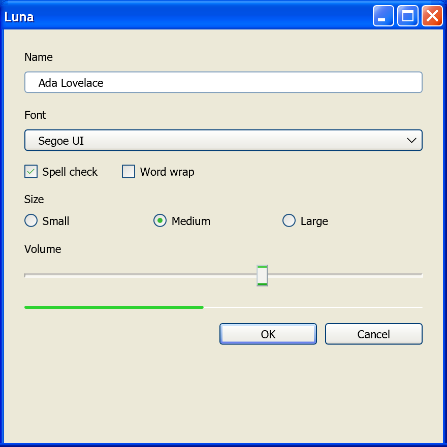

# Luna

Windows XP, 2001 to 2006; Win32 (common controls version 6) and WinForms.

Luna is the default look of Windows XP and Windows Server 2003: rounded window tops, saturated
blue captions with a "soft plastic" gradient, an amber hot state on the controls you press,
green check marks, Tahoma with three companion faces, and three hand-authored color schemes
(Blue, Olive Green, Silver) locked behind a signature check. Microsoft never shipped the name
"Luna". Users saw "Windows XP style", pre-release documents said "the Whistler style", and the
internal codename stuck.

This page is unusual among the era pages in one respect: the shipping artifact itself is the
primary source. The values below are either a declaration in `luna.msstyles`' own INI sections or
a pixel measured out of its 558 lossless bitmaps, corroborated by the 2001 design document and by
Microsoft's own later reimplementations. What the style file cannot show is what the theme engine
computed at paint time (the nine-grid stretch, an alpha blend over an arbitrary backdrop). Those
values are derived arithmetic, not observations of a running Windows XP.

!!! note "Evidence Tiers"
    This page ranks its sources, highest first:

    **Tier 0** is `luna.msstyles` from Windows XP Professional SP3 (5.1.2600.5512), its nine
    scheme and size INIs and 558 bitmaps.[^msstyles] It wins over everything below for any value
    it states.

    **Tier 1** is Microsoft's still-maintained reimplementations (WPF's
    `PresentationFramework.Luna`[^wpf] and WinForms' `ProfessionalColorTable`[^winforms]) and the
    Platform SDK headers `Uxtheme.h`, `Tmschema.h` and `winuser.h`.[^sdk]

    **Tier 2** is the *Windows XP Visual Guidelines*, 49 pages by "The Windows XP Design Team",
    dated 1 August 2001.[^guidelines] Its swatches are vector fills, so their exact RGB is
    readable; its control art is JPEG and only good to about ±3 per channel.

    **Tier 3** is ReactOS's `uxtheme` and its `Lunar` style,[^reactos] cited for the format's
    structure only. None of its values is Luna's.

    Where WPF or WinForms disagree with the shipped style, the style wins. Where a value below
    is WPF's alone, the text says so.

## Principles

### A Skin Over Windows 2000's Behavior

Luna has no interaction guidelines of its own. The only first-party design document of the era
is 49 pages of appearance: colors, fonts, icons, control art, folder layouts. It has no keyboard
model, no control-selection advice, no writing style, no motion and no accessibility chapter. The
behavioral specification for the whole XP era stays the 1999 *Microsoft Windows User
Experience*,[^wue] the same book that governs the [Windows 9x](win9x.md) era.

The architecture enforces the same split. Comctl32 version 6 does not change what a button *is*,
it changes who paints it. The class stays `BUTTON`, the messages stay `BM_*`, the styles stay
`BS_*`. An application opts in with a manifest and gets identical behavior with different
pixels. An earlier plan with new control classes (`UxButton` in a separate `UXCTRL.DLL`) failed
because programs find controls by class name.[^chen-manifest] So Luna is a renderer, not a
control library.

### The Four Adjectives

The Guidelines' "About the Design" chapter names four: **fresh, desirable, colorful, simple**.

| Adjective | What the Guidelines say | What it becomes in the grammar |
|---|---|---|
| Fresh | "Say goodbye to Windows gray and say hello to fresh colors, soft curves, rich gradients" | the warm off-white `#ECE9D8` replaces `#C0C0C0`/`#D4D0C8` |
| Desirable | "The title bar and taskbar have a soft plastic feel and colorful buttons light up on mouseover" | vertical gradients with a specular band; the amber hot ring |
| Colorful | "blues with accents of green, red and yellow"; "the green Start button and red Close button" | hue carries state and meaning |
| Simple | "Improved typography and layout provide hierarchy and clarity" | four faces with written roles |

The Controls chapter sums it up in one line: controls are characterized by "round corners,
subtle dimensionality, and color to help distinguish states". The classic era carried state by
bevel direction. Luna carries it by hue.

### The One Normative Color Rule

Everything else in the Guidelines describes appearance. The Navigation Buttons section is the one
place that prescribes meaning:

| Hue | Meaning (Guidelines, p.37) | Example |
|---|---|---|
| Blue | a neutral action | minimize a window |
| Green | the start of an action, or a simple navigation | the Go button in the Address bar |
| Red | an action with a high-impact result | the Close button, Shut Down |
| Yellow | less severe than red, but still high impact | Log Off |

With a hard scope limit on the same page: "They should not be used for command buttons." This is
the first time "destructive is red" appears in Windows as a stated principle, and it is scoped far
more narrowly than any later era scopes it. An ordinary XP dialog's OK button is never red.

### What Luna Deliberately Is Not

Each of these is a checked absence, read in the sources, not an assumption:

- **No motion system.** Zero duration, easing or timing content anywhere.
- **No elevation model.** Modeled light (gradients, specular bands, a fixed upper-left light
  source) but no height scale and no shadow tokens.
- **No accent color.** The user picks one of three complete schemes. Nothing is derived from a
  seed hue, and Olive Green is not Blue with the hue rotated.
- **No translucency.** `TransparentColor` in the style format is a color key (magenta
  `#FF00FF`), not alpha. Real alpha exists only in icon art and shell watermarks.
- **No scalable geometry.** Chrome is bitmaps stretched through nine-grid sizing margins, with
  DPI handled by picking one of several pre-drawn images.
- **Not open to third parties.** The FAQ says "At this point in time we are not allowing
  additional themes to be created for Windows XP", and "you should never use any of the theme
  bitmaps directly, you should always render the theme images using the theme API's". Microsoft
  Learn still says "Microsoft does not support the authoring of .msstyles files".[^vsoverview]

Microsoft's own user research on the reception is worth one line, because it explains the
"Fisher-Price" criticism that followed Luna from day one: "People want Luna for others, but they
want Aero for themselves."[^chen-look] Windows Classic was selectable from the start, and Classic
is not a second code path but the absence of a theme, so Luna is the first Windows look that is
optional by construction.

## Foundations

### Color

Luna's `COLOR_*` values are style content, not OS constants. The style's `[SysMetrics]` section
defines **19 of the 31 slots** and leaves the rest to the classic defaults. The values are
identical across the three size variants.

| `[SysMetrics]` key | Blue | Olive Green | Silver |
|---|---|---|---|
| `Window` | `#FFFFFF` | `#FFFFFF` | `#FFFFFF` |
| `Menu` | `#FFFFFF` | `#FFFFFF` | `#FFFFFF` |
| `MenuBar` | `#ECE9D8` | `#ECE9D8` | `#E0E2EB` |
| `Btnface` | **`#ECE9D8`** | `#ECE9D8` | `#E0DFE3` |
| `BtnHighlight` | `#FFFFFF` | `#FFFFFF` | `#FFFFFF` |
| `BtnShadow` | **`#ACA899`** | `#ACA899` | `#9D9DA1` |
| `DkShadow3d` | `#716F64` | `#716F64` | `#716F64` |
| `Light3d` | `#F1EFE2` | `#F1EFE2` | `#F1EFE2` |
| `GrayText` | `#ACA899` | `#ACA899` | `#ACA899` |
| `Highlight` | **`#316AC5`** | `#93A070` | `#B2B4BF` |
| `HighlightText` | `#FFFFFF` | `#FFFFFF` | `#000000` |
| `MenuHilight` | `#316AC5` | `#93A070` | `#BBB7C7` |
| `Background` (desktop) | `#004E98` | `#9DACBD` | `#585768` |
| `ActiveCaption` | `#0054E3` | `#8BA169` | `#C0C0C0` |
| `GradientActiveCaption` | `#3D95FF` | `#C6D2A2` | `#C8C8C8` |
| `CaptionText` | `#FFFFFF` | `#FFFFFF` | `#0E1010` |
| `InactiveCaption` | `#7A96DF` | `#D4D6BA` | `#FFFFFF` |
| `GradientInactiveCaption` | `#9DB9EB` | `#D4D6BA` | `#EEEFF7` |
| `InactiveCaptionText` | `#D8E4F8` | `#FFFFFF` | `#A2A1A1` |
| `Hottracking` | not set | not set | `#648BCB` |

What the table settles:

- **`#316AC5` is `COLOR_HIGHLIGHT` and `COLOR_MENUHILIGHT` both**, so in Blue the menu highlight
  and the selection highlight are one color.
- **`COLOR_BTNSHADOW` is `#ACA899`.** WPF's `#CBC7B8` is a real Luna color, a mid-tone in its
  reconstructed gradients, but it is not the shadow slot. The style states the same five-stop
  ramp a second time in `[globals]` (`EdgeLightColor`, `EdgeHighLightColor`, `EdgeShadowColor`,
  `EdgeDkShadowColor`, `EdgeFillColor`) and the two agree exactly.
- **Luna recolors surfaces, not text.** `MenuText`, `WindowText` and `BtnText` are all absent,
  so every piece of enabled text is the system's black.
- **`MENUHILIGHT` (29) and `MENUBAR` (30) are XP additions**, guarded by `WINVER >= 0x0501`. They
  exist because XP's menus were not drawn through the theme engine at all (see Menus below).

Next to its neighbors, the ramp shows the whole of "say goodbye to Windows gray":

| Ramp stop | Windows 95/98 | Windows 2000 | Luna Blue/Olive | Luna Silver |
|---|---|---|---|---|
| face | `#C0C0C0` | `#D4D0C8` | `#ECE9D8` | `#E0DFE3` |
| light | `#DFDFDF` | `#D4D0C8` | `#F1EFE2` | `#F1EFE2` |
| shadow | `#808080` | `#808080` | `#ACA899` | `#9D9DA1` |
| dark shadow | `#000000` | `#404040` | `#716F64` | `#716F64` |
| selection | `#000080` | `#0A246A` | `#316AC5` | `#B2B4BF` |
| desktop | `#008080` | `#3A6EA5` | `#004E98` | `#585768` |

Luna is the first era whose dark shadow is not black or near-black: `#716F64` is a warm
brown-gray that matches the face.

#### Two Disabled Grays

`COLOR_GRAYTEXT` is `#ACA899`, but the Guidelines and the style's own per-part
`TextColorDisabled` give **`#A1A192`** for disabled control text. They are not in conflict. A
themed control draws disabled text from its part (`#A1A192`); a control drawing itself the
classic way calls `GetSysColor(COLOR_GRAYTEXT)` and gets `#ACA899`. Menus use a third value,
neutral `#808080`, on their white background. Using one where another belongs is the easiest
color mistake to make in a Luna reproduction.

#### What the Schemes Change

About two thirds of the theme is scheme-invariant. The check-box and radio glyphs, the amber
interaction accent, the tab-pane gradients and the menu, tooltip and text-box colors are the same
in all three. The values a scheme actually changes:

| Role | Blue | Olive Green | Silver |
|---|---|---|---|
| button border | `#003C74` | `#376206` | `#003C74` |
| field border | `#7F9DB9` | `#A4B97F` | `#A5ACB2` (text box only) |
| group-box title | `#0046D5` | `#99540A` | `#0046D5` |
| group-box frame | `#D0D0BF` | `#D0D0BF` | `#BFB8BF` |
| progress fill | green `#2ED331` pipe | orange `#E48245` | duller green with a hard metal line |

The amber accent survives every scheme because Blue shipped first: Olive Green and Silver were
added during development as re-hues of an existing Blue design, and the re-hue touched the chrome
and left the interaction accent alone. The hot-state family in WinForms' three Luna tables is
byte-identical across all three (hover `#FFFFDE`/`#FFE1AC`/`#FFCB88`, pressed
`#FE803E`/`#FFB16D`/`#FFDF9A`). Royale, the same engine one product cycle later, replaced it
wholesale with blue-gray, so orange-on-blue hover is a Luna decision and not a Windows convention.

!!! warning "Two Menu Designs"
    The Guidelines describe Luna's own menu: white, a `#316AC5` highlight, white highlight text.
    WinForms' `ProfessionalColorTable` describes the **Office-style command bar** that XP-era
    Office and `ToolStrip` drew: near-white with an amber `#FFEEC2` hover. Both are correct for
    their own surface. Do not merge them. The same caution applies to WPF's `ToolBar*` brushes,
    which model the Office command bar, not the `TOOLBAR` theme class.

### Type

Luna is the first Windows design language with **more than one typeface as a matter of policy**.
Three of the four role statements contain the word "only":

| Face | Stated role (Guidelines p.11) |
|---|---|
| Tahoma | "the system's default font", at 8, 9 or 11 pt |
| Trebuchet MS | "used only for the title bars of windows", Bold 10 pt |
| Franklin Gothic | "used only for text over 14 point"; "should never be used for body text" |
| Verdana | "used only for title bars of tear-off/floating palettes", Bold 8 pt |

The shipped style confirms Trebuchet MS Bold 10 exactly, and adds what the document never
published: the full system font table, in three size variants.

| Slot | Normal Size | Large Fonts | Extra Large Fonts |
|---|---|---|---|
| `CaptionFont` | Trebuchet MS 10 bold | Trebuchet MS 14 bold | Trebuchet MS 17 bold |
| `SmallCaptionFont` | Tahoma 8 bold | Tahoma 9 bold | Tahoma 10 bold |
| `MenuFont`, `MsgBoxFont`, `IconTitleFont` | Tahoma 8 | Tahoma 10 | Tahoma 12 |
| `StatusFont` | Tahoma 8 | Tahoma 10 | Tahoma 10 |
| `StartPanelFont` | Franklin Gothic Medium 14 | 17 | 20 |
| `StartButtonFont` | Franklin Gothic Medium 14 italic | 17 italic | 20 italic |

Four things follow. **Verdana is not in the style at all**: the small-caption slot that actually
paints palette titles is Tahoma 8 bold, so Verdana was advice to application authors, never a
system font. **Franklin Gothic is reachable by exactly two Start-panel parts and no system
metric.** Application chrome needs Tahoma and Trebuchet MS, nothing else. **The color schemes
never change the type.** And **Tahoma is not a Luna change**: it became the Windows UI font in
Windows 2000, reaching applications through the `MS Shell Dlg 2` pseudo-font.[^uxguide] Luna
inherited it and added the other three faces.

The ramp is a short list, not a scale: Tahoma 8 (everything), Tahoma 8 bold (task-pane headers),
Tahoma 9 (help body), Trebuchet MS Bold 10 (captions), Tahoma 11 (legal, never shown), Franklin
Gothic Medium 14 and 21 (shell pages). There is no 12, 16 or 18, and no ratio between steps.

A disabled Luna label is a flat recolor to a single gray. The classic era's embossed
`DSS_DISABLED` double-draw is gone. The Guidelines never mention ClearType; Luna's typography as
documented is a grayscale-antialiased design. ClearType is widely reported to have shipped off by
default on XP, but no first-party source states it.

### Metrics

Luna did not change the layout system. Dialog-unit counts carry over from the classic era; the
pixel value of one DLU moved because the font changed. The Vista/7 UX Guide states the Tahoma 8 pt
conversion outright:

| Font | 1 hDLU | 1 vDLU | Standard button |
|---|---|---|---|
| MS Sans Serif 8 pt (95 to NT 4) | not stated | not stated | 50 × 14 DLU |
| **Tahoma 8 pt (2000, XP)** | **1.50 px** | **1.625 px** | **75 × 23 px** |
| Segoe UI 9 pt (Vista, 7) | 1.75 px | 1.875 px | 75 × 23 px, restated in pixels |

Half a pixel rounds *down* ("unlike other contexts, .5 is rounded down to 0 instead of up to 1").
The XP Guidelines state the button in both units at once: "75 pixels wide (50 dialog units) by 23
pixels tall (14 dialog units)". 50 × 1.50 = 75 and 14 × 1.625 = 22.75, rounded to 23. Two
first-party documents nine years apart agree to the pixel. The same button measures 73 × 21 when
painted, because "some controls have a one pixel invisible border", which is the Guidelines'
"the curve of a command button is a 1 pixel indent" seen from the layout side.

Every other layout rule (7 DLU spacing, 4 DLU minimum, dialog maximums) is inherited from the
classic era without restatement. Luna's own geometry lives per part, in the style:

| Part | `SizingMargins` (l, r, t, b) | `ContentMargins` | Sizing |
|---|---|---|---|
| `Button.Pushbutton` | 8, 8, 9, 9 | 3, 3, 3, 3 | Stretch |
| `Button.Groupbox` | 4, 4, 4, 4 | none | Tile |
| `Tab.TopTabItem` | 6, 6, 6, 6 | 0, 0, 0, 0 | Stretch |
| `Header.HeaderItem` | 8, 8, 3, 4 | 3, 0, 0, 0 | Tile |
| `Toolbar.Button` | 4, 4, 4, 4 | 0, 0, 0, 0 | Stretch |
| `Status` | 50, 17, 5, 9 | none | Tile |
| `Progress.Bar` | 4, 4, 3, 3 | none | Tile |
| `ScrollBar.ArrowBtn` | 5, 5, 5, 5 | 0, 0, 3, 3 | Stretch |
| `TrackBar.Thumb` | 3, 4, 3, 4 | none | Tile |
| `Window.Caption` | 28, 35, 9, 17 | 1, 1, 1, 1 | Stretch |

`[SysMetrics]` adds the non-client metrics, identical across schemes: scroll bars 17 px, caption
bar 25 px, small caption 17 px at Normal Size (19/29/19 and 21/35/21 in the two larger sizes). The
window frame border is 5 px and never scales.

DPI is a set of discrete buckets, and they are **per part**. The check box and radio button pick
13, 16 or 25 px art at 96, 118 and 185 DPI; the tree expander uses 96, 133 and 150. There is no
correct Luna at 150 %: the design supplies art for three buckets and stretches within them. The
three size variants are a separate axis, and they change almost nothing but type: every
`SizingMargins`, `ContentMargins` and image is byte-identical across them.

### Material, Depth and Edges

Luna has exactly one material, and Microsoft named it four times: **soft plastic**. A multi-stop
vertical gradient from a lighter top to a saturated bottom, a brighter band near the top as a
specular highlight, a darker line at the bottom edge. On the caption and taskbar it runs full
width; on a push button it is a soft lightening of a near-white face.

The format can declare gradients natively (five stops, positioned by ratios that sum to 255),
but Luna declines: of 174 sections that declare a background type, 151 are bitmaps, and exactly
one part in the whole style (`[ExplorerBar]`, the task-pane background) declares a gradient.
Every other gradient in the era is pixels in a bitmap, stretched by the nine-grid.

| Modern concept | Luna |
|---|---|
| elevation scale | none |
| shadow tokens | none; one boolean for menus |
| translucency, blur, glass | none; a magenta color key |
| gradients | yes, baked into bitmaps |
| specular highlight | yes, a fixed nine-grid edge band |
| text shadow | only on active window captions and the Start panel |
| minimum color depth | 15 bpp; visual styles do not run in 256 colors |

Rounding follows one rule: **field surfaces are square, chrome is rounded.** The five field
classes (edit, combo, list box, list view, tree view) are 1 px `BorderFill` parts with no border
type, so square. Everything with a curve is a bitmap part. The style declares no radius anywhere;
every curve is painted. The measured ones: the push button runs one antialiased arc of about 3 px,
the group box about 2 px, the tab's top about 2 to 3 px, and the window's top corners are a 5-row
magenta mask, not a radius at all. A maximized window loses them.

The classic bevel survives inside the engine (`DrawThemeEdge` is `DrawEdge` with part colors)
but no Luna control's identity depends on it. Two one-pass tricks replace it: a translucent
one-sided overlay that darkens one edge and lightens the opposite, and the **engraved highlight**,
a glyph drawn twice in white and in the dark color offset by (+1, +1), used on the scroll-thumb
gripper, toolbar gripper, overflow chevron and resize grip.

The era's two real shadows: `SPI_GETDROPSHADOW`, new in XP, a boolean with no exposed geometry,
under menus and drop-downs; and a Photoshop recipe for icon art (angle 135°, distance 2, size 2,
black at 75 %), which is content, not chrome. WPF's Luna supplies the only popup-shadow numbers:
`#71000000` (44 % black), offset +5, +5, with a 5 px fall-off inside the displaced rectangle, in a
`SystemDropShadowChrome` class that Luna's and Aero's WPF themes compile from the same shared
file. So the Luna and Aero popup shadows are one renderer.[^wpf]

### Motion

**None designed.** The Guidelines contain no duration, easing or transition. The era's effects are
`SystemParametersInfo` booleans, and reading the version guards in `winuser.h` dates them: every
fade, menu animation, gradient caption and hot-tracking flag sits under `WINVER >= 0x0500`, which
is Windows 2000. XP added exactly two visual toggles: `SPI_GETFLATMENU` and
`SPI_GETDROPSHADOW`.[^sdk]

Hot and pressed states switch instantly, and that is provable from two artifacts. `Tmschema.h`
reserves the `TMT_INTLIST` range from 2801 and declares nothing in it (Vista later puts
`TMT_TRANSITIONDURATIONS` there), and `GetThemeTransitionDuration` is a Vista-only export. An XP
visual style could not express a transition. A hot Luna control is a different bitmap cell
selected on the next paint.

## Controls

The state model is the same everywhere: one bitmap strip per part, one cell per state, indexed by
the `Tmschema.h` state number. **Hot is four different things**, measured from the art, and "amber
on everything" is the tempting wrong generalization:

| Hot treatment | Controls |
|---|---|
| amber accent | push button, check box, radio button (rings), tab (cap), column header (bottom bar), trackbar thumb (bands), balloon close button |
| cyan-shifted lightening | combo drop button, spin buttons, scroll arrows, scroll thumb |
| warm near-white | toolbar buttons |
| nothing | list items, the scroll track |

Pressed dims and moves the light source, where Windows 95 inverted a bevel. Disabled is a flat
recolor. Focus is the classic dotted rectangle, unchanged.

### Push Button

75 × 23 px recommended, painted 73 × 21. `BUTTON.BMP` is five 20 × 23 cells, `SizingMargins =
8, 8, 9, 9`, so the stretchable center is only 4 × 5 px.

| State | Face | Border | Ring (2 px, inset 2) | Text |
|---|---|---|---|---|
| normal | near-white ramp `#FCFCFB` → `#F3F3EF` → `#ECEBE6` | `#003C74` | none | black |
| hot | **unchanged** | `#003C74` | amber, `#FFF0CF` → `#FDD98C` → `#F8B330` → `#E59700` | black |
| pressed | reversed ramp, dark top `#D1CCC1`, light bottom `#F2F1EE` | `#003C74` | suppressed | black |
| disabled | flat `#F5F4EA` | `#C9C7BA` | none | `#A1A192` |
| defaulted | normal | `#003C74` | blue glow, `#CEE7FF` → `#BCD4F6` → `#89ADE4` → `#6982EE` | black |

The face ramp, measured down the center column (rows 4 to 18), is monotone but not linear: it falls
fast over the first four rows, crawls through the middle and drops four levels at the last row. A
three-pixel darkening down the right edge, held in the fixed right band, is the face's inner
shadow.

**Hovering a Blue or Olive button does not change its face.** In the shipping art the hot cell's
interior is pixel-identical to the normal cell's; only the amber ring is added. Silver is the one
scheme whose face shifts on hover. This is the most commonly mis-reproduced Luna behavior.

No state combines defaulted with hot or pressed, so a strip-based renderer must pick one; WPF's
precedence picks hot. WPF also binds keyboard focus to the defaulted appearance, following the
classic rule that "any command button becomes the default when users tab to it", so a focused Luna
button shows both the dotted rectangle (inset 3) and the blue glow. A checked toggle button renders
identically to a pressed button: Luna has no separate checked look for it.

WPF's reconstruction draws the button as eight stacked layers with a fill radius of 4 inside a
border radius of 3. The shipping art has **one arc**; the "fill rounder than the border" bulge is
WPF's own.

### Check Box and Radio Button

The largest authored state sets in the design: 12 check-box cells (three values × four states)
and 8 radio cells. 13 px at 96 DPI, 16 px from 118, 25 px from 185, all three shipped with
distinct art, despite the Guidelines' "only the 16x16 size is available".

| Element | Value |
|---|---|
| border | flat `#1C5180`, 1 px, **square**, all enabled states |
| well, normal | 45° diagonal `#DCDCD7` → `#FFFFFF` |
| well, hot | flat `#E7E7E3` (unchecked); near-flat `#F4F4F3` to `#F7F7F5` (checked) |
| well, pressed | `#B7B7AD` → `#EDEBDB` |
| hot ring | `#FFF0CF` → `#F8B330`, 2 px, inset 1 |
| tick | `#21A121`; pressed `#1C861A` |
| radio dot | 5 px green sphere, `#55D551` / center `#38B935` / `#139210`; no pressed variant |
| mixed mark | 7 × 7 square: `#6DBB6C` → `#76C576`; hot flat `#21A121`; pressed `#187416` → `#1F941C` |
| disabled | white well, `#CAC8BB` border and mark (radio dot `#C0BFB5`) |

Three things are worth keeping. **The glyphs are green in all three schemes**; the classic era drew
them in `COLOR_WINDOWTEXT` black. **The border is `#1C5180`, not the button's `#003C74`**: the INI's
own color hints distinguish the two, one unit apart, and no source explains why. And **hot is not
purely additive here**: the well under the ring flattens and lightens too. The shipped tick is a
2 px stroked polyline (3,5) → (5,9) → (9,3), smaller than WPF's filled six-point path.

### Text Box, Combo Box and Spin Control

Luna turns the classic two-tone sunken bevel into a **flat 1 px border**.

| Control | State | Border | Fill | Text |
|---|---|---|---|---|
| text box | normal | `#7F9DB9` | `#FFFFFF` | black |
| text box | disabled | `#7F9DB9` (unchanged) | `#EBEBE4` | `#A1A192` |
| text box | read-only | `#7F9DB9` | `#EBEBE4` | black |
| combo field | disabled | `#C9C7BA` | `#F5F4EA` | `#A1A192` |
| spin field | normal | `#828276` | `#FFFFFF` | |
| spin field | disabled | `#A1A192` | `#EBEBE4` | |

`#7F9DB9` is Luna Blue's single "sunken field edge": the five field classes carry the identical
value, and the 2001 Guidelines, WPF and WinForms agree on it to the byte. In Silver only the text
box moves to `#A5ACB2`; lists and combos keep Blue's value. A read-only text box is an authored
appearance, a disabled look with live black text. A focused text box shows **no chrome change
at all**, only the caret: no hot state, no focus rectangle. The Guidelines transpose the disabled
combo's two colors; the style has them the right way around, matching the disabled push button's
pair.

The combo's frame never reacts to the pointer; hot and pressed reach only the drop button, which is
a stretched background plus a separate chevron glyph. The spin buttons measure normal `#C0D2FB`,
hot `#D1E9FE`, pressed `#95ACF3`, disabled `#EDEDE6`.

### Lists, Trees and Column Headers

Lists share the field frame: 1 px `#7F9DB9`, square, white. **Items highlight on selection only**,
never on hover, in `COLOR_HIGHLIGHT` `#316AC5` with white text. An unfocused list keeps a separate
inactive-selection color.

The tree expander is a 9 × 9 box with radius 1 inside a 19 × 13 hit area, border `#7898B5`, a
diagonal white → `#C0B7A6` fill, and a black 5 × 5 plus or 5 × 1 minus. The indent is one 19 px
column, kept for leaf nodes so they line up with expandable ones. Tree items draw no focus visual.

The column header's hot state is a 3 px amber bar along its bottom edge, a left-to-right ramp
ending near brown (`#FCC247` hint). It is a different amber from the tab's, with no stroke. The
header face is `#EBEADB` on a `#EEEAD8` strip, not the `#ECE9D8` dialog face. The Guidelines'
"sort" state is really a gray tint down the sorted column's cells, not a header state.

### Menus

Menus are the one control with a complete color set in the Guidelines, and there is a structural
reason: **XP's menus were not themed.** Vista's `Tmschema.h` says so in a comment, "Menu was not
using theme feature in Windows XP". USER32 drew them from system colors, which is why XP needed
two new color slots.

| Element | Value | Slot |
|---|---|---|
| background | `#FFFFFF` | `COLOR_MENU` |
| highlight | `#316AC5` | `COLOR_MENUHILIGHT`, new in XP |
| highlight text | `#FFFFFF` | `COLOR_HIGHLIGHTTEXT` |
| enabled text | `#000000` | `COLOR_MENUTEXT` |
| disabled text | `#808080` | `COLOR_GRAYTEXT` |
| border and separator | `#808080` | no slot |
| menu bar | `#ECE9D8` | `COLOR_MENUBAR`, new in XP |

The drop-down is white and the bar is the dialog face; the style states both. Menus are **flat**:
`FlatMenus = true` is in the style itself, so choosing Windows Classic restores beveled menus
without touching the Effects tab. The highlight is a filled rectangle edge to edge.

### Toolbars and Tabs

The toolbar is the cheapest interactive surface in Luna. Icons have two states, default and hot,
and hot is a gamma 0.75 Levels move on the same artwork. The button strip has six cells:

| Cell | Appearance (all three schemes) |
|---|---|
| normal, disabled | fully keyed out: **nothing is drawn** |
| hot | warm near-white ramp `#FDFDFB` → `#F4F4EE` → `#E4E1D6` |
| pressed | flat `#E2E1DA` |
| checked | `#FFFFFF` |
| hot checked | `#FFFFFF` → `#F0EDE9` |

That keyed-out rest cell is the real reason XP toolbars read as flat. The toolbar separator is a
single 1 px `#CAC6AF` rule (`#BFBFC5` in Silver).

On a tab, **the body never changes**. The selected tab and the hovered tab carry the same 3 px
amber cap: a `#E68B2C` stroke row over `#FFC83C` and `#FFC73C` fill rows. The body is a near-white
ramp `#FCFCFE` → `#F4F3EE`, the pane frame `#919B9C`, and the top corners round at about 3 px.
A focused tab looks like a hovered one.

### Scroll Bar, Group Box, Status Bar and Tooltip

| Part | Values |
|---|---|
| scroll track | a near-white cylinder across the bar's width, `#EEEDE5` edges, `#F3F1EC` → `#FEFEFB`, mean `#F9F8F5`; hot cell identical to normal; pressed `#D7D5C2`/`#E3DED3` → `#FDFDF6` |
| scroll thumb | light blue body, `#C8D6FB` measured (`#C6D5FD` hint) |
| scroll arrows | slate `#4D6185` chevrons, `#C9C9C2` when disabled; two glyph sizes chosen by rectangle size |
| group box | 1 px `#D0D0BF` frame rounded at about 2 px, no fill; title `#0046D5`, disabled `#A1A192` |
| status bar | tiled beige surface; two-tone separator `#C7C5B2` and white; gripper `#B8B4A3` with a white engraved pass |
| resize grip | six 2 × 2 squares in a triangle, `#B8B4A3`, drawn twice for the engraved look |
| tooltip | untouched classic tooltip: `#FFFFE1` fill, black text, black 1 px frame, square, padding `1,1,3,1` |

libwinui draws this bar under Luna, after WPF's Luna `ScrollChrome` (Blue): a permanent 17 px
gutter that `ui::Scroll` gives up, the track above, its held half pressed, arrow buttons with a
diagonal blue gradient inside a white ring and a soft shadow line, lit on their own hover, and a
thumb with four 1 px gripper bars. Disabled, the arrows go gray and the thumb goes.

libwinui's `GroupBox` draws the Luna frame with the same geometry as Aero's (themed comctl32's:
the title 12 px in, a 2 px gap either side, the content 16 px down and 9 px in), in `#D0D0BF`
rounded at 2 px, with the `#0046D5` title.

The group box's blue title is the one place an ordinary Luna dialog shows a colored label. The
status bar is the one place Luna kept the classic etched separator. The tooltip is the clearest
case of Luna leaving something alone: `InfoBk`, `InfoText` and `WindowFrame` are among the twelve
slots the style does not set, and its only themed part is the balloon's close button, which has
a genuine amber hot state. That button's art (`BalloonClose.bmp`) is authored on `#FFFFE1`, which
backs the classic fill from inside the style itself.

The scroll track's own `FillColorHint` (`#C6D5FD`) is the thumb's value copied onto the wrong
part. Measure the track, do not read it.

### Slider (Trackbar) and Progress Bar

The slider thumb is 11 × 21 at 96 DPI (13 × 26 and 21 × 44 in the higher buckets; the "13/16/25"
in its file names is a borrowed convention, not its size). Its body and its 1 px bevel never
change; **two 2 px accent bands carry the state**.

| State | Near band | Far band |
|---|---|---|
| normal | `#48CB46` | `#1FAE1D` |
| hot = focused | `#FAC158` | `#E2A330` |
| pressed | `#48A73B` | `#1F8710` |
| disabled | `#D2D0C6` | `#C2C0B3` |

The body is `#F3F3EF` (disabled `#F5F4EA`), the bevel `#B5C4CD` above and left and `#778892` below
and right, with a one-pixel corner cut. The focused cell is byte-identical to the hot one, so on a
Luna slider focus and hover look the same. The groove is 4 px, `#F2F1E9`, sunken with a `#9D9C99`
rule above and white below, and **never filled behind the thumb**. Tick marks are `#A1A192`, the
disabled-text gray reused as decoration, and the only color the trackbar class states as a plain
property. Olive Green is the one scheme that recolors these bands; Blue and Silver share them.

The progress indicator is "the green square that fills the progress track": 6 px chunks with a
2 px gap on a white track with a `#686868` border. Blue's fill is a glossy `#ABEDAC` → `#2ED331` →
`#8EE790` pipe, Olive Green's is orange, Silver's a duller green with a hard metal highlight. This
is one of the few places a scheme changes a semantic color. There is no marquee mode in any Luna
document.

### Window Frame

The frame is non-client chrome, drawn by the system rather than by any control, but it sets the
colors an application's content sits against. At Normal Size the caption bar is 25 px plus a 4 px resize grip, Trebuchet MS Bold 10,
white text with a 1,1 shadow in `#0A1883`. The active caption is not a two-stop gradient: it rises
from `#0055E5` to a peak of `#026AFE` about two thirds down and falls to `#0043CF`. Caption buttons
are 21 × 21 at a 4 px right inset with 3 px gaps, in eight cells (four states, active and
inactive). The frame border is 5 px of painted art that never scales, darker on the right because
the window is lit from the upper left.

## Reproducing It Today

<figure markdown="span">
  { .era width="440" }
  <figcaption>libwinui's <code>Luna</code> theme, in a window opened with <code>Frame::Themed</code>.</figcaption>
</figure>

Luna is unusually well documented for a re-creation, because the style file states most of its
own values. What it does not give away is its art. About half of Luna is continuous-tone surfaces
that a modern 2D renderer can generate from measured numbers; the other half is hand-drawn pixel
glyphs, and all of it is Microsoft's copyrighted artwork. The two questions to settle are how
closely a gradient can stand in for a stretched bitmap, and where measuring ends and copying
begins.

### Exactly Reproducible

| What | Why it transfers |
|---|---|
| The `[SysMetrics]` colors and the five-stop edge ramp, in all three schemes | Declared hex values in the style. |
| Every per-state color in the control tables above | Declared hints or pixels sampled from lossless bitmaps. |
| `SizingMargins`, `ContentMargins`, the caption, scroll-bar and frame metrics, the DPI buckets | Plain numbers in the style. |
| The font table | Tahoma, Trebuchet MS, Franklin Gothic Medium and Verdana still ship with Windows. |
| Continuous-tone ramps such as the push-button face | A small measured table (15 entries for the button face) is a measurement, not a copy of the bitmap. |
| The nine-grid itself | Fixed corner and edge bands around a stretched center are ordinary geometry, as long as the renderer draws them as nine regions and not as one gradient. |
| Instant state changes | Luna has no transitions to reproduce. |
| Flat menus, the classic tooltip, the dotted focus rectangle, the square fields | System colors and 1 px rectangles. |
| The popup drop shadow | `CS_DROPSHADOW` still exists, and WPF's Luna gives the only numbers: `#71000000`, +5, +5, 5 px fall-off. |

Text is grayscale-antialiased, which is how the Guidelines present it.

### Approximated

| What | Why |
|---|---|
| Any surface drawn at a size other than its bitmap | A push button is 9 fixed rows, a 5-row center stretched to fit and 9 fixed rows. One linear gradient over the full height matches at 23 px and drifts at every other height, most visibly where the fixed bands hold the top highlight and the bottom turn-down. |
| The glossy parts: caption buttons, the Close button, the combo drop button, the spin buttons, the Start button, the rebar background | Their shading is two-dimensional (a radial specular highlight on a rounded square). A focal gradient is the right model, but its center, radius and fall-off have to be fitted to the art; the style does not declare them. |
| Rounded corners | Every curve in Luna is painted, not declared. A rounded-rectangle path at about 3 px is close, not pixel-identical, and the push button's real corner pixels cannot be settled from the style alone. |
| Glyphs: the check mark, the radio sphere, the chevrons, the caption-button symbols | Hand-drawn pixel art at three separately authored sizes (13, 16 and 25 px for check boxes and radio buttons), with no vector master. An original vector glyph matches weight, color and silhouette, not pixels, and scales better than Luna's three buckets. |
| Scaling at any DPI | Luna stretches pre-drawn art within discrete per-part DPI buckets. There is no correct Luna at 150 %, so any scale factor between buckets is an interpretation. |
| The window frame | On Windows 10 and 11 DWM draws the frame and takes only a caption color. A libwinui window opened with `Frame::Themed` draws Luna's frame itself, from the Blue style's own measurements: the caption gradient row by row, the painted frame strips, and every state of the caption buttons. It also cuts the top corners out of the window with a window region, from the style's 5-row mask, the way uxtheme shaped XP's windows. A region costs the DWM shadow, which XP windows did not have. |
| Olive Green and Silver | Measurable from the style like Blue, but only Blue is described by any document of the era. |

Embedding the art instead is not an option. `luna.msstyles` carries its own notice, "Copyright ©
Microsoft Corporation, 2000", and no redistribution license exists for it. Size is not the
obstacle: all 558 bitmaps come to about 440 KB as optimized PNG. A workable line runs inside
"procedural", not around it:

> Parametric descriptions and small measured tables of continuous tone: yes.
> Per-pixel reproductions of authored shapes: no.

Colors, margins, state counts and part names are facts about an interface. A per-pixel table of
the 13 × 13 check mark is the bitmap in a different encoding. Luna's own structure supports that
split: its 186 distinct parts divide into 91 surfaces, 91 glyphs and 4 icons, and a glyph such as
a caption symbol or a chevron is stored as a separate resource from the face it sits on. The four
genuinely irreducible parts are all Start-panel chrome that an application never draws. The Start
button itself is not among them: it is a plain green pill, and Explorer composites the Windows
flag from its own resources.

For byte-exact chrome, the one clean route is the one Wine and ReactOS took: parse a `.msstyles`
the user already owns instead of shipping one.

Three things are out of reach for any re-creation, because only a running Windows XP could show
them: what the engine's nine-grid stretch put on screen, the push button's corner pixels (the
style declares no transparency there, and the sheet's corner holds scheme-dependent residue), and
the menu animation, which XP exposes as a pair of booleans with no timing.

### Not a Theme

Some of what makes an application look like XP is layout, behavior or content, and a theme alone
cannot give it: dialog layout in dialog units (a 50 × 14 DLU button, 7 DLU margins), the keyboard
model and the rule that the focused command button becomes the default, both from the classic
era's behavioral guide, the colored navigation-button convention (a meaning, applied only to
navigation buttons), the task panes and Franklin Gothic shell pages, the icon style, and the
menu and drop-down animations, which are the user's `SystemParametersInfo` switches applied by the
system rather than a property of the style.

### High Contrast

Luna has no high-contrast scheme, by design. The *"Designed for Microsoft Windows XP"*
specification states it: "When High Contrast is enabled, Windows automatically switches the user
to the Windows Classic Style."[^logo] The high-contrast look of the era is therefore the classic
beveled construction in the system's contrast colors, and a faithful re-creation stops being
Luna while high contrast is on. The same specification separates the High Contrast *color
scheme*, a palette the user picks, from High Contrast *mode*, the `SPI_GETHIGHCONTRAST` flag
applications are asked to respond to; the flag dates from Windows 2000.

## Sources

The values on this page come from the primary sources below.

[^msstyles]: `luna.msstyles`, Windows XP Professional with Service Pack 3 (build 5.1.2600.5512),
    English volume-license installation media: the `NormalBlue`, `NormalHomeStead` and
    `NormalMetallic` INI sections for each size, the `[SysMetrics]` and `[globals]` blocks, and the
    558 lossless `BITMAP` resources. Values are read as declared or sampled from the source pixels.

[^guidelines]: The Windows XP Design Team, *Windows XP Visual Guidelines*, Microsoft, last updated
    1 August 2001, 49 pp. Colors pp.14 to 16, Controls pp.28 to 39, Fonts pp.11 to 13, FAQ pp.47
    and 48. An archived copy: <https://archive.org/details/XPGuidelines>.

[^wpf]: [dotnet/wpf](https://github.com/dotnet/wpf),
    `src/Microsoft.DotNet.Wpf/src/Themes/PresentationFramework.Luna/`:
    `Themes/Luna.NormalColor.xaml`, `Luna.HomeStead.xaml`, `Luna.Metallic.xaml`,
    `Microsoft/Windows/Themes/ButtonChrome.cs`, and the shared `BulletChrome.cs`, `ScrollChrome.cs`
    and `SystemDropShadowChrome.cs`.

[^winforms]: [dotnet/winforms](https://github.com/dotnet/winforms),
    `src/System.Windows.Forms/System/Windows/Forms/Controls/ToolStrips/ProfessionalColorTable.cs`
    (the Blue, Olive and Silver Luna tables and `InitRoyaleColors`).

[^sdk]: Microsoft Platform SDK, Windows XP SP2 edition (build 2600.2180): `Include/Tmschema.h`,
    `Include/Uxtheme.h`, `Include/winuser.h`. The Windows SDK for Windows Vista (v6.0A)
    `Tmschema.h` for the note that XP menus were not themed.

[^reactos]: [reactos/reactos](https://github.com/reactos/reactos), `dll/win32/uxtheme/` and
    `media/themes/Lunar/`.

[^wue]: Microsoft Corporation, *Microsoft Windows User Experience*, Microsoft Press, 1999.

[^uxguide]: Microsoft, *Windows User Experience Interaction Guidelines* for Windows 7 and Windows
    Vista, 2010: p.618 (the Tahoma 8 pt DLU conversion and the invisible border), p.624 (`MS Shell
    Dlg 2`).

[^logo]: Microsoft, *"Designed for Microsoft Windows XP" Application Specification*, version 2.3,
    2 January 2002, requirement S3.2. An archived copy:
    <https://archive.org/details/designed-for-windows-xp-spec-v-2.3>.

[^chen-manifest]: Raymond Chen, *The Old New Thing*, 29 January 2008,
    <https://devblogs.microsoft.com/oldnewthing/20080129-00/?p=23663>.

[^chen-look]: Raymond Chen, "The look of Luna", *The Old New Thing*, 31 March 2004,
    <https://devblogs.microsoft.com/oldnewthing/20040331-00/?p=39953>.

[^vsoverview]: Microsoft Learn, "Visual Styles Overview", Win32 Controls documentation, 31 May 2018,
    <https://learn.microsoft.com/en-us/windows/win32/controls/visual-styles-overview>.

Further first-party background: Kyle Marsh, Dave Massy and John Boylan, *Microsoft Windows XP:
What's in It for Developers?*, February 2001
(<https://learn.microsoft.com/en-us/previous-versions/ms997638(v=msdn.10)>; the hot state "in much
the same way as hot spots on a Web page"), and Paul Hellyar, *Using Windows XP Visual Styles and
PrintWindow in Windows Applications*, 25 October 2001
(<https://learn.microsoft.com/en-us/previous-versions/ms997649(v=msdn.10)>).
