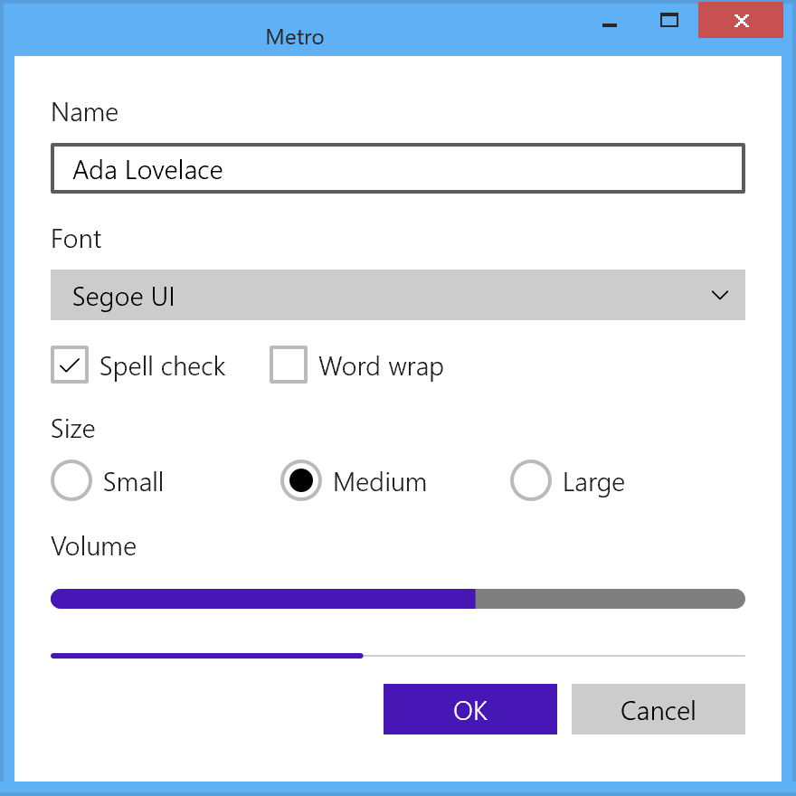

# Metro (MDL)

Windows Phone 7 and 8, Windows 8 and 8.1, 2010 to 2015; WinRT XAML and Silverlight for Windows Phone.

Metro is the design language Microsoft introduced with Windows Phone 7 in 2010 and carried into
Windows 8 and 8.1 Store apps. It is flat, typographic and square: a 20 px grid, four type sizes,
no gradients, no shadows, no corner radius, and commands hidden at the screen edge. This page
describes the Windows 8.1 variant in the most detail, because that is the one with a control
framework whose theme files shipped in an SDK. Windows 8.0 and Windows Phone are covered where they
differ.

The values on this page come from four kinds of evidence, and the page says which when it
matters:

| Tier | What it is | Used for |
|------|------------|----------|
| 1 | The shipped theme XAML: Windows 8.1 and 8.0 SDK `generic.xaml` and `themeresources.xaml`[^w81][^w80], the Windows Phone 7.1 and 8.0 SDK design XAML[^wpsdk], the Visual Studio 2012 `StandardStyles.xaml` template layer[^ss], the Windows Phone Toolkit[^toolkit] | every color, size and duration |
| 2 | The era's written guides: the Codename Metro book[^book], the Windows Phone 7 guide[^wp7], the Windows 8 UX guidelines[^win8ux] | principles, layout grid, anything no XAML states |
| 3 | Samples and decks: the Windows 8.1 Store app samples[^samples], the CeBIT 2012 deck[^cebit] | proof that a pattern shipped, never a value |
| out of era | Measurements taken on a modern Windows | labeled as such where used |

When the written guidance and the shipped XAML disagree, the XAML wins.

## Principles

### What Microsoft Called It

There is no single Metro principle set. There are three first-party framings, and they do not
share a vocabulary.

| Document | Date | Name used | Principles |
|----------|------|-----------|------------|
| *Windows Phone Design System: Codename Metro*[^book] | April 2010 | "our design language, internally code named Metro" | A manifesto (*"modern and clean … fast and in motion … about content and typography … entirely authentic"*) and three Red Threads: Personal, Relevant, Connected |
| *UI Design and Interaction Guide for Windows Phone 7*[^wp7] | July 2010 | "the Metro design style" | Five Metro principles: clean, light, open and fast; content, not chrome; integrated hardware and software; world-class motion; soulful and alive |
| *Windows 8 User Experience Guidelines*[^win8ux] | August 2012 | "Microsoft design", "Windows 8 UI"; the word "Metro" appears **zero** times | Five Microsoft design principles: show pride in craftsmanship; be fast and fluid; be authentically digital; do more with less; win as one |

The rename happened between a CeBIT deck from March 2012, which still says "Metro style apps"[^cebit],
and the August 2012 guide. "Modern UI" appears in none of the era documents. This page uses Metro,
as the 2010 documents did.

The only influence the era sources name is signage: the phone UI *"echoes the visual language of
airport and metro system signage in its design and typeface"*[^wp7]. The Swiss typographic style,
Bauhaus, Encarta and Zune's design are often named as Metro's lineage in retrospectives, but no era
source says so.

### Content Before Chrome

One idea survives all three framings, spelled three ways: *content, not chrome* (2010), *content
before chrome* (the CeBIT deck), *put content before chrome* and *content over chrome* (the Windows 8
guide). It has the biggest pixel consequence of anything Metro said about itself.

On Windows 8 the idea is spatial. App bars are hidden by default and appear on an edge swipe,
system commands live in the charms at the right edge, and apps must not show Close buttons. The
phone could not do that and kept a persistent status bar and application bar, minimized rather than
removed.

### What Turns Into Pixels

| Trait | First-party statement | How it shows in the shipped XAML |
|-------|----------------------|----------------------------------|
| Typography is the hierarchy | *"TYPOGRAPHY IS BEAUTIFUL. PERIOD."*[^book]; *"Use typography beautifully"*[^win8ux] | Four sizes and three weights; size and weight jumps, never boxes, carry structure |
| A grid and a silhouette | *"Align your app layout to the grid"*; *"a wide margin on the top, bottom, and left edges"*[^win8ux] | A 20 px unit, content 120 px from the left and 140 px from the top |
| Flat, bold color | *"Use bold, vibrant colors"*[^win8ux] | Only `SolidColorBrush` in every theme file |
| No ornament | *"No decoration, no ornamentation, no need"*[^book]; *"apps are pixels on a screen"*[^win8ux] | Zero gradients, zero shadows, zero corner radii |
| Motion carries meaning | *"Motion brings Metro to life"*[^book]; *"Use motion meaningfully"*[^win8ux] | Named OS theme animations; no timing in control templates |
| Icons flat, monochrome, glyph-drawn | *"graphic in nature, flat in perspective, and monochromatic"*[^win8ux] | Segoe UI Symbol codepoints in a ring |

### What Metro Is Not, Checked Against Tier 1

Thirteen era theme files (8.0 and 8.1 SDK, Windows Phone 7.0, 7.1 and 8.0 SDK, both Toolkits and
`StandardStyles.xaml`) were counted for the usual claims:

| Claim | Count in the shipped XAML | Verdict |
|-------|---------------------------|---------|
| No gradients | 0 gradient brushes | Holds for app XAML. The Start screen applies one to tile brand colors, drawn by the shell. |
| No rounded corners | 0 `RadiusX`/`RadiusY`; the only `CornerRadius` is the phone button's explicit `"0"` | Holds. Circles (radio buttons, rings) are true ellipses, not rounded rectangles. |
| No shadows or effects | 0 `DropShadow`, `Shadow`, `Blur` | Holds. |
| No 3D | no bevel geometry | Holds for rendering, not motion: the phone's press tilt is a perspective rotation. |
| No translucency | no blur or material brush | Mostly. Windows 8.0's dark app bar is `#E5000000`, and a few tracks and bands are alpha fills. |
| No skeuomorphism | | A preference in 2010, a principle in 2012. The toggle switch still *"mimics a physical switch"*. |

A Metro theme needs fewer primitives than any other era: flat rectangles, circles, 1 and 2 px
strokes, glyph runs and one dashed focus rectangle. The hard parts are typography, the grid and the
dark/light split.

## Foundations

Windows 8.1 values unless marked. Windows 8 values are px at the 100 % scale plateau; the OS scales
them to 140 % and 180 %, which is why every metric is a multiple of 5.

### Color

#### A Flat, One-Layer Model

Windows 8 XAML has no color ramp and no alias layer. Every color is a literal written into one of
353 per-control `*ThemeBrush` keys (267 in 8.0), repeated once per theme dictionary. There are three
dictionaries, and their names matter:

| Key | Meaning | Page background |
|-----|---------|-----------------|
| `Default` | **the dark theme** | `#FF1D1D1D` |
| `Light` | the light theme | `#FFFFFFFF` |
| `HighContrast` | every brush mapped to one of eight OS system colors | `SystemColorWindowColor` |

There is no `Dark` key in either SDK. An app that sets nothing gets dark. Windows 8 feels like a
light platform in hindsight because the Visual Studio project template sets
`RequestedTheme="Light"`: 277 of 407 `App.xaml` files in the Windows 8.1 Store app samples[^samples]
do it. The samples skew light; the platform does not.

#### The Core Brushes

| Key | Dark | Light | Rendered over the page (derived) |
|-----|------|-------|----------------------------------|
| `ApplicationPageBackgroundThemeBrush` | `#FF1D1D1D` | `#FFFFFFFF` | |
| `ApplicationForegroundThemeBrush` | `#DEFFFFFF` | `#DE000000` | `#E2E2E2`, 13.0:1 / `#212121`, 16.1:1 |
| `ApplicationHeaderForegroundThemeBrush` | `#FFFFFFFF` | `#FF000000` | the one opaque text rung |
| `ApplicationPointerOverForegroundThemeBrush` | `#CCFFFFFF` | `#CC000000` | |
| `ApplicationSecondaryForegroundThemeBrush` | `#99FFFFFF` | `#99000000` | `#A5A5A5`, 6.8:1 / `#666666`, 5.7:1 |
| `ApplicationPressedForegroundThemeBrush` | `#66FFFFFF` | `#66000000` | `#777777`, 3.8:1 / `#999999`, 2.9:1 |
| `FocusVisualWhiteStrokeThemeBrush` | `White` | `White` | same in high contrast |
| `FocusVisualBlackStrokeThemeBrush` | `Black` | `Black` | same in high contrast |

Text is alpha over the ground, not a mixed gray: 87 %, 80 %, 60 % and 40 % of white or black.
Secondary text clears the Windows 8 guide's 4.5:1 floor in both themes; the 40 % rung is for pressed
and disabled states and is not meant to carry readable content. The same 8.0 values hold, down to
the page color.

The alpha vocabulary is larger than it looks. The 8.1 `Default` and `Light` dictionaries hold 639
`#AARRGGBB` literals using **39** distinct alpha bytes. The common ones are `FF`, `66` (40 %), `99`
(60 %), `CC` (80 %), `59` (35 %, tracks and progress), `21` (13 %, the hover wash), `DE` (87 %) and
`26`, `33`, `45`, `1A` for borders.

#### Half the Brushes Ignore the Theme

177 of the 353 brushes have the same value in `Default` and `Light`. The pattern to remember is that
**input and popup surfaces are light in both themes**:

| Surface | Dark | Light |
|---------|------|-------|
| `TextBoxBackgroundThemeBrush` / `Foreground` | `#FFFFFFFF` / `#FF000000` | same |
| `ComboBoxBackgroundThemeBrush` / `Foreground` | `#CCFFFFFF` / `#FF000000` | same |
| `ComboBoxPopupBackgroundThemeBrush` | `#FFFFFFFF` | same |
| `CheckBoxBackgroundThemeBrush` | `#CCFFFFFF` | same |
| `ToolTipBackground` / `Foreground` / `Border` | `#FFFFFFFF` / `#FF666666` / `#FF808080` | same |
| `SettingsFlyoutHeaderBackground` / `Foreground` | `#FF464646` / `#FFFFFFFF` | same |
| Scroll bar: track / thumb / arrow | `#59D5D5D5` / `#FFCDCDCD` / `#99000000` | same, all seventeen `ScrollBar*` brushes |
| `MenuFlyoutSeparatorThemeBrush`, `AppBarSeparator` | `#FF7A7A7A` / `#FF7B7B7B` | same |

What flips is the chrome around them: borders, the page, button fills and all foregrounds. On top of
that, 8.1's `FlyoutPresenter`, `MenuFlyoutPresenter` and `SettingsFlyout` styles set
`RequestedTheme="Light"`, so every shipped flyout and menu is white with a black border even in a
dark app.

#### The Accent That Is Not an Accent

Windows 8 has **no accent resource**. The string `Accent` occurs zero times in either SDK's theme
files, the 8.1 high-contrast sample[^samples] reads thirteen system colors and none of them is an accent, and no
era API carries the user's Start-screen color into a Store app. The violet every Windows 8 user
remembers is a literal, `#FF4617B4`, pasted into about thirty brushes per theme together with twelve
shades that all share its hue of 258°:

| Literal | Role | Dictionary |
|---------|------|------------|
| `#FF4617B4` | base: list, combo and text selection, search button; in light also progress, slider fill and switch curtain | both |
| `#FF5F37BE` | hover on a selected item or accent fill | both |
| `#FF7241E4` | pressed slider fill and switch curtain | light |
| `#FF5729C1` / `#FF6E46CA` / `#FF7E4FEC` | switch curtain rest / hover / pressed | dark |
| `#FF5B2EC5` / `#FF724BCD` / `#FF8152EF` | progress fill and slider fill rest / hover / pressed | dark |
| `#FF8A57FF` | indeterminate progress dots | dark |
| `#FF9C72FF` | hyperlink (5.0:1 on the dark page) | dark |
| `#FF4F1ACB` | hyperlink (9.0:1 on white) | light |
| `#994617B4` | list drag background, the only translucent violet | both |

The rules the data encodes: selection fills use the base undiluted in both themes, with white text
(10.3:1). Hover is one lighter step. The dark theme lifts indicator fills (curtain, progress, slider)
one step so they read on `#FF1D1D1D`, while selection stays on the base. Hyperlink hover and press
are alpha rungs (`CC`, `99`) of the hyperlink color. Under high contrast every violet becomes
`SystemColorHighlightColor`, and hyperlinks become `SystemColorHotlightColor`.

Windows Phone is the opposite design. `PhoneAccentColor` is a real user setting: ten accents on
Windows Phone 7 (default blue `#FF1BA1E2`), twenty on Windows Phone 8. That is almost certainly where
the memory of "Metro had a user accent" comes from. It is a phone fact, not a Windows 8 fact, and the
Windows 8 Start-screen palette is not recorded in any era source.

#### Windows Phone Color

The phone uses a small token set instead: about thirty `Phone*Color` values per theme, swapped as
whole files.

| Token | Dark | Light |
|-------|------|-------|
| `PhoneBackgroundColor` | `#FF000000` | `#FFFFFFFF` |
| `PhoneForegroundColor` | `#FFFFFFFF` | `#DE000000` |
| `PhoneSubtleColor` | `#99FFFFFF` | `#66000000` |
| `PhoneDisabledColor` | `#66FFFFFF` | `#4D000000` |
| `PhoneChromeColor` | `#FF1F1F1F` | `#FFDDDDDD` |
| `PhoneTextBoxColor` | `#BFFFFFFF` | `#26000000` |
| `PhoneSemitransparentColor` | `#AA000000` | `#AAFFFFFF` |

Unlike Windows 8, the phone's page is pure black and its text boxes do flip with the theme. On
Windows Phone 8 the accent also became the interaction color: pressed buttons and focused text boxes
fill or outline with it, where Windows Phone 7 inverted like Windows 8 does.

### Typography

The Windows 8 ramp is four sizes and three weights of one family, each on a quantized line box.

| Role (8.1 style) | Size | Weight | Line box |
|------------------|-----:|--------|---------:|
| `HeaderTextBlockStyle` | 56 | Light | 40 |
| `SubheaderTextBlockStyle` | 26.667 | Light | 30 |
| `TitleTextBlockStyle` | 14.667 | SemiBold | 20 |
| `SubtitleTextBlockStyle` | 14.667 | Normal | 20 |
| `BodyTextBlockStyle` | 14.667 | SemiLight | 20 |
| `CaptionTextBlockStyle` | 12 | Normal | 20 |

The 8.1 styles set no foreground and inherit it. The 8.0 template styles set
`ApplicationForegroundThemeBrush`, and 8.0's `CaptionTextStyle` used the secondary `#99…` rung;
8.0 also had an `ItemTextStyle` (14.667 Normal) that 8.1 dropped.

The family is `Segoe UI` (`ContentControlThemeFontFamily`) and control content uses
`ControlContentThemeFontSize` = 14.667. Button, RepeatButton, ToggleButton, HyperlinkButton and
MenuFlyoutItem content is **SemiBold**. The era therefore needs five distinct faces: 300, 350, 400,
600 and 700 (the last only for the ComboBox chevron).

Three details matter for a renderer:

- **Every line is quantized.** The base style sets `LineHeight="20"` with
  `LineStackingStrategy="BlockLineHeight"`; Header overrides to 40 and Subheader to 30. A layout
  engine that derives line height from the font's ascent and descent will not reproduce Metro's
  vertical rhythm. Windows 8.0 then nudged each baseline with a `TranslateTransform` (`-1,4`,
  `-1,6`, `-2,8`); 8.1 replaced the nudge with `TextLineBounds="TrimToBaseline"`.
- **Stylistic Set 20 is part of the look.** Every ramp style sets `Typography.StylisticSet20="True"`
  and discretionary ligatures (8.1 adds case-sensitive forms). Segoe UI as it ships today still
  carries `ss20`.
- **The ramp moved from template to platform in 8.1.** In 8.0 it lived only in the project
  template's `StandardStyles.xaml` (`HeaderTextStyle` and friends); 8.1 ships the same values as
  `*TextBlockStyle` resources in `generic.xaml`. The "42 / 20 / 11 / 9 pt" ramp often quoted for
  Windows 8 is a conversion of these px values, not an era statement.

The Windows 8 guide names two system faces, Segoe and the alternate Cambria, and allows a brand face
*"if typography is important"*[^win8ux]. No XAML resource references Cambria.

Windows Phone is a different ramp on a different font, `Segoe WP`: eight sizes from 18.667 to
186.667 px, body 20, with Panorama titles at 187 px Light (170 px on Windows Phone 8). The era's own
Segoe WP files ship in both phone SDKs. The Windows 8 builds of Segoe UI and Segoe UI Symbol are not
recoverable, so glyph shapes are only checkable against today's builds.

### Metrics

#### The Grid and the Page Silhouette

> *"One unit equals 20 × 20 pixels. Each unit is further divided into subunits of 5 × 5 pixels."*
> Windows 8 UX guidelines[^win8ux]

| Metric | Value | Source |
|--------|------:|--------|
| Grid unit | 20 px | Tier 2 |
| Sub-unit | 5 px | Tier 2 |
| Page header baseline | 100 px from the top | Tier 2 |
| Content left margin | 120 px (6 units) | Tier 2 |
| Content top | 140 px (7 units) | Tier 2 |
| Bottom margin | 50 to 130 px | Tier 2 |
| Gap between groups | 80 px | Tier 2 |
| Gap between hard-edged items | 10 px | Tier 2 |
| 8.0 `GridView` padding | `116,136,116,46` (120/140/50 minus the 4 px item focus inset) | Tier 1 |
| 8.1 `GridView` padding | `120,126,120,50` | Tier 3 (one sample page) |
| 8.1 `Hub` padding | `40,60,40,0` | Tier 1 |
| App bar minimum height | 68 px | Tier 1 |

The 10 px gutter between grid items is 4 + 2 + 4: each item draws its content 4 px in from its
bounds and adds a `0,0,2,2` margin. `StandardStyles.xaml` says so in a comment.

Windows Phone runs on a 12 px module instead: `PhoneMargin`, `PhoneHorizontalMargin` and
`PhoneTouchTargetOverhang` are all 12, unchanged from 7.0 to 8.0, and `PhoneBorderThickness` is 3.

#### Corners, Borders and Targets

| Metric | Value |
|--------|-------|
| Corner radius | **0**, everywhere. 8.1 `generic.xaml` has zero `CornerRadius` and zero `RadiusX` attributes. |
| Control border | 2 px where present, flat, no bevel, no inner ring |
| Touch target (Windows 8) | 9 mm = 48 px actual target, 11 mm (about 60 px, three grid units) total including padding |
| Touch target (Windows Phone 7) | 9 mm = 34 px, never below 7 mm = 26 px |

Metro is the only era in this series with no rounded geometry at all. Even
[MDL2](mdl2.md) had a rounded ToggleSwitch track and Slider thumb.

#### Elevation and Materials

None. No shadow, blur, gradient or material brush exists in any era theme file. Overlays separate
from content with a 2 px contrasting border and z-order, not a shadow. Windows 8 has three
translucent surfaces that lie over content: the 8.0 dark app bar (`#E5000000`, opaque in 8.1), the
tile text band (`#A6000000`) and the floating FlipView and SemanticZoom buttons and scroll-bar track
(`#59D5D5D5`). High contrast removes all translucency.

### Motion

Metro templates contain almost no timing.

| Count in 8.1 `generic.xaml` | Value |
|-----------------------------|------:|
| Zero-length durations (`Duration="0"`, `"0:0:0"`) | 184 |
| Non-zero durations | 13, all in list/grid item selection and drag hints and `ProgressBar` |
| Duration, spline or easing *resources* | 0 |
| Inline `KeySpline`s | 40, all in `ProgressBar`'s dot choreography |

Every control state change is a `DiscreteObjectKeyFrame KeyTime="0"`: instant. There are no motion
tokens. Whatever moves (page entrances, flyouts, list reorders) calls a named OS theme animation such
as `EntranceThemeTransition`, `PointerDownThemeAnimation` or `SplitOpenThemeAnimation`, and those
timings live in the OS animation library. No surviving era source states them. Running the animation
metrics API on a modern Windows reports a decelerate curve `cubic-bezier(0.1, 0.9, 0.2, 1)` and a
167 ms press scale to 0.975, but that is an out-of-era measurement and should not be read as Windows 8.

Three things that are commonly assumed and are wrong:

- **Buttons do not tilt.** `PointerDownThemeAnimation` appears only on list items, grid items and
  search suggestions. A button's press feedback is the color inversion and nothing else.
- **There are no page navigation transitions.** `NavigationThemeTransition` and the
  `*NavigationTransitionInfo` family do not exist in either Windows 8 SDK; they are Windows Phone 8.1
  and Windows 10 API. The Windows 8 page entrance is an `EntranceThemeTransition` on the root panel.
- **The indeterminate ProgressBar is choreographed in XAML**: five dots on a 3.917 s loop, 0.167 s
  apart, easing in on `KeySpline 0.4,0,0.6,1`.

The phone is where Metro's motion lives: the Toolkit's turnstile rotates pages from −80° to 0 in
350 ms (`ExponentialEase` 6), items feather in on a 40 to 50 ms stagger, and the tilt effect leans up
to 0.3 rad toward the finger and sinks up to 25 px.

### Focus and Interaction States

| State | Rule |
|-------|------|
| Keyboard focus | Two coincident 1 px dashed rectangles, `White` and `Black`, `StrokeDashArray="1,1"`, offsets 1.5 and 0.5 so the dashes interleave. Same colors in every dictionary, high contrast included. |
| Pointer focus | Nothing. `PointerFocused` is an empty state in all 25 templates that have it. |
| Hover | A low-alpha wash: `#21FFFFFF` (13 % white) on a dark button. |
| Press | A hard polarity inversion: foreground and background swap. |
| Disabled | `66` alpha (40 %) on the foreground. |
| Transitions | Instant. |

Press as an inversion rather than a darkening is the single most recognizable Metro interaction and
the opposite of every other era. Accent-filled parts (ToggleSwitch curtain, Slider fill) lighten on
press instead. The dashed pair is the rule with four exceptions: list and grid items use a solid 2 px
rectangle, ComboBox fills with the accent, MenuFlyoutItem gets its hover background, and text boxes go
to full opacity.

Windows Phone has no focus visual and no hover at all: *"There is no visible focus state"*[^wp7].

## Controls

### Button

Dark and light buttons are two different constructions drawn by one template. A per-theme
*thickness* token, `ButtonBorderThemeThickness` (2 dark, 0 light, 2 high contrast), picks between an
outline and a fill.

| Property | Value |
|----------|-------|
| Padding | `12,4,12,4` (RepeatButton, ToggleButton, HyperlinkButton: `12,4,12,5`) |
| Outer margin | `Margin="3"` around the visible `Border`, which keeps the dashed focus ring clear of the 2 px stroke |
| Font | Segoe UI 14.667 SemiBold |
| Minimum size | none set |
| Label alignment | centered |

| State | Dark fill | Dark border | Dark text | Light fill | Light text |
|-------|-----------|-------------|-----------|------------|------------|
| Rest | transparent | 2 px `#FFFFFFFF` | `#FFFFFFFF` | `#B3B6B6B6`, no border | `#FF000000` |
| Hover | `#21FFFFFF` | 2 px `#FFFFFFFF` | `#FFFFFFFF` | `#D1CDCDCD` | `#FF000000` |
| Pressed | `#FFFFFFFF` | `#FFFFFFFF` | `#FF000000` | `#FF000000` | `#FFFFFFFF` |
| Disabled | transparent | `#66FFFFFF` | `#66FFFFFF` | `#66CACACA` | `#66000000` |

The label is centered even though the `Button` style sets `HorizontalAlignment="Left"`. That setter
places the button in its parent. The label follows `HorizontalContentAlignment`, which the style
never sets; of the 22 styles in 8.1 that do set it, not one sets `Center`, which settles the default.

**ToggleButton** checked is monochrome, not accent: white fill with black text in dark, black fill
with white text in light. In light it is a 2 px `#FF000000` outline on transparent rather than a gray
fill, because its border thickness is 2 in all three dictionaries.

**HyperlinkButton** has no underline on Windows 8 and changes only its foreground, on the violet
hyperlink color. The Windows Phone one is the opposite: foreground-colored and underlined.

On Windows Phone 7 a pressed button inverts like Windows 8; Windows Phone 8 fills it with the accent
and white text, and moved the font from 25.333 to 22.667 px.

### CheckBox and RadioButton

The border inversion from Button repeats here, reversed: `CheckBoxBorderThemeThickness` and
`RadioButtonBorderThemeThickness` are **0 in dark and 2 in light** and high contrast.

| Property | CheckBox | RadioButton |
|----------|----------|-------------|
| Indicator | 21 × 21 square | 23 × 23 ellipse |
| Glyph | 16 × 14 vector tick; 9 × 9 indeterminate square | 13 × 13 dot |
| Indicator column | 27 px | 29 px |
| Box fill | `#CCFFFFFF`, both themes | same |
| Box border | none (dark) / 2 px `#45000000` (light) | same |
| Glyph color | `#FF000000`, both themes | same |
| Disabled glyph | `#66000000` | same |

A dark check box is a solid near-white square on the dark page. A light one is a faint outline on a
white page. The glyph stays black because it always sits on the light box. Pressed is a white box
with a black glyph in dark, and an inversion (black box, white glyph) in light. Neither the box nor
the dot resizes with state.

The radio button's ellipse is the one round shape in the era.

### ToggleSwitch

| Property | Value |
|----------|-------|
| `MinWidth` | 154 (6 + 65 + 7 + 13 + 50 + 13) |
| Track | 50 × 19, square: a 44 px curtain inside a 2 px outer and 1 px inner border |
| Knob | 12 px wide rectangle, full track height |
| Knob travel | 38 px (12 + 38 = 50) |
| On color | the 44 px accent curtain wiping in behind the knob: `#FF5729C1` dark, `#FF4617B4` light |
| Curtain hover / pressed | `#FF6E46CA` / `#FF7E4FEC` dark, `#FF5F37BE` / `#FF7241E4` light |
| Motion | none in XAML beyond `RepositionThemeAnimation` |

It is the only toggle that uses the accent. It is not a capsule.

### Slider

| Property | Value |
|----------|-------|
| Track height | 11 (`SliderTrackThemeHeight`) |
| Thumb | an 11 × 11 square `Border`, 1 px border; width and height both bind to the track height |
| Thumb color | white in dark, black in light; never changes on hover or press |
| Fill (decrease side) | `#FF5B2EC5` → `#FF724BCD` → `#FF8152EF` dark, `#FF4617B4` → `#FF5F37BE` → `#FF7241E4` light |

All state feedback is on the track fill.

### Text Input

A Windows 8 text box is a **white box in both themes** with black text. The theme changes only the
border and an opacity ladder.

| Property | Value |
|----------|-------|
| Minimum size | 64 × 32 |
| Padding | `10,3,10,5` |
| Border | 2 px; `#FFFFFFFF` dark, `#A3000000` light |
| Background / border opacity, rest | 0.8 / 0.8 dark, 0.8 / 0.45 light |
| Background / border opacity, hover | 0.87 / 0.87 dark, 0.87 / 0.73 light |
| Focused | full opacity (the `Focused` state is empty, so the animations are released) |
| Placeholder (8.1) | `#AB000000`, both themes |
| Selection highlight (8.1) | `#FF4617B4`, both themes |
| Delete / reveal buttons | Segoe UI Symbol `U+E0A4` / `U+E052` |

The state feedback is opacity, not color.

### ComboBox

| Property | Value |
|----------|-------|
| Face | `#CCFFFFFF` fill, black text, in both themes |
| Border | 2 px; `#CCFFFFFF` dark (merges with the fill), `#45000000` light |
| Chevron | Segoe UI Symbol `U+E011`, Bold, 21 px, in a fixed 32 px column |
| Focus | the text column fills with `#FF4617B4` and the text turns white; no dashed ring |
| Drop-down | `#FFFFFFFF` with a 2 px `#FF212121` border, both themes |
| Opening | around the selected item (`CarouselPanel` with split open/close animations), not below the box |

The 8.1 DatePicker and TimePicker are three stock ComboBoxes side by side. Windows 8.0 XAML had no
picker.

### Lists and Grids

Selection draws three things, each at a 4 px inset: an accent fill behind the content, a 4 px accent
border, and a 40 × 40 right-triangle "earmark" in the top-right corner carrying a 15 × 13 vector check
mark. The fill is the base violet in both themes, `#FF5F37BE` on hover, with white text. List items
signal press with `PointerDownThemeAnimation` (a tilt) rather than a color change, and disable to
opacity 0.55.

8.1 replaced the 430-line, 31-state item template with a native `ListViewItemPresenter` that draws
the same geometry.

### App Bar and Commands

| Property | Value |
|----------|-------|
| App bar minimum height | 68 |
| App bar background | `#FF000000` dark, `#FFF0F0F0` light (8.0: `#E5000000`, `#FFFFFFFF`) |
| App bar border | 2 px on the content-facing edge, same color as the background; visible only in high contrast |
| AppBarButton slot | 100 px wide |
| Ring | 40 × 40, 2 px stroke (two `Ellipse`s in 8.1; two Segoe UI Symbol glyphs in 8.0) |
| Command glyph | 20 px |
| Label | 12 px, 88 px wide |

The app-bar background is the only `Default`/`Light` value that changed between 8.0 and 8.1. On 8.1
`CommandBar.SecondaryCommands` is not an overflow menu: secondary commands sit in a left-aligned
stack and primary commands on the right, with no "…" button.

**Hub** (8.1 only) has a 56 px Light header at `Padding="40,60,40,0"`; section headers are 26.667 px
SemiLight, hover `#FFD1D1D1` and pressed `#FF777777` in both themes.

Windows 8.1 has **no** NavigationView, SplitView, Pivot or TabView. Phone pivots are type alone:
72 px SemiLight headers at 0.4 opacity when unselected.

### Flyouts, Menus and Tooltips

| Surface | Value |
|---------|-------|
| Flyout | white, 2 px `#FF000000` border, padding `20,17,20,20`, maximum 450 × 718; forced to the Light theme |
| MenuFlyout | white, black text; item hover `#FFE5E5E5` with black text, never the accent |
| SettingsFlyout | 346 px wide, 80 px `#FF464646` header with white text in both themes, 26.667 px SemiLight title |
| ToolTip | white, 2 px `#FF808080` border, 12 px `#FF666666` text, padding `10,6,10,7`, identical in both themes |
| Light-dismiss scrim | none; only the system `MessageDialog` dims the app |

Forcing the Light theme re-resolves the whole popup subtree, not just its fill: the stroke becomes
`FlyoutBorderThemeBrush` black and the content reads the Light foreground. A framework that swaps only
the fill draws a white box, stroked white, holding white text.

### Scroll Bar

Theme-invariant: a `#FFCDCDCD` thumb on a `#59D5D5D5` track with `#99000000` arrows, in both themes.
The mouse bar is 17 px thick with 33 px arrow buttons and a 48 px minimum thumb; the touch panning
indicator is a 4 px bar. Both overlay the content rather than taking layout space.

### ProgressBar and ProgressRing

| Property | Value |
|----------|-------|
| Track | `#59FFFFFF` dark, `#30000000` light |
| Fill | `#FF5B2EC5` dark, `#FF4617B4` light |
| Indeterminate dots | `#FF8A57FF` dark, `#FF4617B4` light; they ignore `Foreground` |
| Minimum height | 6 (8 in high contrast) |
| ProgressRing | five dots (six at the large size) on a 3.217 s cycle, 0.167 s and 6° apart |

### High Contrast

`HighContrast` maps every brush onto eight OS system colors: `ButtonText` (115 brushes), `ButtonFace`
(77), `Highlight` (52), `GrayText` (39), `HighlightText` (32), `WindowText` (14), `Hotlight` (11) and
`Window` (8). Six brushes are not system colors: the focus pair stays black and white, three borders
are transparent, and the ComboBox placeholder keeps `#88000000`.

High contrast changes geometry too. Button and check-box borders are both 2 px (dark's outlined
button and light's outlined box at once), tracks and the progress bar gain a 1 px border, text-control
opacities go to 1, and the progress bar's minimum height rises from 6 to 8. It is also the one
dictionary where the check box itself reacts to hover and press.

## Reproducing It Today

<figure markdown="span">
  { .era width="440" }
  <figcaption>libwinui's <code>Metro</code> theme, in a window opened with <code>Frame::Themed</code>.</figcaption>
</figure>

Metro is the easiest era to draw and the easiest to source. Every value is a literal in a shipped
SDK dictionary: there is no bitmap archive to leave out and no glyph sheet to redraw, because the
chrome glyphs are font codepoints. Its primitives (flat rectangles, true ellipses, 1 and 2 px
strokes, glyph runs, a dashed rectangle) map one to one onto Direct2D and DirectWrite. What makes
it hard is the model, not the drawing.

### Exact From the Data

| What | Why it is exact | What to watch for |
|------|-----------------|-------------------|
| Every color, thickness and opacity | Literals in the 8.1 `Default`, `Light` and `HighContrast` dictionaries | Transcribe per control, not per role. 177 brushes do not flip with the theme, and 13 non-brush values do (the button and check-box border thickness, the text-control opacities, and more). A model that only swaps colors on a theme change draws the wrong construction on the most common control. |
| Geometry | Radius 0, 2 px borders, the templates' sizes | "Square" has to hold for every radius a renderer knows about: popups, the switch track and the slider thumb as well as buttons. A switch drawn as a capsule by default is the usual leak. |
| The dashed focus pair | Two ordinary 1 px dashed strokes with a known dash and offset | Keep the 3 px margin outside the button's visible box, or the focus ring collides with the border. |
| State feedback | Press inversion, hover wash, 40 % disabled rung, all instant | Draw no transition and borrow no easing curve: the era has none for control states. |
| The type ramp | Four sizes, three weights, fixed line boxes | Needs a text engine that takes a fixed line height (DirectWrite's uniform line spacing does) and an OpenType switch for `ss20`. Without them the sizes are right and the rhythm and glyphs are not. |
| Light-forced popups | The 8.1 styles say so | Re-resolve the whole popup subtree, not just its fill (see [Flyouts, menus and tooltips](#flyouts-menus-and-tooltips)). |
| The ProgressBar and ProgressRing dots | The keyframes and splines are in the template | The dot geometry scales with the control's width in code that is not in XAML, so sizes are a choice. |

### Approximated

- **Fonts.** Segoe UI, Segoe UI Semilight and Segoe UI Symbol still ship with Windows, and the
  symbol font still carries every command codepoint the era used (`U+E100` to `U+E1E9`). The
  Windows 8 builds of these fonts are not recoverable, so today's glyph shapes are a stand-in and a
  glyph that renders proves nothing about how the era drew it. Segoe WP ships with the phone SDKs,
  not with desktop Windows.
- **Theme animation timings.** Entrances, flyouts and list reorders call named OS theme animations
  whose timings lived in the Windows 8 animation library and are not stated in any era source.
  Anything used today is borrowed from a later Windows and should be labeled as such.
- **Runtime-computed values.** Combo box popup height, progress-dot geometry and flyout placement
  offsets are computed in control code and cannot be read from any theme file.
- **A user accent.** Windows 8 has none. An implementation that offers one is adding a non-era
  feature, and because the era's hover and pressed shades are unrelated literals rather than a ramp,
  any shades derived from a user color are invented, not era data.
- **Text rasterization.** No era source describes how WinRT XAML antialiased text, so any choice
  between grayscale and ClearType is unverified.
- **Desktop window corners.** Windows 8 windows were square and Windows 11 rounds them by default.
  DWM still lets a window opt out of rounding and decline a system backdrop, which is all Metro
  needs: it used no glass, blur or material, so nothing the OS dropped is missing.
- **The desktop window frame.** DWM draws the frame of the running OS. A libwinui window opened
  with `Frame::Themed` draws the Windows 8 frame itself, measured from the Windows 8 style's DWM
  atlas: an 8 px frame and a 23 px caption in one flat window color, a 2 px outer edge 10 %
  darker, a centered title in `#282828`, and flat buttons hanging from the top edge. Minimize and
  maximize turn `#3665B3` when hot and `#3D6099` when pressed. Close is `#C75050`, `#E04343` hot
  and `#993D3D` pressed. An inactive window takes a fifth of the color over white. Windows 8 took
  the window color from the wallpaper, so the pack uses the default wallpaper's sky blue
  `#60B0F5`, or the app's accent when it sets one. The button sizes are the art's (28, 30 and
  47 × 20 px), and their placement is not documented.

### Not Appearance

A theme cannot give these, because they are layout, interaction or content rather than looks:

| Trait | What it is |
|-------|------------|
| The 20 px grid, the 120 / 140 content origin, the page silhouette | Layout. It is the most Metro thing an application can do, and the application has to do it. |
| Edge-hidden commands, the app bar, the charms | Interaction model and shell surfaces |
| Tiles, badges, toasts, splash screens, `MessageDialog`, `PopupMenu`, the Start screen | Drawn by the shell, not by a control framework |
| Lowercase headings, ALL CAPS app titles | Application content |
| The 100 / 140 / 180 % scale plateaus | A DPI model, and the reason every metric is a multiple of 5 |
| The press tilt on list items, the phone's turnstile and tilt | Motion tied to specific controls, not state colors |
| Windows Phone pivots and panoramas | The same design language on a different framework |

### High Contrast Today

The era's high-contrast mechanism is mechanical: every literal becomes one of eight system colors
(see [High contrast](#high-contrast) above), so a re-creation that resolves them from the live OS
palette follows the era exactly. Two things are easy to miss. Eleven brushes (hyperlinks, and hub
and list headers on hover) use `Hotlight`, a system color many high-contrast palettes leave out.
And the dictionary changes geometry as well as color, so a high-contrast theme that only swaps
colors is incomplete. High contrast is also the one place a user-chosen color ever reached a
Windows 8 app.

## Sources

[^w81]: Microsoft, Windows 8.1 SDK (2013), `Include/winrt/xaml/design/generic.xaml` and `themeresources.xaml`. The primary value source for this page: the `Default`, `Light` and `HighContrast` theme dictionaries and every control template.
[^w80]: Microsoft, Windows 8 SDK (2012), `Include/winrt/xaml/design/generic.xaml` and `themeresources.xaml`. The 8.0 baseline for every 8.0 to 8.1 comparison.
[^wpsdk]: Microsoft, Windows Phone SDK 7.1 (2011) and Windows Phone SDK 8.0 (2012), `Design/System.Windows.xaml` and `ThemeResources.xaml`, including the per-accent dictionaries and the Segoe WP fonts.
[^ss]: Microsoft, `StandardStyles.xaml`, the `Common/` layer stamped into every Visual Studio 2012 Windows Store app project; copies survive in the samples of [microsoftarchive/msdn-code-gallery-microsoft](https://github.com/microsoftarchive/msdn-code-gallery-microsoft). Two builds circulate (about 59 KB and 119 KB); values here are from the smaller, majority copy.
[^toolkit]: Microsoft, Windows Phone Toolkit, August 2013 release (MS-PL, shipped as the `WPtoolkit` NuGet package), [microsoftarchive/WindowsPhoneToolkit](https://github.com/microsoftarchive/WindowsPhoneToolkit): `Themes/Generic.xaml` and `Effects/TiltEffect.cs`, `TurnstileFeatherEffect.cs`.
[^book]: Microsoft, *Windows Phone Design System: Codename Metro*, April 2010, 24 pages.
[^wp7]: Microsoft, *UI Design and Interaction Guide for Windows Phone 7*, version 2.0, July 2010 (pre-release documentation).
[^win8ux]: Microsoft, *Windows 8 User Experience Guidelines*, 14 August 2012, 314 pages. Principles pp. 6 to 7, page layout pp. 28 to 33, typography pp. 29 and 59 to 64.
[^samples]: Microsoft, Windows 8.1 Store app samples, as preserved in the 2015 snapshot [oldnewthing/old-Windows8-samples](https://github.com/oldnewthing/old-Windows8-samples) (including the `HighContrast` sample and the sample pages built on the Visual Studio 2013 templates).
[^cebit]: Dariusz Parys (Microsoft), *Metro Style Apps mit HTML5 + JavaScript*, CeBIT 2012, 21 March 2012.
