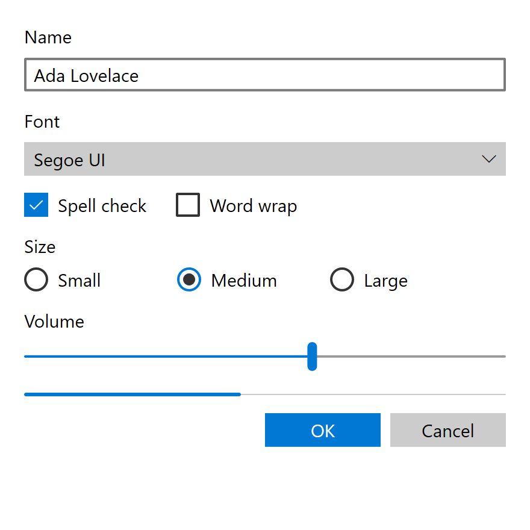

# MDL2

Windows 10 from 1507 (July 2015) to 1703 (April 2017); UWP and WinRT XAML. The flat, square,
thin-stroked look Windows 10 launched with, before Acrylic, Reveal and rounded corners arrived with
the Fluent Design System.

"Microsoft Design Language 2" is a press name. No Microsoft document of the era uses it: the
378-page August 2015 UWP design guidelines contain the phrase "design language" zero times.[^v1509]
The name is kept here because everyone uses it.

!!! note "Evidence Tiers"
    Values on this page are graded by where they come from.

    **Tier 1** is the shipped implementation: the `generic.xaml` and `themeresources.xaml` of the
    four era Windows 10 SDKs (builds 10240, 10586, 14393 and 15063).[^sdk]

    **Tier 2** is the era's written guidance, which survives as two snapshots bracketing the era:
    the August 2015 *UWP app design guidelines*[^v1509] and the `windows-dev-docs` repository as of
    2017-05-12.[^docs]

    **Tier 3** is shipping samples, used only as corroboration.

    Where Tier 1 and Tier 2 disagree, the XAML wins. Most of the geometry on this page is Tier 1,
    because the prose of this era almost never quotes a control's box model.

## Principles

MDL2 has no principles page. That is a finding rather than a gap in reading. The Windows 8
guidelines of 2012 opened with five named "Microsoft design principles" (pride in craftsmanship,
fast and fluid, authentically digital, do more with less, win as one).[^win8uxg] The 2015 UWP
guidelines, from the same series of consolidated PDFs, drop that section entirely. What they
describe instead is platform mechanics, organized around device families (Mobile, Desktop, Team,
IoT) rather than around an aesthetic:

| Built-in feature | What it means |
| --- | --- |
| Effective pixels and scaling | A density-aware scaling model so a 24 px font reads the same on a phone at arm's length and on a Surface Hub at ten feet. |
| Universal input | Apps target "smart" pointer interactions, not mouse-versus-touch branches. |
| Universal controls | One input-aware control set for every device family. |
| Universal styles | Automatic light/dark theme with accent participation, a Segoe type ramp, default animations, high contrast, RTL and font fallback. |

The visual language has to be reconstructed from what the foundations specify and, just as much,
from what they never mention:

- **Flat, square, thin-stroked.** No corner radius resource, no elevation, no material, no
  directional light. Depth comes from z-order and from the opaque `Chrome*` grays, nothing else.
- **Personal color, not brand color.** The user picks an accent from 48 curated swatches and it
  tints interactive parts. The app brings almost no color of its own beyond the neutral ramp.
- **Light and dark as use cases.** Light for reading-heavy productivity apps, dark for media apps,
  the system setting for everything else.
- **Motion as named behavior.** `FadeInThemeAnimation`, `EdgeUIThemeTransition` and friends are
  prescribed by purpose. The prose never gives a duration or an easing value.
- **Icons as construction.** The icon guidance is the most numeric part of the era's prose: four
  angle pairs, quarter- and eighth-circle arcs, fill limits on a 32 px grid.

### What MDL2 Is Not

These are checked absences. The mechanism that eventually fills each one is dated two to four years
after 1703:

- **No material.** Acrylic ships in 1709. Transparency in MDL2 is flat alpha on a brush.
- **No Reveal.** Hover and press are flat brush swaps.
- **No elevation or shadow.** `ThemeShadow` needs 19H1 (2019).
- **No rounded corners**, with two exceptions found in the SDK XAML, not in the prose: the Slider
  thumb and the ToggleSwitch track. Rounding as a resource arrives with WinUI 2.2 in August 2019.
- **No selection indicator anywhere.** Lists, drop-downs, tab strips and the nav pane mark
  selection with a fill or a label color, never with a bar or pill.
- **No scrim by default.** `LightDismissOverlayMode` is `Auto`, which dims only on Xbox.
- **No semantic status colors.** The first one in SDK XAML, `SystemErrorTextColor`, arrives in
  1809.

One trap for anyone reading the documentation snapshot directly: the 2017-05-12 tree already holds
draft articles for Acrylic, Reveal, Parallax, NavigationView, PersonPicture, RatingControl,
ColorPicker and TreeView, merged from a `build2017` branch four days earlier and each marked "hasn't
been released yet". None of them shipped before 1709 (ColorPicker and TreeView not before 1809), so
none of them is MDL2. They are covered on the [Fluent](fluent.md) page.

## Foundations

### Color

MDL2 is the first Windows era with a real token system, in three layers: 24 `System*Color` values,
then `SystemControl*Brush` aliases named `SystemControl[HighContrast name][light/dark name]Brush`,
then the controls. That makes a role-based palette the era-correct shape here, which it is not for
[Metro](mdl.md), where every color is a literal pasted into a per-control brush.

The 24-key ramp, published in two columns. The table below is Tier 2 prose, and it matches the
`Default` and `Light` dictionaries of the 1507 SDK key for key.[^docs][^sdk]

| Key | Light | Dark |
| --- | --- | --- |
| `SystemAltHighColor` | `#FFFFFFFF` | `#FF000000` |
| `SystemAltLowColor` | `#33FFFFFF` | `#33000000` |
| `SystemAltMediumColor` | `#99FFFFFF` | `#99000000` |
| `SystemAltMediumHighColor` | `#CCFFFFFF` | `#CC000000` |
| `SystemAltMediumLowColor` | `#66FFFFFF` | `#66000000` |
| `SystemBaseHighColor` | `#FF000000` | `#FFFFFFFF` |
| `SystemBaseLowColor` | `#33000000` | `#33FFFFFF` |
| `SystemBaseMediumColor` | `#99000000` | `#99FFFFFF` |
| `SystemBaseMediumHighColor` | `#CC000000` | `#CCFFFFFF` |
| `SystemBaseMediumLowColor` | `#66000000` | `#66FFFFFF` |
| `SystemChromeAltLowColor` | `#FF171717` | `#FFF2F2F2` |
| `SystemChromeBlackHighColor` | `#FF000000` | `#FF000000` |
| `SystemChromeBlackLowColor` | `#33000000` | `#33000000` |
| `SystemChromeBlackMediumLowColor` | `#66000000` | `#66000000` |
| `SystemChromeBlackMediumColor` | `#CC000000` | `#CC000000` |
| `SystemChromeDisabledHighColor` | `#FFCCCCCC` | `#FF333333` |
| `SystemChromeDisabledLowColor` | `#FF7A7A7A` | `#FF858585` |
| `SystemChromeHighColor` | `#FFCCCCCC` | `#FF767676` |
| `SystemChromeLowColor` | `#FFF2F2F2` | `#FF171717` |
| `SystemChromeMediumColor` | `#FFE6E6E6` | `#FF1F1F1F` |
| `SystemChromeMediumLowColor` | `#FFF2F2F2` | `#FF2B2B2B` |
| `SystemChromeWhiteColor` | `#FFFFFFFF` | `#FFFFFFFF` |
| `SystemListLowColor` | `#19000000` | `#19FFFFFF` |
| `SystemListMediumColor` | `#33000000` | `#33FFFFFF` |

How to read it:

- `Alt` and `Base` are exact opposites, of each other and of themselves across themes, on six alpha
  steps: `19` (10 %), `33` (20 %), `66` (40 %), `99` (60 %), `CC` (80 %) and `FF` (100 %). Fluent
  inherits this vocabulary unchanged, which is why the color step from MDL2 to Fluent is small and
  the material step is total.
- These are **alpha rungs**. A disabled or secondary color is the base color composited over
  whatever is behind it. Baking them into opaque grays works on the default page and breaks over a
  selection, an image or any other surface.
- The `Chrome*` family is the exception: real opaque grays, already inverted per theme. They give
  MDL2 chrome its tonal weight without any accent.
- The page background, `ApplicationPageBackgroundThemeBrush`, is a flat literal rather than an alias
  (`#FFFFFFFF` Light, `#FF000000` Dark).

**The dark theme is first-class.** The ramp is published in both columns, the guidance tells apps
which to pick, and the 1507 SDK's unnamed `Default` dictionary, the one an app gets when it asks for
nothing, is the dark one (`SystemAltHighColor` = `#FF000000`). The honest boundary: whether a
system-wide "app mode" setting existed on day one of 1507 is not established. The claim is "MDL2 has
a dark theme", not "Windows 10 shipped a dark mode at launch".

The brush layer is the era's own invention. Its size, counted in the SDKs:

| Build | `SystemControl*` keys | `*ThemeBrush` keys |
| --- | --- | --- |
| Windows 8.1 | 0 | 354 |
| 1507 (10240) | 83 | 373 |
| 1511 (10586) | 84 | 373 |
| 1607 (14393) | 89 | 387 |
| 1703 (15063) | 91 | 395 |
| 1709 (Fluent) | 153 | 402 |

All 83 of 1507's `SystemControl*` keys are new with Windows 10, while almost all `*ThemeBrush` keys
are inherited from 8.1. The era grows gently, and the jump of 62 keys at 1709 is Fluent arriving.
A current Windows SDK carries 163 such keys, which is not the MDL2 set, so a modern key list is no
guide to what an era control could bind.

#### Accent

MDL2 is the first era where the OS accent really reaches controls. Aero's colorization tinted only
the frame, and Metro's violet was a literal. The user picks one of 48 curated swatches in Settings
(21 TV-safe ones on Xbox), and apps consume it as `SystemAccentColor` plus six luminosity shades.
There is no accent literal an app author was expected to hard-code.

The default accent, before any user choice, is `#0078D7`, and the era's own worked example derives
its shades from it:[^docs]

| Resource | Value |
| --- | --- |
| `SystemAccentColorLight3` | `#A6D8FF` |
| `SystemAccentColorLight2` | `#76B9ED` |
| `SystemAccentColorLight1` | `#429CE3` |
| `SystemAccentColor` | `#0078D7` |
| `SystemAccentColorDark1` | `#005A9E` |
| `SystemAccentColorDark2` | `#004275` |
| `SystemAccentColorDark3` | `#002642` |

The guidance says accent should rarely be a background, precisely because it is user-chosen and may
be light or dark. For accent-safe text it gives a luminance test,
`5 * G + 2 * R + B <= 8 * 128` meaning "dark".

Note that a modern machine reports its default accent as `#0078D4` through `UISettings`, while
`GetSysColor(COLOR_HIGHLIGHT)` still returns a frozen `#0078D7`. The two are close enough that wiring
up the wrong source is invisible under this theme.

#### High Contrast

The `HighContrast` dictionary re-points every brush at one of eight OS-provided `SystemColor*`
values. The era documents initial defaults and says outright that there is no closed list, since the
user sets them:

| Key | Ease of Access name | Initial default |
| --- | --- | --- |
| `SystemColorButtonFaceColor` | Button Text (background) | `#FFF0F0F0` |
| `SystemColorButtonTextColor` | Button Text (foreground) | `#FF000000` |
| `SystemColorGrayTextColor` | Disabled Text | `#FF6D6D6D` |
| `SystemColorHighlightColor` | Selected Text (background) | `#FF3399FF` |
| `SystemColorHighlightTextColor` | Selected Text (foreground) | `#FFFFFFFF` |
| `SystemColorHotlightColor` | Hyperlinks | `#FF0066CC` |
| `SystemColorWindowColor` | Background | `#FFFFFFFF` |
| `SystemColorWindowTextColor` | Text | `#FF000000` |

The contrast floor is 4.5:1 for all text, citing WCAG 2.0 technique G18, with no large-text
exemption. Fluent states it the same way.

### Typography

Seven `TextBlock` styles, all based on `BaseTextBlockStyle`. Sizes are Tier 1, identical in all four
era SDKs:[^sdk]

| Style | Size (epx) | Weight |
| --- | --- | --- |
| `HeaderTextBlockStyle` | 46 | Light |
| `SubheaderTextBlockStyle` | 34 | Light |
| `TitleTextBlockStyle` | 24 | SemiLight |
| `SubtitleTextBlockStyle` | 20 | Normal |
| `BaseTextBlockStyle` | **15** | SemiBold |
| `BodyTextBlockStyle` | **15** | Normal |
| `CaptionTextBlockStyle` | 12 | Normal |

**Base and Body are 15 px, not 14.** This is the single easiest way to ship "MDL2" that is really
Fluent. Reading every SDK from 10240 onward, the two styles are 15 in 1507, 1511, 1607, 1703, 1709
and 1803, and 14 from 1809 (17763). So the change does not even fall on the Fluent boundary. It comes a year
and a half after MDL2 closes. The other five sizes never change. `ControlContentThemeFontSize`, the
size of a control's own label, is 15 as well.

The font family is a `Segoe UI` literal in 1507. From 1511 on, `BaseTextBlockStyle` sets
`XamlAutoFontFamily`, a localization indirection rather than a different face.

Icons come from **Segoe MDL2 Assets**, which ships with 1507 and replaces Metro's Segoe UI Symbol:
1830 Private Use Area glyphs, which need the font named explicitly because there is no fallback.[^mdl2font]
The era documents a construction system for authoring new glyphs:

| Rule | Value |
| --- | --- |
| Sizes | 16, 24, 32, 48 px |
| Angles (ratio: vertical / horizontal) | 1:1 45° / 45°, 1:2 26.57° / 63.43°, 1:3 18.43° / 71.57°, 1:4 14.04° / 75.96° |
| Curves | quarter- and eighth-circle arcs only |
| Solid fills | at most 4 px at a 32 px grid, filled circles at most 6 x 6 px |
| Badges | 10 to 18 px on a 32 px grid, bottom-right |
| Badge colors | green `#128B44` positive, blue `#2C71B9` neutral, yellow `#FDC214` caution |

Segoe Fluent Icons supersedes it in 2021, sharing 1828 codepoints.

### Metrics

| Metric | Value | Tier |
| --- | --- | --- |
| Layout grid | 4 epx | 2 |
| Touch target | 44 epx, the whole era (40 is a 1809 change) | 2 |
| Border width (`ButtonBorderThemeThickness`, `TextControlBorderThemeThickness`, CheckBox, RadioButton) | **2** | 1 |
| Button padding | `8,4,8,4` (Fluent 1's is `8,5,8,6`) | 1 |
| Corner radius | 0, except the Slider thumb (4) and the ToggleSwitch track (a pill) | 1 |
| Focus visual | 2 epx outer ring, 1 epx inner ring, 1 epx margin, square | 2, confirmed in 1607 and 1703 |
| `SplitView` compact pane | 48 px | 2 |
| Scroll bar | 16 px, overlaid on content | 2 |
| `ListViewItemMinHeight` / `MinWidth` | 44 / 88 | 1 |
| `ProgressRing` minimum | 20 x 20 epx | 2 |

The two rounded parts are worth a sentence each. Searching 10240's whole `generic.xaml` for
`CornerRadius` finds exactly one hit: the Slider thumb. The ToggleSwitch track is rounded through
`RadiusX="10"` on a `Rectangle`, which a `CornerRadius` search misses. Neither is mentioned anywhere
in the prose.

The focus visual's customization properties (`FocusVisualPrimaryThickness`, `FocusVisualMargin`)
first appear in 1607. 10240's `Button` already sets `UseSystemFocusVisuals="True"`, so a system
focus visual existed from the start, but no XAML records what it looked like in 1507 and 1511. The
brush pairing (`SystemBaseHighColor` outside, `SystemAltMediumColor` inside) is sourced from Fluent's
shipped code, not from this era.

Responsive breakpoints moved inside the era, the one place the two documentation snapshots visibly
disagree:

| | August 2015 | May 2017 |
| --- | --- | --- |
| Key widths | 320, 720, 1024 epx | 360, 640, 1024, 1366 epx |
| Small / medium boundary | 720 epx | 640 / 641 epx |
| Window margin | 12 px small, 24 px medium and large | same |

### Motion

The prose names motion by purpose and never by number:

| Motion | API |
| --- | --- |
| Add/delete | `AddDeleteThemeTransition` |
| Connected animation | `ConnectedAnimationService` |
| Content transition | `ContentThemeTransition` |
| Drill in/out | `DrillInThemeAnimation` |
| Fade | `FadeInThemeAnimation`, `FadeOutThemeAnimation` |
| Press feedback | `PointerDownThemeAnimation` |
| Edge-based UI | `EdgeUIThemeTransition`, `PaneThemeTransition` |
| Reposition | `RepositionThemeAnimation`, `RepositionThemeTransition` |
| Drag and drop | `DragItemThemeAnimation`, `DropTargetItemThemeAnimation`, `DragOverThemeAnimation` |
| Pop-up | `PopInThemeAnimation`, `PopOutThemeAnimation`, `PopupThemeTransition` |

These named animations are implemented by the OS and expose no XAML, so their timings stay
unreadable. The storyboards control templates write by hand are readable, and they give a sharp
answer: `Duration="0"` occurs 98 times in 10240's `generic.xaml`, and every non-zero duration
belongs to one of a handful of owners.

| Duration | Owner |
| --- | --- |
| 0.15 s | `ListViewItem` |
| 0.167 s | `AppBar`, `CommandBar`, `ScrollViewer` |
| 0.2 s | `ListViewItem`, `GridViewItem` |
| 0.25 s | `ProgressBar` |
| 0.33 s | a `ContentPresenter` |
| 0.667 s | `AppBar`, `CommandBar` |
| 3.917 s | `ProgressBar` (the indeterminate cycle) |

Button, CheckBox, RadioButton, ToggleSwitch, Slider, ComboBox and TextBox appear nowhere in that
table. **A simple control's state change in MDL2 is instantaneous.** The era spends its motion on
transitions, not on hover and press.

The easing curve that dominates is `KeySpline="0.1,0.9 0.2,1.0"` (75 keyframes across AppBar,
CommandBar, SplitView, ListViewItem and ScrollViewer), a much harder decelerate than Fluent 2's
`(0,0)-(0,1)`. Its mirror `0.9,0.1 0.2,1.0` (25) handles outgoing halves, and ProgressBar uses a
plain `0.4,0,0.6,1` (10). ProgressRing is the one piece of bespoke motion: five different splines,
six keyframes each, one per dot.

## Controls

Brushes below are the `SystemControl*` keys the 1507 SDK's templates bind, unless another build is
named. Percentages are the alpha rung of the key's base color.

### Button

A button in this era is **a gray alpha fill behind a border that is invisible at rest**. Hover grows
an outline and leaves the fill alone; press deepens the same gray. The accent never touches an
ordinary button.

| State | Background | Border | Foreground |
| --- | --- | --- | --- |
| Rest | `BackgroundBaseLow` (20 %) | `ForegroundTransparent` | `ForegroundBaseHigh` |
| Hover | unchanged | `HighlightBaseMediumLow` (40 %) | `HighlightBaseHigh` |
| Pressed | `BackgroundBaseMediumLow` (40 %) | transparent | `HighlightBaseHigh` |
| Disabled | `BackgroundBaseLow` | transparent | `DisabledBaseLow` |

Padding `8,4,8,4`, border 2, square. 1703 routes the same values through per-control keys
(`ButtonBackground` and so on) and adds `FocusVisualMargin="-3"`.

`HyperlinkButton` is 44 epx high when used as a larger hit target. `TextBlockButtonStyle` makes a
button look like accent text without an underline. `NavigationBackButtonNormalStyle` (40 x 40) and
`NavigationBackButtonSmallStyle` (30 x 30) take a Segoe MDL2 `Symbol` as content.

### Accent Button

For three of the four era builds there is no accent button resource at all. `AccentButtonStyle`
occurs zero times in the 1507, 1511 and 1607 SDKs and first appears in 1703, together with
`ContentDialog.DefaultButton`. Before that, "accent button" is only the visual treatment a dialog's
default button takes on. The 1703 ladder is structurally the ordinary button's:

| State | Background | Border | Foreground |
| --- | --- | --- | --- |
| Rest | `ForegroundAccent` | transparent | `BackgroundChromeWhite` |
| Hover | `ForegroundAccent` (unchanged) | `HighlightBaseMediumLow` | `BackgroundChromeWhite` |
| Pressed | `BackgroundBaseMediumLow` (neutral gray) | transparent | `HighlightBaseHigh` |
| Disabled | `BackgroundBaseLow` | transparent | `DisabledBaseMediumLow` |

Fluent 1 names `SystemAccentColorLight1` and `Dark1` for hover and press, a lighten/darken pair.
MDL2 grows a border and drops to gray. Importing Fluent's shape here is the same kind of mistake as
importing its padding.

`ContentDialog` has three button roles: `PrimaryButton` leftmost, `SecondaryButton` in the middle,
and the required `CloseButton` rightmost, bound to Esc, system back and gamepad B. The guidance puts
the affirmative action on the left on purpose, for one-handed phone use.

### CheckBox

| Part | Value |
| --- | --- |
| Box | 20 x 20, 2 px stroke, square |
| Indicator column | 20 wide, content `Padding="8,5,0,0"` |
| Unchecked | transparent fill, stroke `ForegroundBaseMediumHigh` (80 %) |
| Checked | fill `HighlightAccent`, transparent stroke, glyph `HighlightAltChromeWhite` |
| Pressed (checked or not) | box `HighlightBaseMedium` (60 %) |
| Disabled | every part `DisabledBaseLow` |

The indeterminate box is **not** the checked one. It leaves the fill transparent, moves the accent
to the stroke and draws Segoe MDL2's filled square in the foreground color:

| State | Stroke | Square |
| --- | --- | --- |
| Rest | `ForegroundAccent` | `ForegroundBaseMediumHigh` |
| Hover | `HighlightAccent` | `ForegroundBaseHigh` |
| Pressed | `HighlightBaseMedium` | `ForegroundBaseMedium` |
| Disabled | `DisabledBaseLow` | `DisabledBaseLow` |

### RadioButton

The checked ring never fills: a checked MDL2 radio is an accent **outline**
around a gray dot. Rings are 20 x 20, the dot is 10 x 10 and does not resize with state.

| State | Outer ring | Checked ring | Dot |
| --- | --- | --- | --- |
| Rest | `ForegroundBaseMediumHigh` | `HighlightAltAccent` | `HighlightAltBaseMediumHigh` |
| Hover | `HighlightBaseHigh` | `HighlightAccent` | `HighlightAltBaseHigh` |
| Pressed | `HighlightBaseMedium` | `HighlightBaseMedium` | `HighlightAltBaseMedium` |
| Disabled | `DisabledBaseLow` | `DisabledBaseLow` | `DisabledBaseLow` |

### ToggleSwitch

A 44 x 20 pill (`RadiusX="10"`), the era's second piece of rounding, with a 10 px knob in a 20 px
cell. The `On` storyboard moves the knob by exactly 24. The knob never resizes. The track uses the
same three brushes as the check box: `ForegroundBaseMediumHigh` stroke off, accent fill on, white
knob on accent. Metro's switch, one era earlier, was a sliding curtain behind a square knob.

The era's guidance on picking between the three toggles is explicit: a check box is for status and
commits later, a toggle switch is for action and commits immediately, and radio buttons are for one
of up to about eight options. Two options become one check box or one switch.

### Slider

| Part | Value |
| --- | --- |
| Track height | 2 (`SliderTrackThemeHeight`; Fluent's is 4) |
| Thumb | 8 x 24 rounded rectangle, `CornerRadius="4"`, no border |
| Row | `MinHeight` 44 |

| Part | Rest | Hover | Pressed | Disabled |
| --- | --- | --- | --- | --- |
| Track | `ForegroundBaseMediumLow` (40 %) | `ForegroundBaseMedium` (60 %) | | `DisabledChromeDisabledHigh` |
| Value fill | `HighlightAccent` | | | `DisabledChromeDisabledHigh` |
| Thumb | `ForegroundAccent` | no state | `HighlightChromeHigh` (gray) | `DisabledChromeDisabledHigh` |

The thumb has no `PointerOver` state at all, and it goes to a neutral gray when pressed. Fluent 1
keeps the track exactly but changes the thumb on all three axes: it adds a hover color, presses to
a darker accent, and replaces the rectangle with two concentric circles.

### Text Input

`TextBox` background `BackgroundAltHigh`, text `ForegroundBaseHigh`, border
`ForegroundChromeDisabledLow` at 2 px, selection highlight `HighlightAccent`. The era's prose
documents behavior, not focus-state geometry. `NumberBox` does not exist yet; numeric entry is a
`TextBox` with `InputScope="Number"`.

### Lists, Drop-Downs and Selection

`ListViewItemPresenter` states the whole selection model as properties, which is why a
`VisualState` search misses it:

| Property | Brush | Accent alpha (Light / Dark) |
| --- | --- | --- |
| `PointerOverBackground` | `HighlightListLow` | 10 % base |
| `PressedBackground` | `HighlightListMedium` | 20 % base |
| `SelectedBackground` | `HighlightListAccentLow` | 0.4 / 0.6 |
| `SelectedPointerOverBackground` | `HighlightListAccentMedium` | 0.6 / 0.8 |
| `SelectedPressedBackground` | `HighlightListAccentHigh` | 0.7 / 0.9 |
| `SelectedForeground` | `HighlightAltBaseHigh` | unchanged in every state |

A selected row is an accent-filled row, with no pill, bar or border. It gets **deeper** as you touch
it, the opposite of Fluent 1, whose selected row goes fainter on hover. The opacities differ per
theme, one of the few places the era's brushes are not mirror images. `ComboBoxItem` uses the same
three rungs. `ComboBox` itself is documented only as a "drop-down list" inside the lists article.

### Navigation

There is no `NavigationView` in this era; it ships in 1709. The nav pane is a pattern: a
`SplitView` hosting a `ListView`, with a hamburger button. So a selected nav item is a selected list
row, filled, with no indicator.

| `SplitView` mode | Closed | Open |
| --- | --- | --- |
| Overlay | hidden | over content |
| Inline | always visible | divides space |
| CompactOverlay | 48 px icon sliver | over content |
| CompactInline | 48 px icon sliver | pushes content |

The 2017 guidance switches modes at 640 and 1008 epx. `Pivot` is the tab strip, and it marks
selection in the label alone: the header background is transparent in every state, and the label
goes from `ForegroundBaseMedium` (60 %) unselected, to `HighlightAltBaseMediumHigh` (80 %) on hover,
to `HighlightAltBaseHigh` selected. `CommandBar` replaces the Windows 8 `AppBar`, with 20 x 20
primary icons and 16 x 16 overflow icons.

### Menus, Tooltips and Overlays

| Surface | Background | Border | Text | Hover |
| --- | --- | --- | --- | --- |
| `MenuFlyoutPresenter` | `BackgroundChromeMediumLow` | `ForegroundChromeHigh` | `ForegroundBaseHigh` | item `HighlightListLow` (10 %), text unchanged |
| `ToolTip` | `BackgroundChromeMediumLow` | `ForegroundChromeHigh` | `ForegroundBaseHigh` | |
| Menu separator | `ForegroundBaseMediumLow`, a single flat stroke | | | |

A hot menu item is a faint neutral wash, not an accent bar with inverted text. Tooltips are
flyout-gray, not the classic pale yellow. Light-dismiss surfaces dim the page only on Xbox by
default, and no MDL2 popup casts a shadow.

### Hyperlink, Progress and Scroll Bars

- **Hyperlink:** `SystemControlHyperlinkTextBrush` is the accent itself. Hover, press and disabled go
  to `PageTextBaseMedium`, `HighlightBaseMediumLow` and `DisabledBaseMediumLow`: a link grays under
  the pointer.
- **ProgressBar:** fill `HighlightAccent`, track `BackgroundBaseLow` (20 %). `ProgressBar` does not
  block, `ProgressRing` does; that is the era's rule for choosing between them.
- **ScrollBar:** a touch panning indicator that morphs into a full scroll bar under the mouse.
  `ScrollBarTrackBackgroundThemeBrush` `#59D5D5D5` and `ScrollBarThumbBackgroundThemeBrush`
  `#FFCDCDCD` are theme-independent literals.

## Reproducing It Today

<figure markdown="span">
  { .era width="440" }
  <figcaption>libwinui's <code>Mdl2</code> theme.</figcaption>
</figure>

MDL2 is the least demanding era to re-create and the easiest to get wrong by a small margin. Nothing
in it is bitmap art, nothing is license-encumbered, and nothing needs a compositor: the look is a
published token table plus square rectangles. The risk runs the other way. A flat square theme looks
unfinished next to Fluent, and every "modern" touch added to finish it (a 1 px border, 14 px text, a
pressed accent, a selection pill, a drop shadow) is a Fluent value under an MDL2 heading.

### Exactly Reproducible

| What | Why it transfers |
| --- | --- |
| The 24-key ramp, both columns, and the page background | Published hex values. Keep the alpha rungs as alpha and composite them. |
| The accent and its six shades | Read live from the OS, which is the era's own policy; `#0078D7` is only the default. |
| Border 2, button padding `8,4,8,4`, radius 0 | Plain metrics from the SDK XAML. |
| The Slider thumb (8 x 24, radius 4) and the ToggleSwitch pill (44 x 20, `RadiusX="10"`) | Plain geometry. |
| The type ramp with Base and Body at 15 | Segoe UI still ships. |
| Icons | Segoe MDL2 Assets still ships with Windows 11, so the era's glyphs need no artwork. Name the font explicitly: a modern symbol resource resolves to the Windows 11 redraw. |
| Every control ladder in the tables above | Brush swaps and fixed geometry, no per-pixel art. |
| Instant state changes and the era's easing curve | Zero durations, and `0.1,0.9 0.2,1.0` for anything that does move. |
| No material, no shadow, square window corners | Expressed by drawing none of them. On Windows 11, square corners and no system backdrop have to be requested from DWM. |

Rasterization is the ordinary modern kind: antialiased geometry and ClearType text, which is what
UWP drew.

### Approximated

| What | Why |
| --- | --- |
| The focus visual in 1507 and 1511 | No XAML records it. The 1607 to 1703 geometry is the nearest evidence, and its brush pairing comes from Fluent. |
| The accent button before 1703 | No style exists. The 1703 ladder is the only one with a source. |
| Status colors (errors, warnings, info bars) | The era has none. Any severity hue is a later era's value or an invention. |
| The named theme animations | Their timings live inside the OS and expose no XAML, so they cannot be read, only imitated. |

### Not a Theme

Some of what makes an app look like MDL2 is layout, behavior or content, and a theme alone cannot
give it: the 4-epx grid and effective pixels, the 44-epx touch target, the responsive breakpoints,
the `SplitView` nav pane pattern, the dialog button order (primary left, close right), light-dismiss
dimming that only happens on Xbox, and `ElementSoundPlayer`, which is off by default except on Xbox.
The transition storyboards (ListViewItem, AppBar, ScrollViewer, ProgressBar) and ProgressRing's
per-dot keyframes are timelines, not state colors.

### High Contrast Today

The era's `HighContrast` dictionary re-points every brush at one of the eight OS-provided
`SystemColor*` values listed [above](#high-contrast), and keeps each control's shape. Resolving high
contrast from the live OS palette is therefore the era's own mechanism rather than an approximation.
The initial defaults in that table are only defaults, since the user sets them.

## Sources

[^v1509]: Microsoft, *UWP app design guidelines*, revision v1509, August 2015, 378 pages.
    <https://download.microsoft.com/download/2/4/A/24A81A29-77CF-4AA5-967E-64E42554F21B/UWP%20app%20design%20guidelines%20v1509.pdf>.
    The opening bracket of the era: principles, patterns, breakpoints, the 44 epx button height,
    the August 2015 Segoe MDL2 glyph table. It carries no color values.
[^docs]: MicrosoftDocs, `windows-dev-docs`, revision `bd1d164c6` (2017-05-12), under
    `windows-apps-src/`: `controls-and-patterns/xaml-theme-resources.md` (the color ramp, accent,
    high-contrast keys, type ramp and named styles), `style/color.md`, `style/typography.md`,
    `style/icons.md`, `style/motion.md` and its `motion-*.md` articles, `layout/` (breakpoints),
    `input-and-devices/guidelines-for-visualfeedback.md` (focus visuals),
    `input-and-devices/guidelines-for-targeting.md`, `accessibility/accessible-text-requirements.md`
    and the per-control articles. <https://github.com/MicrosoftDocs/windows-dev-docs>.
[^sdk]: Windows 10 SDK 10.0.10240 (1507), 10.0.10586 (1511), 10.0.14393 (1607) and 10.0.15063
    (1703): `generic.xaml` and `themeresources.xaml` under
    `DesignTime/CommonConfiguration/Neutral/UAP/<version>/Generic/` in the SDK. The Windows 8.1 SDK's
    `themeresources.xaml` is used only for the key count before the era, and the 10.0.16299 (1709)
    and 10.0.17763 (1809) SDKs only to date the Fluent boundary and the 15 to 14 px change.
[^win8uxg]: Microsoft, *Windows 8 User Experience Guidelines*, August 2012, "Microsoft design
    principles". Cited only for the contrast with what the 2015 guidelines dropped.
[^mdl2font]: Microsoft Learn, *Segoe MDL2 Assets*,
    <https://learn.microsoft.com/en-us/typography/font-list/segoe-mdl2-assets>, whose change list
    dates the font to Windows 10 1507, 2015-07-29.
