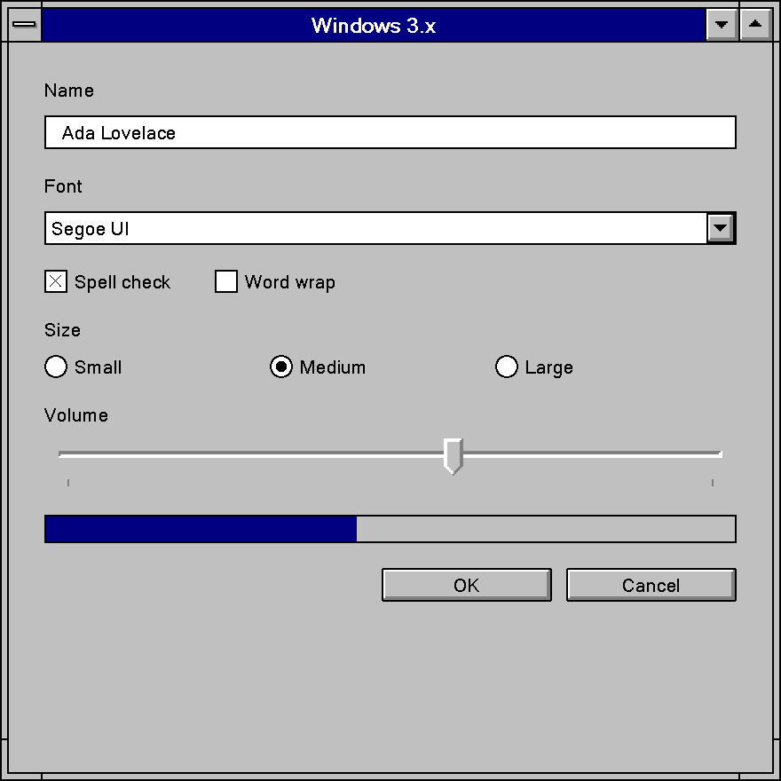

# Windows 3.x

Windows 3.0, 3.1 and Windows for Workgroups 3.11, 1990 to 1995; Win16. Gray faces, one-pixel
frames, a bevel that lives in bitmap art rather than in an API, round-cornered push buttons, an X
in the check box and a bold bitmap System font.

No first-party Microsoft document names this design language. "Windows 3.x" is a filing name,
the same way "Windows 9x" is for its successor.

!!! note "Evidence Tiers"
    The values on this page carry evidence tiers.

    **Tier 1** is a shipped artifact read directly: a display driver's bitmaps, a `.FON` file's
    header, the retail `CONTROL.SRC`.

    **Tier 1′** is an SDK header.

    **Tier 2** is a first-party document: the 1992 design guide and the SDK's *Programmer's
    Reference*.

    **Tier 4**, contemporary books, is never used for a value.

    No running Windows 3.x was booted, so every appearance claim comes from a static resource or a
    document, never a screenshot.

## Principles

### The Specification Is About Behavior

The era has exactly one normative design book, *The Windows Interface: An Application Design
Guide* (June 1992)[^ag92]. It covers Windows 3.0 and 3.1 in one volume, and it is almost entirely
about behavior: wording, ordering, layout and keyboard handling. It has four sentences about
three-dimensionality in 228 pages, seven pixel values and not a single RGB value. Appearance is
deferred to Control Panel and to the system's own drawing: *"Colors and border thickness are based
on the settings in the Windows Control Panel."*

The chiseled gray look people remember as Windows 3.1 is therefore not in the guide. It is in
the art the display driver ships (see [Foundations](#foundations)). Both halves are true at the same
time: the specification is flat and defers, the implementation is beveled and fixes it in
bitmaps. Sourcing a bevel to the 1992 guide is a category error.

### The Eight Principles

Chapter 1 of the guide lists eight principles, all prose, with no number in the whole chapter:

| # | Principle | What it asks for |
|--:|-----------|------------------|
| 1 | User Control | The user drives the application. Modes are avoided, and where unavoidable they are visible and easy to leave. *"The best interface is often the one that is hardly noticed."* |
| 2 | Directness | The object-action paradigm: select an object, then pick an action for it. Direct manipulation where it fits. |
| 3 | Consistency | With the real world and between applications. When cross-platform and within-platform consistency conflict, within-platform wins, *"because most users only work within one platform."* |
| 4 | Clarity | Visual, conceptual and linguistic. Interface text is *"clear, unambiguous, and free of jargon."* |
| 5 | Aesthetics | Grouping, contrast and three-dimensional representation. That sentence is the whole appearance principle. |
| 6 | Feedback | Immediate and tangible, graphical first. |
| 7 | Forgiveness | Exploration without penalty. *"Error messages should not imply that the user is at fault."* |
| 8 | Awareness of Human Strengths and Limitations | *"Recognizing items is much easier than recalling them."* |

Windows 95's guide has seven principles, and the two lists are not interchangeable. Clarity and
Awareness are 1992 only; Simplicity arrives in 1995.

The guide grades its rules as **recommended**, **optional** or **suggested**, with *"no
conformance requirement, expressed or implied."* There is no "required" tier. Most rules carry no
grade at all, and some grades are surprising: the always-on-top shadow and bold control labels are
only *suggested*, while the 40 x 14 DU minimum OK/Cancel size and the button spacing table are
*recommended*.

### What the Era Deliberately Is Not

| Concept | Status in Windows 3.x |
|---------|-----------------------|
| Material, translucency | Does not exist. No alpha, no blending, no gradient. The only "opacity" is a 50 % dither. |
| Elevation | Does not exist. One *suggested* shadow, for always-on-top windows only. |
| A named bevel ramp | Does not exist. Three button color slots, none named as a light or shadow. |
| A system bevel API | Does not exist. No `DrawEdge`, `DrawFrameControl` or `DrawState` in either era header. |
| Rounded corners | Only as art: `OBM_BTNCORNERS` rounds the push button. No radius parameter anywhere. |
| An accent color | Does not exist. There is a user-set highlight color for selection and nothing that brands the UI. |
| Dark mode | Does not exist, though all 21 color slots are user-settable. |
| Motion | Four response-time thresholds and no animation duration or easing at all. |
| Accessibility as a platform feature | Does not exist. It ships as a university-authored add-on pack. |

### The Era's Own Vocabulary

Using a later word dates a claim to the wrong decade.

| 1992 term | Later term |
|-----------|------------|
| option button | radio button |
| command button | push button |
| slider (also the scroll box) | trackbar |
| control bar (ribbon, ruler, toolbox, palette) | toolbar |
| message dialog | message box |
| dialog units (DUs) | dialog base units (1995), dialog units, DLUs (1999) |
| Control-menu box | system menu |
| pop-up menu | context menu |

## Foundations

### Color

Windows 3.1 has a 21-slot system color table (19 in Windows 3.0), every slot user-settable in
Control Panel and persisted as decimal `R G B` in `WIN.INI [colors]`[^h92]. `COLOR_BTNFACE` and
`COLOR_BTNSHADOW` are new in 3.0; `COLOR_BTNHIGHLIGHT` and `COLOR_INACTIVECAPTIONTEXT` are new in
3.1, behind the first `#if (WINVER >= 0x030a)` guard in the lineage. There is no `COLOR_3DLIGHT`,
no `COLOR_3DDKSHADOW`, no `COLOR_INFOBK` and no `COLOR_HOTLIGHT`. There is no `SPI_*` for colors
either: `SystemParametersInfo` arrives in 3.1 and never touches the color table.

`COLOR_BTNHIGHLIGHT` is documented as *"Selected button in a control"*[^v2], a selection color,
not a bevel highlight. The values line up with a bevel; the concepts do not. Naming the ramp is a
Windows 95 act.

#### The 22 Shipped Schemes and the Missing Default

Windows 3.1's retail `CONTROL.SRC`[^controlsrc] carries 22 named color schemes in exact hex,
recovered verbatim (Tier 1): Arizona, Black Leather Jacket, Bordeaux, Cinnamon, Designer, Emerald
City, Fluorescent, Hotdog Stand, three LCD schemes, Mahogany, Monochrome, Ocean, Pastel, Patchwork,
Plasma Power Saver, Rugby, The Blues, Tweed, Valentine and Wingtips. Each is 21 COLORREFs in
Control Panel applet order, not `COLOR_*` index order.

"Windows Default", the out-of-box scheme, is not among them. It is not in `CONTROL.SRC`, `WIN.SRC`
or `SETUP.INF`, and a byte sweep of `USER.EXE` and the drivers finds no table. The defaults are
compiled into `USER.EXE` as immediates. What the 22 schemes do agree on is the buttons:

| Slot | Value | Schemes | Corroboration |
|------|-------|--------:|---------------|
| `ButtonFace` | `#C0C0C0` | 22 / 22 | the chrome art's face |
| `ButtonHilight` | `#FFFFFF` | 22 / 22 | the chrome art's 1 px highlight |
| `ButtonText` | `#000000` | 22 / 22 | |
| `MenuText` | `#000000` | 22 / 22 | |
| `ButtonShadow` | `#808080` | 19 / 22 | the chrome art's 2 px shadow; the three LCD schemes use `#80807F` |
| `WindowFrame` | `#000000` | 19 / 22 | `SS_BLACKFRAME` is *"black in the default Windows color scheme"*[^v4] |
| `Window` | `#FFFFFF` | 18 / 22 | `SS_WHITEFRAME` is *"white in the default Windows color scheme"* |
| `HilightText` | `#FFFFFF` | 15 / 22 | |
| `Background` (desktop) | gray, shade unknown | no majority | `SS_GRAYFRAME` is *"gray in the default Windows color scheme"* |
| `ActiveTitle` | blue, shade unknown | no majority | a modal dialog's inner border *"shares the color of the title bar (default color blue)"* |

However lurid a scheme's desktop and title bars, the buttons stay silver: Hotdog Stand paints the
desktop yellow and the windows red and leaves the buttons alone. Two independent Tier 1 routes,
the scheme table and the driver art, agree on the button triad. This page calls this set **the
shipped-scheme consensus**, never "the Windows Default".

#### Why These Grays

`#C0C0C0` and `#808080` are the two grays a stock 16-color VGA can paint solid; any other gray
dithers. The driver's own 16-entry table and GDI's 20-entry static palette (complete with money
green, sky blue, cream and medium gray in 3.1's `GDI.EXE`, two years before Windows 95) both
contain them. The stock brushes match: `LTGRAY_BRUSH` is the face and `GRAY_BRUSH` the shadow.
The bevel ramp is a hardware constraint made into a design decision, which is why it outlived the
constraint by a decade. Schemes like Pastel, Patchwork, Tweed and Designer used off-palette values
and were visibly dithered on the hardware of the day; the button triad never was.

#### Selection, and What Color Means

The guide's whole adaptive-color doctrine is one sentence: monochrome displays use reverse video
(XOR), grayscale displays a shade of gray, color displays *"a highlight color"*. The highlight has
no name and no value in the guide. It also says: *"Don't rely on color alone to provide essential
information."*

### Relief: The Edge Grammar

This is the center of the era. `VGA.DRV` holds all 34 `OBM_*` chrome bitmaps as `RT_BITMAP`
resources (ids 32734 to 32767)[^vgadrv], not `USER.EXE`. Every 4-bpp one uses exactly four colors
in a fixed, asymmetric arrangement:

| Ring (outermost first) | Width | Color | Sides |
|------------------------|------:|--------|-------|
| frame | 1 px | `#000000` | all four |
| highlight | 1 px | `#FFFFFF` | top, left |
| shadow | 2 px | `#808080` | right, bottom |
| face | rest | `#C0C0C0` | |

**One pixel of white, two of gray.** A symmetric bevel reads as Windows 95. The content inset is
2 px on the top and left and 3 px on the right and bottom, so content sits slightly up and left of
center, which is why the pressed offset looks right rather than exaggerated.

The driver ships a separate bitmap per state, so each state is a measured fact:

| State | Frame | Top / left | Right / bottom | Content |
|-------|-------|-----------|----------------|---------|
| Raised | 1 px `#000000` | 1 px `#FFFFFF` | 2 px `#808080` | at rest |
| Pressed | 1 px `#000000` | 1 px `#808080` | none | +1, +1 |
| Disabled (color chrome, 3.1 only) | unchanged | unchanged | unchanged | glyph in `#808080` with a `#FFFFFF` copy offset +1, +1 |

The pressed state is not a mirrored bevel. It drops the white entirely and drops the bottom/right
edge, leaving one gray edge on the top and left. The embossed disabled glyph is a Windows 3.1
invention: the four `OBM_*ARROWI` disabled scroll arrows are the only new chrome art in 3.1, and
they arrive with `LBS_DISABLENOSCROLL`, `CBS_DISABLENOSCROLL` and `EnableScrollBar`.

All 30 Windows 3.0 chrome bitmaps are byte-identical to their 3.1 counterparts. The white
highlight is in the 1990 art, two years before `COLOR_BTNHIGHLIGHT` exists as a slot, so Windows
3.0 applications could see a highlight on the system's scroll bars that no color slot let them
match.

The split between beveled and flat art is exact. Chrome the user manipulates directly (caption
buttons, scroll arrows, the Control-menu box) is 4-bpp color art. Glyphs that sit inside a
control the system already colored are 1-bpp monochrome and inherit its colors:

| Element | Bitmap | Size (VGA) | Depth |
|---------|--------|-----------:|------:|
| Control-menu box (app and MDI child) | `OBM_CLOSE` | 36 x 18 | 4 bpp |
| Minimize, maximize, restore, and pressed | `OBM_REDUCE` / `ZOOM` / `RESTORE`, `...D` | 19 x 18 | 4 bpp |
| Scroll arrows, normal / pressed / disabled | `OBM_UPARROW` etc., `...D`, `...I` | 17 x 17 | 4 bpp |
| Push-button corners | `OBM_BTNCORNERS` | 30 x 10 | 1 bpp |
| Check box and radio, every state | `OBM_CHECKBOXES` | 56 x 39 | 1 bpp |
| Menu check mark | `OBM_CHECK` | 14 x 14 | 1 bpp |
| Cascade arrow | `OBM_MNARROW` | 7 x 11 | 1 bpp |
| Combo drop-down glyph | `OBM_COMBO` | 7 x 9 | 1 bpp |
| Size corner | `OBM_SIZE` | 13 x 14 | 1 bpp |

All of this is per display driver. `OBM_UPARROW` is 18 x 11 on CGA, 17 x 14 on EGA, 17 x 17 on
VGA and 21 x 22 on 8514/A, and CGA chrome is monochrome, so on CGA Windows 3.1 had no bevel at
all. Heights track the vertical resolution while widths barely move: the art was hand-drawn per
display so the chrome keeps its physical size. The VGA column is the one quoted everywhere here.

The window frame itself is flat. The guide describes a modal dialog frame as a 1 px black line
with a thicker inner border in the title-bar color, and a modeless dialog as a single 1 px black
line. Windows 3.x is flat where it is drawn by code and beveled where it is drawn by art.

### Materials

There is no material system. Every surface is a flat, opaque fill: no alpha plane in any bitmap
format, no `AlphaBlend`, no layered windows, no `GradientFill`. `WS_EX_TRANSPARENT` (3.1) is a
z-order and clipping flag, not an opacity one. Icons and cursors use an AND/XOR mask pair, which is
binary transparency.

Where a later era reaches for opacity, Windows 3.x draws a **50 % checkerboard** of two solid
colors: the disabled check box row of `OBM_CHECKBOXES`, `GrayString` disabled text, the
`DrawFocusRect` focus box, the `50% Gray` desktop pattern (`170 85 170 85 ...`). The stock
`LTGRAY_BRUSH`, `GRAY_BRUSH` and `DKGRAY_BRUSH` are the era's three-stop opacity scale. At 1:1 a
dither sparkles, and approximating one with 50 % alpha is visibly wrong.

### Typography

There is no scalable UI type. Every character the interface draws comes from a hand-authored
bitmap font, shipped per display resolution and picked by Setup from the display driver. TrueType
arrives in 3.1 for documents, never for chrome. Every metric below comes from the `FONTINFO`
header of the shipped `.FON` files[^fon] (Tier 1).

There are **two** UI faces, and the chrome one is **bold**:

| Face | Used for | pt | Cell (VGA) | Ascent | Int. leading | Avg / max advance | Weight |
|------|----------|---:|-----------:|-------:|-------------:|------------------:|-------:|
| System (`VGASYS.FON`) | title bars, menus, icon titles, dialogs without `DS_SETFONT` | 10 | 16 px | 13 | 3 | 7 / 14 | **700** |
| MS Sans Serif (`SSERIFE.FON`) | every shipped dialog | 8 | 13 px | 11 | 2 | 5 / 11 | 400 |
| Fixedsys (`VGAFIX.FON`) | Notepad, fixed-pitch editors | 12 | 15 px | 12 | | 8 fixed | 400 |

The System font's metrics are identical in the 1990 3.0 SDK and the 1992 retail files. Title bars
and menus read semibold because the stock face *is* bold; a regular-weight caption is wrong at the
font level.

MS Sans Serif is Helv renamed, with identical metrics at every size. `WIN.SRC` maps
`Helv=MS Sans Serif`, and every dialog template in `PROGMAN.EXE`, `MAIN.CPL` and `WINFILE.EXE`
carries `DS_SETFONT` at 8 pt `"Helv"`, while `USER.EXE`'s own dialogs say `"MS Sans Serif"`. So
MS Sans Serif 8 pt is the dialog font three years before Windows 95, which usually gets the credit.
The guide's layout footnote assumes the **bold** face (bold labels *"remain legible when
dimmed"*), while every shipped template uses the regular weight.

The trailing letter on a `.FON` file is a resolution axis, not a size axis: B is EGA (96 x 72 dpi),
E is VGA (96 x 96) and F is 8514/A (120 x 120). Windows 3.1 ships only B, E and F.

**No antialiasing anywhere.** Every screen font is 1 bpp, TrueType in 3.1 rasterizes to 1 bpp with
hinting, and font smoothing arrives with the Windows 95 Plus! pack. The faithful rasterization is
aliased text snapped to device pixels.

### Metrics and Layout

Dialogs are laid out in dialog units (DUs): one horizontal DU is the dialog font's average
character width / 4, one vertical DU its height / 8. `GetDialogBaseUnits()` always uses the System
font, while `MapDialogRect()` honors the dialog's own `DS_SETFONT` font, so it is the wrong number
for almost every real dialog. The 4-and-8 divisors are already in the 1986 Windows 1.03 style
guide[^sg86].

At VGA with MS Sans Serif 8 pt, one vertical DU is 13 / 8 = 1.625 px, so a 14 DU button is
22.75, about **23 px**. With an average width of about 6 px a 50 DU button is about 75 px. The
canonical 75 x 23 px "standard Windows button" falls out of Windows 3.1's own conventions. The
vertical figure is solid; the horizontal one is an inference from the font file, since no
`GetDialogBaseUnits` value was measured on a running system.

The guide gives no control heights at all. These come from counting 90 SDK sample resource
scripts and the shipped shell's dialog templates (Tier 1):

| Control | House height | Evidence |
|---------|-------------:|----------|
| Push button | **14 DU** | 65 of 67 buttons in the SDK samples; every button in Program Manager and `USER.EXE` |
| Check box, option button | 12 DU | on a 13 DU pitch inside a group |
| Single-line edit | 12 DU | |
| One line of static text | 8 DU | 10 DU in the shipped shell |
| Group box | none | always sized to its content |

And the button layout the guide does prescribe (graded *recommended*):

| Measurement | Arrangement A: column at the right (default) | Arrangement B: row at the bottom |
|-------------|----------------------------------------------|----------------------------------|
| Dialog edge to buttons | 6 DU | 6 DU |
| Between buttons in a group | at least 3 DU | at least 4 DU |
| Between groups | at least 8 DU | at least 9 DU |
| Separator lines between groups | forbidden, *"which simply clutter the dialog"* | forbidden |
| Minimum OK / Cancel | 40 x 14 DU | 40 x 14 DU |
| Order | OK, Cancel, action verbs, GoTo/GoSub, unfold, Help | same, left to right |

**The default is a vertical stack at the right edge.** A bottom row is mandatory only for message
dialogs. The shipped product disagrees with its guide twice: the SDK samples mostly use 32 x 14
buttons, below the 40 x 14 minimum, and Program Manager's five dialogs ship 6 DU between groups
where the guide asks for 8. The File Open common dialog follows the guide exactly: 50 x 14 buttons,
4 DU inside the OK/Cancel group, 8 DU before Help, 6 DU margins.

### Motion

There is no motion design. No control fades, slides or cross-fades; it is repainted from a
different bitmap. The guide mentions animation twice, both times as a caution, and gives no
duration, rate or easing anywhere. What the era does have is a handful of thresholds and the
input defaults Setup writes into `WIN.INI`[^winsrc]:

| Value | Source | Meaning |
|------:|--------|---------|
| 2 to 3 s | guide | show the hourglass over a window that is blocked |
| 5 s | guide | add a progress indicator as well |
| 1 min | guide | the minimum time-out, where time-outs are used at all |
| 530 ms | `WIN.SRC` `CursorBlinkRate` | caret blink; also the attention-flash rate |
| 452 ms | `WIN.SRC` `DoubleClickSpeed` | double-click interval |
| 3 | `WIN.SRC` `BorderWidth` | the sizing-border multiplier, the one geometric value a user controls |

Move and resize drag a gray XOR "ghost" frame rather than a live preview. Auto-repeat on scroll
arrows and auto-scroll past an edge exist, with no rate stated anywhere.

### Focus and States

| State | Indicator |
|-------|-----------|
| Normal | the control's ordinary look |
| Pressed | edge as above, content +1, +1 |
| Focused | a dotted box **around the label**, always shown while focused |
| Disabled | grayed text, a dithered 1-bpp glyph, or an embossed color glyph |
| Default (buttons) | a *"heavy"* or *"bold"* border, width never stated |
| Selected | reverse video, a gray, or the highlight color, by display type |
| Mixed (check boxes) | *"filled with a gray pattern"* |
| Hover | **does not exist** |

For command buttons, option buttons and check boxes the dotted focus box encloses the label, not
the control. There is no focus-hiding policy; that is a Windows 2000 arrival. There is no hover
state anywhere, and the guide argues against rollover feedback on control-bar buttons as
distracting. Disabled is drawn three ways, chosen by what the art could express: `COLOR_GRAYTEXT`
(new in 3.0) for text, a 50 % dither for monochrome glyphs, an embossed glyph for color chrome.

The keyboard model is the 1986 one: Tab moves between controls without operating them, Space
operates the focused one, Enter chooses the default button, Esc chooses Cancel or Close, and
Alt+mnemonic moves focus and operates in one keystroke.

## Controls

### Push Button

*"The control is a round-cornered rectangle containing the given text"*[^v4]. The driver
confirms it: `OBM_BTNCORNERS` carries a 6 x 6 corner ring (1 px thick, one pixel cut from each
corner), an 8 x 8 heavier ring (2 px thick, two cut) and a 4 x 4 fill mask. Corner shape, more
than any color, is what tells a Windows 3.1 button from a Windows 95 one.

| Property | Value |
|----------|-------|
| Shape | rounded: 1 px corner cut, 2 px on the heavy (default) ring |
| Edge | the raised grammar above, over `COLOR_BTNFACE` |
| Height | 14 DU (about 23 px at VGA) |
| Width | uniform down a column, sized to the longest label; 40 x 14 DU minimum for OK/Cancel |
| Text padding | *"approximately the width of a lowercase 'n'"* per side |
| Pressed | dark top/left edge only, content +1, +1 |
| Disabled | label dimmed |
| Default | extra heavy ring; Enter activates it from anywhere in the dialog, and the heavy border follows focus to another command button |
| Hover | none |

`WM_CTLCOLOR` explicitly *"has no effect on a button with the `BS_PUSHBUTTON` or
`BS_DEFPUSHBUTTON` style"*[^v3]. A push button's look has two handles only: the system-wide
`COLOR_BTN*` slots and `BS_OWNERDRAW`. Uniformity is enforced by the platform.

One caveat stays attached to every button claim. No `OBM_*` bitmap is a dialog push button: the
button is drawn by `USER.EXE` code, which was not disassembled. The edge grammar is evidenced on
scroll arrows and caption buttons, the only era chrome whose pixels survive.

The guide also names a "3-D button", and every passage about it is about toolbox and control-bar
buttons, never OK and Cancel. There, "depressed" means **latched**: the property is in effect, the
tool is selected, or the drop-down it owns is open. Up and depressed are the only two states named.

### Check Box and Option Button

| Property | Value |
|----------|-------|
| Glyph | 13 x 13 px at VGA, 1 bpp, from a 4 x 3 grid on a 14 px pitch |
| Check box, checked | an **X** drawn corner to corner, in a flat 1 px square |
| Option button, selected | a filled center dot in a 1 px circle |
| Relief | none: the glyph is a monochrome outline in the control's own colors |
| Mixed | the square filled with a gray pattern, no X; cycle gray, X, blank, gray |
| Disabled | the glyph dithered 50 %, the label dimmed |
| Height | 12 DU, 13 DU pitch, members inset 7 DU / 10 DU from their group box |
| Label | to the right, no colon, headline capitals |

The checked check box is an X in the guide, in the `BS_AUTOCHECKBOX` reference and in the shipped
bitmap, three independent sources. The **menu** check mark (`OBM_CHECK`) is a tick. Two marks for
two jobs; Windows 95 collapses them into one. Arrow keys in a radio group move focus *and* select;
in a group of check boxes they only move focus.

A value set, a group of adjacent rectangular option buttons with the labels inside, has no system
control. Its selected cell is a depressed 3-D button or an outline in the highlight color.

### Text Box and Spin Box

| Property | Value |
|----------|-------|
| Border | `WS_BORDER`, a 1 px line. The guide specifies no frame, bevel or sunken well at all |
| Height | 12 DU single line |
| Activation | by keyboard it selects all; by mouse it places a caret and selects nothing |
| Ctrl+Left / Right | jump to the start and end of the field, not word by word |
| Disabled | the **label** dims; the box's own look is not specified |
| Label | above or to the left, followed by a colon |

The sunken "well" people associate with the era is not documented in any source read; it came from
applications drawing it themselves or from CTL3D. A spin box is a text box with an up arrow above
a down arrow, working like scroll arrows over a hidden list sorted in *descending* order, so up
increases. There is no spin control in base Windows 3.x; `msctls_updown` arrives in the Windows
for Workgroups SDK's `COMMCTRL.H`[^commctrl].

### List Box and Combo Box

| Property | Value |
|----------|-------|
| Visible height | 3 to 8 items, for standard lists and open drop-downs alike |
| Scroll bar | vertical above 8 items or when the count varies |
| Drop-down list (`CBS_DROPDOWNLIST`) | the arrow button **abuts** the field |
| Drop-down combo box (`CBS_DROPDOWN`) | a **gap** before the arrow button |
| Arrow glyph | `OBM_COMBO`, 7 x 9, a stemmed down-arrow over a rule |
| Unavailable items | omitted by default, dimmed by exception (the reverse of menus) |
| Inactive scroll bar (new in 3.1) | arrows dimmed, scroll box removed, shaft repainted in the dialog background |

The gap is the intended visual discriminator between the two drop-down forms; its width is never
stated.

### Group Box and Frames

*"Group boxes consist of a rectangular one-pixel frame with a label at the upper left."* A plain
1 px rectangle, with the label interrupting the top line. The etched groove is a Windows 95
convention. Between button groups the guide forbids rules outright and asks for white space
instead. The era's only built-in frame primitives are six `STATIC` styles: filled rectangles or
1 px outlines in the window-frame, desktop or window color.

libwinui's `GroupBox` draws the 1 px `COLOR_WINDOWFRAME` frame with the label 7 px in breaking its
top line, and insets the content as PROGMAN does: 7 DU across and 10 DU down.

### Scroll Bar

| Property | Value |
|----------|-------|
| Arrows | 17 x 17 px at VGA, 4 bpp, normal, pressed and (3.1) disabled |
| Scroll box | **fixed size**; a proportional box is an *optional extension* |
| Page | one window height, keeping at least one line of the old view |
| Shaft color | `COLOR_SCROLLBAR` |
| Width | driver-supplied `SM_CXVSCROLL`, not established |

libwinui draws this bar under Windows 3.x in a 17 px gutter, the VGA arrow's size: arrows and
scroll box in the era's 1 : 2 edge, a held arrow pressed as its single dark top-left edge with the
glyph nudged, a stemmed arrow (a 7 x 4 head on a 3 x 3 stem), a fixed 17 px square scroll box,
and the flat shaft inverted under a held page click. Disabled, the arrows are embossed and the box
goes.

A split bar is a double line with one blank pixel between: 1 px, 1 px gap, 1 px.

### Menus

| Property | Value |
|----------|-------|
| Font | System 10 pt bold |
| Separator | solid single line for groups; a dashed line for subgroups |
| Check mark | a tick, `OBM_CHECK` 14 x 14 |
| Cascade | a solid right triangle, `OBM_MNARROW` 7 x 11; cascades *"should be avoided whenever possible"* |
| Unavailable items | dimmed, never removed; a dimmed menu title still opens |
| Pop-up menus | no keyboard interface, no mnemonics, no shortcut text |
| Help menu | after the next-to-last menu, not flush right: the far right is reserved for the MDI Restore button |

No menu metric is stated anywhere: bar height, item height and padding are all driver or `USER.EXE`
values that were not observed. Menus have no shadow.

### Windows and Dialogs

| Window | Frame |
|--------|-------|
| Modal dialog | 1 px black line plus a thicker inner border in the title-bar color |
| Modeless dialog | a single 1 px black line |
| Sizable window | parallel 1 px lines with a thicker border between, width from Control Panel |

Modality is visible in the frame, and no later era does that. There is no close button in the
title bar: closing is the Control menu or a double-click on the Control-menu box. The only shadow
in the whole design language is a *suggested* gray shadow on the right and bottom of always-on-top
windows, width unstated. It is the guide's one hint at a light source, and it agrees with the art:
upper left.

Message dialogs have three types, Information, Warning and Critical; the question mark is
discouraged because it is the Help symbol, even though the API defines `MB_ICONQUESTION`. The
default action button says **OK** rather than a verb when the title already names the action.
Dialogs have no tabs; the era's answer is the unfolding dialog (`Options >>`).

### Controls That Do Not Exist

Tab control, property sheet, tree view, list view, toolbar as a system class, tooltip, progress bar
as a control, rich edit, date picker, status bar as a system class. The Windows for Workgroups 3.1
SDK's `COMMCTRL.H` v1.0 does define a toolbar, `msctls_statusbar`, `msctls_trackbar` and
`msctls_updown`, and three of those class strings survive verbatim into Win32, but nothing in the
retail shell uses them. The guide's "slider" (*"a bar containing notches or measurement markings,
plus an indicator perpendicular to the bar"*) has no control class; an application owner-drew one
or used a horizontal scroll bar.

## Reproducing It Today

<figure markdown="span">
  { .era width="440" }
  <figcaption>libwinui's <code>Windows3x</code> theme, in a window opened with <code>Frame::Themed</code>.</figcaption>
</figure>

Windows 3.x is more computable than it looks. The edge is four flat colors in a fixed arrangement,
not a ramp of hand-drawn bitmaps, so almost all of it can be drawn as geometry from the tables
above. What stands in the way is the art that is genuinely art, the fonts that no longer ship, and a
modern compositor that assumes antialiasing, rounded windows and shadows.

### Exactly Reproducible

| What | Why it transfers |
| --- | --- |
| The palette: face `#C0C0C0`, highlight `#FFFFFF`, shadow `#808080`, frame and text `#000000` | Hex values, confirmed by the scheme table and the driver art independently. |
| All 22 shipped color schemes | Recovered in exact hex; any theme that accepts a user-supplied palette can offer "Windows 3.1 with Hotdog Stand" as data. |
| The raised edge: 1 px frame, 1 px highlight top/left, 2 px shadow right/bottom | Four solid colors in a fixed arrangement. Keep the 1 : 2 asymmetry; a symmetric bevel reads as Windows 95. |
| The pressed edge and the +1, +1 content offset | One gray edge top/left and nothing bottom/right. |
| The embossed disabled chrome glyph | The glyph in `#808080` with a `#FFFFFF` copy offset +1, +1. |
| Flat 1 px check box, radio ring, group box, text box border, separators | Plain rectangles and circles in `COLOR_WINDOWFRAME`, no bevel. |
| The 50 % checkerboard (mixed check box, disabled monochrome glyphs, focus box) | Two solid colors in a pixel checkerboard. Draw it as a dither; half-opacity alpha is visibly wrong. |
| No hover, no animation, no shadow, no gradient, no translucency | Expressed by drawing none of them: hover equals normal, every duration is zero. |
| Aliased rasterization | Turn off antialiasing for geometry and text and snap to device pixels. The era has no smoothing to model. |
| Dialog-unit layout | The DU arithmetic and the 14 DU button height are plain numbers. |

### Approximated

| What | Why |
| --- | --- |
| The fonts | System and MS Sans Serif are bitmap `.FON` faces that modern Windows does not install and DirectWrite cannot render. An outline substitute (Microsoft Sans Serif, or any bold sans for System) differs in metrics as well as in shape. Request both faces and the chrome one bold; one font for everything reproduces neither. |
| The push-button corner | `OBM_BTNCORNERS` is hand-drawn art that may not be redistributed. A 1 px corner cut or radius on the frame gets the effect; the exact pixel pattern must be re-authored, never extracted. |
| The check box and radio glyphs | `OBM_CHECKBOXES` is the same kind of art. The construction (13 x 13, a corner-to-corner X, a center dot) is simple enough to redraw from the description. |
| The desktop and caption colors | Known only as the words "gray" and "blue". Navy `#000080`, the Windows 95 default caption, is the usual pick, but it is a choice. |
| The dialog background | A plain Windows 3.1 dialog did not paint itself in the button face; the gray dialog is the look the CTL3D library gave applications. Menus are a separate slot and white in Monochrome, Hotdog Stand and The Blues. A re-creation has to choose. |
| The per-resolution art | Every driver drew its own chrome. Quote the VGA column and do not attempt CGA, EGA or 8514/A. |
| Controls the era does not have | Toggle switches, progress bars, tooltips, tabs and tree views have no Windows 3.x look. Anything drawn for them is the era's edge grammar extended, not a measurement. |

### Not a Theme

Some of what makes an application look like 1992 is layout, behavior or content, and a theme
alone cannot give it: the button column at the right of a dialog, OK instead of a verb, the
Cancel-to-Close relabeling, modality shown in the frame, the unfolding `Options >>` dialog instead
of tabs, the focus box that is always visible, MDI and Program Manager. The default
button's heavy ring cannot be sized from any source.

The window frame is non-client, and on current Windows DWM draws it. A libwinui window opened with
`Frame::Themed` gets the era's sizing frame from the pack instead: two 1 px frame lines around the
border color, notched where each corner's sizing zone ends, the Control-menu box, and the
minimize and maximize arrow buttons sized from the VGA driver's caption art, with no close button.
The black modal dialog frame is not drawn.

### High Contrast

The era has no high-contrast concept and ships no high-contrast scheme. What it has is the mechanism
without the intent: all 21 color slots are user-settable, and the guide tells applications to read
them rather than hard-code colors, so a user who needed contrast set it by hand. The closest
shipped scheme is Monochrome: black on white, silver buttons, black title bars. Resolving a modern
contrast theme into the 21 slots and keeping the four-color edge is faithful to how the era
worked. Accessibility features beyond that came from the Access Pack for Microsoft Windows, a Trace
R&D Center (University of Wisconsin-Madison) add-on in the Windows Driver Library, not from
Windows itself.

## Sources

[^ag92]: Microsoft, *The Windows Interface: An Application Design Guide*, Microsoft Press, June
    1992, ISBN 1-55615-384-8, document PC28921-0692, item 9 of the Windows 3.1 SDK manual set. A
    scan is public at
    [bitsavers.org](http://www.bitsavers.org/pdf/microsoft/windows_3.1/Microsoft_Windows_3.1_SDK_1992/PC28921-0692_Windows_Interface_Applications_Design_Guide_199206.pdf).
    Tier 2. Principles (ch. 1), selection (pp. 21-22), focus (pp. 29-30), timing (p. 40), window
    frames (p. 55), group boxes (p. 119), button layout (pp. 133-137).
[^h92]: `WINDOWS.H` from the Windows 3.0 SDK (1990-06-01) and the Windows 3.1 SDK (1992-03-23).
    Tier 1′. The `COLOR_*`, `BS_*`, `SS_*`, `OBM_*` and `SPI_*` tables, and the absence of
    `DrawEdge`, `DrawFrameControl` and `DrawState`.
[^v2]: Microsoft, *Microsoft Windows 3.1 Programmer's Reference, Volume 2: Functions*, 1992,
    document PC28916-0492, part of the Windows 3.1 SDK manual set. Tier 2. `GetSysColor`,
    `GetDialogBaseUnits`, `MapDialogRect`, `BS_DEFPUSHBUTTON` (*"a heavy black border"*),
    `SystemParametersInfo`.
[^v3]: Microsoft, *Microsoft Windows 3.1 Programmer's Reference, Volume 3: Messages, Structures,
    Macros*, 1992, document PC28917-0492, p. 102. Tier 2. `WM_CTLCOLOR` and push buttons.
[^v4]: Microsoft, *Microsoft Windows 3.1 Programmer's Reference, Volume 4: Resources*, 1992,
    document PC30211-0492. Tier 2. `PUSHBUTTON` (*"a round-cornered rectangle"*),
    `SS_BLACKFRAME` / `SS_GRAYFRAME` / `SS_WHITEFRAME`, the dialog template format. The SDK
    manual set is public as scans at
    [bitsavers.org](http://www.bitsavers.org/pdf/microsoft/windows_3.1/Microsoft_Windows_3.1_SDK_1992/).
[^vgadrv]: `VGA.DRV` from the Windows Driver Library of the *Microsoft Windows 3.1 Resource Kit*
    (1992-04-07) and from the Windows 3.0 SDK (1990-06-01), with `EGA.DRV`, `CGA.DRV` and
    `8514.DRV`. Tier 1. The 34 `OBM_*` bitmap resources, measured for size, color inventory and
    edge widths; no pixels reproduced.
[^controlsrc]: `CONTROL.SRC` from the Windows 3.1 retail installation media (copied to
    `CONTROL.INI` by Setup), with `MAIN.CPL`'s applet-index table for the field order. Tier 1. The
    22 color schemes.
[^winsrc]: `WIN.SRC` and `SETUP.INF` from the same Windows 3.1 retail media. Tier 1. The shipped
    `[windows]`, `[Desktop]` and `[FontSubstitutes]` defaults.
[^fon]: `VGASYS.FON`, `SSERIFE.FON`, `VGAFIX.FON` and siblings from the Windows 3.1 retail media,
    and `VGASYS.FNT` from the Windows 3.0 SDK. Tier 1. `FONTINFO` header fields read directly.
[^sg86]: Microsoft, *Microsoft Windows Software Development Kit: Application Style Guide*, version
    1.03, 1986, part of the Windows 1.03 SDK manual set. Tier 2. The dialog unit, top-right
    OK/Cancel and the bold default border, four years before Windows 3.0.
[^commctrl]: `COMMCTRL.H` v1.0 (1992) from the Windows for Workgroups 3.1 SDK, and `CTL3D.H` /
    `CTL3D.DLL` (1993) from the same SDK's samples. Tier 1′ and Tier 1. The Win16 common controls
    and the 3-D control library.
