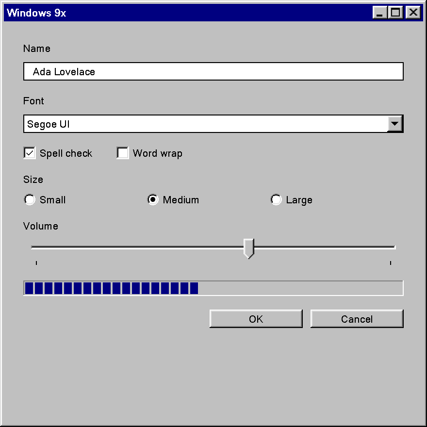

# Windows 9x

Windows 95, 98, Me, NT 4.0 and 2000, 1995 to 2001; Win32, `USER32`/`GDI32` and `COMCTL32` v4/v5.

This is the gray, beveled design language Windows 95 introduced and Windows XP's Luna replaced:
flat fills, two-pixel raised and sunken edges drawn from a small system-color ramp, square
corners everywhere, MS Sans Serif (later Tahoma), and a dotted focus rectangle. One design
language across five OS releases. No first-party document of the time gives it a name. "Windows
Classic" is the label Windows XP gave it after the fact, and "Windows 9x" is used here as a filing
convenience, not as a period term.

!!! note "How Sure the Numbers Are"
    This page ranks its evidence in tiers and says which tier a value comes from where it
    matters.

    **Tier 1** is the shipped implementation. Genuine Windows 95 (OSR2.5), Windows 98 SE and
    Windows 2000 installation media supplies every default color on this page, read out of the
    OS's own setup files.[^media] No era system was booted, so anything that needs observation
    (how a hot-tracked push button looked, animation timing) stays open.

    **Tier 2** is the written specification: the 1995/96 and 1999 design guidelines, the Windows
    2000 Application Specification and the printed Win32 Developer's Reference Library.

    **Tier 3** is reimplementations that encode values, mainly ReactOS (Wine lineage). They are
    used for geometry the specifications describe but never number, and are marked as such.

    **Tier 4**, a screenshot-eyeballed demake, is quarantined and never cited for a value.

## Principles

Unlike several later eras, this one states its own principles, and states them twice. Chapter 2 of
both the 1995/96 guidelines and the 1999 *Microsoft Windows User Experience*, "Design Principles and
Methodology", carries the same seven principles in the same order.[^g99][^g95] The Windows 95 team
behind them was a twelve-person interdisciplinary group formed in October 1992 that tested
iteratively in a usability lab, so the list is not rationale written after the fact.[^sullivan]

| Principle | What it means for a control |
|---|---|
| User in Control | The user starts actions, and software reflects the user's own system settings ("colors, fonts, or other options") rather than fixing its own. This is the design-level reason every border is named by a `COLOR_*` slot and never by an RGB value. |
| Directness | Direct manipulation over command syntax, recognition over recall, metaphor as a bridge rather than a goal. |
| Consistency | Within an application, with the platform and with the chosen metaphor. The 1999 book calls it "the primary goal of this book". |
| Forgiveness | Discovery through interaction, reversible actions, slips and wrong choices treated as design failures to accommodate. |
| Feedback | Every action gets a response, and the response tells you what kind of action happened. |
| Aesthetics | Visual design in service of the task. Chapter 14 "Visual Design" is where this becomes concrete. |
| Simplicity | *"Simplicity is not the same as being simplistic."* A small extension that complicates the common case is a regression. |

Those principles turn into a very small visual grammar:

- **A named color ramp, never literals.** Every border comes from five slots
  (`COLOR_BTNHIGHLIGHT`, `COLOR_3DLIGHT`, `COLOR_BTNFACE`, `COLOR_BTNSHADOW`, `COLOR_3DDKSHADOW`) so
  the user can recolor the whole system from the Appearance tab. An application painting a literal
  RGB broke the first principle, not just a style rule.
- **One fixed light source.** *"The light source in Windows comes from the upper left"* (1999,
  p. 409). Raised and sunken are the same color pair with top/left and bottom/right exchanged.
- **Layout in dialog units, not pixels**, so dialogs scale with the system font. Toolbars are the
  one named exception and are measured in pixels.
- **Words over motion.** The Writing Style section is thorough (a capitalization system, a title
  bar table, terminology rules), while the Animation section holds exactly one number.

What the era deliberately is not:

- No material. No glass, blur or translucency; every surface is an opaque `COLOR_*` fill.
- No elevation and no shadow. Depth is bevel direction and z-order, nothing else.
- No rounded corners. Not even the rounded push button Windows 3.x had.
- No accent color. Selection is `COLOR_HIGHLIGHT`, one ordinary slot in a scheme the user picks
  wholesale. The active caption color is the closest thing to a "personality" color, but no
  source says it was meant as an accent.

## Foundations

### Color

The system color model is a flat array of `COLOR_*` slots, and `winuser.h` dates each generation
with its own `WINVER` guard.[^winuser]

| Indices | Guard | Arrives with | Slots |
|---|---|---|---|
| 0 to 20 | none | before Windows 95 | `COLOR_SCROLLBAR` to `COLOR_BTNHIGHLIGHT` |
| 21 to 24 | `WINVER >= 0x0400` | Windows 95 / NT 4.0 | `COLOR_3DDKSHADOW`, `COLOR_3DLIGHT`, `COLOR_INFOTEXT`, `COLOR_INFOBK` |
| 25 | no `#define` | Windows 98 | unnamed; the registry calls it `ButtonAlternateFace` (`#B5B5B5`) |
| 26 to 28 | `WINVER >= 0x0500` | Windows 98 / 2000 | `COLOR_HOTLIGHT`, `COLOR_GRADIENTACTIVECAPTION`, `COLOR_GRADIENTINACTIVECAPTION` |
| 29 to 30 | `WINVER >= 0x0501` | Windows XP, not this era | `COLOR_MENUHILIGHT`, `COLOR_MENUBAR` |

The two slots Windows 95 adds, `3DLIGHT` and `3DDKSHADOW`, are exactly the two extra ramp stops that
turn Windows 3.x's three button colors into this era's five-stop bevel. The ramp and its API
arrive together.

#### The Default Palette: Two Rows, Not One

The guidelines define every border by slot name and deliberately state no default, and no
Resource Kit, SDK or reference volume prints one either. The installation media does. Windows 9x
seeds a new profile from a `REG_BINARY` scheme blob inside `shell2.inf`, Windows 2000 from plain
decimal text in `HIVEDEF.INF`, and both name the scheme **"Windows Standard"**, the same name the
Resource Kits use.[^media][^rk]

Windows 98 SE is byte-identical to Windows 95 on every slot Windows 95 has. Windows 2000 is the only
release that moves anything, and it moves as a unit:

| Slot | Windows 95 / 98 SE | Windows 2000 |
|---|---|---|
| `BTNHIGHLIGHT` (lightest) | `#FFFFFF` | `#FFFFFF` |
| `3DLIGHT` | `#DFDFDF` | `#D4D0C8` (equals the face) |
| `BTNFACE`, `MENU`, `SCROLLBAR`, borders | `#C0C0C0` | `#D4D0C8` |
| `BTNSHADOW`, `GRAYTEXT` | `#808080` | `#808080` |
| `3DDKSHADOW` (darkest) | `#000000` | `#404040` |
| `WINDOWFRAME` | `#000000` | `#000000` |
| `WINDOW` (field interior) | `#FFFFFF` | `#FFFFFF` |
| `WINDOWTEXT`, `BTNTEXT`, `MENUTEXT` | `#000000` | `#000000` |
| `HIGHLIGHT` (selection) | `#000080` | `#0A246A` |
| `ACTIVECAPTION` | `#000080` | `#0A246A` |
| `GRADIENTACTIVECAPTION` | absent on 95, `#000080` (inert) on 98 | `#A6CAF0` (a real gradient) |
| `INACTIVECAPTION` | `#808080` | `#808080` |
| `GRADIENTINACTIVECAPTION` | absent on 95, `#808080` on 98 | `#C0C0C0` |
| `BACKGROUND` (desktop) | `#008080` teal | `#3A6EA5` blue-gray |
| `INFOBK` (tooltip) | `#FFFFE1` | `#FFFFE1` |
| `HOTLIGHT` (links) | absent on 95, `#0000FF` on 98 | `#000080` |

Three things follow from this table:

- **A theme has to pick one row.** Pairing Windows 2000's `#D4D0C8` face with Windows 95's navy
  selection reproduces no released version. There is no third row to compromise toward.
- **The Windows 2000 ramp cannot be computed from its face.** `3DLIGHT` equals the face there, and
  no lighten function returns its input. The ramp is flattened at the light end and softened at the
  dark end, and both are editorial choices, so a Windows 2000 palette has to be literal data.
- **`#C0C0C0` survives on Windows 2000**, but as the inactive caption gradient end, not the face.
  That is the trap to avoid when generalizing a familiar gray back to "the Windows 95 button".

No Windows Me media was examined, so which row Windows Me belongs to is open. The named alternate
schemes (Brick, Maple, Spruce, Teal and the rest) sit in the same setup file as further blobs but
were not decoded for this page.

#### High Contrast

High contrast in this era is not a separate rendering path. It is a scheme category built from the
same slots, switched on from Accessibility Options, and the Windows 98 Resource Kit counts 27 such
schemes.[^rk] An application that already reads every color from a slot supports it for free, and the
1999 guidelines add one duty on top: while High Contrast is set, hide any image drawn behind
text.[^g99] The Windows 2000 Application Specification made both into logo requirements: 5.1
"Support standard system size, color, font, & input settings" and 5.2 "Ensure compatibility with
the High Contrast option".[^appspec]

### Typography

| Surface | Windows 95 / 98 / NT 4.0 | Windows 2000 |
|---|---|---|
| Dialogs, controls, menus, status text | MS Sans Serif 8 pt | Tahoma 8 pt for the OS's own chrome |
| Title bars | the same face, bold | the same face, bold |
| Chrome glyphs (caption buttons, scroll arrows, size grip, check and radio parts) | Marlett | Marlett |
| Wizard 97 exterior page titles | Verdana Bold 12 pt | Verdana Bold 12 pt |

The 1999 guidelines state the succession in one sentence (p. 430): MS Sans Serif 8 pt is the
default on Windows 98 and NT 4.0, Tahoma 8 pt is *recommended* for Windows 2000 but *"not set by
default in Windows 2000; you must explicitly select it"*, while Windows 2000 itself uses Tahoma for
most of its own interface.[^g99] An application that did nothing got MS Sans Serif on Windows 2000
too. Both faces are reached through the same indirection (`DEFAULT_GUI_FONT`, the `MS Shell Dlg`
logical name), so an application written once picked up the platform's choice.

Bold is for title bars only: *"Except for title bars, avoid using bold or italic for interface
text. In menus, bold text implies that the command is a default action"* (p. 431). There is no type
ramp beyond 8 pt UI text and the one 12 pt wizard title.

Marlett draws chrome as font glyphs requested at the target rect's own pixel height, which is what
makes classic chrome resolution-independent:[^reactos]

| Chrome | Marlett characters |
|---|---|
| Close / Help / Minimize / Maximize / Restore | `r` `s` `0` `1` `2` |
| Scroll arrows left / right / up / down | `3` `4` `5` `6` |
| Size grip (normal / flat) | `o` `p` / `x` `y` |
| Check box frame, then center | `c` `d` `e` `f`, center `g` |
| Check mark | `b` |
| Radio frame, then center | `j` `k` `l` `m`, center `n` |
| Radio dot | `i` |
| Menu cascade arrow, check, bullet | `8`, `a`, `h` |

### Metrics

#### The Edge Grammar

This is the center of the era. There is no z-axis; there are four single-pixel border primitives,
stated with an identical table in both guideline editions and implemented by `DrawEdge`:[^g99][^v3]

| Primitive | Top/left | Bottom/right |
|---|---|---|
| Raised outer | `BTNFACE` | `WINDOWFRAME` |
| Raised inner | `BTNHIGHLIGHT` | `BTNSHADOW` |
| Sunken outer | `BTNSHADOW` | `BTNHIGHLIGHT` |
| Sunken inner | `WINDOWFRAME` | `BTNFACE` |

Every named style is one primitive or two stacked:

| Composite | Built from | Used by |
|---|---|---|
| Window border | raised outer + raised inner | window and menu borders, scroll arrows |
| Button border, up | raised outer + raised inner, with the top/left colors swapped between the rings | command buttons |
| Button border, down | sunken outer + sunken inner, same swap | pressed command buttons |
| Field border | sunken outer + sunken inner | text boxes, list boxes, combo boxes, check-box wells, the work area |
| Status field | sunken outer only | status bar panes, read-only dynamic fields |
| Grouping border (`EDGE_ETCHED`) | sunken outer + raised inner | group boxes, etched separators |
| Toolbar button, hot | raised inner only | flat toolbar buttons under the pointer |
| Toolbar button, down | shadow top/left, highlight bottom/right | pressed flat toolbar buttons |

`DrawEdge` spells the combinations as `EDGE_RAISED`, `EDGE_SUNKEN`, `EDGE_ETCHED` and `EDGE_BUMP`,
plus `BF_*` flags for which sides draw, whether to fill (`BF_MIDDLE`), whether to shrink the rect
past the edge (`BF_ADJUST`) and `BF_SOFT`. `DrawFrameControl` draws whole controls (`DFC_BUTTON`,
`DFC_CAPTION`, `DFC_MENU`, `DFC_SCROLL`); `DFCS_HOT` and `DFCS_TRANSPARENT` are marked Windows 98 and
2000 only.[^v3]

A command button is `EDGE_RAISED` with `BF_SOFT`, which is a different four-color arrangement from a
plain raised window border. ReactOS's lookup tables (Tier 3) give both:[^reactos]

| Ring | Window border (`EDGE_RAISED`) | Command button (`EDGE_RAISED` with `BF_SOFT`) |
|---|---|---|
| Outer top/left | `3DLIGHT` | `BTNHIGHLIGHT` |
| Inner top/left | `BTNHIGHLIGHT` | `3DLIGHT` |
| Inner bottom/right | `BTNSHADOW` | `BTNSHADOW` |
| Outer bottom/right | `3DDKSHADOW` | `3DDKSHADOW` |

Two raised shapes, not one, is the most common way to get this era subtly wrong: draw group boxes
with the button arrangement and they read like buttons, draw buttons with the window arrangement
and they read flat.

The 1999 prose and the ReactOS table disagree about one edge of the button, and it is a different
edge in each half of the era. The prose puts `BTNFACE` on the inner top/left ring and `WINDOWFRAME`
on the outer bottom/right. On Windows 95/98 that makes the inner light ring `#C0C0C0` where the
table paints `#DFDFDF`; on Windows 2000 the inner ring agrees (both `#D4D0C8`) but the outer dark
ring does not (`#000000` against `#404040`). The ReactOS table is Windows 2000-era code, and the
disagreement vanishes exactly where that palette collapses, which suggests the table encodes a
Windows 2000 coincidence. That reading is an inference; no Windows 95 `USER32` was disassembled.

The rects matter as much as the colors. In `IntDrawRectEdge` the outer ring runs each edge end to
end and is drawn top, left, bottom, right, so on a raised button the top-right and bottom-left
corner pixels are `3DDKSHADOW`. The inner ring is pulled back one pixel at every corner the outer
ring owns. Draw all eight lines full span and you get a one-pixel spur at each corner of every
button in the UI.

A pressed command button draws the same rings mirrored and moves its label one pixel right and one
down (1999, p. 424, "Pressed Appearance"). `DFCS_ADJUSTRECT` gives back a content rect inset 2 px
per side.

#### Field Interiors

The 1999 guidelines fill most fields with button highlight and text fields with button face when
read-only or disabled (p. 421). ReactOS's check-box and radio code fills with `COLOR_WINDOW` normally
and `COLOR_BTNFACE` when inactive or pushed. Under every default palette `BTNHIGHLIGHT` and `WINDOW`
are both white, so the difference only shows once a user scheme tints the window color.

#### Dialog Units

Layout is in dialog units: one horizontal DLU is a quarter of the average character width of the
current system font, one vertical DLU an eighth of its height.[^g99]

| Control | Height (DLU) | Width (DLU) |
|---|---|---|
| Command button | 14 | 50 |
| Most single-line controls (default) | 14 | as needed |
| Check box, radio button | 10 | as needed |
| Drop-down combo / list box | 10 / 14 | match other fields |
| Text box | 14, plus 8 per extra line | match other fields |
| Text label | 8 per line | as needed |
| Dialog or property sheet, maximum | 263 | 263 (at 640 x 480) |
| Property sheet page, minimum | 114 | 212 |
| Wizard 97 exterior / interior page | 193 / 143 | 317 |

| Spacing | DLU |
|---|---|
| Dialog margins, unrelated controls, paragraphs | 7 |
| Related controls, buttons in a row | 4 |
| Label to its control | 3 |
| First control in a group box, from the top | 11 |
| Smallest gap between controls | 2 |

Toolbars are the exception and are measured in pixels, and the numbers changed inside the era:

| Edition | Small button | Large button | Small image | Large image |
|---|---|---|---|---|
| 1995/96 | 24 x 22 | 32 x 30 | 16 x 16 | 24 x 24 |
| 1999 | 21 high (22 wide image-only) | 26 high (28 wide image-only) | 16 x 16 | 20 x 20 |

The DLU system, the OK-before-Cancel rule and the dialog ceiling are layout and behavior rather
than colors and edges, so a theme alone cannot supply them. They are what makes an application
written in period style read as 1997 rather than as a modern dialog repainted gray.

### Materials, Focus and States

- **Materials:** none. The only semi-transparent effect is a 50% checkerboard dither of two solid
  colors, used for an option-set toolbar button and a mixed-value check box, and becoming a true
  halftone on displays with 256 colors or more. The single mention of real alpha blending in the
  1999 visual design chapter is Windows 2000's drag image, not chrome.
- **Focus:** `DrawFocusRect` is a `PatBlt` with `PATINVERT` of a 50% gray dither brush, four strips
  whose thickness comes from `SPI_GETFOCUSBORDERWIDTH`/`HEIGHT`. The "dots" come from the dither
  meeting XOR, not from a dash pattern, which is why the indicator works under every scheme without
  a color. Windows 2000 added hiding focus rectangles and access-key underlines until the keyboard
  is used (`WM_CHANGEUISTATE`, `UISF_HIDEFOCUS`, `UISF_HIDEACCEL`).
- **States:** pressed, option-set, mixed-value, unavailable, input focus, hot-tracked and flat.
  An unavailable label is engraved: drawn once in `BTNHIGHLIGHT`, then again at a one-pixel offset
  in `BTNSHADOW` (`DrawState` with `DSS_DISABLED`). An unavailable check mark or radio dot is not
  engraved; it is drawn flat in `BTNSHADOW`. Hot-tracking is documented for toolbar and menu-bar
  buttons only.

### Motion

There is essentially none. The whole Animation section of both editions holds one number: fluid
animation needs **16 frames per second or more**, a floor rather than a duration. No transition
duration or easing curve is stated anywhere for this era. `AnimateWindow` exists by Windows 2000
and comctl32 5.80 documents a sliding tooltip animation (`TTS_NOANIMATE` turns it off), but no
source gives either a length. Zero is the era-correct value for every control state change.

## Controls

### Push Button

| Property | Value |
|---|---|
| Recommended size | 50 x 14 DLU |
| Edge at rest | `EDGE_RAISED` with `BF_SOFT`: `BTNHIGHLIGHT` outer and `3DLIGHT` inner top/left, `3DDKSHADOW` outer and `BTNSHADOW` inner bottom/right |
| Face | `BTNFACE`, filled by the same call (`BF_MIDDLE`) |
| Content rect | inset 2 px per side |
| Pressed | rings mirrored, label +1, +1 |
| Hover | none on a dialog push button |
| Focus | dotted rectangle inside the bevel, no separate focused edge |
| Default (`BS_DEFPUSHBUTTON`) | a "heavy black border" added outside; no source states its width |
| Disabled | engraved label, edge unchanged |

The 1999 guidelines list exactly five appearances: normal, pressed, input focus, default and
unavailable, and they compose. `DFCS_HOT` is legal on push buttons from Windows 98, but ReactOS's
push-button path accepts it without branching on it, and whether the real `USER32` drew anything
different is not established. Only one button per window is the default, and the default moves to
whichever push button has focus. OK comes first, then Cancel, then everything else, and OK and
Cancel get no access key because Enter and Esc already reach them.

### Toolbar Button

`TBSTYLE_FLAT` arrives with comctl32 4.70 (Internet Explorer 3). A flat toolbar button draws no
border or fill at rest, gains the raised inner edge alone under the pointer, and shows the mirrored
single edge when pressed. An option-set (checked) toolbar button sits on the face/highlight
checkerboard. The exact colors `COMCTL32` picked for the hot state were never documented.

### Check Box and Radio Button

| Property | Value |
|---|---|
| Height | 10 DLU |
| Well | a sunken field: `BTNSHADOW`/`BTNHIGHLIGHT` outer, `3DDKSHADOW`/`3DLIGHT` inner |
| Interior | `COLOR_WINDOW`; `COLOR_BTNFACE` when pressed or disabled |
| Mark | Marlett `b` (check) or `i` (dot) in `WINDOWTEXT`; `BTNSHADOW` when disabled |
| Mixed value | the mark in `BTNSHADOW` over a `BTNFACE`/`BTNHIGHLIGHT` checkerboard |
| Flat (inside a list box) | all four edge strokes collapse to `WINDOWFRAME` |

The whole indicator is five stacked Marlett glyphs colored with the same four-slot ramp as every
other bevel, sized to the shorter side of the control rect. There is no toggle switch in this era.
The only binary control is the check box, optionally drawn `BS_PUSHLIKE` as a latching button that
is raised when off and sunken when on.

### Text Field and Combo Box

Every field is the sunken field border around a `COLOR_WINDOW` interior, with a blinking caret as
its only focus cue. The edge does not change on focus. A combo box is an edit field with a raised
push button inside its right edge, as wide as a scroll-bar arrow (`SM_CXVSCROLL`, 16 px at 96 DPI),
carrying the `DFCS_SCROLLCOMBOBOX` triangle. Its drop-down is a list box inside a 1 px `WINDOWFRAME`
border, selected row in `HIGHLIGHT`.

### Group Box and Separators

A group box is a `BUTTON`-class control drawing the grouping border (`EDGE_ETCHED`) with its label
breaking the top edge at the upper left. It groups nothing by itself; `WS_GROUP` does. Etched
separators are static controls with `SS_ETCHEDHORZ`/`SS_ETCHEDVERT`, the same edge on two sides.

libwinui's `GroupBox` draws it as USER32 does: the etched frame with its top one pixel above the
label's middle, the label 7 px in over a 1 px gap either side, and the content inset by the
guidelines' 11 DLU from the top and 7 DLU from the bottom, aligned under the label.

### Scroll Bar

`SM_CXVSCROLL` is 16. The arrows and the scroll box are `DrawFrameControl`'s raised buttons; a held
arrow is drawn flat in a `3DSHADOW` frame with the glyph nudged one pixel, and a disabled one
embossed. The shaft is what `CTLCOLOR_SCROLLBAR` hands out: a 50 % dither of `3DHILIGHT` and
`3DFACE` while `3DHILIGHT` equals `WINDOW`, so it never matches the page, else flat
`COLOR_SCROLLBAR`. A held page click inverts its half of the shaft. libwinui draws this bar in a
gutter of its own under Windows 9x, with the proportional thumb no shorter than 8 px, and under
the classic high contrast themes.

### Trackbar (Slider)

`TRACKBAR_CLASS` ships in the original Windows 95 comctl32. The specifications document it only
behaviorally and say its rects are queryable rather than fixed, so the geometry below is **Tier 3**,
recovered from comctl32's Wine/ReactOS restatement:[^reactos]

| Part | Geometry |
|---|---|
| Thumb | 21 px across the track, 11 px along it (forced odd so the point has a center pixel) |
| Point | 5 px deep, a true 45 degrees, growing out of the far end; 16 of the 21 px are flat |
| Thumb edge | `EDGE_RAISED` with `BF_SOFT` on three sides, the command-button shape |
| Channel | `EDGE_SUNKEN`, 4 px thick, so all bevel and no interior; `#808080`, `#000000`, `#DFDFDF`, `#FFFFFF` on the 95/98 row |
| Channel inset | 8 px short of each end; the thumb travels inside it and never overhangs the control |
| Channel offset | 9 px from the client edge, against the thumb's 2, so it rides one pixel above the thumb's center |
| Ticks | 1 px `3DDKSHADOW`, starting 2 px past the point, 3 px long, 4 px for the two end ticks |
| Focus | a dotted rectangle over the whole client rect |

The two end ticks are drawn unconditionally; `TBS_AUTOTICKS` adds one per unit and `TBM_SETTICFREQ`
thins them, while "no ticks" is its own style, `TBS_NOTICKS`. The thumb stays raised in every state.
Disabled and dragging both replace its face with a 50% dither of `3DFACE` over `3DHILIGHT`, which is
all the feedback the control gives while you drag it. The groove is never filled behind the thumb.

### Progress Bar

*"A rectangle that is gradually filled with the system highlight color"* (Vol. 4, p. 413): the fill
is `COLOR_HIGHLIGHT` by definition, on a `COLOR_BTNFACE` well. The base control is segmented;
`PBS_SMOOTH` and `PBS_VERTICAL` arrive with comctl32 4.70. There is no indeterminate or marquee
mode in this era at all. Every "marquee" in the era's documents is a rubber-band selection.[^v4]

### Menus, Tooltips and Status Bar

- **Menus** are `COLOR_MENU` with `COLOR_HIGHLIGHT` behind the selected item, square, with no
  shadow. Glyphs are Marlett.
- **Tooltips** are `COLOR_INFOBK` `#FFFFE1` with `COLOR_INFOTEXT`, a single line sized to the text,
  appearing after about half a second of hover. Balloon tooltips (`TTS_BALLOON`) are comctl32 5.80.
- **Status bar** panes use the status-field border (sunken outer only). `SBT_POPOUT` draws a raised
  pane instead, `SBARS_SIZEGRIP` adds the grip.

## Reproducing It Today

<figure markdown="span">
  { .era width="440" }
  <figcaption>libwinui's <code>Windows9x</code> theme, in a window opened with <code>Frame::Themed</code>.</figcaption>
</figure>

Very little of this era is artwork. The whole look is a handful of colors in a fixed arrangement,
so a re-creation on a current stack (Direct2D and DirectWrite, a DWM-managed window, XAML or any
other retained UI layer) can transcribe most of it and has to approximate only a few things.

### Exact From the Data Above

| Area | Why it transfers |
|---|---|
| Palette | Both rows are literal first-party values. Keep them as data; the Windows 2000 ramp cannot be computed from its face. |
| Edges | Single-pixel lines on an integer grid, two raised arrangements (window and button), the etched group box and the single-edge status and toolbar variants. Drawn aliased and snapped to device pixels, they come out pixel for pixel, provided the rings nest and the outer ring owns the corners. |
| States | Pressed = mirrored rings plus a +1, +1 content offset; the engraved disabled label is two draws of the same text; the disabled mark is one flat `BTNSHADOW` draw. |
| Dithers | The option-set and mixed-value backgrounds are 50% checkerboards of two slot colors. A 2 x 2 bitmap brush reproduces them; a 50% alpha fill does not, because the checkerboard sparkles at 1:1 and the blend does not. |
| Shape and motion | Square corners, no shadow, no translucency and zero durations are all trivially exact, as long as nothing in the host adds them back. |
| Trackbar | The geometry in the [trackbar table](#trackbar-slider) is exact, but only to Tier 3: one measured screenshot of a real trackbar would promote it. |

### Approximated

- **MS Sans Serif.** It is a bitmap `.fon`, which DirectWrite cannot load. The TrueType
  Microsoft Sans Serif is the usual stand-in, and the mismatch is metric, not only antialiasing:
  an outline face at 8 pt puts its stems and sidebearings elsewhere than a hand-hinted bitmap
  strike, so line breaks and control widths drift even with aliased text. **Tahoma**, the Windows
  2000 face, is a TrueType font that still ships, so a re-creation of the Windows 2000 row has no
  font gap at all.
- **Marlett and the toolbar bitmaps.** They are the only Microsoft artwork in the chrome, and
  neither should be redistributed. Marlett's silhouettes (a chevron, a tick, a dot, a hatched
  grip) are simple and were designed to scale, so original vector glyphs in the same shapes are
  the clean default. Current Windows may still carry `marlett.ttf` without registering it as a
  font, so enumeration does not find it; loading the user's own copy is an option, not a
  guarantee. Toolbar images have to be authored fresh at 16 x 16 and 20 x 20.
- **The focus rectangle.** `DrawFocusRect` XORs a dither brush onto whatever is underneath, and
  Direct2D's ordinary drawing path has no raster operation. A 1 px checkerboard strip in a fixed
  color pair per palette matches it over flat faces, which is nearly everywhere, and differs over
  anything non-uniform.
- **The button's inner light ring.** The 1999 prose and the ReactOS table disagree on one edge
  (see [the edge grammar](#the-edge-grammar)). Either is defensible; a re-creation has to pick one
  and cannot cite the era for its choice.
- **A user-defined scheme's ramp.** Deriving the five stops from a single face color gives a ramp
  in the Windows 95 manner, never Windows 2000's flattened one. Call it that rather than "the
  classic ramp".
- **Unmeasured details.** The width of the default push button's "heavy black border", whether a
  hot-tracked push button looked any different, and `BF_SOFT`'s pixel geometry beyond the color
  swap are all unsourced. Any value chosen for them is an implementer's decision.
- **Controls the era never had.** A toggle switch, an indeterminate progress bar or a
  severity-colored message bar has no counterpart. The honest re-creation builds them from the
  era's grammar (a latching button raised when off and sunken when on, for instance) and says so,
  since the era also has no semantic color slots to borrow.

### Window Chrome

By default the title bar, frame and system menu belong to the OS. On Windows 11 DWM rounds the
corners, casts a shadow and may apply Mica, all three foreign to this era. DWM can be asked for
square corners and for caption and border colors, which gets the Windows 95/98 caption (a flat
`#000080`) close.

A libwinui window opened with `Frame::Themed` gets the whole frame from the pack instead. The
caption takes the scheme's own colors, decoded from the scheme data the two releases ship,
including Windows 2000's `#0A246A` to `#A6CAF0` gradient. The 16 x 14 caption buttons are
beveled, and the frame is the raised 4 px one. High Contrast Black gets its purple and green
captions, its yellow border and its larger buttons. The corners stay square and the shadow stays
DWM's.

The same applies inside the window: a modern framework rounds and shadows its popups by default,
and the era has neither.

### Not a Theme's Job

Some of what makes this era recognizable is behavior, layout or content, so no color or edge
setting can supply it:

- the dialog-unit layout, the 50 x 14 DLU button and the 263 x 263 DLU dialog ceiling;
- OK before Cancel, Help last, no access key on OK or Cancel, one default button that follows focus;
- hiding focus rectangles and access-key underlines until the keyboard is used (Windows 2000);
- the tooltip's half-second delay;
- the toolbar icon grid, MDI, Explorer, the Start menu and the taskbar.

An application written in period style needs these as well as the colors.

### High Contrast Today

In this era high contrast is a color scheme, not a rendering mode. A Windows 95 user in a
high-contrast scheme still had beveled buttons, drawn with the same four-slot construction in
the scheme's colors, and the XOR focus rectangle stays visible under any scheme because it
carries no color of its own. An application's duties were to read every color from a slot, to
check `SPI_GETHIGHCONTRAST`, and to hide images drawn behind text while it is set.[^g99][^appspec]

A re-creation that follows a current Windows contrast theme has less to work with: those themes are
defined by a handful of colors (text, background, button text and face, selected text and its
background, hyperlinks, disabled text), none of which is a bevel stop. The light and dark rings
have to be derived from the text and face colors, and they should stay visible on any face the
user picks.

## Sources

[^g99]: Microsoft Corporation, *Microsoft Windows User Experience*, Microsoft Press, 1999. Chapter 2
    "Design Principles and Methodology" (pp. 25 to 38), chapter 14 "Visual Design" (pp. 409 to 476:
    Basic Border Styles p. 417, field interiors p. 421, visual states pp. 423 to 429, font and size
    p. 430, dialog units pp. 448 to 457, animation p. 475), chapter 15 accessibility (pp. 479 to 493).
[^g95]: Microsoft Corporation, *The Windows Interface Guidelines for Software Design*, Microsoft Press,
    1995. Cited from its February 1995 pre-release, published on microsoft.com as *The Windows
    Interface Guidelines: A Guide for Designing Software* (chapter 13 "Visual Design", Basic Border
    Styles p. 300), and from the post-ship web edition of 3 July 1996.
[^v3]: *Microsoft Win32 Developer's Reference Library*, Volume 3 "GDI", Microsoft Press, 2000,
    pp. 514 to 522 (`DrawCaption`, `DrawEdge`, `DrawFocusRect`, `DrawFrameControl`, `DrawState`).
[^v4]: *Microsoft Win32 Developer's Reference Library*, Volume 4 "Common Controls", Microsoft Press,
    2000: Progress Bar (pp. 413 to 418), Property Sheets (pp. 427 to 429), Tooltips (pp. 649 to 665),
    Trackbar (pp. 697 to 699), Wizard 97 (pp. 165 to 170). Volume 2 "User Interface" covers the
    `BUTTON`, `STATIC` and scroll-bar styles.
[^media]: Windows 95 OSR 2.5 (4.03.1216) and Windows 98 SE installation media, `shell2.inf`, the
    `Windows Standard` scheme blob in `[schemes.reg]`; Windows 2000 Professional SP4 installation
    media, `HIVEDEF.INF`, the `Control Panel\Colors` block.
[^rk]: *Microsoft Windows 95 Resource Kit*, Microsoft Press, 1995, chapter 22, p. 751, and
    *Microsoft Windows 98 Resource Kit*, Microsoft Press, 1998 (the "Windows Standard" scheme name
    and the count of 27 high-contrast schemes).
[^appspec]: *Application Specification for Microsoft Windows 2000 for Desktop Applications*, v1.0a,
    21 January 2000, chapter 5 "User Interface Fundamentals",
    <https://learn.microsoft.com/en-us/previous-versions/ms995861(v=msdn.10)>.
[^winuser]: `WINUSER.H` from the 1996 Win32 SDK for Windows NT 4.0 and Windows 95 and from the
    April 1999 Platform SDK, and `winuser.h` from Windows SDK 10.0.26100: the `COLOR_*` table and
    its `WINVER` guards.
[^reactos]: ReactOS, [reactos/reactos](https://github.com/reactos/reactos) at commit `023d8af5566`:
    `win32ss/user/user32/windows/draw.c` (`IntDrawRectEdge`, the `LTInner*`/`LTOuter*` color
    tables, `UITOOLS95_DFC_ButtonPush`, `UITOOLS95_DFC_ButtonCheckRadio`, `DrawFocusRect`) and
    `dll/win32/comctl32/trackbar.c`, both derived from [Wine](https://gitlab.winehq.org/wine/wine).
    Tier 3: a reimplementation written to match the shipped behavior, cited for geometry the
    specifications do not number.
[^sullivan]: Kent Sullivan, "The Windows 95 User Interface: A Case Study in Usability Engineering",
    *Proceedings of CHI '96*, ACM, 1996, pp. 473 to 480.
