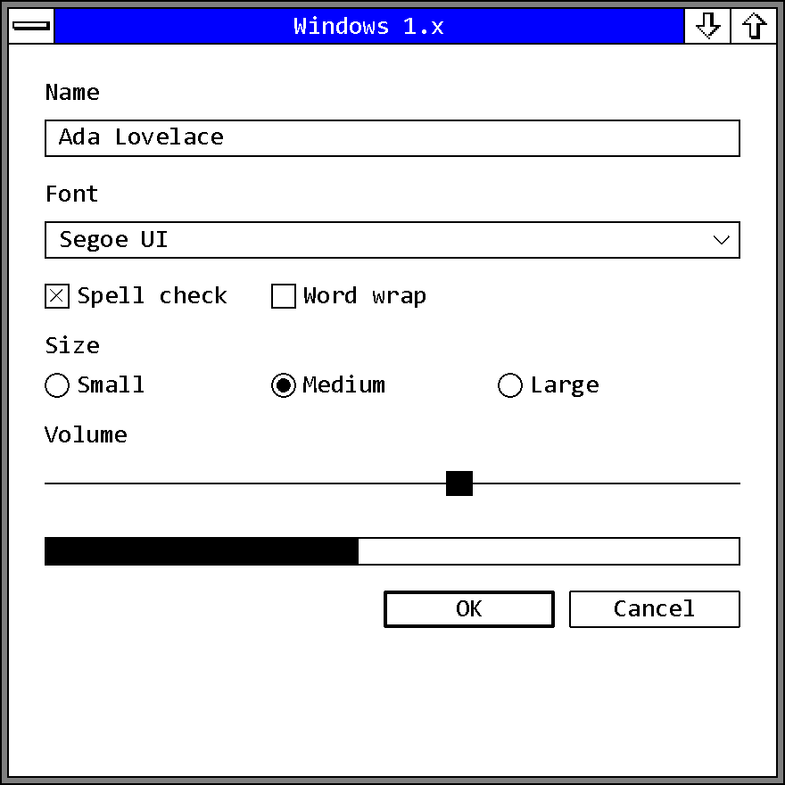

# Early Windows

Windows 1.x and 2.x, 1985 to 1990; Win16. The design language Windows 1.01 introduced in
November 1985 and Windows 3.0 replaced in May 1990: flat one-pixel frames, monochrome line-art
chrome that lives in the display driver, one fixed-pitch bitmap font, and reverse video as the
only state color.

No first-party Microsoft document names this design language. "Early Windows" is a filing name,
the same way "Windows 3.x" and "Windows 9x" are for the two eras after it.

!!! note "Evidence Tiers"
    Every value on this page carries the tier of its source.

    **Tier 1** is shipped media or Microsoft's own source: the Windows 1.01 retail display
    drivers, fonts and `USER.EXE`, and the Windows 2.03 DDK's driver source (`COLOR.ASM`,
    `BLKWHITE.ASM`, `CONFIG.ASM`, the loose `.BMP` artwork). The SDK headers (`WINDOWS.H` from
    1.01, 1.03, 1.04 and 2.03) sit just below that as shipped developer files.

    **Tier 2** is first-party documentation: the 1986 *Application Style Guide*, the *Programming
    Guide* and *Programmer's Reference*, and the 1985 and 1987 retail *User's Guides*.

    Unusually for an old era, almost everything that matters here is Tier 1. No running Windows
    1.x or 2.x was observed; every claim rests on a static resource or a document.

## Principles

### The Guide Specifies Behavior, the Driver Supplies the Pixels

The era has exactly one normative UI document, the *Application Style Guide* version 1.03 from
October 1986.[^sg86] It runs twelve chapters on menus, accelerators, selection, keyboard and mouse
conventions, filenames, dialog and message-box wording, multitasking etiquette, localization and
help. It has **no principles chapter at all**. The one-page introduction is the whole of its stated
intent, and it names a single value, consistency, for the benefit of *"the nonprogramming user"*.
It also says *"Applications should deviate from the guidelines only when absolutely necessary"*,
which is a stricter conformance stance than the 1992 guide that followed it.

What the book does not have is appearance. Its whole section on color, §10.8, is this:

> *"Applications should use color wherever appropriate; however, consideration also must be given
> to how the program looks on monochrome displays."*

That is the complete color specification of the design language. There is no RGB value, no font
name, no bevel, and outside one push-button height ratio no measurement of a drawn thing in all
92 pages. Note where the sentence sits, too: color is filed under *Cooperation*, after memory and
file usage, as a compatibility duty toward hardware the application does not control.

Appearance lived in three places outside the book:

| Where | What it held |
| --- | --- |
| The display driver | every chrome bitmap (`OBM_*`), every cursor and system icon, the UI font, and the default color table |
| The driver's compiled-in color table | the defaults, linked into the driver as absolutes, which is why the shipped `WIN.INI` `[colors]` section is empty |
| Control Panel | one slot at a time, through Hue, Bright and Color scroll bars |

### Cooperation Is the Real Core

Chapter 10, "Cooperation", is the one place the book states an ethic, and nothing in any later
Windows guide replaces it. The machine was an 8088 with 256 to 640 KB, no memory protection and
cooperative multitasking: an application that did not yield froze the whole system, the mouse
included. So the rules are about yielding, signaling progress and not touching what you do not own.

- *"Unless waiting for user input, applications with the input focus must not present any pause in
  activity (dead air) that lasts longer than five seconds."* This is the era's only numeric UI
  requirement, and it is a ceiling on unresponsiveness, not a response-time target.
- The hourglass pointer must be shown for long operations, *"with both keyboard and mouse
  interfaces"*, because the mouse was optional.
- An inactive application may not put a dialog in front of the user. It beeps, flashes its title
  bar or icon, and waits to be activated. The flashing title bar is the era's entire notification
  system.

### What the Era Is Not

| Concept | Status |
| --- | --- |
| A 3-D metaphor | None. The words *raised*, *sunken*, *bevel*, *shadow* and *three-dimensional* do not occur in the style guide, and all chrome is 1 bit per pixel. |
| CUA-derived | No. IBM's first CUA publication is from 1987; the style guide is from October 1986 and the first User's Guide from August 1985. |
| Combo box, MDI, owner-draw | Absent from all four era headers. All three arrive with Windows 3.0. |
| A settable dialog font | No. `DS_SETFONT` is a Windows 3.0 addition; every dialog uses the System font. |
| Common dialogs | None. Every application drew its own Open and Save As boxes. |
| A Help menu | Not allowed. `About...` is the only command an application may add to the System menu, and help hangs off it; F1 enters a "help mode" with a question-mark pointer. |
| Ctrl+X, Ctrl+C, Ctrl+V | No. The clipboard keys are Shift+Esc (Undo), Del (Cut), F2 (Copy), Ins (Paste). |
| Hover, animation | Neither exists as a concept. |

### Two Plateaus and One Cliff

The era looks like one thing but is two flat stretches with a single break between them. Windows
1.01 to 1.04 add two API functions in seventeen months and change nothing visual. Windows 2.03 to
2.11 add no new `#define` names at all and keep 51 of 52 chrome bitmaps byte-identical. Everything
that tells "Windows 1" from "Windows 2" happens at **2.03, December 1987**, and it happens because
windows stopped being tiled.

| Marker | Windows 1.0x | Windows 2.x |
| --- | --- | --- |
| Window placement | tiled (`WS_TILED` is `0`) | overlapping (`WS_OVERLAPPED` is the same `0`, renamed) |
| Focus indicator | a blinking underscore inside the control | a dotted box around the focused area |
| Button label | `Ok` | `OK` |
| Mnemonics | none; Alt+letter opens a menu by first letter | `&` mnemonics (0 of 183 sample menu items in 1.0x, 160 of 186 at 2.03) |
| System menu | 5 items: Size, Move, Icon, Zoom, Close | 7 items: Restore, Move, Size, Minimize, Maximize, separator, Close, with accelerators |
| Caption buttons | none | `OBM_REDUCE`, `OBM_ZOOM`, `OBM_RESTORE` |
| `SM_CMETRICS` | 26 | 36 (sizing frame, minimum track size, caption-button size) |
| Color slots | 10 | 13 |

Two things commonly credited to Windows 3.x are **not** dating markers: the X in the check box and
the rounded push-button corner both run unchanged from 1985 into Windows 3.0.

## Foundations

### Color

#### The Slot Table

Windows 1.x has ten `COLOR_*` slots, Windows 2.x thirteen.[^h101] [^h203] They name surfaces and
their text, nothing else.

| # | Constant | Control Panel label | Paints | Since |
| --: | --- | --- | --- | --- |
| 0 | `COLOR_SCROLLBAR` | Scroll Bars | the scroll-bar shaft (trough) | 1.01 |
| 1 | `COLOR_BACKGROUND` | Screen Background | the desktop | 1.01 |
| 2 | `COLOR_ACTIVECAPTION` | Active Title Bar | active title bar | 1.01 |
| 3 | `COLOR_INACTIVECAPTION` | Inactive Title Bar | inactive title bar | 1.01 |
| 4 | `COLOR_MENU` | Menu Bar | menu background | 1.01 |
| 5 | `COLOR_WINDOW` | Window Background | client area, and every dialog | 1.01 |
| 6 | `COLOR_WINDOWFRAME` | Window Frame | every 1 px frame | 1.01 |
| 7 | `COLOR_MENUTEXT` | Menu Text | menu text | 1.01 |
| 8 | `COLOR_WINDOWTEXT` | Window Text | client-area text | 1.01 |
| 9 | `COLOR_CAPTIONTEXT` | Title Bar Text | active title text | 1.01 |
| 10 | `COLOR_ACTIVEBORDER` | Active Border | active sizing border | 2.0 |
| 11 | `COLOR_INACTIVEBORDER` | Inactive Border | inactive sizing border | 2.0 |
| 12 | `COLOR_APPWORKSPACE` | Application Workspace | MDI client background | 2.0 |

The three 2.x slots all follow from overlapping windows. The header order, the `WIN.INI` keys and
the Control Panel list (string ids 112 to 121 in the shipped `CONTROL.EXE`) are the same ten items
in the same sequence, three independent routes.

What is missing matters more. `COLOR_BTNFACE`, `COLOR_BTNSHADOW`, `COLOR_BTNTEXT`,
`COLOR_HIGHLIGHT`, `COLOR_HIGHLIGHTTEXT` and `COLOR_GRAYTEXT` return **zero hits** in the 1.01,
1.03, 1.04 and 2.03 headers. They arrive with Windows 3.0 (`COLOR_BTNHIGHLIGHT` with 3.1). A push
button in this era is painted from the window colors like everything else; there is no "button
surface" in the color model, and no slot whose job is to show a state.

#### The Four Default Palettes

Both halves of the era have their defaults recovered from first-party evidence, and each half has
a color and a monochrome row.

- **Windows 1.01** is decoded from the shipped retail display drivers. Each carries an `OEMBIN`
  resource holding nine metric words and then ten `R,G,B,0` quads in slot order.[^drv101]
- **Windows 2.03** is read from the DDK's own driver source, `COLOR.ASM` and `BLKWHITE.ASM`,
  whose header says *"The default colors are defined as absolute values to be linked into color
  display drivers"*.[^ddk203]

| Slot | 1.01 mono | 1.01 color (EGA) | 2.03 color | 2.03 mono |
| --- | :-: | :-: | :-: | :-: |
| `SCROLLBAR` | `#C0C0C0` | `#FF0000` | `#3F3F3F` | `#3F3F3F` |
| `BACKGROUND` | `#808080` | `#00FF40` | `#00FFFF` | `#7F7F7F` |
| `ACTIVECAPTION` | `#000000` | `#0000FF` | `#0000FF` | `#000000` |
| `INACTIVECAPTION` | `#808080` | `#4040C8` | `#FFFFFF` | `#FFFFFF` |
| `MENU` | `#FFFFFF` | `#FFFF00` | `#00FFFF` | `#FFFFFF` |
| `WINDOW` | `#FFFFFF` | `#FFFFFF` | `#FFFFFF` | `#FFFFFF` |
| `WINDOWFRAME` | `#000000` | `#000000` | `#000000` | `#000000` |
| `MENUTEXT` | `#000000` | `#000000` | `#000000` | `#000000` |
| `WINDOWTEXT` | `#000000` | `#000000` | `#000000` | `#000000` |
| `CAPTIONTEXT` | `#FFFFFF` | `#FFFFFF` | `#FFFFFF` | `#FFFFFF` |
| `ACTIVEBORDER` | none | none | `#7F7F7F` | `#7F7F7F` |
| `INACTIVEBORDER` | none | none | `#7F7F7F` | `#7F7F7F` |
| `APPWORKSPACE` | none | none | `#0080FF` | `#BFBFBF` |

How each row is corroborated:

| Row | Witnesses |
| --- | --- |
| 1.01 mono | four shipped drivers (`EGAMONO`, `EGAHIBW`, `HERCULES`, `CGA`), and the 1985 *User's Guide* Appendix A, which prints exactly these ten values (`Scrollbar = 192 192 192`, `Background = 128 128 128`, ...)[^ug85] |
| 1.01 color | two shipped drivers (`EGAHIRES`, `EGALORES`), and a second copy of `COLOR.ASM` in the 2.03 DDK whose commented-out `; alpha/beta 1 colors` block is this row exactly, so the Windows 2.0 alpha still carried the 1.x palette |
| 2.03 color | `COLOR.ASM`, identical for EGA, VGA and 1024x768 |
| 2.03 mono | `BLKWHITE.ASM`, identical for all five adapters |

Some details worth keeping:

- **The out-of-box Windows 2.x color desktop is cyan**, with pure-blue title bars, a cyan menu
  bar and white windows. Later eras' navy `#000080` caption invites the assumption that 2.x looked
  the same. It did not.
- **The 1.01 monochrome row is the look most people picture as early Windows**: white windows and
  menus, black text, a black active title bar and a mid-gray screen.
- **`#4040C8` is the only hand-mixed color in the era.** Every other value is built from `00`,
  `3F`, `40`, `7F`, `80`, `BF`, `C0` or `FF`.
- **The 1.01 color row conflicts with Microsoft's own photography on the Windows 1.01 retail
  box**, captioned as an IBM EGA screen, which shows yellow-green
  scroll-bar troughs and pale-cyan client areas. The likeliest reading is a scheme dressed through
  Control Panel for the photograph, but that is an inference. The drivers are the evidence.
- **The 1987 *User's Guide* is two slots stale.** It agrees with `BLKWHITE.ASM` on eleven of
  thirteen keys and still prints the 1.0 values for `Scrollbar` and `InactiveTitle`.[^ug87] The
  driver source is the authority.
- Only three slots moved between 1.01 mono and 2.03 mono: `SCROLLBAR` (`#C0C0C0` to `#3F3F3F`),
  `INACTIVECAPTION` (`#808080` to `#FFFFFF`) and `BACKGROUND` (`#808080` to `#7F7F7F`). Those are
  the ones a viewer notices, so they are the ones not to mix between rows.

**Pick a version first, then a display class, and do not mix them.** The four rows are four
distinct looks.

#### The Grays Go Round in a Circle

Windows 1.01's two grays are `#C0C0C0` and `#808080`, the exact pair Windows 3.x made famous,
shipped five years earlier. Windows 2.03 re-derives the ramp as exact quarters (`#3F3F3F`,
`#7F7F7F`, `#BFBFBF`) and Windows 3.0 goes back to 192 and 128, this time giving them a job as
face and shadow. In this era the grays never compose anything: they paint a scroll-bar shaft, a
desktop, a sizing border and an MDI workspace, and nothing is stacked against anything.

#### Persistence and Theming

`GetSysColor`, `SetSysColors` and `WM_SYSCOLORCHANGE` are all present and unchanged from 1.01.
Control Panel writes changed slots to `WIN.INI` `[colors]` as decimal `R G B` lines. The shipped
`[colors]` section is **empty** in both the 1.01 retail runtime and the 2.03 SDK; an absent key
falls through to the driver's table.

The whole theming model is Control Panel's Screen Colors dialog: a list box of the ten or thirteen
elements, three scroll bars labeled **Hue**, **Bright** and **Color**, a mock window built from
the strings `Active`, `Inactive`, `File  Edit` and `Window Text`, and **Ok / Reset / Cancel**.
There are no named color schemes: the word *scheme* occurs zero times in both User's Guides.
Named schemes arrive with Windows 3.x. A scheme picker in a Windows 1.x or 2.x reproduction is
the most likely anachronism, because every later Windows has one.

#### The Hardware Underneath

Four of the six Windows 1.01 display drivers are monochrome. CGA and Hercules show 2 colors, EGA
16. There is no palette manager, no `LOGPALETTE` and no documented rule for how a `COLORREF` maps
to a 2-color device. Color, in this era, is a property of a minority of installations, and the
style guide's one sentence is a plain description of that installed base.

### Relief: There Is None

This is the central finding for the era, and it is a negative one, provable three ways.

1. **The drawing API cannot express an edge.** The complete rectangle-and-frame surface in both
   1.01 and 2.03 is seven calls: `FillRect`, `FrameRect`, `InvertRect`, `PatBlt`, `GrayString`,
   `Rectangle` and `RoundRect`. None takes an edge, a side, a light direction or a state.
   `FrameRect` draws the same brush on all four sides; it is structurally incapable of an
   asymmetric bevel. `DrawEdge`, `DrawFrameControl`, `DrawState` and `DrawFocusRect` return zero
   hits in all four headers.
2. **The color table has no surface.** No face, no shadow, no highlight slot.
3. **The pixels are one bit deep.** Every `OBM_*` bitmap in every 1.01 driver and every 2.03
   resource set is `planes = 1, bitsPixel = 1`. There are no grays in the artwork because the
   artwork cannot hold one.

A gray brush does exist: `SS_GRAYRECT` and `SS_GRAYFRAME` are static-control styles from 1985, and
`GRAY_BRUSH` is there. No system control is drawn with any of them. **A gray brush exists; a gray
control face does not.** Windows 3.0 introduced no new primitive. It introduced a color slot whose
job was to be a surface.

What the era uses instead:

| Construction | What it is |
| --- | --- |
| Frame | `cxBorder` px of `COLOR_WINDOWFRAME` on the left and right, `cyBorder` px on the top and bottom. Both are 1 on every square-pixel adapter; `cxBorder` is **2** on CGA and EGA low resolution, where pixels are twice as tall as wide, so a vertical rule weighs the same as a horizontal one. |
| Dialog frame | `WS_CAPTION` is literally `WS_BORDER` OR'd with `WS_DLGFRAME`. A dialog gets a 1 px `COLOR_WINDOWFRAME` line plus a flat `cxDlgFrame` band in `COLOR_ACTIVECAPTION`: two flat bands, never two sides of anything. The Programming Guide's section on it is titled *"Creating Pretty Dialog Borders"* and its whole advice is to set the style bit.[^pg86] |
| Sizing frame (2.x only) | `BorderWidth`, default **5** px, user-settable from 1 to 50 and redrawn live. A grab target, not an elevation cue. |
| State | `InvertRect`. The era has exactly two visual planes, normal and inverted. |
| Disabled | `GrayString`, text through a 50 % checkerboard brush. |

There is one seed of what comes next. Windows 2.03's three new caption-button bitmaps and its
redrawn Control-menu box are hollow glyphs with a **1 px top and left edge and a 2 px right and
bottom edge**. In one-bit art that reads as a drop shadow, and it is the first appearance of the
1 : 2 asymmetry that Windows 3.x later states in color. It appears on those glyphs only, is not
expressible in any API, and applies to the glyph inside the button rather than to any surface.

The chrome this era hands forward is literal. `OBM_BTNCORNERS` (the push-button corner sheet) and
`OBM_SIZE` (the scroll-bar corner box) are **bit-for-bit identical from Windows 1.01 (1985) to
Windows 3.0 (1990)**, measured in the Windows 3.0 SDK's `VGA.DRV`.[^vga30] Windows 3.0 did not
repaint the old art. It kept the thirteen monochrome ordinals and shipped fifteen new 4-bpp
beveled bitmaps beside them.

### Typography

The UI type is a single face called **System**: a bitmap font, **fixed pitch**, drawn with
2-pixel stems, shipped at one size per display and at no other.[^fonts] Every value below is read
from the `FONTINFO` headers of the shipped files.

| Release, display | File | Cell (w x h) | Ascent | Leading | Weight | Line pitch |
| --- | --- | --- | --: | --- | --: | --: |
| 1.01, high res (EGA 640x350, Hercules) | `HIFONTS.FON` | **8 x 12** | 10 | 2 external | **400** | **14** |
| 1.01, low res (CGA, EGA 640x200) | `LOFONTS.FON` | 8 x 8 | 7 | 1 external | 334 | 9 |
| 2.03, CGA | `SYS08CGA.FNT` | 8 x 8 | 7 | 1 external | 400 | 9 |
| 2.03, EGA | `SYS08EGA.FNT` | 8 x 10 | 9 | 2 internal | 400 | 10 |
| 2.03, VGA | `SYS12VGA.FNT` | 8 x 15 | 12 | 3 internal | 400 | 15 |
| 2.03, 1024x768 | `SYSHIRES.FNT` | 10 x 20 | 16 | 2 internal | 400 | 20 |

- **Fixed pitch.** `dfPitchAndFamily` has bit 0 clear and `dfAvgWidth == dfMaxWidth == 8`, two
  independent checks. By Windows 3.x the System font is proportional and bold. The change of pitch
  is the largest typographic difference between the two eras.
- **Regular weight, but heavy on screen.** The declared weight is 400, and every stem is drawn two
  pixels wide, so it reads as a semi-bold. A reconstruction with 1 px stems looks markedly
  lighter. `LOFONTS`' weight of 334 is unexplained.
- **One UI face.** Windows 3.x's split between a chrome face and a dialog face does not exist yet.
  Menus, captions, dialogs and edit controls all use System, and edit controls are fixed-pitch by
  rule: *"All edit controls use the fixed pitch ANSI font to display characters."*
- **The zero is slashed**, a diagonal from bottom left to top right inside the bowl. It is the
  fastest test for a substitute face.
- **Bitstream, 1984.** Every face carries `(c) Copyright Bitstream Inc. 1984`, except the 2.03
  1024x768 face, which is a separate Microsoft drawing from 1987.
- **The font may not outgrow the chrome.** Every `FONTS.ASM` in the DDK opens with *"System font
  height should be less than or equal to the close box and the size box bitmaps heights"*, which
  is why font and chrome bitmaps are redrawn per adapter in lockstep rather than scaled.
- No antialiasing, no hinting, no scaling, no outline format and no user choice of UI font. The
  only stroke fonts (`Roman`, `Modern`, `Script`) are document fonts.

The style guide says nothing about type. Its one typographic rule is the push-button height, in
§8.11.1.

#### Substitutes on Current Windows

`System` cannot be redistributed: it is Bitstream-licensed, and a `.FON` raster face besides,
which DirectWrite cannot load. Every monospaced outline face that ships with Windows 11 was
measured for this page; "em for 8 px" is the pixel size at which the advance matches the era's 8.

| Face | Advance / em | Em for 8 px | Zero | Note |
| --- | :-: | :-: | --- | --- |
| `Consolas` | 0.550 | 14.55 | dotted | humanist, least period-looking, keeps the `0`/`O` distinction |
| `Lucida Console` | 0.603 | 13.28 | plain | squarer and more period-looking, loses the distinction |
| `Courier New` | 0.600 | 13.33 | plain | slab typewriter, wrong genre |
| `MS Gothic` | 0.500 | 16.00 | plain | metrically exact, but not inbox on en-US Windows |

None of them fits, and the gap is **weight, not family**. At the size where the advance is 8 px,
all of them render 1 px stems where the era's are 2 px. Asking for bold is not the fix: the era's
face is weight 400 and Windows 3.x's `System` really is 700, so a bold would erase a documented
difference between the two eras.

### Metrics

#### The Dialog Unit Arrives Complete

The *Programming Guide* defines dialog units in 1986 exactly as Win32 still does: a horizontal unit
is a quarter of the System font's character width, a vertical unit an eighth of its height,
excluding external leading.[^pg86]

| Configuration | Cell | 1 h-DU | 1 v-DU | 8 v-DU | 14 v-DU (a push button) |
| --- | --- | --: | --: | --: | --: |
| 1.01, high res | 8 x 12 | 2 px | 1.5 px | 12 px | 21 px |
| 1.01, low res | 8 x 8 | 2 px | 1 px | 8 px | 14 px |
| 2.03, EGA | 8 x 10 | 2 px | 1.25 px | 10 px | 17.5 px |
| 2.03, VGA | 8 x 15 | 2 px | 1.875 px | 15 px | 26.25 px |
| 2.03, 1024x768 | 10 x 20 | 2.5 px | 2.5 px | 20 px | 35 px |

Eight vertical units is one line of text by construction. The 1.01 high-resolution configuration is
the one where everything lands on whole pixels, and it is the configuration every other measurement
on this page is taken at.

#### Control Heights and Layout, as Built

Measured over 57 SDK sample resource scripts and the decoded dialog templates of the shipped 1.01
shell and applets, in dialog units.

| Control | Height | Notes |
| --- | --- | --- |
| Push button | **14** | 159 of 159 buttons, no exception in any SDK version |
| Edit, bordered | 12 | 97 of 97; *"use 8 units if the control has no border, and 12 units if the control has a border"* |
| Radio button | 12 | 60 of 60 |
| Check box | 15 (1.0x samples) / 12 (shipped applets) | |
| Static text, one line | 8 | exactly one character cell |
| Scroll bar in a dialog | 12 | the Control Panel sliders |

| Convention | Value |
| --- | --- |
| Ok / Cancel | 32 x 14 DU each; Open / Cancel in a file dialog 50 x 14 |
| Button width rule | *"the number of characters in the push button name plus 2"*, which gives exactly 32 for `Cancel` |
| Label to field | the static label's y is 2 units above the edit control's |
| Dialog margin | 4 units |
| Maximum dialog | 80 columns x 4 = 320 h-DU; 24 rows x 8 = 192 v-DU; no more than 75 % of the screen |

The style guide prints the maximum height as 96, which does not match its own formula
(24 x 8 = 192). The shipped samples obey the formula.

#### Per-Adapter Pixel Metrics

The first nine words of every driver's configuration block (1.01 `OEMBIN`, 2.03 `CONFIG.ASM`),
identical across both releases:

| Metric | EGA hi-res, VGA, Hercules, 1024x768 | CGA, EGA lo-res |
| --- | :-: | :-: |
| Vertical scroll thumb height | 18 | 12 |
| Horizontal scroll thumb width | 20 | 24 |
| Icon compression (h, v) | 2, 2 | 2, 4 |
| Cursor compression (h, v) | 1, 1 | 1, 2 |
| `cxBorder` | 1 | **2** |
| `cyBorder` | 1 | 1 |

Every one of these is a pixel count a person chose per display. There is no formula and no DPI
concept anywhere in the era. The eight system metrics 2.x adds (`SM_CXMIN`/`CYMIN`,
`SM_CXSIZE`/`CYSIZE`, `SM_CXFRAME`/`CYFRAME`, `SM_CXMINTRACK`/`CYMINTRACK`) are exactly what a
dragged, resizable, minimizable window needs and a tiled one does not.

### States and Motion

The entire state vocabulary is two calls: `InvertRect` and `GrayString`.

| State | Mechanism | 1.0x | 2.x |
| --- | --- | :-: | :-: |
| Selected text or item | reverse video | yes | yes |
| Active window | active vs inactive caption color | yes | yes |
| Insertion point | a flashing caret, *"a bar or bitmap"* | yes | yes |
| Focus | **a blinking underscore** inside the control, under its label | yes | no |
| Focus | **a dotted box** around the focused area | no | yes |
| Default button | a bold border (`OBM_BTNCORNERS` glyph B) | yes | yes |
| Checked menu item | a tick beside the name (`OBM_CHECK`) | yes | yes |
| Checked check box | an X in the box | yes | yes |
| Selected radio | a filled center | yes | yes |
| Pressed push button | *"blackened"*, inverted | yes | yes |
| Pressed check box, radio | *"emboldened"*, the glyph at 2 px stroke | yes | yes |
| Disabled label | grayed, the label only | yes | yes |
| Disabled glyph | 50 % checkerboard dither | yes | yes |
| Hover | **does not exist** | no | no |
| Attention | beep, then flash the title bar or icon | yes | yes |

Some rows need a sentence each.

- **Focus is the sharpest 1.0x vs 2.x discriminator.** The 1985 User's Guide uses *underscore* 18
  times and *dotted* never; the 1987 one uses *dotted* 8 times. In 1.0x the underscore is a single
  indicator for the whole screen that turns into the text caret when it lands in a text box, and
  the style guide sizes push buttons to hold it: *"Push-button height should be 1-1/2 times as high
  as the tallest character in the button name and also should include space for the blinking
  underscore."*
- **Default and focus are separate.** Enter fires the default button from anywhere in the dialog;
  Space fires the focused one. The default never moves in 1.0x. 2.0 adds `DM_SETDEFID`, so it can
  move at run time.
- **Pressed is documented in one sentence**, `BM_SETSTATE`'s: *"If wParam is TRUE, the button is
  blackened, or the check box is emboldened."*[^pg86] There is no pressed artwork for a push
  button or a scroll arrow, no bevel to sink into, and no label offset.
- **Disabled grays the text, never the frame.** *"When a button cannot be chosen, the label in the
  button should be grayed."* On the four monochrome 1.01 drivers there is no gray to draw with, so
  the gray is a checkerboard.
- **No hover.** *hover*, *mouse over* and *rollover* occur zero times across all three books, and
  the `BN_*` set has no enter or leave notification. With inversion as the only state operation a
  hover would be indistinguishable from pressed. A menu highlight follows the pointer only while a
  mouse button is held.

**Motion does not exist.** No duration, easing or transition is named anywhere. The only timing
values in the era are the shipped `WIN.INI` defaults, identical in 1.01 and 2.03, and the five
second dead-air ceiling:

| Value | Default |
| --- | --: |
| `CursorBlinkRate` | 550 ms |
| `DoubleClickSpeed` | 500 ms |
| Maximum dead air with the input focus | 5 s |

### Iconography

The era ships five system icons (`OIC_SAMPLE`, `OIC_HAND`, `OIC_QUES`, `OIC_BANG`, `OIC_NOTE`) and
seven system cursors in 1.x, twelve in 2.x (the five sizing cursors arrive with resizable windows),
all 1 bit deep. Masters are authored at 64 x 64 for icons and 32 x 32 for cursors and then squashed
by integer factors per adapter, so an icon is 64 x 64 on 1024x768, 32 x 32 on EGA and 32 x 16 on
CGA. There is no fixed icon size in this era. The 1.01 icons are a white symbol knocked out of a
black tile; the 2.03 masters are black line art on white, and **the triangle around the exclamation
mark, still in Windows today, arrives with Windows 2.0**. The style guide gives no icon design
guidance at all.

Minimizing is the icon model: there is no taskbar. In 1.0x icons sit in an icon area along the
bottom of the screen; in 2.x they float and can be dragged, and their title shows only while
selected.

## Controls

The era has **five window classes**: `BUTTON`, `EDIT`, `STATIC`, `LISTBOX` and `SCROLLBAR`, plus
menus. Every control on this page is one of them.

### Push Button

A one-bit, round-cornered **outline** with a label in it. No face color, no highlight, no shadow.
*"A push button is a box that contains a string."*

The only shipped artwork is `OBM_BTNCORNERS`, a 30 x 10 monochrome sheet with three motifs,
byte-identical from the 1.01 driver through the 2.03 DDK to Windows 3.0:

| Motif | Extent | Shape | Role |
| --- | --- | --- | --- |
| A | 6 x 6 | ring, 1 px stroke, corner pixel cut | ordinary push-button corner |
| B | 8 x 8 | ring, 2 px stroke, two pixels cut | the **default** button corner |
| C | 4 x 4 | solid block | corner fill / clip mask |

On the 640x200 adapters the sheet is redrawn at 36 x 6 (a 6 x 4 and a 12 x 6 ring), squashed rather
than scaled.

| Property | Value | Source |
| --- | --- | --- |
| Height | 14 DU (21 px at 8 x 12) | every shipped template |
| Width | characters + 2, in 4 DU per character; 32 DU for Ok / Cancel | *Programming Guide* §7.3.6 |
| Fill | `COLOR_WINDOW`, the page itself | no face slot exists |
| Outline | 1 px `COLOR_WINDOWFRAME`, rounded by motif A | `OBM_BTNCORNERS` |
| Default button | the same outline at 2 px, corners from motif B; *"The default button has a bold border"* | style guide §8.5 |
| Pressed | inverted (*"blackened"*); label does not move | `BM_SETSTATE` |
| Disabled | label grayed; frame and corners unchanged | style guide §8.6 |
| Focus | 1.0x underscore under the label; 2.x dotted box | User's Guides |
| Hover | none | |

Every modal dialog *"should have a default push button"*. Where the safe choice is negative, the
guide asks for Yes / No with No as default rather than making Cancel the default.

The system's own labels live in `USER.EXE`'s string table, and they are the sharpest single dating
marker there is:

| Index | 1.01 | 2.03 |
| --: | --- | --- |
| 2 | `Ok` | `OK` |
| 3 | `Cancel` | `Cancel` |
| 4 to 8 | `Abort`, `Retry`, `Ignore`, `Yes`, `No` | `&Abort`, `&Retry`, `&Ignore`, `&Yes`, `&No` |

`Ok` follows the style guide's own rule: *"The first letter in the push-button name should be a
capital. All other characters in the name should be lowercase."*

The guide places buttons *"at the upper right edge of the window with Cancel under Ok"*. Microsoft's
own 1.01 applets mostly put them in a bottom row instead. The guide and the product disagreed from
the first release.

### Check Box and Radio Button

Both are drawn from `OBM_CHECKBOXES`, a sheet of **4 columns x 3 rows** of 1-bit outline glyphs.

| Column | State | Drawn as |
| --: | --- | --- |
| 0 | not set | outline, 1 px stroke |
| 1 | set | outline plus its mark |
| 2 | not set, pressed | outline at 2 px stroke |
| 3 | set, pressed | 2 px outline plus its mark |

| Row | Contents |
| --: | --- |
| 0 | check box: a hollow square; checked is an **X drawn corner to corner** |
| 1 | radio button: a ring; selected is a **filled disc** in the ring |
| 2 | the grayed third state: a 50 % checkerboard (columns 1 and 3; the others are unused scratch art) |

| Release, display | Sheet | Cell |
| --- | --- | --- |
| 1.01, EGA hi-res, Hercules, mono | 56 x 42 | **14 x 14** |
| 1.01, CGA, EGA lo-res | 64 x 24 | 16 x 8 |
| 2.03, EGA, Hercules | 56 x 33 | 14 wide; bands 11 / 10 / 12 |
| 2.03, VGA | 56 x 39 | 14 x 13 |
| 2.03, 1024x768 | 64 x 48 | 16 x 16 |

Facts that matter for a reconstruction:

- **The X is from November 1985.** It is often presented as a Windows 3.x trait; 3.x inherited it.
- **Two marks for two jobs.** A checked check box is an X; a checked menu item is a tick
  (`OBM_CHECK`). Windows 95 later collapses them.
- **Pressed is emboldened, not inverted.** The stroke thickens; ink and paper do not swap.
- **No well.** Not one of the twelve cells has an interior fill or an edge with a direction. A
  check box is a hollow square with a 1 px outline sitting on the dialog background.
- Grouping: radio buttons carry `WS_GROUP` on the first member only and no `WS_TABSTOP`, so Tab
  skips the group and the arrow keys move within it. Each check box carries
  `WS_TABSTOP | WS_GROUP`.

### Edit Control and Static Text

| Property | Value |
| --- | --- |
| Height | 12 DU with a border, 8 without; every shipped edit is 12 |
| Frame | 1 px `COLOR_WINDOWFRAME` (`WS_BORDER`) |
| Fill, text | `COLOR_WINDOW`, `COLOR_WINDOWTEXT` |
| Font | fixed-pitch, by rule; `EM_SETFONT` requires a fixed-pitch font |
| Selection | reverse video, shown on focus and hidden on focus loss unless `ES_NOHIDESEL` |
| Caret | a flashing vertical bar, 550 ms blink |
| Styles | the seven `ES_*` values are identical from 1.01 to 2.03; no password, read-only or case styles |

`STATIC` is both the label and the dialog editor's only decorative primitive. Its six rectangle
styles, `SS_BLACKRECT`, `SS_GRAYRECT`, `SS_WHITERECT` and the matching `*FRAME` trio, are flat
single-color fills or one-unit frames in three tones, and they are the era's whole ornamental
vocabulary.

### List Box

Four `LBS_*` styles, unchanged across the era, and `LB_DIR` fills one with a file listing in a
single message. **There is no combo box**: not in the headers, the style guide, the User's Guides,
the 57 sample scripts or the 507 dialog items decoded from 12 shipped binaries. An Open dialog pairs
an edit field with a list box because that was the only way to get the combination. There is no
height rule either; the shipped habit is 56 DU (seven rows at 8 DU) for a file list.

### Scroll Bar

The 1985 User's Guide describes it as *"the gray bars"* with *"the small white box"* as the thumb,
the only control whose colors any source states. The shaft is `COLOR_SCROLLBAR`.

| Part | EGA hi-res (1.01) | Note |
| --- | --- | --- |
| Up / down arrow | 15 x 16 | a solid triangle on a stem, floating on background, no box and no pressed variant |
| Left / right arrow | 20 x 13 | |
| Thumb (`OBM_BTSIZE`) | 15 x 14 | 15 x 13 in the 2.03 EGA set |
| Vertical thumb height | 18 px | 12 on CGA |
| Horizontal thumb width | 20 px | 24 on CGA |

libwinui draws this bar under Windows 1.x/2.x in a 17 px gutter: the stemmed arrows in
`COLOR_WINDOWFRAME` on `COLOR_WINDOW` boxes, a white scroll box of the driver's fixed 18 px (20 on
a horizontal bar) framed the same way, and the flat `COLOR_SCROLLBAR` shaft, inverted under a held
page click. The bar's thickness is not on file; 17 holds the 15 px square-pixel arrow art in its
frame.

The four arrows and the size box are byte-identical between 1985 and 1988. The size box
(`OBM_SIZE`, 13 x 14) is two 3 px bars forming an elbow: a divider, not a grip. There is no
trackbar in the era; Control Panel uses a horizontal scroll bar between `Slow` and `Fast` labels as
its slider.

### Group Box

`BS_GROUPBOX`, a member of the `BUTTON` class: *"a rectangle that has an identifying text string in
its upper left corner"*. No source states its line weight or corner treatment, and there is no
bitmap for it; a one-pixel rectangle is the only plausible reading. There is no etched groove in
any source. In shipped dialogs the first child sits 4 DU in from the side and 12 DU down from the
top.

libwinui's `GroupBox` draws that reading: a 1 px `COLOR_WINDOWFRAME` rectangle with the label at the
upper left breaking its top line, and the content 8 px in and 24 px down.

### Menus

The menu bar is the **entire navigation model**. There is no toolbar, status bar, context menu,
cascading menu, tooltip or Help menu. Menu text is on a fixed 8 px grid, so accelerator columns
line up with literal spaces.

| Element | Treatment |
| --- | --- |
| Bar, drop-down | `COLOR_MENU` fill, `COLOR_MENUTEXT` text, 1 px frame |
| Highlight | reverse video |
| Disabled item | grayed, never removed |
| Toggle | a tick beside the name |
| Separator | one kind only, a single *"line separator"* |
| Dialog-opening item | name ends in an ellipsis |
| Accelerators | to the right of the name; `^key` for Ctrl, `Fn` for function keys |

The prescribed Edit accelerators are Shift+Esc (Undo), Del (Cut), F2 (Copy), Ins (Paste). Windows
2.0 moves to Alt+Backspace, Shift+Del, Ctrl+Ins and Shift+Ins. Ctrl+Z/X/C/V arrives with Windows
3.1.

### Dialogs and Message Boxes

| Property | Value |
| --- | --- |
| Surface | `COLOR_WINDOW`, the same white as every client area; there is no gray dialog page |
| Modal frame | the double flat frame of `WS_DLGFRAME` |
| Modeless | a title bar and a System menu, captioned with the command that opened it |
| Shadow, scrim | none |
| Message-box types | four in the guide, matching four icons: note, exclamation, question, hand |
| Message-box caption | the application name; *"should not use "WARNING" or exclamation points"* |
| Icon position | upper left |

### Windows

| Release | Model |
| --- | --- |
| 1.0x | Tiled. `WS_TILED` is `0`: tiled is what you get when you ask for nothing. The screen is split column-first into tiles, with an icon area along the bottom; Zoom is the only way to overlap. |
| 2.x | Overlapping. `WS_OVERLAPPED` is defined as `WS_TILED`, the same bit pattern renamed. Free drag and resize, and Minimize / Maximize / Restore replace Icon / Zoom. |

The chrome bitmaps across the era, EGA high resolution:

| Bitmap | 1.01 | 2.03 DDK | Change |
| --- | --- | --- | --- |
| `OBM_BTNCORNERS` | 30 x 10 | 30 x 10 | byte-identical |
| `OBM_UPARROW`, `OBM_DNARROW` | 15 x 16 | 15 x 16 | byte-identical |
| `OBM_LFARROW`, `OBM_RGARROW` | 20 x 13 | 20 x 13 | byte-identical |
| `OBM_SIZE` | 13 x 14 | 13 x 14 | byte-identical |
| `OBM_BTSIZE` | 15 x 14 | 15 x 13 | redrawn |
| `OBM_CHECK` | 16 x 16 | 14 x 14 | redrawn |
| `OBM_CHECKBOXES` | 56 x 42 | 56 x 33 | redrawn |
| `OBM_CLOSE` | 26 x 14 | 50 x 14 | redesigned, with the 1 : 2 shadow edge |
| `OBM_REDUCE`, `OBM_ZOOM`, `OBM_RESTORE` | none | new | 2.x only |

### Controls the Era Does Not Have

Slider, progress bar, combo box, tab control, tree view, toolbar, status bar, toggle switch,
tooltip, spin box and every common dialog are later inventions. `BS_USERBUTTON` and `SS_USERITEM`
are the only owner-supplied escape hatches, and the shipped applets use neither.

## Reproducing It Today

<figure markdown="span">
  { .era width="440" }
  <figcaption>libwinui's <code>Windows1x</code> theme, in a window opened with <code>Frame::Themed</code>.</figcaption>
</figure>

Unusually for an old era, most of the look can be rebuilt exactly on a modern stack such as
Direct2D and DirectWrite. The chrome is one-bit line art on one-pixel frames and the colors are in
Microsoft's own driver source, so there is no bitmap archive to approximate and no bevel ramp to
reconstruct. The hard part is suppression: every instinct a modern toolkit has (a gray face, a
bevel, hover, antialiasing, animation) has to be turned off.

### Exactly Reproducible

| Era fact | What it takes |
| --- | --- |
| The four default palettes | the ten or thirteen values from [the table above](#the-four-default-palettes), one row at a time |
| No relief | flat fills and 1 px frames in `COLOR_WINDOWFRAME`, stroked inside the bounds, and no two-tone edge anywhere |
| White page | dialogs, fields and every client area use `COLOR_WINDOW`; there is no gray surface to fall back to |
| Push button | a rounded outline on the page, with a 2 px outline for the default button and an inverted fill with an unmoved label for pressed |
| Check box, radio | a hollow square with a corner-to-corner X, and a ring with a filled disc; pressed thickens the outline from 1 px to 2 px |
| Dialog frame | a `cxBorder` line in `COLOR_WINDOWFRAME` plus a flat band in `COLOR_ACTIVECAPTION`, two flat bands rather than a heavier border |
| Selection | reverse video, swapping text and background colors |
| Focus | the 1.0x blinking underscore or the 2.x dotted box, matched to the version of the palette |
| States | no hover, no transition, no easing; disabled grays the label only |
| Rasterization | aliased geometry and aliased text, snapped to whole device pixels |
| Layout | dialog units computed from the System font's cell, as in [Metrics](#metrics) |

### Approximated

| Gap | Why, and what the choice costs |
| --- | --- |
| The `System` font | It cannot be redistributed and DirectWrite cannot load a `.FON` face. The options are a re-authored 8 x 12 bitmap face under a license you hold, or a monospaced outline face at the size whose advance is 8 px, drawn aliased (see [Substitutes on current Windows](#substitutes-on-current-windows)). The outline face gives 1 px stems where the era's are 2 px and a dotted or plain zero where the era's is slashed. A proportional face changes layout, not just texture, because every caption, menu and dialog was built on cell arithmetic. |
| The hand-drawn glyph sheets | `OBM_CHECKBOXES` and `OBM_BTNCORNERS` are Microsoft's art and must not be extracted or redistributed. They have to be re-drawn from the measurements on this page. Everything else (arrows, thumb, size box, menu tick) is simple enough to generate as geometry. |
| Per-pixel art vs geometry | The corner of a push button is a hand-cut pixel pattern, not a radius; a 1 px radius only stands in for motif A's cut, and motif B cuts two pixels. The era also redrew its art per adapter rather than scaling it, so at a modern DPI an implementation either picks one adapter's art and scales it by whole multiples, or draws geometry that no longer matches it pixel for pixel. |
| The disabled gray | The era's gray is a 50 % checkerboard. Drawn as a pattern it needs pixel snapping to stay crisp; drawn flat it becomes the color it averages to (`#808080` for black on white). |
| Reverse video on color rows | The era's prose rule is a swap of foreground and background. The actual `InvertRect` is a bitwise complement, and on a color row the two differ: over the 2.03 cyan menu bar a complement comes out red, not black. |
| `cxBorder` of 2 | On CGA and EGA low resolution vertical rules are 2 px thick to make up for tall pixels. Current displays have square pixels, so a re-creation targets the square-pixel adapters and draws 1 px everywhere. |
| The title bar | DWM owns the modern title bar and takes square corners and caption and border colors, which gets close to the era's flat caption. A libwinui window opened with `Frame::Themed` draws the caption itself. A 2.x scheme gets the System-menu box and the outline-arrow boxes inside a sizing frame. A 1.0x scheme gets a caption with only the three-bar box, inside a single frame line. Which of 1.01's two box glyphs shows at rest is not settled, so libwinui's early-Windows theme draws the three bars. |
| Controls the era lacks | A modern application expects sliders, progress bars, toggle switches, combo boxes, tabs, tooltips and more. The era has five window classes and nothing else, so anything drawn for the rest is an invention. Building them from era parts (a 1 px rule, a flat fill, the checkerboard, the scroll-bar thumb) keeps them plausible. The era's own slider was a horizontal scroll bar. |

### Behavior, Not Appearance

Some of the most recognizable parts of the era are behavior, content or layout. A theme that
changes only how controls are drawn cannot give them; an application or a window manager has to.

| Era trait | What it actually is |
| --- | --- |
| Tiled windows in 1.0x, the icon area along the bottom | window management |
| Del / F2 / Ins as Cut / Copy / Paste, Shift+Esc as Undo | input handling |
| The five-item System menu, no mnemonics in 1.0x | menu content |
| `Ok` vs `OK` | string content, and the sharpest dating marker there is |
| No combo box, no MDI, no common dialogs, no Help menu | which controls and dialogs an application uses |
| The five-second dead-air ceiling | application responsiveness |

### High Contrast

The era has no high-contrast setting and no accessibility settings at all. The style guide never
names accessibility, although its rule that every command must work from the keyboard as well as
the mouse has the same effect for keyboard users. What the era did have is the next best thing:
four of the six Windows 1.01 display drivers are monochrome, so the default for most installations
was already black on white, and every color slot could be set by hand in Control Panel. Because
nothing in the model is derived from anything else, any set of slot values, including a modern
contrast theme mapped onto the ten or thirteen slots, leaves the construction intact.

The next era, [Windows 3.x](win3x.md), keeps this era's rounded button corner and check-box X and
adds the first real bevel.

## Sources

[^sg86]: Microsoft, *Microsoft Windows Software Development Kit: Application Style Guide*, version 1.03, document 050051016-103-101-1086, October 1986, 92 pp. Windows 1.03 SDK manuals. Cited by section; §10.8 (color), §8.5 (default button), §8.6 (button placement and disabled label), §8.11.1 (push-button height), §10.1 to §10.5 (cooperation), §12 (help).
[^pg86]: Microsoft, *Windows Programming Guide*, Windows 1.03 SDK, 1986. §7.3.1 and §7.3.3 (button styles, `BM_SETSTATE`), §7.3.6 (push-button size), §7.4.2 (edit-control heights), §7.10.8 (dialog units), §7.10.11 ("Creating Pretty Dialog Borders"). The *Programmer's Reference* (document 050051053-103-101-1086) from the same set supplies the `STATIC` style table and `CreateCaret`.
[^ug85]: Microsoft, *Microsoft Windows User's Guide*, version 1.0, document 050050001-100-R00-0885, August 1985, 205 pp. Appendix A p. 140 (default `[colors]`); pp. 4, 62, 74 (the flashing underscore); p. 164 (scroll bar glossary).
[^ug87]: Microsoft, *Microsoft Windows User's Guide*, version 2.0, document 050050001-200-R01-0887, August 1987, 298 pp. Appendix A p. 208 (`[colors]`); pp. 24, 58, 91 (the dotted box); pp. 142 to 145 (fonts); pp. 150, 206 (`BorderWidth`).
[^h101]: Microsoft Windows 1.01 SDK (November 1985), `WINDOWS.H`: `COLOR_*` slots, `OBM_*` ordinals, `WS_*` styles, `SM_*` metrics, drawing functions. The 1.03 and 1.04 SDK headers are identical on every value cited.
[^h203]: Microsoft Windows 2.03 SDK (January 1988), `INC/WINDOWS.H`.
[^drv101]: Microsoft Windows 1.01 retail runtime (also the Runtime disk set of the Windows 1.01 SDK), display drivers `EGAHIRES.DRV`, `EGALORES.DRV`, `EGAMONO.DRV`, `EGAHIBW.DRV`, `HERCULES.DRV`, `CGA.DRV`: `OEMBIN` resource 1 (metrics and default palette), `RT_BITMAP` resources (the `OBM_*` chrome), and `USER.EXE` and `CONTROL.EXE` resources (System menu, button strings, Screen Colors dialog), plus the shipped `WIN.INI`.
[^ddk203]: Microsoft Windows 2.03 DDK (January 1988), `RESOURCE/<adapter>/COLOR.ASM`, `BLKWHITE.ASM`, `CONFIG.ASM`, `FONTS.ASM` and the loose `*.BMP` chrome artwork; `DRIVER/COLOR.ASM` and `BLKWHITE.ASM` for the commented-out pre-release palettes. `COLOR.ASM` header: *"Created: 06-Jan-1987. Author: Walt Moore [waltm]."*
[^fonts]: Windows 1.01 retail runtime `HIFONTS.FON` and `LOFONTS.FON`; Windows 2.03 DDK `FONTS/SYS08CGA.FNT`, `SYS08EGA.FNT`, `SYS12VGA.FNT`, `SYSHIRES.FNT`. Values read from the `FONTINFO` headers.
[^vga30]: Microsoft Windows 3.0 SDK (May 1990), `VGA.DRV`: `RT_BITMAP` ids 32738 to 32767, compared row by row against the 1.01 art after reversing the DIB row order.
