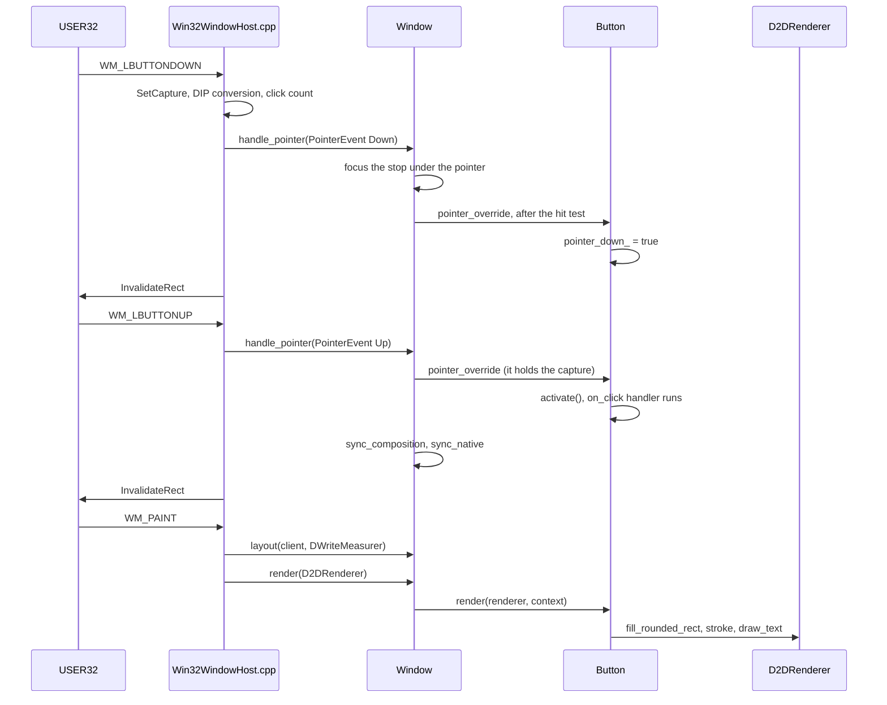

# How It Works

The pieces of libwinui as they are built today, and how a frame moves through them. Read this
before you change anything below the public API.

The one idea the whole design hangs on: controls never talk to Windows. A control measures
itself against a `TextMeasurer`, draws through a `Renderer`, reads colors from a `Theme` and
receives `PointerEvent`/`KeyEvent` values. Each of those is an interface or a plain value, and
each has a Windows implementation and a test implementation. That is why the canonical test
needs no window, no GPU and no Windows session:

```cpp
ui::ButtonControl button{"Hello"};
ui::testing::TestRenderer  renderer;
button.render(renderer);
REQUIRE(renderer.count() == 3); // background + elevation-border stroke + text
```

## The Pieces

| Page | What it covers | Main files |
| --- | --- | --- |
| [The Tree](the-tree.md) | `Element`, single ownership, observers, `DirtyFlags`, `VisualId`, `VisualTree` | `include/winui/ui/Element.hpp`, `core/DirtyFlags.hpp`, `ui/VisualTree.hpp` |
| [Specs and build()](specs-and-build.md) | The declarative `ui` layer, `Spec`/`SpecList`, `Property<T>` and bindings | `ui/spec/*.hpp`, each control's header, `core/Property.hpp` |
| [Layout](layout.md) | Measure and arrange, the measurer seam, sizing rules, containers, parallel measuring | `ui/Element.hpp`, `render/Text.hpp`, `ui/panels/Stack.hpp`, `ui/ParallelLayout.hpp` |
| [Rendering](rendering.md) | The render-command stream, `TestRenderer`, `D2DRenderer`, `describe()`, offscreen capture, composition and animation | `render/Renderer.hpp`, `src/render/Compositor.hpp`, `ui/Animation.hpp` |
| [Input and Focus](input-and-focus.md) | Pointer and key routing, popups and modals, the tab ring, shortcuts, automation | `ui/Window.hpp`, `src/ui/Window.cpp`, `ui/AutomationTree.hpp` |
| [Theming](theming.md) | `Theme`, palettes per era, `ThemeRequest`, the OS theme source, high contrast | `ui/themes/Theme.hpp`, `ui/themes/*Palette.hpp`, `ui/themes/ThemeSource.hpp` |
| [Era Packs](era-packs.md) | What each of the nine theme variants reproduces, approximates and cannot, per era | `src/ui/themes/Theme*.cpp`, `ui/themes/*Palette.hpp` |
| [Platform Seams](platform-seams.md) | Every OS service behind an interface with a test double | `ui/Clipboard.hpp`, `render/NativeHost.hpp`, `src/ui/WindowHost.hpp`, ... |

A few layout rules hold everywhere and are worth knowing before you open any of them:

- `include/winui/<subdir>/` mirrors `src/<subdir>/` one to one. A header and its `.cpp` sit in
  matching folders, and includes always use the full `winui/<subdir>/<name>.hpp` form.
- Everything Windows-specific lives under `src/platform/windows/`. Its headers, `D2DRenderer`
  and `DWriteMeasurer` among them, are private and never installed.
- `include/winui/testing/HeadlessUI.hpp` is the other host. It builds the same logical
  tree with a deterministic text measurer and never touches a Windows object. It is part of the
  testing tier, a library of its own (`winui::testing`, sources in `src/testing/`) that only
  tests link.

## One Request Through the System

A left click on a `Button` in a running window, from the mouse message to the pixels. Every
step names the function that does it.



In words:

1. **The host translates the message.** `WM_LBUTTONDOWN` in `src/platform/windows/Win32WindowHost.cpp`
   calls `SetCapture` (so the matching button-up arrives even outside the window), converts the
   position from physical pixels to DIPs, counts the click streak for double and triple clicks,
   and builds a `PointerEvent{position, PointerButton::Left, PointerAction::Down}`.
2. **`Window::handle_pointer()` routes it.** It remembers the cursor under the press, then checks
   in order: a drag in progress, an open modal, open popups (a press outside every popup and its
   owner light-dismisses them and is swallowed). For an ordinary press it walks the tab ring and
   focuses the first stop whose `takes_focus_at()` accepts the point, then hands the event to
   the content root.
3. **The content root routes it.** `Element::handle_pointer()` hit-tests once, finds the
   `Button` as the topmost element under the point, and hands it the event in `pointer_override()`
   before its parents. The `Button` sets `pointer_down_` and `hovered_` and returns true, so a
   list row or card around it does not act on the same press. It does not redraw anything itself.
   The press captures the pointer for the button and its parents until the release.
4. **The host asks for a repaint.** Every mouse message ends with `InvalidateRect`.
5. **The release clicks.** On `WM_LBUTTONUP` the button sees `Up` inside its bounds after its own
   `Down`, calls `activate()`, and the `on_click` handler runs. If that handler writes a
   `Property<T>`, every bound control updates synchronously through its setter, and each setter
   calls `mark_dirty()`. After dispatch, the window calls `sync_composition()` (the hover overlay
   fades through the compositor) and `sync_native()`.
6. **Deferred work runs.** A `DispatchGuard` wraps every input entry point. When the outermost
   one unwinds, a modal closed from its own button is destroyed and queued URI launches are
   handed to the `Launcher`, so no stack frame is still inside the objects being torn down.
7. **Paint lays out, then draws.** `WM_PAINT` calls `Window::layout()` first. It measures and
   arranges only what is marked `Measure` or `Arrange`, or everything when the client size changed, clears the
   dirty flags, rebuilds the tab ring and re-places popups. Then `paint()` clears the target to
   `Window::background()` (or to transparent, under a system backdrop) and calls `Window::render()` with a `D2DRenderer` wrapped around the
   `ID2D1HwndRenderTarget`. The button emits its three commands and Direct2D draws them.

The message loop also calls `Window::tick()` after every message it dispatches, and every 100 ms
while a window wants ticks (sooner when an `after()` or `every()` timer or a `request_tick_in()`
is due), with the real elapsed time. Once nothing wants ticks, it waits for the next message or
due timer. `tick()` runs posted work, the app's
`on_tick()` hook, every element's animations and `tick_override()`, and the tooltip countdown, and
returns whether anything is dirty so the loop knows to invalidate again.

The headless host runs the same steps minus the first and last: a test calls
`Window::handle_pointer()` directly, then `layout()` with a `HeadlessTextMeasurer`, then
`render()` into a `TestRenderer`.

## Threading

Everything in the tree is UI-thread only. There are no locks in `Element`, `Window` or
`Property<T>`. Two things cross threads:

- `Window::post()` may be called from any thread. The work runs on the UI thread at the start
  of the next `tick()`, and the host is woken so it does not wait for the idle timer. It needs
  the `Window` to exist; `WindowRef::post()` (from `Window::ref()`) is the same and drops the
  work once the `Window` is destroyed (see [Coroutines](#coroutines)).
- `Scheduler` (`include/winui/core/Scheduler.hpp`) is a small worker pool for coarse chunks of
  work that never touch the tree. `Window::layout()` uses it to measure large batches of
  independent siblings whose subtrees answer `Element::parallel_measure_safe()` on worker threads;
  measuring there only reads, see [Layout](layout.md#parallel-measuring-in-windowlayout).

The UI thread of a `Window` is the thread that constructed it. A tree belongs to the window it
hangs under: `set_content()` and `show_modal()` stamp the window's thread on the root, and an
element finds it by walking up its parents. An element that is not under a window yet belongs
to nobody, so a page can be built on a worker and handed over with `post()`.

### The thread checks

`include/winui/core/ThreadCheck.hpp` turns the "UI thread only" rule into a report in debug
builds. `LIBWINUI_THREAD_CHECKS` switches it: unset, it follows `NDEBUG`; the CMake option
`LIBWINUI_THREAD_CHECKS` (`AUTO`, `ON`, `OFF`) forces it as a public compile definition, because
`PropertyBase`, `Element` and `Window` carry an extra `std::thread::id` with the checks on.
With them off nothing is stored and nothing is called; `tests/thread_checks_off.cpp` is built
without the library to prove it, as a leftover call would not link.

Only mutations are checked, never reads, so `measure()` on a worker passes:

| What | Checked against | Hook |
|---|---|---|
| element setters | the root's window thread; detached elements are not checked | `Element::mark_dirty()` |
| `Window` members other than `post()` and `ref()` | the constructing thread | `Window::check_thread()` |
| `Property::set()`/`update()`/`=`, `ObservableVector` edits, `Signal::raise()` | the thread of the first write that reached an observer | `PropertyBase::check_write()` |
| `observe()` | the same, once claimed | `PropertyBase::attach()` |

A property with no observers is not checked, and does not claim a thread until a write first
reaches one. Claiming on the first subscriber would be wrong for a page built on a worker: its
bindings subscribe there, and the UI thread's writes afterwards would be reported.

Every check takes a defaulted `std::source_location`. A default argument is evaluated at the
call site, so the one on `mark_dirty()` names the setter that called it, and the ones on
`Property::set()`, `update()`, `Window::set_content()` and `show_modal()` name the app's file and
line. `Property::operator=` cannot take one itself, so it takes `detail::AssignedValue<T>`, whose
converting constructor has the defaulted location, and the conversion runs at the caller. While a property write
dispatches, `detail::WriteScope` remembers where it was made, and an element report it leads to
ends with "reached from a ui::Property write at main.cpp:42".

`ui::set_thread_check_handler()` replaces what a failed check does; the tests install a
recording one. The default writes the message to stderr and the debugger output, then breaks
into an attached debugger, or aborts: the call is a data race, and what it corrupts surfaces far
away from it.

### Coroutines

`include/winui/ui/Coroutine.hpp` lets a handler hop threads in straight-line code.
`ui::FireAndForget` is the return type: it starts at once and frees its frame at the end, and an
exception escaping it calls `std::terminate()`, since nobody is waiting to catch it.
`co_await ui::on_background()` resumes on `ui::background_scheduler()` (a `Scheduler` made on
first use and never destroyed, so exit never joins its workers), or on a given `Scheduler`.
`co_await ui::on_ui_thread(home)` resumes through `post()` on the window a `ui::WindowRef` names
(taken with `Window::ref()` on the UI thread), so always inside a later `tick()`, even from the
UI thread.

The resumption `post()` carries owns the suspended frame. Run, it resumes it; dropped, because
the window closed first, it destroys it, so the coroutine never resumes, its locals' destructors
run, and nothing leaks. Which thread drops it depends on when: the awaiting thread when the
window was closed or destroyed already, the UI thread as the window closes, the destroying thread when the
`Window` dies with the work queued. `post()` and the close path destroy dropped work outside the
window's lock, so those destructors may post again. A `Scheduler` runs every job it accepts, so
`on_background()` needs no such care.

The default pool is never joined, so a coroutine can still hop back after `main()` destroyed its
`Window`. `on_ui_thread()` therefore never calls `Window::post()`; it posts through a
`ui::WindowRef`, which `src/ui/WindowRef.cpp` resolves against a process-wide registry of live
windows: a mutex and a map from address to a serial number, leaked so it outlives static
destruction. `Window`'s constructor registers as its last step, its destructor unregisters as its
first, and `WindowRef::post()` looks the window up and queues the work while it holds the
registry's lock, so a destructor running at the same time waits until the work is queued (and
then drops it with the rest of the queue) or finds it refused. Lock order is registry, then the
window's queue lock; nothing takes them the other way round. A refused resumption destroys the
frame on the posting thread. A `WindowRef` carries the serial as well as the address, so a new
`Window` at a reused address does not get work meant for the old one; there is no form that goes
by address alone, since that is made on the worker, after the window may be gone.

## Where to Go Next

- To add something, the [hooks](../hooks/index.md) pages walk the files for each kind of change.
- To write tests for it, see [Write Tests](../development/write-tests.md).
- For where the visual targets come from, see the [background pages](../../background/index.md).
