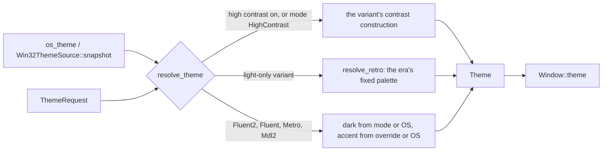

# Theming

Tokens, palettes, eras, and where the colors come from. libwinui draws Fluent 2 by default and
can draw every earlier Windows design language back to Windows 1.0 from the same controls.

## The One Rule Every Pack Follows

Behavior, layout and semantics are identical under every theme. Only `Theme` *data* changes
between eras: colors, metrics, which render primitives the data selects, and the rasterization
policy. No control ever asks "which era am I in". A Windows 95 button is the same `ui::ButtonControl`
with a `ButtonVisual` whose `border_style` is `Raised`, drawn through the same
`draw_control_chrome()` as the Fluent one.

Dark and light are never an era either. They live on `ThemeMode`, which follows the live OS
setting by default.

Fluent 2 (`ThemeVariant::Fluent2`, Windows 11) is the real target. Every other variant is a
best-effort era pack by comparison, and several of them merge neighboring releases into one
representative look. What each pack reproduces and approximates is on
[Era Packs](era-packs.md); the eras themselves, with sources, are in the
[theme background pages](../../background/themes/index.md).

## Theme and Tokens

There are three tiers:

| Tier | Type | What it holds |
| --- | --- | --- |
| 1 and 2: tokens | `Palette` (`ui/themes/Palette.hpp`) and its era siblings | 64 color roles (`text_fill_primary`, `control_fill_default`, ...), one per Fluent fill and stroke color: text fills, control fills, strokes, accent, surfaces, status colors |
| 3: resolved theme | `Theme` (`ui/themes/Theme.hpp`), public | the design tokens and the button sets |
| 3: control chrome | `detail::ControlChrome` (`src/ui/themes/ControlChrome.hpp`), private | how each built-in control draws in the era |
| request | `ThemeRequest` + `OsThemeSnapshot` (`ui/themes/ThemeSource.hpp`) | what the app asked for and what the OS reports |

`Theme` is a plain struct, and controls only ever read it. It is handed to every `measure()` and
`render()` call by the window, so a control has no global theme to reach for and a test passes
whichever theme it wants. Its public fields are the design tokens an app or a custom control
works with:

- **What it is**: `variant` (the `ThemeVariant` the pack draws), `high_contrast`, `palette` (filled
  only under the Fluent variants outside high contrast) and `accent_ramp`.
- **Global metrics**: `corner_radius` (`ControlCornerRadius`), `overlay_corner_radius`, button
  `padding`, `border_width`, `sizing` (density), `page`, the focus-ring widths and margin,
  animation durations (`anim_faster`, ...).
- **A type ramp** (`Theme::TypeRamp`): one `TextStyle` per `TextRole`. `ui::Text`'s `.role` names a
  step, never a font, so a caption follows Fluent's ramp under Fluent and MS Sans Serif under
  Windows 9x.
- **Role colors** (`ThemeColors`, `theme.colors()`): text, background, card, overlay, field,
  accent and control fills, strokes, divider, selection, focus and the four severities. Every
  factory and resolver fills every role, high contrast included, so a custom control reads them
  without checking the variant. They are read-only: the theme packs write them through
  `detail::edit_colors()`, an app gets other colors from `Theme::fluent(const ThemeColors&)` or
  `Theme::classic(const ThemeColors&, ...)`, which map the changed roles onto the family's palette
  and derive the rest, and a container hands its content other text and background colors with
  `with_content_colors()`. Text, background, field, selection, divider, link, scrim and
  focus are the theme's own values. The rest are copied from the button visuals, `surfaces`,
  `severity` and (Fluent only) `palette` by `detail::fill_derived_colors()`, which each factory
  and `resolve_theme()` run last.
- **Era detail behind the roles**: `Surfaces` for field borders, menus, flyouts, tooltips, link
  states, separators and scroll bars, `severity` (each severity's background too),
  `spelling_error`, and `overlay_material`, the in-app acrylic the light-dismiss surfaces fill
  with through `fill_overlay_surface()` (Fluent 2 only, unset elsewhere).
- **The button sets**: one `ButtonVisual` per state per style (`button_normal`, `button_hover`,
  `accent_button_pressed`, `subtle_button_*`, `for_state()`, `subtle_for_state()`). A
  `ButtonVisual` is a fill, a border and a label color, plus optional era layers (gradient fill,
  bevel, elevation-gradient border, inner shadow, inset well) that `draw_control_chrome()` draws
  when set. They are public because a custom control draws its own surfaces with them.
- **Era-wide shapes**: `focus_visual` (the focus visual),
  `divider_visual`, `disclosure_visual`, `popup_shadow`, `popup_motion`.
- **`rasterization`**, the `SetRasterization` policy `Window::render()` emits first (see
  [Rendering](rendering.md#rasterization-is-theme-data)).
- **`chrome`** (`ChromeHints`): what the host asks DWM for, covered below.

Everything else a pack states is per-control and private: the check box, radio and toggle switch
records (`ToggleVisuals`, `IndeterminateVisuals`, `ToggleSwitchShape` and the indicator sizes),
the slider's thumb, fills and era constructions, the nine text-field records, the drop-down
construction, row selection, the navigation pane and indicator, tooltip, progress and swipe
colors, the pressed label offset, the check glyph, and the per-control gates
(`press_state_flip`, `chromeless_text_states`, `card_surfaces`, ...). They live in
`detail::ControlChrome`, which the built-in controls read with `detail::controls(theme)`. An app
never needs them, and keeping them out of the public header means a new control's era data costs
no public API and recompiles only the files that read it.

`Theme` holds its `ControlChrome` behind a `shared_ptr<const ControlChrome>`. Copying a theme
shares the record; `detail::edit_controls(theme)` copies it first when another theme still shares
it, so editing one theme's chrome never shows through in a copy. A pack writes it in the same
function that sets the era's tokens:

```cpp
Theme theme;
theme.variant = ThemeVariant::Metro;
detail::ControlChrome& controls = detail::edit_controls(theme);
controls.press_state_flip       = true;
```

Take the reference after the last copy of `theme` the function makes: one taken before a copy
points at the record both now share.

A default-constructed `Theme` is not usable: the button sets have no meaningful default. (Its
control chrome reads as a default-constructed `ControlChrome`, so it is at least safe to draw
with.) Always start from `Theme::light()`, `Theme::fluent(palette)` or `resolve_theme()`,
including for a member default (`Theme theme_ = Theme::light();`). Because every public field is
plain data, an app may resolve a theme, adjust a few tokens and `Window::pin_theme()` the result.

### Reading a Token That Every Era Fills

A control drawn under nine eras can only trust a token that all nine resolvers set to something
meaningful. Two defaults make a wrong read visible rather than subtle:

- `Color` default-constructs to `{0, 0, 0, 1}`, opaque black, not transparent.
- `Theme::palette` is filled only by `Theme::fluent()` (Fluent 2 and Fluent 1). Under every other
  era and under high contrast it stays default, so every role in it is opaque black. A custom
  control checks `variant` and `high_contrast` before reading it.

A control that reads `theme.palette.*` unconditionally therefore paints a black block under Luna
or Windows 9x. `InfoBar` once rendered as a solid black bar that way, and `ProgressBar` did the
same with its track. The fix is always one of two things: read a field every resolver fills
(`theme.severity` exists for exactly the InfoBar and ProgressBar case), or gate the palette read
on a flag only `Theme::fluent()` sets. `PersonPicture`'s dedicated fill and stroke are gated on
the control chrome's `person_picture_dedicated_fill`, and the other `palette` readers in `src/ui/`
sit behind flags such as `card_surfaces` or `list_item_subtle_selection`.

The same bug has a second form: a token that exists everywhere but means something else one era
over.

| Token | Where it misleads | What the control reads instead |
| --- | --- | --- |
| `accent_button_normal.background` | Under `Windows1x` the accent button is an outline, so this is the page's `COLOR_WINDOW` white. A `ProgressRing` drawn in it disappears against its own page. | The control chrome's `progress_fill`, falling back to the accent button only when a theme states no progress color. |
| a radio button's checked `background` | It is the ring's fill. Under `Windows1x` it is plain window white, and Aero's `#F4F4F4` well is nearly as light, so a dot drawn in it vanishes. | The dot uses the checked visual's `text`, the mark color. The ring is always a filled disc under its stroke; a hollow ring is a transparent `background`, a ring without a stroke a zero stroke width. |
| the general button text color | Opaque white in dark themes, so the overlay scroll bar's arrows stood out against the gray bar. | `surfaces.scrollbar_thumb`: one brush serves `ScrollBarButtonArrowForeground` and `ScrollBarThumbFill`. While fading, its alpha is scaled by the progress, never replaced. |
| the check box's `ToggleVisual::border_style` | Flattening the Windows 3.x check box dropped `ToggleSwitch` into the Fluent capsule branch. | `toggle_switch_shape`, the switch's own shape token. |

Some fields must be set by every resolver because a control reads them without a gate.
`colors.divider` is one: `SplitterControl::render()` draws it directly, so a resolver that forgets it
(high contrast once did) draws a black rule on a black page. `text_style` is another trap in the
other direction. It must stay centered on both axes, because `Button` draws its label into its full
bounds; seeding it from the type ramp's Body entry (leading-aligned) pushes every button label
against the left border. `CheckBox`, `RadioButton`, `ToggleSwitch` and `ComboBox` set their own
leading alignment, since their label sits beside an indicator.

Where two eras disagree about one visual, the switch is split per control rather than made one
era flag. `row_selection_fills` (a selected row is accent-filled, and `ListView`, `TreeView`,
`TableView` and `ComboBox` then drop their accent pill) and
`accent_selection_indicator` (`NavigationShell` and `SelectorBar` draw a selection bar) are
separate because Fluent 1 needs them to disagree: its list rows are accent-filled, yet its
`NavigationShell` still draws a bar.

`tests/test_theme.cpp` sweeps every `ThemeVariant` for these cases, which is why a new era has to
be added to those sweeps (see [Add a Theme Era](../hooks/add-a-theme-era.md#tests)).

`Theme::fluent(const Palette&)` is a pure function from the palette's tokens to every token and
control-chrome field, the direct analog of a `*_themeresources.xaml` file. The `Palette` field
names are Fluent 2's; the tables need not be. `Palette::fluent1_light()`/`fluent1_dark()` fill
the same roles from Windows 10 Fluent's entirely different resource names. A role survives an
era; a key name does not.

## Palettes per Era

Each era is a tier-1 table plus one derivation function, or a hand-built resolver where no
token table exists.

| `ThemeVariant` | Era | Tier-1 table | Derivation | Dark/light, accent |
| --- | --- | --- | --- | --- |
| `Fluent2` (default) | Windows 11 | `Palette::fluent_light()`/`fluent_dark()` | `Theme::fluent()` (`Theme.cpp`) | yes, yes |
| `Fluent` | Windows 10 Fluent (1709 on) | `Palette::fluent1_light()`/`fluent1_dark()` | `Theme::fluent()` plus overrides | yes, yes |
| `Mdl2` | Windows 10 1507 to 1703 | `Mdl2Palette` (`Mdl2Palette.hpp`) | `Theme::mdl2()` (`ThemeMdl2.cpp`) | yes, yes (the live OS accent) |
| `Metro` | Windows 8 and 8.1 | `MetroPalette` (`MetroPalette.hpp`) | `Theme::metro()` (`ThemeMetro.cpp`) | yes, yes |
| `Aero` | Windows Vista and 7 | none | `resolve_aero()`, hand-built | no, no |
| `Luna` | Windows XP | none | `resolve_luna()`, hand-built | no, no |
| `Windows9x` | Windows 95, 98, 2000 | `ClassicPalette` (`ClassicPalette.hpp`) | `Theme::classic()` | no, no |
| `Windows3x` | Windows 3.x | `ClassicPalette` | `Theme::classic(..., win3x_edge = true)` | no, no |
| `Windows1x` | Windows 1.x and 2.x | `EarlyPalette` (`EarlyPalette.hpp`) | `Theme::early()` (`ThemeEarly.cpp`) | no, no |

`theme_variant_supports_dark_mode()` tells the two groups apart. The light-only variants ignore
`ThemeMode::Light`/`Dark` and `ThemeRequest::accent_override` entirely; they have no dark mode
concept.

A few design points that are easy to undo by accident:

- **Classic schemes are free.** `Theme::classic()` computes the whole four-ring bevel ramp from
  one face color (with the published Windows 95/98 ramps returned verbatim for their two
  canonical faces, because the computed and shipped ramps disagree). So
  `ThemeRequest::classic_scheme` turns `Windows9x` into "Windows 9x with the Eggplant scheme"
  with one `ClassicPalette` literal.
- **Windows 3.x is a different edge**, not the 9x ramp with stops removed: a 1 px black frame, a
  1 px white highlight top-left and a 2 px gray shadow bottom-right (`draw_win3x_border()`). It
  shares the palette and derivation and sets `win3x_edge`.
- **Windows 1.x/2.x is not in the classic system at all.** The era has no button-face, highlight
  or gray-text color slot, so there is no face to derive a ramp from. Its table is
  `EarlyPalette`, with the 2.x-only slots `optional` so "did not exist yet" is structural.
  `ThemeRequest::early_scheme` picks one of the four recovered palettes.
- **Metro and MDL2 take a `dark` flag** next to the palette, because unlike every other retro era
  they had a real dark/light dictionary pair.

Adding an era is walked through on [Add a Theme Era](../hooks/add-a-theme-era.md).

## ThemeSource

`resolve_theme(const ThemeRequest&, const OsThemeSnapshot&)` combines what the app asked for with
what the OS reports:



- **`OsThemeSnapshot`** is the raw OS state: `dark` (the app mode), `accent` and its
  `accent_ramp`, `high_contrast` and the contrast palette `hc`, USER32's menu and combo-box
  animation switches, and `animations_enabled`, the "Animation effects" setting. A default-constructed one is light, Windows' default blue accent, no high
  contrast, which resolves to the colors Windows 11 shows out of the box.
- **`ThemeRequest`** is what the app asks for. Every field left at its default means "follow
  the system": `mode` (`System`, `Light`, `Dark`, `HighContrast`), `accent_override`, `variant`,
  `classic_scheme`, `early_scheme`, `animations` (`System`, `On`, `Off`).
- **`os_theme()`** returns the live snapshot; the Win32 backend's `Win32ThemeSource` reads the OS
  on every call. A test builds its own `OsThemeSnapshot`, so it is deterministic whatever the
  machine's theme is.

Every `resolve_theme()` result gets a fresh `generation` number, so a cache of derived themes can
tell a new theme from the one it was built from.

Windows exposes the accent's tonal ramp (`AccentRamp`, Light1 to Dark3) only for the live system
accent, through `UISettings`. The system-accent path always takes `OsThemeSnapshot::accent_ramp`
as is. When an app sets `ThemeRequest::accent_override`, `resolve_theme()` approximates a ramp
with `derive_ramp()`: Light1/2/3 are the accent lerped 15, 30 and 45 % toward white, Dark1/2/3
the same toward black. Under `Metro` an override also gets derived hover and pressed colors
(lightened 15 %, darkened 10 %), because Windows 8's hover and pressed rungs are three unrelated
literals with no ramp to follow. Neither derivation is era data.

`Theme::popup_motion` for Luna and Aero comes from the user's own `SPI_GETMENUANIMATION`,
`SPI_GETMENUFADE` and `SPI_GETCOMBOBOXANIMATION` switches, and it does so under high contrast too,
since a contrast theme leaves those system settings alone.

`Theme::overlay_material` is set by the Fluent 2 resolve alone, and only while
`OsThemeSnapshot::transparency_enabled` holds: the inputs WinUI's own effect policy reads,
`UISettings.AdvancedEffectsEnabled` and `PowerManager.EnergySaverStatus`, plus
`SM_REMOTESESSION`. Under high contrast it stays unset. Flyouts, the drop-down and suggestion
lists, menus, the command bar's overflow and open Compact bar, the light-dismiss TeachingTip,
NumberBox's and Breadcrumb's popups and Carousel's buttons fill with it. Menus and
`CommandBarFlyout` take the in-app material too, since libwinui does not open the separate window a
desktop blur would need. Fluent (Windows 10) keeps its solid fills: its popups
blurred the desktop, which an in-app blur would misrepresent.

On Windows the host resolves the `WindowOptions::theme` request on `WM_CREATE` and again on
`WM_SETTINGCHANGE` and `WM_DWMCOLORIZATIONCOLORCHANGED`, so light/dark, accent and contrast
changes apply without a restart. Energy Saver and a remote session reach it as registered
`WM_POWERBROADCAST` and `WM_WTSSESSION_CHANGE` messages. `Window::pin_theme()` also bumps `theme_revision()`, which the
host polls to re-apply everything the OS draws: caption colors, the dark-mode caption and the
backdrop.

### Why Theme Does Not Read GetSysColor

`GetSysColor` returns light values on a dark-mode machine (dark mode is not part of the classic
system-color table at all), and `COLOR_HIGHLIGHT` is a frozen Windows 10-era `#0078D7`, not the
user's accent (`#0078D4` by default). `Win32ThemeSource` therefore reads the app mode from the
registry (`AppsUseLightTheme`) and the accent and its ramp from `UISettings`, falling back to the
registry and `DwmGetColorizationColor` only when WinRT is unreachable. `GetSysColor` is the right
source for exactly one thing: high contrast, where the user chose those exact values.

Both fallbacks have a trap. The registry's `DWM\AccentColor` is stored as `0xAABBGGRR`, red and
blue swapped against `Color::from_argb()`. `DwmGetColorizationColor` returns the auto-computed
glass and title-bar tint, which visibly differs from the accent picked in Settings;
`UIColorType::Accent` is the one that matches Settings exactly. Without `UISettings` the ramp is
approximated from the accent rather than repeating the accent in every slot.

### High Contrast

While the OS is in a contrast theme (`SPI_GETHIGHCONTRAST`), `resolve_theme()` draws with the
OS palette (`HighContrastPalette`, the eight `SystemColor*Color` slots plus `COLOR_WINDOWFRAME`
for borders) whatever the request says. The colors are taken verbatim, never derived.

The variant still decides the *construction*, because that is what each Windows did: a
Windows 95 user in High Contrast Black still had beveled buttons, and Windows 8 kept its square
2 px outlines. Windows 9x/3.x/1.x take the contrast colors as one more color scheme, Luna and
Aero drop to the classic look exactly as XP and 7 did, and Metro, MDL2 and Fluent keep their
shapes under their `HighContrast` dictionaries.

A Windows 11 contrast theme only has the eight slots, so the classic eras fill in the rest:

- **The bevel ramp.** There are no bevel slots, so `high_contrast_bevel_ramp()` derives one: the
  outer rings are the button text color, the inner highlight and shadow are that text lerped
  25 % and 50 % toward the face. White on black gives `#BFBFBF` and `#808080`, within one step of
  Windows 2000/XP's High Contrast Black, and both bevel edges stay visible on any face.
- **`COLOR_MENU` and `COLOR_INFOBK`** take the window color, as Windows 2000's High Contrast
  Black does.
- **The type ramp** is kept. Fluent 2's `HighContrast` dictionary recolors but never resizes
  (`TitleTextBlockStyle` and friends live outside `ThemeDictionaries`), and Fluent 1 does the same
  with its own ramp.

`ThemeMode::HighContrast` forces contrast rendering without the OS being in a contrast theme. The
colors are then the era's own shipped contrast scheme (Fluent 2 uses Windows 11's Aquatic,
Metro/MDL2/Fluent 1 use Windows 8 to 10's High Contrast Black). No era borrows another era's
contrast scheme.

High contrast also turns off `set_requested_theme()`, the accent override and system backdrops.

### Turning Animations Off

Windows has one switch for motion in app content: Settings > Accessibility > Visual effects >
Animation effects, read with `SPI_GETCLIENTAREAANIMATION` (what `UISettings.AnimationsEnabled`
reports). `Win32ThemeSource` puts it in `OsThemeSnapshot::animations_enabled`, and it is re-read
on `WM_SETTINGCHANGE` like everything else in the snapshot. `ThemeRequest::animations` follows it
by default (`AnimationPreference::System`); `On` and `Off` override it, which is how an app's own
"Reduce motion" setting works:

```cpp
ui::ThemeRequest request = window.theme_request();
request.animations       = ui::AnimationPreference::Off;
window.set_theme(request);
```

The result is `Theme::animations_enabled`. With it off, a change still happens, only without the
motion: every transition lands on its end state, and completion handlers still run.

- **Durations in the theme.** `resolve_theme()` (and `Window::pin_theme()`, for a hand-built
  theme) zeroes `anim_faster`, `anim_fast`, `anim_normal` and `popup_motion`, the same way the eras
  without motion already do. The compositor-driven hover fades, the RadioButton dot, the Slider
  thumb, the ToggleSwitch knob, menu and drop-down motion all read these, so they snap.
- **Clocks in `tick_override()`.** `Window` opens a scope around everything it does to its tree (ticks,
  layout, render, input), and inside it `ui::animations_enabled()` answers the theme's switch.
  `ui::animation_delta(delta)` is the tick's time as an animation sees it: `delta`, or, with
  animations off, long enough to finish any finite animation. Every control tween advances its
  clock by it (Expander, SidePane and NavigationShell panes, the NavigationShell indicator, Sections,
  SelectorBar, Carousel, Swipe, CommandBar, flyouts, dialogs, menus, PullToRefresh's settle,
  Scroll's animated scrolls, AnimatedIcon, the Fluent CheckBox drawing its tick in), so a
  tween started anywhere lands on the next tick.
- **The visual layer.** An implicit transition snaps, a `start_animation()` with a finite length
  finishes on the next tick (a spring lands on its final value without overshooting), a theme
  storyboard is drawn at its end and completes on the next tick, Load and Layout theme
  transitions do not start, and an element removed with `AddRemoveTransition` leaves no
  ghost. A `BrushTransition` does not blend. A connected animation completes on the next tick.

What keeps running is everything that is not an animation: the tooltip delay, the caret blink,
key and button repeat, the submenu and hover-expand delays, timeouts. Motion that *is* the
information keeps running too: an indeterminate `ProgressBar` or `ProgressRing` (which Windows
keeps moving with the setting off), the PullToRefresh spinner, a looped `AnimatedVisualPlayer`
and an animated picture. So does an animation that never ends (an expression, a forever
repeat).

A custom control with its own tween does the same: advance its clock by
`ui::animation_delta(delta)` rather than `delta`, or check `ui::animations_enabled()`.

### Light, Dark and Requested Themes

For the variants with both modes, `resolve_theme()` fills `Theme::with_dark_mode`: a function
that re-resolves the same request in the other mode. `Element::set_requested_theme()` uses it to
measure and draw a subtree in the light or dark version of whatever theme it is handed, caching
the derived theme per `generation`. It has no effect under the light-only eras or high contrast,
where `with_dark_mode` is empty. A popup opened from
inside such a subtree is drawn in the window's theme.

### Non-Client Chrome

`Theme::chrome` (`ChromeHints`) is what the host asks DWM for: the corner preference, dark-mode
caption, caption, border and caption-text colors, and whether a system backdrop is allowed.
Every non-Fluent 2 pack asks for square corners, since a Windows 95 pack inside a rounded Windows
11 frame does not read as Windows 95. Only Fluent 2 allows Mica: it shipped after every earlier
era, and a theme composited over the wallpaper cannot guarantee contrast for text in a band the
app left bare. The app's `Window::set_chrome()` overrides are merged on top.

This is attribute-level chrome only. A classic pack drawing its own title bar and borders from
`WM_NCCALCSIZE`, which is the only way a `Windows9x` window looks like Windows 95 end to end, is
not implemented.

## The Image Theme Backend

`src/render/ImageThemePack.hpp` (private) holds `ImageThemePack` and `NineSliceMetrics`, and
`Renderer::draw_image_nine_slice(name, bounds, slice_margins)` is the matching primitive. The
idea is a bitmap-backed theme that works the way `uxtheme` visual styles do:
named images, nine-slice cuts, a backend that blits them.

It is plumbing only. **libwinui ships no images**, and never will: extracting anything from an
`*.msstyles` file is a copyright violation and permanently out of scope. A pack may only hold
originally authored, CC or public-domain art. Today no control emits
`draw_image_nine_slice()`, and the Win32 host installs no pack in `D2DRenderer`
(`set_image_pack()`), so the command is a no-op everywhere outside its own tests. The
controls draw every era from computed primitives instead.

## Where the Research Is

The per-era sources and measured values are in the
[theme background pages](../../background/themes/index.md), one page per era, the reasoning behind
each pack's approximations is on [Era Packs](era-packs.md), and the Win32
color and theme-API findings are in the
[Win32 theme stacks study](../../background/studies/win32-theme-stacks.md). Those pages name the
source of each value, so a value in a palette or a resolver can be checked against the files it
was measured from.
