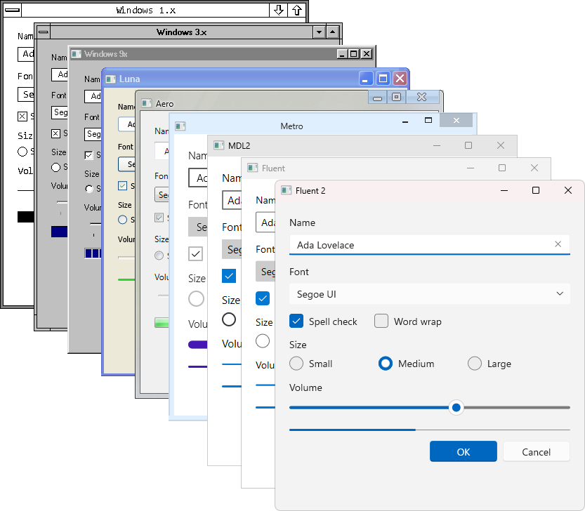

---
hide:
  - navigation
  - toc
---

# libwinui

A native-like Windows UI library built with C++23 that you link statically and ship as one small `.exe`. No XAML, no .NET, no Windows App SDK and no installer.

<figure markdown="span">
  { width="833" }
  <figcaption>Travel in time with era-specific themes.</figcaption>
</figure>

## One File to Ship

Your app can be a single `.exe` with no additional framework to install. Link libwinui and the C runtime statically (`-DCMAKE_MSVC_RUNTIME_LIBRARY=MultiThreaded`), and there's no DLL or Visual C++ redistributable to ship either. Direct2D and DirectWrite, which it draws with, are part of Windows. You copy the file to a machine and run it.

At about 1.2 MB for the counter app from the [first tutorial](tutorials/basics/01-first-window.md), you may just be able to ship your next app on a floppy.

## Declarative UI in Plain C++

The whole API is C++23. There's no XAML, no code generation, no IDL, no markup compiler and no separate build step. You describe the UI with aggregates and designated initializers, write the state down once, and every display of it is derived from there:

```cpp
#include <winui/winui.hpp>

#include <format>

int main()
{
    ui::Property<int> clicks{0};

    ui::Window window{{.title = "My first window", .size = {480, 320}}};
    window.set_content(ui::VerticalStack{
        .spacing              = 12,
        .horizontal_alignment = ui::Alignment::Center,
        .vertical_alignment   = ui::Alignment::Center,
        .content =
            {
                ui::Text{.text = ui::bind(clicks, [](int n) { return std::format("Clicks: {}", n); })},
                ui::Button{.text = "Click me", .on_click = [&] { ++clicks; }},
                ui::Button{.text = "Reset", .on_click = [&] { clicks = 0; }},
            },
    });
    return ui::run(window);
}
```

You fill in a `ui::Button` once and hand it over, and it builds a `ui::ButtonControl`, which keeps its own setters for later changes. Since every node has exactly one owner and the tree is torn down in order, the UI needs neither a garbage collector nor reference counting. It all builds with CMake, and your usual debugger steps right into any control's source. The program above is the [first tutorial](tutorials/basics/01-first-window.md), which goes through it line by line.

## Native Look, Native Speed

- Controls are drawn with Direct2D into one `HWND` per top-level window. They aren't child windows, so a thousand controls don't mean a thousand window handles.
- Text goes through DirectWrite and uses the system's fonts, fallback and shaping.
- A setter marks its control dirty, layout only runs when a size or position changed, and a window with nothing dirty isn't repainted.
- Lists virtualize, so a list realizes a screenful of rows, no matter if the model holds a hundred items or a hundred thousand.
- The controls follow Windows 11's Fluent design, with its parts, states, metrics and keyboard rules, plus Mica, light and dark mode and the system accent color. Theme packs for older Windows eras are included as well.
- Native Win32 controls, e.g. a rich edit box, can be hosted inside the tree when you need them.

## What You Can Do With It

<div class="grid cards" markdown>

-   **Your First Window**

    ---

    A window, two buttons and a counter, from `main()` to a running app.

    [Start the basics](tutorials/basics/01-first-window.md)

-   **An App Skeleton**

    ---

    A title bar with a search box, a navigation pane with pages and a tab strip of documents.

    [Build the frame](tutorials/navigation/01-app-skeleton.md)

-   **Large Data**

    ---

    Lists that realize a screenful of rows, no matter if the model holds a hundred items or a hundred thousand.

    [The virtual list](tutorials/collections/02-virtual-list.md)

-   **Theme Eras**

    ---

    The look of the running Windows by default, and the same controls drawn the way Windows 1.x, 3.x, 9x, Luna, Aero, Metro, MDL2, Fluent and Fluent 2 did it.

    [Pick a theme](tutorials/guides/themes.md)

-   **Extending the Tree**

    ---

    Write your own element, host a native Win32 control or mix hand-built subtrees into a declared one.

    [Your own element](tutorials/extending-the-tree/01-your-own-element.md)

-   **Testing Without a Window**

    ---

    Controls emit render commands, so you can test layout, input and drawing without an `HWND` or a GPU.

    [Test your UI](tutorials/guides/testing.md)

</div>

## What You Need

- A C++23 compiler: MSVC 19.3x, Clang 16+ or GCC 14+.
- CMake 3.28 or newer. The library builds as a static library by default.
- A Windows SDK.
- Windows 10, version 1703 or newer, to run the result.
- Nothing else on the target machine.

## Where to Go Next

- [Reference](reference/index.md): every spec, control and type, generated from the headers.
- [Contributing](contributing/index.md): building the library, how it works inside and where to hook in.
- [Background](background/index.md): the history of Windows UI, the theme eras and the studies behind the design.
- The library is MIT licensed, see the `LICENSE` file in the repository.
