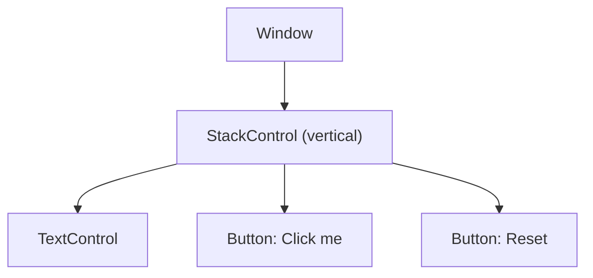

# Your First Window

Get the library into a CMake project, open a window with a counter in it, and run the message loop.

The example for this page builds as `tutorial_01_first_window`.

{ .screenshot width="480" }
{ .screenshot width="480" }

## Get the Library

libwinui is a CMake project whose library target is `winui::winui`. The simplest way in is to put the repository next to your code (a git submodule, a copy, whatever you prefer) and add it as a subdirectory:

```cmake
cmake_minimum_required(VERSION 3.28)
project(my_app LANGUAGES CXX)

add_subdirectory(external/libwinui)

add_executable(my_app WIN32 main.cpp)
target_compile_features(my_app PRIVATE cxx_std_23)
target_link_libraries(my_app PRIVATE winui::main)
```

`FetchContent` works the same way: declare the repository, call `FetchContent_MakeAvailable`, then link `winui::main` as above. An installed copy works with `find_package(winui CONFIG REQUIRED)` in place of `add_subdirectory` ([Building](../../contributing/development/building.md#install-and-find_package) has the details).

Some details:

- `WIN32` in `add_executable` makes it a GUI program, so no console window opens next to yours.
- A `WIN32` program normally starts at `wWinMain`. Linking `winui::main` lets it start at a plain `int main()` instead, which is what every tutorial uses. Leave it out if you prefer to write `wWinMain` yourself.
- All strings in libwinui are UTF-8. With MSVC the library adds `/utf-8` to your target as well, so a literal like `"Grüezi"` arrives intact.
- To ship a single `.exe` with nothing to install, link the C runtime statically: put `set(CMAKE_MSVC_RUNTIME_LIBRARY "MultiThreaded$<$<CONFIG:Debug>:Debug>")` before `add_subdirectory`. Otherwise the target machine needs the Visual C++ redistributable.
- When libwinui is a subdirectory of another project, its tests and examples are not built. You only get the library.
- Configuring downloads `stb_image` and, on Windows, the C++/WinRT tool, so the first configure needs network access.

The compiler has to speak C++23: MSVC 19.3x, Clang 16+ or GCC 14+. [Building](../../contributing/development/building.md) has the full list of options.

## The Includes

```cpp
--8<-- "examples/tutorials/01_first_window/main.cpp:includes"
```

`winui/winui.hpp` is the only libwinui header an app includes: every control, the layout panels, the specs, `ui::Window` and `ui::run()`. It names nothing of the operating system, so there is no `<windows.h>` and no `#ifdef` in your code. Everything in it is in namespace `ui`.

## State and a Window

```cpp
--8<-- "examples/tutorials/01_first_window/main.cpp:state"
```

`ui::Property<int>` is a value that tells whoever is interested when it changes. The counter lives here, once, and everything on screen that shows it is derived from it. [State and Bindings](03-state-and-bindings.md) covers this in detail.

```cpp
--8<-- "examples/tutorials/01_first_window/main.cpp:window"
```

A `ui::Window` is the root of the UI tree, and an object your app owns: here a local of `main()`. Its constructor takes what the window is created with (title, size and more). At this point it is only a C++ object. Nothing is on screen until `ui::run()`.

The state is declared before the window on purpose. Locals are destroyed in reverse order, so the window and its tree go first and never outlive the state they show.

```cpp
--8<-- "examples/tutorials/01_first_window/main.cpp:tree"
```

This is the declarative surface. `ui::VerticalStack`, `ui::Text` and `ui::Button` are plain structs, filled in with C++20 designated initializers. They describe controls. `set_content()` takes the description, builds the real controls from it and hands them to the window.

- `ui::VerticalStack` stacks its children top to bottom, 12 DIPs apart (a DIP is a device-independent pixel, 1/96 of an inch). The window gives its content the whole client area. `.horizontal_alignment` and `.vertical_alignment` center the stack in it at the size it needs instead.
- `ui::Text` shows text. Its `.text` is a `bind(...)` over `clicks`, so it shows "Clicks: 0" now and follows every later change. The format string exists exactly once.
- The two `ui::Button`s get an `.on_click` handler. Neither touches the label. They only write to `clicks`, and the label follows.

When the window opens, keyboard focus is on the first control that can take it, here the "Click me" button. Tab and Shift+Tab move between the two buttons, Enter or Space presses the focused one.

The handlers capture by reference with `[&]`. That is correct here, because `clicks` lives in `main()` and outlives the message loop. [Components](06-components.md) shows where `[&]` becomes a bug.

## Run the Message Loop

```cpp
--8<-- "examples/tutorials/01_first_window/main.cpp:run"
```

`ui::run(window)` creates the operating system's window for it, with a renderer and everything else it needs, shows it and runs the message loop. It returns when the window is closed. `run()` only borrows the window: it is a local of `main()`, so it is destroyed, with its whole tree, when `main()` returns.

What the window is created with, a `ui::WindowOptions`, goes into its constructor, again filled in by name, which is why the declaration has two pairs of braces. Leave out a field and you get its default. `size` is the room the content gets, in DIPs; the frame comes on top of it.

!!! note "Theme and Backdrop"
    The window follows the system's light or dark mode, accent color and high contrast by default, and [Themes](../guides/themes.md) shows how to choose them yourself or add Mica.

## More Windows

A second window that should go away when the user closes it is handed to the loop with `ui::open_window()`. It shows the window and destroys it once it has closed, so closing it is all there is to do, from its own buttons too:

```cpp
auto about = std::make_unique<ui::Window>(ui::WindowOptions{.title = "About", .size = {320, 200}});
ui::Window& w = *about;
about->set_content(ui::Button{.text = "Close", .on_click = [&w] { w.close(); }});
ui::open_window(std::move(about));
```

`window.is_open()` is a property that is `true` while a window is open, so a menu item or a button can follow it. To reach a window later, keep `window.ref()`. Its `get()` returns the window, or `nullptr` once it is gone.

## Asking Before Closing

`on_closing` runs whenever the window is about to close, and returning `ui::Cancel` keeps it open. A handler that returns nothing, or `ui::Proceed`, lets it close. It has to decide right away, so to ask the user, show the question, cancel, and close with `force_close()` once they answered. `force_close()` closes like `close()` without asking `on_closing` again:

```cpp
window.on_closing([&] {
    if (!document.dirty())
        return ui::Proceed;
    window.show_modal(ui::Dialog{
        .title     = "Save changes?",
        .primary   = {.text = "Save"},
        .secondary = {.text = "Don't save"},
        .close     = {.text = "Cancel"},
        .on_closed = [&](ui::DialogResult result) {
            if (result == ui::DialogResult::Primary)
                document.save();
            if (result != ui::DialogResult::Close)
                window.force_close();
        },
    });
    return ui::Cancel;
});
```

## What You Built

The description turned into this tree of controls:



Note the names: `ui::VerticalStack` built a `ui::StackControl`, `ui::Text` built a `ui::TextControl`. A control's class name ends in `Control`, so the two are easy to tell apart: the `ui::` struct is what you write, the `...Control` is the live object it built.

Ownership is strict and simple. Every node is owned by exactly one parent through a `std::unique_ptr`: the window owns the stack panel, the stack panel owns its three children. There is no `shared_ptr` anywhere in the tree. When `main()` returns, the window is destroyed, and with it the whole tree, top down.

The `TextControl` also owns its subscription to `clicks`. When the `TextControl` goes away, the subscription goes with it, so `clicks` never calls into a destroyed control.

## Next

[Layout](02-layout.md): stacks, alignment, sizes, grids and scrolling.
